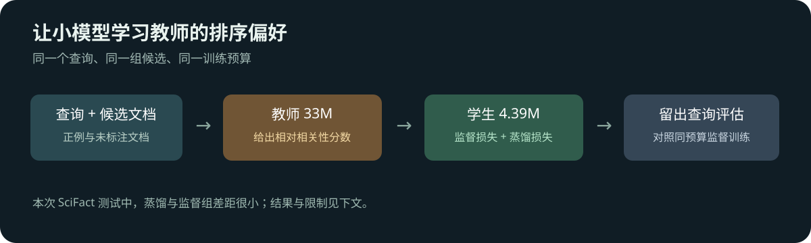

# 文本重排序模型蒸馏

> 阅读导航：[检索与排序](../README.md) · [重排序体系导览](README.md) · [知识蒸馏与软标签监督](../知识蒸馏与软标签监督.md) · [文本重排序模型微调](重排序监督微调.md) · 代码实践：[`reranker-distillation`](../../../../experiments/reranker-distillation/README.md)

在生产级两阶段检索系统中，大尺寸交叉编码器（如 8B 参数级别）虽能给出精准的相关性判别，但对每个候选文档逐对执行全自注意力计算的延迟和显存开销极高，难以承担大流量在线服务。关于知识蒸馏三大训练信号形态（词表级、标量差值 Margin-MSE、候选分布 Softmax KL）的系统数学推导，参见 [知识蒸馏与软标签监督](../知识蒸馏与软标签监督.md)。本实验探究将 Qwen3-Reranker-8B 教师的细粒度排序偏好蒸馏至仅 4.39M 参数的极轻量 TinyBERT-L2 交叉编码器，严格执行开发集教师优势前置检验（门槛 $\Delta\text{nDCG@10} \ge 0.05$），并针对原始硬标注、教师硬排序、教师软分数开展五臂多种子对照实验。

---

## 一、核心原理

### 1. 跨架构标量分差分布对齐

在重排序任务中，教师与学生的底层 Tokenizer 词表与网络隐藏层维度通常异构，无法执行中间层特征对齐。
蒸馏采用**候选对相对分差的 Softmax 分布对齐**：对于同一查询下的候选正例 $d^+$ 与未标注负例代理 $d^-$，教师与学生分别给出相关性标量得分 $z_{\text{teacher}}$ 与 $z_{\text{student}}$。通过温度超参数 $T=2$ 将两者转化为二元相对偏好概率分布。



### 2. 成对 KL 散度蒸馏损失代数推导

教师与学生在对数打分空间上的相对概率分布定义为：
$$P^T = \operatorname{softmax}(z_{\text{teacher}} / T), \quad P^S = \operatorname{softmax}(z_{\text{student}} / T)$$

成对 KL 散度蒸馏损失函数为：

$$\mathcal{L}_{\text{KD}} = T^2 \cdot D_{\text{KL}}\left( \operatorname{softmax}(z_{\text{teacher}} / T) \parallel \operatorname{softmax}(z_{\text{student}} / T) \right)$$

在软分数蒸馏组中，总训练目标为硬标签监督交叉熵与蒸馏损失的等权组合：
$$\mathcal{L} = 0.5 \mathcal{L}_{\text{supervised}} + 0.5 \mathcal{L}_{\text{KD}}$$
反向传播梯度仅回传至学生网络，更新 TinyBERT 的全自注意力权重与分类头参数。

---

## 二、实验设计

### 1. 师生架构参数比与打分机制

- **教师模型**：[Qwen3-Reranker-8B](https://huggingface.co/Qwen/Qwen3-Reranker-8B)，约 8B 参数，BF16 精度，输入上限 512 Token。其打分机制基于指令提示词，采用预测下一 Token 的 `yes` 与 `no` 原始 logit 差值作为连续相关性分数；
- **学生模型**：[TinyBERT-L2-v2](https://huggingface.co/cross-encoder/ms-marco-TinyBERT-L2-v2)，仅 4.39M 参数（2 层 Transformer），FP32 精度，输入上限 192 Token。其排序头直接输出标量相关性 logit；
- **参数压缩比**：教师与学生参数规模比例约为 **1822:1**。

### 2. 开发集教师优势前置门禁检验（ΔnDCG ≥ 0.05）

在启动学生微调前，必须首先在独立开发集（89 条 SciFact 查询，每条 30 个 BM25 候选）上核验教师相对学生是否具备显著统计优势：
- 教师开发集 nDCG@10 为 **0.7363**；
- 学生原生基线开发集 nDCG@10 为 **0.6138**；
- 相对优势差值为 **+0.1225**，按查询配对 Bootstrap 的 95% 置信区间为 **[0.0749, 0.1743]**。
区间下限明显高于预设的 0.05 门槛，确认教师优势显著，准予启动蒸馏。

### 3. 五臂对照实验设计（原始标注、硬排序、软分数及混合组）

为彻底分离硬标签与软标签的因果贡献，在相同的 390 条训练查询与统一候选集上设计五组对照条件：
1. **组别 A（原始标注）**：仅使用 SciFact 原始硬标签进行成对监督训练；
2. **组别 B（教师硬排序）**：仅使用教师对候选打分的高低大小作为 One-Hot 标签训练；
3. **组别 C（教师软分数）**：仅使用教师输出的连续分差 Softmax KL 散度损失训练；
4. **组别 D（原始标注 + 教师硬排序）**：双重硬标签混合；
5. **组别 E（原始标注 + 教师软分数）**：监督交叉熵与成对 KL 散度各占 0.5 权重。

---

## 三、过程与开销

### 1. 教师离线打分前向与显存开销

教师模型仅在离线阶段对训练和测试候选进行单次批量推理打分并落盘缓存。在线服务仅需部署 4.39M 参数的 TinyBERT 学生，大幅消除显存常驻与端到端计算延迟。

### 2. 学生端 180 步微调训练收敛

学生模型以 8 个查询为批次大小，学习率 $2 \times 10^{-5}$，使用 AdamW 优化器训练 180 步，单次训练耗时仅需数十秒。

---

## 四、实验结果与观察

### 1. 初次单种子测试指标与 Bootstrap 区间

在 300 条留出测试查询（每条 30 个固定 BM25 候选）上的初次基准测量：

| 评估对象 | 参数规模 | nDCG@10 | MRR@10 | 相对原学生增量 |
|---|---:|---:|---:|---:|
| **Qwen3-Reranker-8B 教师** | 约 80 亿 | 0.7635 | 0.7449 | +0.1368 |
| **TinyBERT 原生基线** | 439 万 | 0.6267 | 0.5963 | 基线 (0.0000) |
| **学生：仅原始标注监督** | 439 万 | 0.6336 | 0.6053 | +0.0069 |
| **学生：原始标注 + 教师软分数** | **439 万** | **0.6356** | **0.6066** | **+0.0089** |

加入教师软分数的学生相对纯监督组高出 +0.0019 nDCG@10；按测试查询做 10,000 次配对 Bootstrap，差值 95% 置信区间为 **[−0.0028, 0.0068]**。区间包含零点，表明单种子测量下提升未达到统计显著。

### 2. 五臂多随机种子对比实测数据（均值与方差）

为消除随机初始化的偶发扰动，对五种训练信号分别运行 3 个独立随机种子，统计测试集 nDCG@10 的均值与样本标准差：

| 训练信号类型 | 测试 nDCG@10（3 种子均值 ± 标准差） | 机制特征 |
|---|---:|---|
| **原始标注** | 0.6321 ± 0.0017 | 仅依赖稀疏的人工正例标注 |
| **教师硬排序** | 0.6327 ± 0.0036 | 仅采纳教师打分的离散正负偏好 |
| **教师软分数** | **0.6370 ± 0.0006** | 完整拟合教师分数的平滑连续相对分布 |
| **原始标注 + 教师硬排序** | 0.6327 ± 0.0004 | 离散硬标签的等权叠加 |
| **原始标注 + 教师软分数** | 0.6352 ± 0.0016 | 真实正例硬标签与平滑软分布混合 |

### 3. 硬排序 vs 软分数有效性的直接事实观察

1. **纯软分数表现最高且方差极小**：纯教师软分数组（0.6370）取得了全部对照组中的最高均值，且种子间标准差最小（±0.0006），验证了平滑概率分布相较于粗暴离散二值化对微小模型收敛的稳定作用；
2. **软分数对硬排序的统计优势**：教师软分数组比教师硬排序组平均高出 **+0.0042**。逐查询配对 Bootstrap（3 种子均值差值）的 95% 置信区间为 **[0.0006, 0.0088]**（区间完全位于正区间），表明连续软标签保留的置信度强弱信息为学生提供了更丰富的监督梯度；
3. **样本一致性统计**：在 1,434 次三元组抽样中，教师有 1,402 次（97.8%）将标注相关文档排在未标注文档前面，仅 29 次反转、3 次平分。

---

## 五、代码与复现

### 1. 逐查询证据与统计复算脚本

- **实验根目录**：[`experiments/reranker-distillation`](../../../../experiments/reranker-distillation/README.md)
- **五臂对照证据明细**：`evidence/hard-soft-five-arms/`
- **指标统计与 Bootstrap 复算脚本**：
  ```bash
  python experiments/reranker-distillation/scripts/summarize-five-arms.py
  ```

### 2. 实验复现命令与环境要求

- **环境要求**：PyTorch 2.1+、Transformers 4.38+；
- **训练执行示例**：
  ```bash
  python experiments/reranker-distillation/scripts/train_reranker_distill.py \
      --teacher_model Qwen/Qwen3-Reranker-8B \
      --student_model cross-encoder/ms-marco-TinyBERT-L2-v2 \
      --distill_type soft_score \
      --temperature 2.0 \
      --num_steps 180
  ```

---

## 六、参考资料

1. **TinyBERT (Findings of ACL 2020)**: Jiao, X., Yin, Y., Shang, L., Jiang, X., Chen, X., Li, L., Wang, F., & Liu, Q. *TinyBERT: Distilling BERT for Natural Language Understanding*. [arXiv:1909.10351](https://arxiv.org/abs/1909.10351).
2. **Qwen3-Reranker (2024)**: Qwen Team Technical Report on Generative & Discriminative Reranking Models. [HuggingFace:Qwen/Qwen3-Reranker-8B](https://huggingface.co/Qwen/Qwen3-Reranker-8B).
3. **SciFact (EMNLP 2020)**: Wadden, D., Lin, S., Lo, K., Wang, L. L., van Zuylen, M., Cohan, A., & Hajishirzi, H. *Fact or Fiction: Verifying Scientific Claims with Evidence*. In Proceedings of EMNLP 2020. [arXiv:2004.14974](https://arxiv.org/abs/2004.14974).
