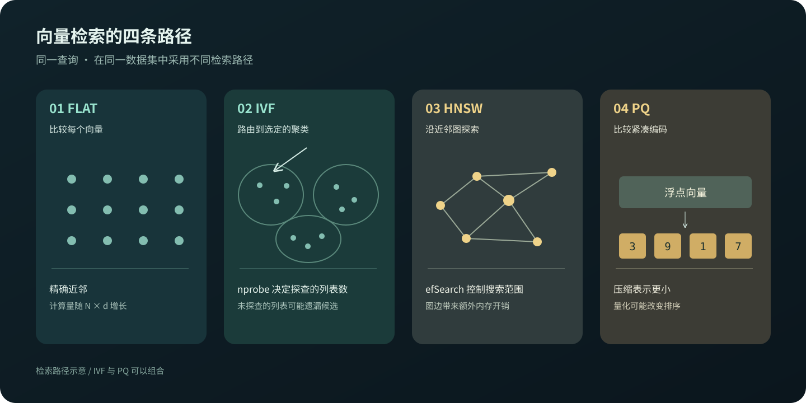

# 向量索引与近邻搜索

> 阅读导航：[检索与排序](../README.md) · [向量搜索导览](README.md) · [向量数据库架构与选型](向量数据库架构与选型.md) · [向量数据库评测方法](向量数据库怎么测才可比.md) · 代码实践：[`vector-db-benchmark`](../../../../experiments/vector-db-benchmark/)

在密集向量检索落地中，当全库向量规模扩展至数百万乃至数亿时，对所有文档逐一计算内积或欧氏距离的暴力扫描（Flat Search）会带来极高的计算开销与延迟瓶颈。近似最近邻检索（Approximate Nearest Neighbor, ANN）通过空间分区剪枝、多层近邻图路由或子空间向量压缩，在略微牺牲绝对近邻召回率（通常维持在 95%~99%）的前提下，将查询耗时压缩数个数量级。关于单向量高维流形与双塔编码的数学基础，参见 [稠密向量表示与最近邻检索](../embedding/稠密向量表示与最近邻检索.md)。本文系统梳理向量索引的四大核心检索路径（Flat、IVF、HNSW、PQ）、内存物理组成的代数推导，以及在生产系统中的选型与调优准则。

---

## 一、概念与问题概述

### 1. 距离度量与基准真值定义（余弦 vs 欧氏距离）

设查询向量为 $\mathbf{q}$，候选库中文档向量为 $\mathbf{x}_i \in \mathbb{R}^d$。余弦相似度与平方欧氏距离（L2）的代数形式分别为：

$$\cos(\mathbf{q}, \mathbf{x}_i) = \frac{\mathbf{q}^\top \mathbf{x}_i}{\|\mathbf{q}\|_2 \|\mathbf{x}_i\|_2}, \quad d^2(\mathbf{q}, \mathbf{x}_i) = \|\mathbf{q} - \mathbf{x}_i\|_2^2$$

当查询向量与候选向量在入库前均经过 L2 范数归一化（即 $\|\mathbf{q}\|_2 = 1, \|\mathbf{x}_i\|_2 = 1$）时：
$$d^2(\mathbf{q}, \mathbf{x}_i) = \|\mathbf{q}\|_2^2 + \|\mathbf{x}_i\|_2^2 - 2\mathbf{q}^\top \mathbf{x}_i = 2 - 2\mathbf{q}^\top \mathbf{x}_i$$
此时最大化内积严格等价于最小化平方欧氏距离，排序结果一致。但需注意，量化压缩（如 PQ 重建）后的向量并不一定严格保持单位模长，不能跨度量直接混用。

### 2. 向量近邻召回率（Recall@k）的第一性判据

在索引评估中，必须先由暴力全量扫描（Flat）计算出无损的精确 Top-$k$ 近邻集合 $G_k$，近似近邻索引输出的集合记为 $A_k$。对 $Q$ 条查询，向量维度的召回率定义为：

$$\operatorname{Recall@}k = \frac{1}{Q} \sum_{i=1}^{Q} \frac{|A_k^{(i)} \cap G_k^{(i)}|}{k}$$

该指标仅度量近似索引找回几何真值的准确度，不代表下游业务相关性。真实端到端效果仍需配合检索模型本身的评测基准。

---

## 二、核心原理

### 1. Flat 暴力穷举扫描

存储全部 $N$ 条原始浮点向量。查询时对全量候选逐一计算内积并维护 Top-$k$ 优先队列。
- **复杂度**：$\mathcal{O}(N \cdot d)$；
- **特征**：零精度损失、无需离线建图或聚类训练；在数据量可控（如 $N \le 50,000$）且批量推理场景下，借助硬件连续内存读取与 SIMD/AVX 指令，Flat 的吞吐表现常优于小规模复杂图索引。

### 2. IVF 空间聚类与倒排分区分割

在建立索引时，利用 K-Means 算法预先训练 $n_{\text{list}}$ 个聚类中心（Voronoi 分区），每个向量根据距离分配到对应中心的倒排列表中。
- **查询时序**：先计算查询向量到 $n_{\text{list}}$ 个聚类中心的距离，仅选取距离最近的 $n_{\text{probe}}$ 个列表进行内部遍历；
- **特征**：扫描候选量缩小为约 $N \cdot \frac{n_{\text{probe}}}{n_{\text{list}}}$。若真实近邻所在的分区未被选入探测列表，将产生不可逆的分区漏检。

### 3. HNSW 分层可导航小世界图路由

将向量视为高维图节点，边连接近邻节点。构建多层跳表式分层图结构：
- **查询时序**：从最上层（稀疏图）的固定入口节点出发，贪心逼近局部最优近邻；逐层向下移动，最终在底层稠密图上展开局部束搜索并输出 Top-$k$；
- **参数控制**：`M` 控制节点最大邻居数（决定索引体积与图连通性），`efConstruction` 控制建图深度，`efSearch` 控制在线查询候选范围。

### 4. 标量量化（SQ）与乘积量化（PQ）查表机制

- **标量量化（SQ8）**：对每个维度独立做线性映射，将 32 位浮点数压缩为 8 位整型（INT8），内存直降为 1/4；
- **乘积量化（PQ）**：将 $d$ 维向量划分为 $m$ 个低维子空间，每个子空间训练包含 $2^b$ 个聚类码字的码本。向量每个子空间仅存储 1 个字节的码字编号。查询时预先计算查询子向量到各码字的距离表（Asymmetric Distance Computation, ADC），在线仅通过高速查表求和估算距离。

---

## 三、工程代价与加速方案

### 1. 各类索引内存物理组成与代数推导

以下针对常见 CPU 索引主体内存进行代数估算（向量基于 float32，每个浮点数 4 字节）：

| 索引类型 | 主体存储估算公式（字节） | 内部物理构成分析 |
|---|---:|---|
| **Flat** | $4Nd$ | 每条向量 $d$ 个 float32 原生存储 |
| **SQ8** | $Nd + \mathcal{O}(d)$ | 每维压缩为 1 字节，附加极少量标定元数据 |
| **PQ** | $N \lceil mb/8 \rceil + 4d 2^b$ | 每条向量的子空间码字编号 + 全部子空间码本查找表 |
| **IVF-Flat** | $4Nd + 8N + 4n_{\text{list}}d$ | 原始向量 + 每条 8 字节倒排链指针 ID + 聚类中心向量 |
| **IVF-PQ** | $N(\lceil mb/8 \rceil + 8) + 4d 2^b + 4n_{\text{list}}d$ | PQ 压缩码 + 倒排链指针 ID + 码本 + 聚类中心 |
| **HNSW-Flat** | $4Nd + 8MN + \mathcal{O}(N)$ | 原始向量 + 底层与高层双向邻居指针边开销 |

### 2. 内存计算实例与 Faiss 序列化开销验证

以参数 $N = 20,000, d = 128, m = 8, b = 8, n_{\text{list}} = 64$ 为例：
- **Flat 原生向量**：$20,000 \times 128 \times 4 = 10,240,000 \text{ 字节}$（约 10.24 MB）；
- **纯 PQ 索引**：编码矩阵 $20,000 \times 8 \times 1 = 160,000 \text{ 字节}$，码本 $4 \times 128 \times 256 = 131,072 \text{ 字节}$，主体合计 291,072 字节。Faiss 实际序列化落盘大小为 291,158 字节（差异仅为格式头元数据），压缩比超过 **35:1**；
- **IVF-PQ 索引**：追加倒排链 ID 与中心后，Faiss 实际序列化体积为 484,532 字节。

### 3. 候选集放大与二阶段精排补偿机制

量化虽然大幅消减了内存，但不可避免地引入了距离重建误差。工程上标准补偿架构为**候选集放大 + 原始向量重排**：
- 第一阶段利用 IVF-PQ 快速在量化空间中召回放大的候选集（如 $K' = 100$）；
- 第二阶段从磁盘或内存中加载原始 FP32 向量，计算真实内积并重新排序，输出最终 Top-10。这样既享受了量化索引常驻内存小的优势，又找回了量化导致的排序精度损失。

---

## 四、选型指南与协同架构

### 1. 四大近邻索引检索路径特性对比

| 索引形态 | 查询时间复杂度 | 内存与存储开销 | 召回精度稳定性 | 动态写入支持 |
|---|---|---|---|---|
| **Flat** | $\mathcal{O}(N \cdot d)$ | 原生（4 字节/维） | 100%（绝对精确基准） | 极好（直接追加） |
| **IVF** | $\mathcal{O}(N \cdot \frac{n_{\text{probe}}}{n_{\text{list}}})$ | 原生 + 聚类中心 | 中等（受未命中分区影响） | 较差（需重新聚类训练） |
| **HNSW** | $\mathcal{O}(\log N)$ | 偏大（需存储指针图拓扑） | 极高（95%~99%） | 良好（支持在线图插入） |
| **PQ / IVF-PQ** | 查表加法极速 | 极小（原生 1/16~1/35） | 较低（有量化排名误差） | 较差（码本与中心固定） |

### 2. 生产级向量索引基准测试与调优准则

在工业部署中，建议遵循以下工程步骤：
1. **基准锁定**：首先使用 Flat 暴力扫描在样本查询集上跑出精确结果，固化真实近邻真值（Ground Truth）；
2. **锁定召回率再比延迟**：脱离 Recall@k 谈吞吐毫无意义。应先扫描 `efSearch` 或 `nprobe`，确定在召回率达到 95% 或 98% 的门槛下，横向比较各方案的 QPS、P99 延迟与索引体积；
3. **内存受限场景路径**：当单机内存无法装入全量向量时，优先选用 SQ8（无损度最高）；若数据量达数千万以上，选用 IVF-PQ 配合二阶段原始向量精排。

---

## 五、参考资料

1. **HNSW (IEEE TPAMI 2020)**: Malkov, Y. A., & Yashunin, D. A. *Efficient and Robust Approximate Nearest Neighbor Search Using Hierarchical Navigable Small World Graphs*. IEEE Transactions on Pattern Analysis and Machine Intelligence, 42(4), 824-836 (2020).
2. **Product Quantization (IEEE TPAMI 2011)**: Jégou, H., Douze, M., & Schmid, C. *Product Quantization for Nearest Neighbor Search*. IEEE Transactions on Pattern Analysis and Machine Intelligence, 33(1), 117-128 (2011).
3. **Faiss Library**: Johnson, J., Douze, M., & Jégou, H. *Billion-scale similarity search with GPUs*. IEEE Transactions on Big Data, 7(3), 535-547 (2019). [GitHub:facebookresearch/faiss](https://github.com/facebookresearch/faiss).
