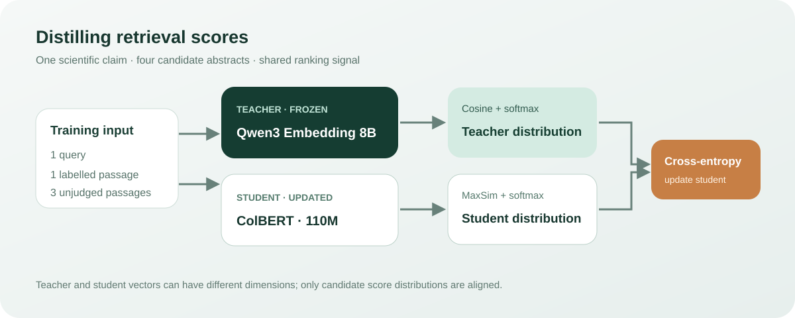

# Distilling a teacher into ColBERT

[中文](README.md)

Can a small multi-vector retriever learn a larger embedding model's ranking preferences? We distill the scores of Qwen3-Embedding-8B into ColBERT and compare it with label-supervised training under the same budget. This is a fixed-candidate reranking experiment, not a full-corpus retrieval benchmark.



## What happened

On 300 held-out SciFact queries, nDCG@10 increased from **0.6536 to 0.6653**, but supervised training reached **0.6686**. The prespecified goal, an improvement of at least 0.02 without falling below the supervised comparison, was not met.

| Condition | nDCG@10 | MRR@10 |
|---|---:|---:|
| Initial ColBERT | 0.6536 | 0.6262 |
| Label supervised | 0.6686 | 0.6452 |
| Teacher distillation | 0.6653 | 0.6421 |
| 8B teacher | 0.7341 | 0.7044 |

The paired query bootstrap 95% interval for distillation minus the initial model is [0.0012, 0.0222]; for distillation minus supervised it is [-0.0113, 0.0041]. There is only one training seed, so these intervals do not capture training variability.

## Data and method

[SciFact](https://github.com/allenai/scifact) associates scientific claims with supporting literature. Training uses 128 queries, each with one evidence-backed positive and three unlabelled BM25 candidates. Testing uses 300 different queries and up to 30 BM25 candidates each. Documents can occur across splits; 39 test queries have no labelled relevant document in their candidate pool. Unlabelled documents are not necessarily negatives.

The student [ColBERT](https://huggingface.co/lightonai/colbertv2.0) independently encodes query and document tokens, then sums each query token's maximum similarity to a document token:

$$s_S(q,d)=\sum_i\max_j \widehat{q_i}^{\mathsf T}\widehat{d_j}.$$

The teacher produces a cosine score for each of four candidates; softmax with temperature 0.05 converts these scores to a distribution. The student minimizes $D_{\mathrm{KL}}(p_T\Vert p_S)$ between teacher and student candidate distributions. The supervised comparison uses an approximately one-hot positive target instead. Both run 128 steps, batch size 4, AdamW learning rate 3e-6, seed 20261107, and query/document maximum lengths 32/180. The recorded 26-second distillation training time on DGX Spark excludes teacher scoring and evaluation.

## Reproduce and inspect

The published [per-query metrics](per-query-metrics.csv) can be checked on CPU with Python's standard library:

```bash
python recompute_metrics.py
```

This verifies aggregates and paired bootstrap intervals, not the underlying ranking-to-label computation. Student per-query metrics were independently recomputed against the original test qrels; teacher metrics come from the teacher run record.

For a new run, obtain [BEIR SciFact](https://public.ukp.informatik.tu-darmstadt.de/thakur/BEIR/datasets/scifact.zip), the [original training claims](https://github.com/allenai/scifact), the [teacher checkpoint](https://huggingface.co/Qwen/Qwen3-Embedding-8B/tree/1d8ad4ca9b3dd8059ad90a75d4983776a23d44af), and the student checkpoint. Run on Linux with CUDA and PyLate:

```bash
python prepare_pools.py --data /path/to/scifact --original-claims /path/to/claims_train.jsonl --out /path/to/prepared
python prepare_teacher.py --data /path/to/scifact --pools /path/to/prepared/pools.json --model /path/to/Qwen3-Embedding-8B --device cuda --out /path/to/source
python run.py --data /path/to/scifact --source /path/to/source --model /path/to/colbert --output /path/to/output --smoke
```

Remove `--smoke` for the full run. The candidate preparation entry point delegates to the [shared SciFact tool](../../utils/scifact-pools/README.en.md), which documents inputs, hashes and its Python 3.11 requirement. The candidate pool reconstructed on CPU matched the original SHA-256 `e7cac48e7083bdd948e2773136c1df9672b4ca8f787ee5b774697b32d689c5f8`. The rewritten real-teacher scoring path has **not** been rerun, so exact end-to-end reproduction of the original teacher scores is not established. Its synthetic encoder is for interface smoke tests only. The training script enforces a 50 GiB available-memory guard specific to this setup, not a general requirement.
