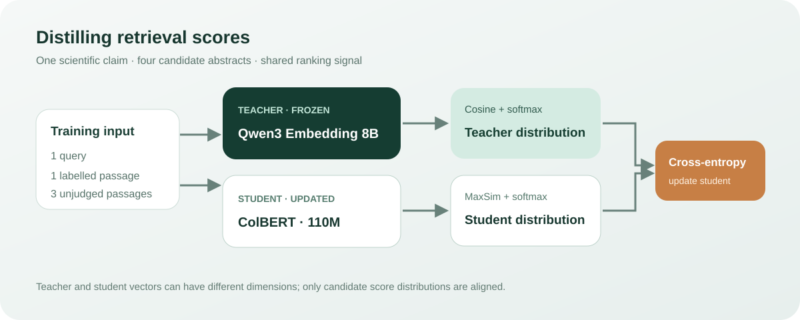

# 用大模型分数蒸馏 ColBERT：搜索排序能提升多少？

[English](README.en.md)

当搜索结果不够准确时，ColBERT 可以通过查询和文档的词元级匹配重新排列候选。它比单向量匹配保留更多细节，但一个较小模型的排序能力仍可能不足。这个实验让约 1.10 亿参数的 ColBERT 学习 8B 向量模型对同一组候选的排序偏好，并与相同预算的标签监督训练比较。

在本次 SciFact 固定候选测试中，蒸馏模型的 nDCG@10 从 **0.6536 提升到 0.6653**，但低于监督训练的 **0.6686**，没有达到预先设定的目标。结果说明这次设置下蒸馏有小幅改善，尚不能证明优于直接监督。



## 数据与评估

[SciFact](https://github.com/allenai/scifact) 是科学论断与论文摘要的证据检索数据集。这里复用 BEIR 格式语料：128 条训练查询，每条包括 1 个有证据的正例与 3 个 BM25 未标注候选；另外保留 300 条测试查询，每条评估 BM25 前 30 个候选。训练与测试查询互斥，但文献语料共享；未标注不等于确定的负例。39 条测试查询的候选中没有标注相关文献，因此本实验衡量的是**固定候选上的排序**，不能代表全库召回表现。

| 条件 | nDCG@10 | MRR@10 |
|---|---:|---:|
| 原始 ColBERT | 0.6536 | 0.6262 |
| 标签监督 | 0.6686 | 0.6452 |
| 教师分数蒸馏 | 0.6653 | 0.6421 |
| 8B 教师 | 0.7341 | 0.7044 |

蒸馏相对原模型的 nDCG@10 差值为 +0.0117，按查询配对 bootstrap 的 95% 区间为 [0.0012, 0.0222]；相对监督为 -0.0033，区间为 [-0.0113, 0.0041]。只有一个训练种子，这些区间不反映训练随机性。预设目标是较原模型至少提升 0.02 且不低于监督对照，**本次未达到**。逐查询分数已用原始测试 qrels 独立复算，三组结果一致。[汇总数据](summary.json)包含时间和参数记录。

## 原理：跨模型架构学习排序偏好

学生分别编码查询和文档，再将每个查询词元与最相似的文档词元匹配并求和：

$$s_S(q,d)=\sum_i\max_j \widehat{q_i}^{\mathsf T}\widehat{d_j}.$$

教师是单向量模型，学生是多向量模型，不需要统一向量维数。教师对同一查询的四个候选分别计算余弦相似度并除以温度 0.05，经过 softmax 得到分布 $p_T$；学生 MaxSim 分数经过 softmax 得到 $p_S$，用 $D_{\mathrm{KL}}(p_T\Vert p_S)$ 学习教师的相对偏好。监督组则将教师分布换成正例近似 one-hot 的分布。实际实现通过 PyLate 的掩码处理文档填充和标点；查询扩展 token 保留参与计算。

## 训练设置与运行

学生使用 [lightonai/colbertv2.0](https://huggingface.co/lightonai/colbertv2.0)，教师使用 [Qwen3-Embedding-8B](https://huggingface.co/Qwen/Qwen3-Embedding-8B)。两个训练条件使用同一初始化、训练样本和种子 20261107，各训练 128 步、每批 4 个查询，AdamW 学习率 3e-6；查询和文档最大长度分别为 32、180。实验在 DGX Spark 上运行，单次蒸馏训练约 26 秒；该计时不含教师打分和测试，不应用作端到端吞吐量。

[run.py](run.py) 是本次训练与评估脚本，需提供 `--data`（包含 corpus.jsonl、queries.jsonl）、`--source`（包含 manifest.json、teacher.json）、`--model` 和 `--output`；加 `--smoke` 先运行小样本。脚本要求 Linux、CUDA、PyLate，默认离线读取模型；数据清单应记录每条查询的 `id`、`candidates` 和 `relevant`，教师文件需要按查询 ID 保存候选顺序一致的 `scores`。脚本含 50 GiB 可用内存下限，这是此次设备上的保护设置，不是模型的普遍最低配置。

**复现边界：**候选池和真实 8B 教师打分的新脚本已完成一次重新运行；新蒸馏结果与历史有差异，不能声称精确复现原分数，详见[复验记录](RECHECK-20261107.md)。更换清单、教师模型版本或环境后，应重新生成分数并单独报告结果；不要把本次数值视为所有场景的模型排名。

模型卡分别标记学生为 MIT、教师为 Apache-2.0；数据集使用请同时遵循其原始来源许可。

## 复算汇总结果

[逐查询指标](per-query-metrics.csv)保留 300 条查询在四个条件下的 nDCG@10 和 MRR@10；行号是用于配对的顺序编号，不包含查询、文档文本或数据集原始 ID。[复算脚本](recompute_metrics.py)仅依赖 Python 标准库：

```bash
python recompute_metrics.py
```

脚本以固定种子进行 10,000 次配对 bootstrap，并检查均值、区间和变化方向数量与汇总文件一致。该文件可复算汇总统计，无法单独验证每条指标由候选排序和标签正确计算；学生三组的逐条指标此前已使用原始 qrels 独立复算，教师逐条指标沿用教师运行记录。

## 从数据准备候选与教师分数

使用 [SciFact 共享候选池工具](../../utils/scifact-pools/README.md)准备数据。它按证据句筛选正例，过滤跨分组高相似查询，再用 BM25 生成候选；数据来源、配置与输入哈希见工具说明。本次复算在 CPU 上重建的 pools.json 与原始运行文件 SHA-256 完全一致（`e7cac48e7083bdd948e2773136c1df9672b4ca8f787ee5b774697b32d689c5f8`）。

```bash
python prepare_pools.py --data /path/to/scifact --original-claims /path/to/claims_train.jsonl --out /path/to/prepared
python prepare_teacher.py --data /path/to/scifact --pools /path/to/prepared/pools.json --model /path/to/Qwen3-Embedding-8B --device cuda --out /path/to/source
python run.py --data /path/to/scifact --source /path/to/source --model /path/to/colbert --output /path/to/output --smoke
```

[prepare_teacher.py](prepare_teacher.py) 以种子 20261107 选训练查询，编码带任务指令的查询与标题加摘要，输出按候选顺序排列的余弦分数。它的 `--synthetic-encoder` 使用确定性伪向量，仅用于 CPU 数据接口冒烟，不能用于模型评估；本次 CPU 冒烟生成的训练及测试候选清单与原实验逐项一致。真实模型打分路径已重跑，新旧教师分数存在差异，原因尚未确定，详见[复验记录](RECHECK-20261107.md)。

教师输出绑定候选清单、语料和查询文件的 SHA-256；训练前会核对绑定、候选顺序对应的分数数量及有限性。旧格式没有这些绑定，必须重新生成教师分数。伪向量只允许配合 `--smoke` 使用；教师输出目录与每个训练输出子目录必须是新路径，避免覆盖或混入旧结果。此前绑定校验修订已重跑真实教师打分与训练；下述输入 ID 校验改动未重跑 GPU。

教师打分和训练都会检查语料、查询文件的 `_id` 为非空且唯一，防止重复 ID 被后面的记录静默覆盖；候选清单的查询数与每条候选数也会显式检查。文件哈希可验证训练时文本文件与打分时一致，但不能证明标注正确。

本机教师的四片 safetensors SHA-256 与 [Hugging Face revision 1d8ad4ca](https://huggingface.co/Qwen/Qwen3-Embedding-8B/tree/1d8ad4ca9b3dd8059ad90a75d4983776a23d44af) 的 LFS 元数据一致；配置、分词器及池化配置也完成内容哈希对照。匹配这些文件支持模型权重与关键配置的来源判断，但并非对运行环境和仓库中全部文件的完整复现证明。
