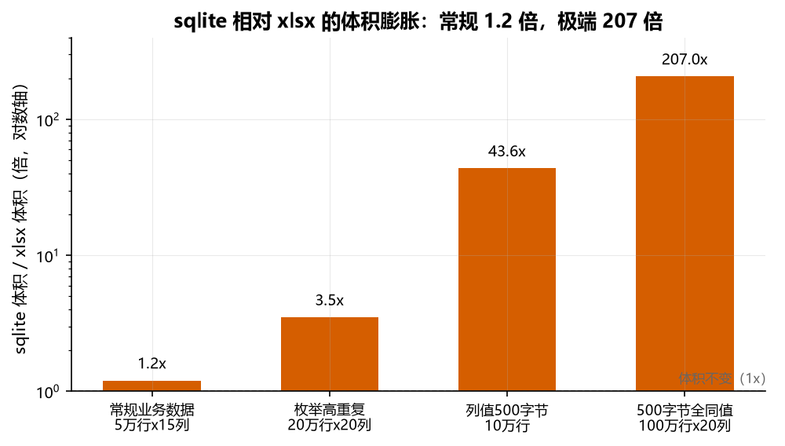
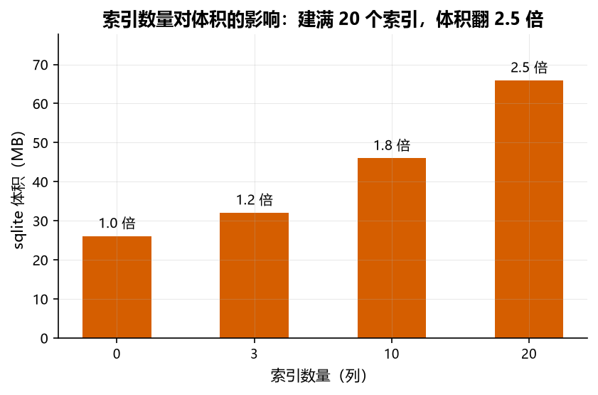
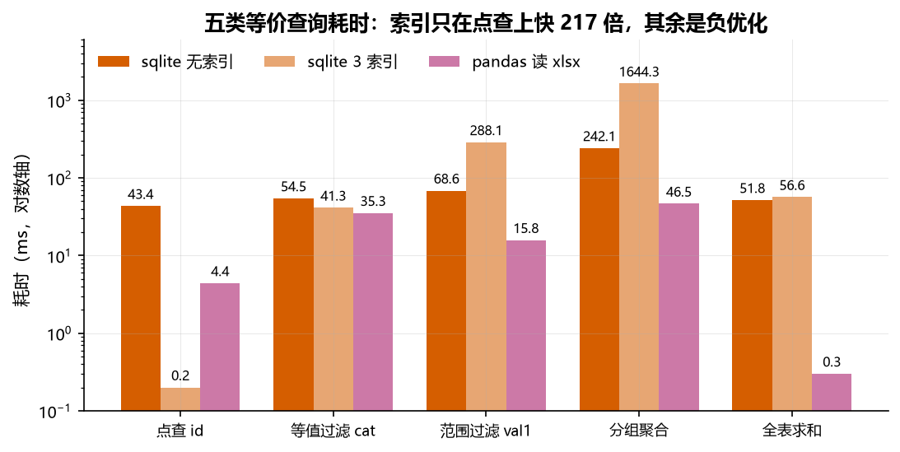
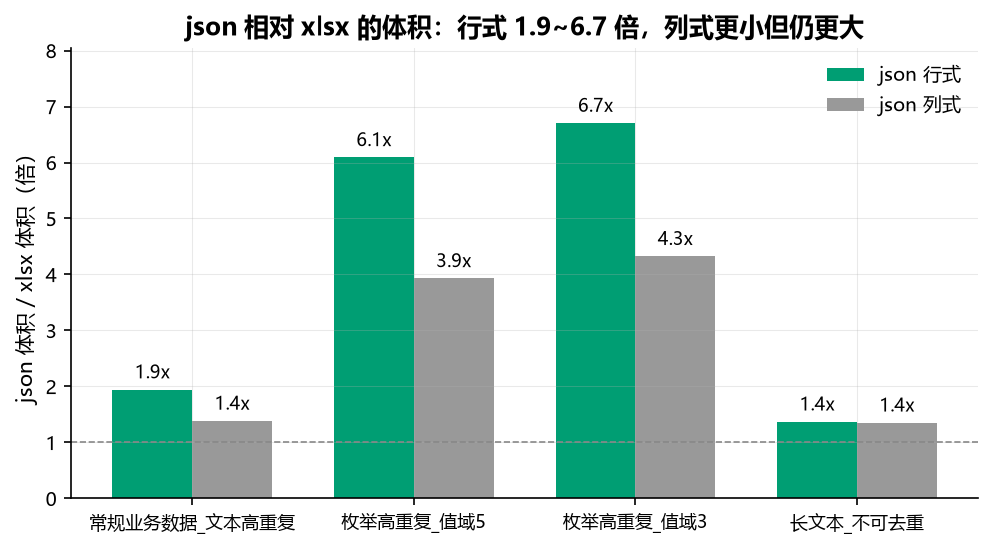
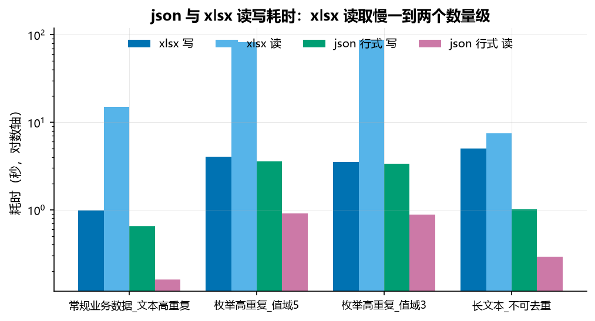
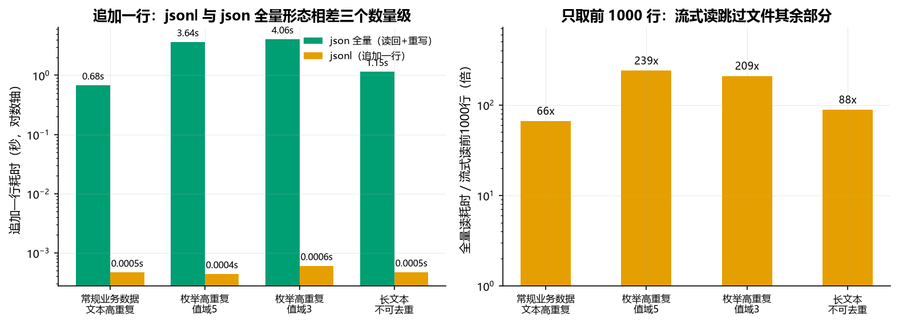

> **阅读提示：**本页保留历史测量及其条件；原始机器环境、数据和计时产物不随仓库完整提供，数值无法在此独立复核。不同输入、序列化方式、查询计划和系统缓存可能改变结果，不能把这里的倍数或归因当作普遍规律。

# xlsx、sqlite、json 与 jsonl 的体积与速度实测

朋友丢来一句话：几兆的 Excel 表导进 sqlite，文件变成了上 G。我第一反应是不信，但说不清哪里不对。

另一个问题藏在我自己身上。我一直觉得 sqlite 查数据比 Excel 快，理由是它有索引而 Excel 没有。这个想法从没验证过，只是默认成立。

第三个问题更日常。往配置和缓存里写数据时，json 和 xlsx 该选哪个，我每次都按感觉定，没算过代价。

三个问题指向同一件事：同一份数据在不同格式下的体积和速度到底怎么算。这篇记录保留历史结果和相近测试方法；由于原始数据和环境未完整保存，不能保证复现表中数字。

## 结论

历史记录显示，本次不同数据形态的体积和耗时差异很大；索引、序列化方式和读取范围都可能改变结果。以下数字仅描述记录中的配置，不能推广为格式或数据库的固定倍率。

## 体积：格式编码与数据分布共同决定大小

xlsx 是 zip 压缩的 XML，sqlite 是不压缩的二进制行存储。直觉是压缩包解开会变大，但 sqlite 的行存储比 XML 紧凑，XML 要给每个单元格写开合标签，sqlite 只记类型加长度加值。两种格式的编码与重复值处理不同，sqlite 文件大小不能直接由 xlsx 的压缩率推得。

**压缩率不是一个可以自由设置的参数**，它由数据特征决定，实测范围 1.5 倍到 300 倍以上。决定因素有三个：基数（重复度）、值长、值的随机性。短文本高重复场景压缩率可达 320 倍，超长文本低重复场景只有 1.7 倍，固定值 5.0 在极端场景下误差可达 17 倍。

| 数据类型 | 基数范围 | 值长范围 | 压缩率范围 | 典型场景 |
|---|---|---|---|---|
| 枚举/分类字段 | 3-20 | 5-20B | 40-320 倍 | 状态、类型、分类标签 |
| 短文本 | 10-1000 | 8-20B | 5-50 倍 | 姓名、地址、短描述 |
| 长文本 | 1000-10000 | 100-500B | 1.5-5 倍 | 长描述、备注、评论 |
| 随机数据 | >10000 | 任意 | 1.5-2 倍 | UUID、哈希值、随机 ID |

常规业务数据测出来是 1.1 到 1.2 倍，方向甚至可能是缩小。

| 数据形态 | xlsx | 压缩率 | sqlite | 膨胀 |
|---|---|---|---|---|
| 5 万行 15 列，文本高重复 | 8.26MB | 5.3 倍 | 9.80MB | 1.2 倍 |
| 5 万行 15 列，文本全唯一 | 13.90MB | 3.6 倍 | 16.30MB | 1.2 倍 |
| 20 万行 8 列，纯数字 | 8.90MB | 6.8 倍 | 11.00MB | 1.2 倍 |



这些高重复样例中 SQLite 文件更大；XLSX 的字符串表示、压缩和 SQLite 的编码方式都可能影响差异，不能仅凭这些结果断定某一机制是唯一原因。

| 数据形态 | xlsx | 压缩率 | sqlite | 膨胀 |
|---|---|---|---|---|
| 20 万行 20 列，取值 5 种 | 10.60MB | 20.7 倍 | 37.30MB | 3.5 倍 |
| 50 万行 40 列，取值 5 种 | 60.42MB | 18.2 倍 | 178.01MB | 2.9 倍 |

我一度以为压缩率有上限，探到 100 字节时看到 55 倍就下了结论。把值长拉到 500 字节再测，压缩率到 110.3 倍，膨胀 207 倍，跨过了 200。

| 数据形态 | xlsx | 压缩率 | sqlite | 膨胀 |
|---|---|---|---|---|
| 10 万行，每行 500 字节 | 1.28MB | 45.0 倍 | 55.94MB | 43.6 倍 |
| 100 万行 20 列，500 字节全同值 | 95.13 MiB | 110.3 倍 | 19.23 GiB | 207.0 倍 |

上述样例表明长且高度重复的值可能造成较大的体积差；该样例不能证明压缩率无上限，也不能确定膨胀所需的必要条件。

索引本身也占体积。同一份数据（10 万行 20 列，取值 5 种，xlsx 21.89MB）：

| 索引数 | sqlite | 膨胀 | 相对无索引 |
|---|---|---|---|
| 0 | 26.12MB | 1.2 倍 | 1.0 倍 |
| 3 | 32.09MB | 1.5 倍 | 1.2 倍 |
| 10 | 46.04MB | 2.1 倍 | 1.8 倍 |
| 20 | 65.96MB | 3.0 倍 | 2.5 倍 |



建满 20 个索引，索引体积可以超过表本身。短值列影响较小，长文本列建满索引能让总体积再涨 1.5 到 2 倍。这些数据不能证明索引是达到某个膨胀倍数的必要条件。

## 速度：索引与查询计划的成本

50 万行 8 列，xlsx 27.0MB，同一份数据跑五类等价查询，三种形态对比。

| 查询 | sqlite 无索引 | sqlite 3 索引 | pandas 读 xlsx 后 |
|---|---|---|---|
| 点查 `id=250000` | 43.4ms | **0.2ms** | 4.4ms |
| 等值过滤 `cat='cat7'` | 54.5ms | 41.3ms | **35.3ms** |
| 范围过滤 `val1 100~200` | 68.6ms | **288.1ms** | **15.8ms** |
| 分组聚合 `GROUP BY cat` | 242.1ms | **1644.3ms** | **46.5ms** |
| 全表求和 `SUM(val2)` | 51.8ms | 56.6ms | **0.3ms** |



点查快了 217 倍，这是本组测量中索引加速最明显的场景；索引也可能用于范围查询、排序、分组和覆盖查询，效果取决于数据与查询计划。

另外三行索引是负优化。`val1` 是 0 到 1000 均匀分布，范围条件覆盖约 10% 的数值区间；具体命中行数和查询计划没有保存，可能存在回表等开销，从 68.6ms 涨到 288.1ms。分组聚合从 242.1ms 涨到 1644.3ms；缺少查询计划与 I/O 证据，不能断定变慢的原因。

pandas 在内存里做向量化运算，全表求和 0.3ms 对 sqlite 51.8ms，差 170 倍，五类查询里拿三个最优。

我原本默认的「sqlite 因为有索引所以更快」，在这里只剩点查那一格成立。

### 场景决定谁快

读入是一次性的，之后都在内存或本地文件上跑，sqlite 导入 76.9 秒，pandas 读 xlsx 69.5 秒，之后都是毫秒级。

差别在数据活在哪里。DataFrame 只存在于进程内存，进程结束即消失；sqlite 落盘，进程结束数据还在。

本组查询中部分 pandas 操作更快，导入 SQLite 比读取 XLSX 多约 7 秒。跨进程或跨会话时，SQLite 可直接复用持久化数据库；DataFrame 可从不同格式重新加载，成本取决于格式与工作负载。

这些结果不能决定其他查询或数据规模下哪种方案更快；需要分别计入导入、加载和实际查询成本。

## json 与 xlsx：用体积换读取速度

这四个样例中 JSON 文件比 XLSX 大约 1.4 到 6.7 倍，读取约快 24 到 104 倍；数据分布、序列化方式、读取库及执行环境都会影响结果。

| 数据形态 | xlsx | json 行式 | json 列式 | 行式 / xlsx | 列式 / xlsx |
|---|---|---|---|---|---|
| 5 万行 15 列，文本高重复 | 8.27MB | 16.07MB | 11.44MB | 1.9 倍 | 1.4 倍 |
| 20 万行 20 列，取值 5 种 | 11.65MB | 70.95MB | 45.78MB | 6.1 倍 | 3.9 倍 |
| 20 万行 20 列，取值 3 种 | 10.58MB | 70.95MB | 45.78MB | 6.7 倍 | 4.3 倍 |
| 10 万行 2 列，值长 500 字节 | 71.13MB | 97.47MB | 96.13MB | 1.4 倍 | 1.4 倍 |



取值 5 种和取值 3 种两个场景，json 体积完全相同，都是 70.95MB。这两个历史样例的字节数相同；字符串内容、转义规则和序列化选项均可能影响 JSON 大小，不能将该现象推广到其他数据。XLSX 则从 11.65 MiB 缩到 10.58 MiB；仅凭这两项记录无法把差异归因于共享字符串表。

反过来说到长文本场景，只差 1.4 倍。500 字节的随机字母串 zip 压不动，xlsx 丢掉压缩这一层，只剩共享字符串表的去重（10 万个唯一值各存一次），而 json 每行存全量，两边差距自然收窄。

JSON 和 XLSX 的编码与压缩不同，这些样例不足以将差异归因于单一机制。列式 json 能扳回一部分，15 列和 20 列的场景小了三成半，因为行式每行都要重复写一遍全部键名，列式只写一次。长文本场景只有 2 列，这个收益就缩到 1.4%，几乎可以忽略。

耗时上读的差距比体积更值得看。

| 数据形态 | xlsx 写 | json 行式 写 | xlsx 读 | json 行式 读 | 读取加速 |
|---|---|---|---|---|---|
| 5 万行 15 列，文本高重复 | 1.01s | 0.99s | 19.90s | 0.20s | 100 倍 |
| 20 万行 20 列，取值 5 种 | 4.42s | 3.76s | 96.50s | 0.95s | 102 倍 |
| 20 万行 20 列，取值 3 种 | 4.00s | 3.86s | 105.13s | 1.01s | 104 倍 |
| 10 万行 2 列，值长 500 字节 | 5.19s | 1.01s | 7.51s | 0.32s | 24 倍 |



本次拆分结果显示 XML 解析占主要时间；该结果基于两次独立读取计时相减，不是对同一次读取的直接分段测量。把解压和解析拆开测，长文本场景解压 71MB 只要 0.44 秒，解析那 20 万个单元格要 7.51 秒，占 95%。枚举场景 400 万个单元格，平均每个 24 微秒；同样的数据 json 读是一次 C 层扫描，0.95 秒走完。长文本场景只差 24 倍，因为它只有 20 万个单元格，XML 解析总量小。按记录的总时间除以单元格数得到的平均值分别约 38 微秒和 24 微秒；由于代码是用两次独立运行耗时相减估计解析时间，不能据此确认共享字符串查找是原因。

写入两者同量级，只有长文本场景例外，xlsx 花 5.19 秒去压缩一堆压不动的内容，json 只要 1.01 秒。枚举场景两边接近，因为重复数据的压缩很便宜。

记录中的列式 JSON 在体积、写入、读取三个维度上都优于行式，读快 1.2 到 2.9 倍，写快 1.4 到 3.0 倍，代价是失去行独立性，不能按行流式处理，写入方必须凑齐整列数据。

## jsonl：逐行读取与追加

jsonl 是每行一个独立 JSON 对象、行尾换行、无外层数组。记录中它与 JSON 全量形态在四个场景的字节数相等（16850000、74400000、74400000、102200000）。原因很直接，json 行式是 `[{...},{...}]`，jsonl 是 `{...}` 换行 `{...}`，差别只是外层两个括号和行间逗号换成换行，行数上去之后这点字节可以忽略。但空白字符、换行符、编码及序列化选项不同会改变大小，不能推广为普遍相等。

值得比较的三项操作是：只取前 N 行、末尾追加一行、流式读取的内存峰值。

### 只取前 1000 行：快 66 到 239 倍

本次使用的 `json.load` 会解析完整文件，JSON 数组也可使用流式解析器增量读取；本次 JSONL 读满 1000 行就可以停手，不必解析剩余记录。

| 数据形态 | jsonl 全量读 | 流式读前 1000 行 | 加速 |
|---|---|---|---|
| 5 万行 15 列，文本高重复 | 0.31s | 0.0046s | 66 倍 |
| 20 万行 20 列，取值 5 种 | 1.37s | 0.0057s | 239 倍 |
| 20 万行 20 列，取值 3 种 | 1.60s | 0.0076s | 209 倍 |
| 10 万行 2 列，值长 500 字节 | 0.66s | 0.0074s | 88 倍 |

提前停止读取的收益取决于待读比例、行大小、解析实现与存储缓存；不能从四个样例推断与数据规模无关。

代价是全量读反而慢一点。jsonl 逐行读 1.37 秒，json 行式全量读 0.91 秒，慢 1.5 到 2.3 倍。逐行 `json.loads` 每次调用都有固定开销，20 万行就是 20 万次调用，而 `json.load` 是一次 C 层扫描走完。这是增量能力的对价，不是实现缺陷。

### 追加一行：快 1458 到 8333 倍

本次脚本用读取、修改、重写的方式更新 JSON 数组，用追加方式写入 JSONL。JSONL 的单次追加通常只需写入新行，但延迟仍受文件系统、缓存和持久化策略影响；JSON 数组也可通过其他实现方式更新。

| 数据形态 | json 行式追加 | jsonl 追加 | 倍数 |
|---|---|---|---|
| 5 万行 15 列，文本高重复 | 0.68s | 0.0005s | 1458 倍 |
| 20 万行 20 列，取值 5 种 | 3.64s | 0.0004s | 8333 倍 |
| 20 万行 20 列，取值 3 种 | 4.06s | 0.0006s | 6773 倍 |
| 10 万行 2 列，值长 500 字节 | 1.15s | 0.0005s | 2449 倍 |

对于日志和流水记录，JSONL 追加接口便于逐条写入；若采用本次数组重写实现，每次追加需要重新处理整个文件。

### 内存：全量读同量级，流式读差 48 到 201 倍

峰值内存用 `tracemalloc` 计量。全量读时 jsonl 与 json 行式同量级，但差异方向不稳定，枚举场景 jsonl 高 27%（442.9MB 对 347.9MB），长文本场景 jsonl 低 40%（129.7MB 对 219.0MB）。

长文本场景的历史记录与文本缓冲开销相符：json 全量读必须同时持有整个文件的文本缓冲（该文件 102MB），jsonl 逐行读没有这份缓冲。把文本缓冲排除后单独测 json 解析，峰值从 219.0MB 降到 121.5MB，与 jsonl 的 129.7MB 持平。枚举场景的反向差异尚未定论，已排除「重复值去重」这一假设（验证：单次 `json.loads` 调用内，重复出现的值也不是同一对象）。

流式读的内存才是决定性的。只取 1000 行时峰值 1.3 到 2.2MB，是全量读的 1/48 到 1/201。

| 数据形态 | json 行式全量 | jsonl 全量 | jsonl 流式 1000 行 |
|---|---|---|---|
| 5 万行 15 列，文本高重复 | 76.5MB | 91.5MB | 1.9MB |
| 20 万行 20 列，取值 5 种 | 347.9MB | 442.9MB | 2.2MB |
| 20 万行 20 列，取值 3 种 | 347.9MB | 442.9MB | 2.2MB |
| 10 万行 2 列，值长 500 字节 | 219.0MB | 129.7MB | 1.3MB |



## 选型

格式选择取决于数据、读写方式和约束：JSON 适合结构清晰的交换数据；JSONL 便于逐行处理和追加；SQLite 支持持久化、索引与事务；XLSX 方便表格软件交互。需要频繁查询、分析或归档时，应按自己的负载测量导入、查询、写入和存储成本。压缩格式、列式文件和其他数据库也可能适合，不能仅凭本次四种格式的对比排除。

## 运行

命令从 `experiments/data-structure-costs` 目录运行；脚本会在 `scripts/output/` 中创建或覆盖固定名称的文件，绘图脚本也会写 `scripts/figures/`。先确认目标目录中没有需要保留的数据。

```bash
# 体积测试（xlsx 转 sqlite），约 3 分钟
python scripts/bench_size.py

# 体积测试，只跑小场景
python scripts/bench_size.py --quick

# 速度测试，约 3 分钟
python scripts/bench_speed.py

# 速度测试，缩小规模
python scripts/bench_speed.py --rows 100000

# 跳过 pandas 侧对比
python scripts/bench_speed.py --skip-pandas

# json 与 xlsx 对比，约 7 分钟
python scripts/bench_json.py

# json 与 xlsx 对比，只跑小场景
python scripts/bench_json.py --quick

# 额外拆分 xlsx 读取的解压与 XML 解析耗时
python scripts/bench_json.py --decompose

# 按现有数据重出图表（读 output/bench_json_results.json）
python scripts/make_figures.py
```

依赖：`openpyxl`、`pandas`、`matplotlib`。

jsonl 的三项测量（流式读、追加写、峰值内存）都在 `bench_json.py` 里，产物同样写入 `output/bench_json_results.json`，字段以 `jsonl_` 开头。

体积、耗时及倍数均可能随硬件、数据分布、序列化方式和库版本变化。

按当前脚本路径计算，产物写入 `scripts/output/`；绘图脚本写入 `scripts/figures/`，并非本报告引用的实验根目录 `figures/`。运行前应检查目标目录，避免覆盖已有文件。

## 实测环境

- 日期：2026-09-05
- 操作系统：Windows 11
- Python 3.13.0
- openpyxl 3.1.5
- pandas 3.0.5（仅 speed 测试用）
- matplotlib 3.11.1（图表）
- SQLite 3.49.1
