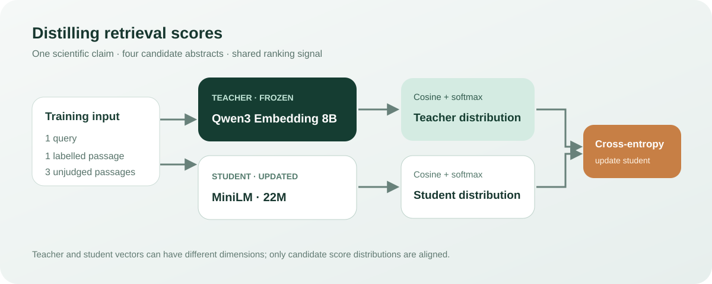

# Distilling an embedding model for scientific literature retrieval

English | [中文](README.md)

Can a small retrieval model learn useful ranking behavior from a much larger model? We use a roughly 22-million-parameter MiniLM bi-encoder as the student and Qwen3-Embedding-8B as the teacher. A smaller encoder can reduce the cost of embedding documents and queries, but its retrieval quality may suffer. Distillation transfers the teacher's relative preferences over candidate documents, rather than trying to match vectors of incompatible dimensions.

## What happened

On 2026-11-07, we ran the experiment on a DGX Spark GB10. All methods ranked the same 30 BM25 candidates for each of 300 held-out SciFact queries. For 39 queries, none of the annotated relevant documents appeared among those candidates; reranking cannot recover them.

| Model | nDCG@10 | MRR@10 |
|---|---:|---:|
| Qwen3-Embedding-8B teacher | 0.7341 | 0.7044 |
| MiniLM baseline | 0.6654 | 0.6228 |
| MiniLM, supervised labels | 0.6702 | 0.6269 |
| MiniLM, distilled teacher scores | 0.6711 | 0.6308 |

Distillation improved nDCG@10 by 0.0057 over the baseline, with a 95% paired-query bootstrap interval of [−0.0074, 0.0190]. The difference from the same-budget supervised model was 0.0009, with an interval of [−0.0182, 0.0200]. Neither comparison establishes an improvement. Our pre-specified goal required at least +0.02 over the baseline and a result no worse than supervised training; this run did not meet it. Bootstrap captures query-sampling uncertainty, not variation between training seeds. It is one run, not evidence of a stable gain.

## Data and experimental design

SciFact connects scientific claims to research abstracts and relevance judgments. The input is a claim and a document's title plus abstract; the output is an embedding, with cosine similarity used to rank documents. We sampled 128 training queries, using seed 20261107, from 390 eligible queries. Each training example contains one labeled relevant document and the first three unjudged BM25 candidates. Unjudged does not mean confirmed irrelevant. The 300 test queries are disjoint from the training queries, with near-duplicates filtered by the existing Jaccard rule. The corpus is shared, so this does not establish generalization to a new corpus.

The comparison fixes candidates, initialization, sample order, batch size and update count across the two student training conditions. Both run 128 updates with four queries per batch, AdamW at 2e-5, and a maximum of 192 tokens. Supervised training uses cross-entropy with the labeled document in the first position. Distillation uses the teacher's distribution over the same four candidates. The teacher placed the labeled document first for 116 of 128 training queries; the other 12 cases do not establish teacher error because unjudged documents can also be relevant.

## How the loss transfers ranking information



For each query $q_i$ and candidate $d_{ij}$, teacher and student calculate cosine scores $s^T_{ij}$ and $s^S_{ij}$. Each set of scores is converted to a distribution using temperature $\tau=0.05$. The teacher is fixed and only the student receives gradients:

$$
p^X_{ij}=\frac{\exp(s^X_{ij}/\tau)}{\sum_{k=1}^{4}\exp(s^X_{ik}/\tau)},\qquad
\mathcal L_{\mathrm{distill}}=-\frac{1}{B}\sum_{i=1}^{B}\sum_{j=1}^{4}p^T_{ij}\log p^S_{ij}.
$$

Unlike a single hard label, the teacher distribution can express relative preference among candidates. It can also transfer teacher mistakes, and the quality of that signal depends on the candidate set and temperature.

## Cost and limitations

The teacher produces 4096-dimensional vectors and the student 384-dimensional vectors. The teacher used BF16 and batch size 2; the student used FP32 and batch size 16. Both used at most 192 tokens from their respective tokenizers; teacher queries included a task instruction. Teacher document encoding took approximately 262.45 seconds for 3,929 documents; student evaluation document encoding took approximately 3.60–3.77 seconds for 3,864 documents. The document sets, precision and batch sizes differ, so these numbers are not a controlled throughput comparison. Model loading and indexing are excluded. Student training took about 7.07 seconds for supervised learning and 6.52 seconds for distillation, excluding teacher encoding and evaluation.

We report ranking within a fixed candidate pool, not whole-corpus recall. The shared corpus, small training set and single seed limit the conclusions. The teacher's four weight shards matched the hashes for [Qwen3-Embedding-8B revision 1d8ad4ca](https://huggingface.co/Qwen/Qwen3-Embedding-8B/tree/1d8ad4ca9b3dd8059ad90a75d4983776a23d44af); tokenizer files were not individually verified. The [student model](https://huggingface.co/sentence-transformers/all-MiniLM-L6-v2) cache reported revision `1110a243fdf4706b3f48f1d95db1a4f5529b4d41`.

## Recalculate and reproduce

Run `python scripts/verify.py` to recompute the table and paired bootstrap intervals from the included per-query metrics. These records contain query IDs and metrics, not texts, predictions or qrels, and cannot independently validate inference or the relevance labels. The original test qrels were separately checked against the 300 test relevance sets and used to recompute the four sets of metrics.

The public training script was parameterized from the device-side run and has **not** completed a new end-to-end reproduction. A CPU smoke test with substitute small models exercised scoring, the baseline and both training branches; it does not reproduce the reported model comparison. Formal runs require Linux, CUDA, PyTorch, NumPy and Sentence Transformers, as well as approximately 50 GiB available system memory. Python 3.11 or newer is required by the candidate-preparation script.

Obtain BEIR SciFact and the original SciFact training claims, verify their hashes, and run only `prepare_pools.py` as described in the [candidate-preparation instructions](../colbert-distillation/README.md#从数据准备候选与教师分数). The other experiment's teacher and student commands are unnecessary here. The resulting `pools.json` fixes training positives and BM25 candidates. Data and models are downloaded from their sources; consult the [original SciFact license](https://github.com/allenai/scifact/blob/master/LICENSE.md) as annotation and corpus licenses differ. Candidate preparation currently depends on scripts and configuration from the neighboring experiment.

Download pinned model snapshots from the experiment directory:

```bash
python -c "from huggingface_hub import snapshot_download; snapshot_download('Qwen/Qwen3-Embedding-8B', revision='1d8ad4ca9b3dd8059ad90a75d4983776a23d44af', local_dir='models/teacher')"
python -c "from huggingface_hub import snapshot_download; snapshot_download('sentence-transformers/all-MiniLM-L6-v2', revision='1110a243fdf4706b3f48f1d95db1a4f5529b4d41', local_dir='models/student')"
```

Set `DATA` to the extracted BEIR SciFact directory and `POOLS` to the prepared `pools.json`:

```bash
python scripts/train.py --stage teacher --data "$DATA" --pools "$POOLS" --out output --teacher models/teacher --student models/student
python scripts/train.py --stage student --data "$DATA" --pools "$POOLS" --out output --teacher models/teacher --student models/student
```

Add `--smoke` to both commands for two queries and two training steps; add `--device cpu` for a CPU pipeline check. Both modes still require Linux `/proc/meminfo` and the memory guard. The teacher stage saves scores; the student stage evaluates the baseline, supervised and distilled models. The stages check data and pool hashes, model paths and completion of teacher outputs. A model changed in place is not detected by a path check: independently verify model revisions and weights. Hardware, dependencies and randomness can affect results.

The change to reset CUDA peak-memory statistics for each branch has not been rerun on a GPU; it does not retrospectively validate historical peak measurements.
