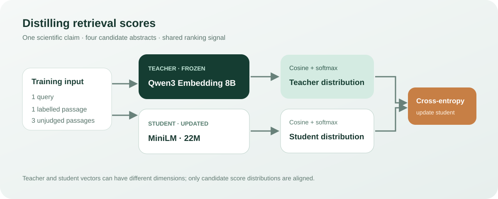

# 科学文献检索中的向量模型蒸馏

## 问题和计划

检验一个约 2200 万参数的 MiniLM 双编码器能否从 Qwen3-Embedding-8B 的文档相对分数中学习，提高科学论断到论文摘要的排序质量。两个模型向量维度不同，使用同一查询下候选文档的相似度分布传递信息，不直接回归向量。

固定已有 SciFact 数据准备结果：训练侧从 390 条合格查询中按种子 20261107 取 128 条，每条取一个标注正例及前三个 BM25 未标注候选；评价侧为 300 条互斥查询与每条 BM25 前 30 个固定候选。未标注不是人工确认的负例；语料跨训练和测试共享，测试单位是查询，不代表新语料泛化。训练查询与测试查询按已有 Jaccard 规则过滤近重复。

预先指定四个条件：MiniLM 原模型、同预算正例标签监督训练、教师分布蒸馏训练、教师排序。两种训练都从同一学生初始化开始，使用相同训练样本、批次顺序和更新步数；前者使用正例交叉熵，后者使用教师分数 softmax 与学生分数分布的交叉熵；都以余弦相似度除以温度 0.05。评价固定候选的 nDCG@10 和 MRR@10，不把结果写成全库召回。

教师只编码本轮候选文档与训练、测试查询；学生每个条件 128 步、查询批次 4、最多 192 token、单种子。脚本在可用内存低于 50 GiB 时停止。比较时同时记录模型参数量、编码耗时口径与显存峰值。实验证据以完成后的原始记录为准，未运行或不完整时不声称效果。

预先规定：只有蒸馏后相对学生原模型的测试 nDCG@10 提高至少 0.02，且不低于同预算监督训练，才说本次达到探索目标；配对 bootstrap 区间用于表达查询抽样的不确定性。否则如实记录未达目标，不围绕测试集反复调参。单次训练种子不能验证训练随机性的稳定性。

## 结果

2026-11-07 在 DGX Spark GB10 上运行。300 条留出查询使用相同 30 个 BM25 候选，其中 39 条没有标注相关文献进入候选，所有方法在这些查询上均无法重排找回相关结果。

| 模型与训练方式 | nDCG@10 | MRR@10 |
|---|---:|---:|
| Qwen3-Embedding-8B 教师 | 0.7341 | 0.7044 |
| MiniLM 原模型 | 0.6654 | 0.6228 |
| MiniLM 同预算标注监督 | 0.6702 | 0.6269 |
| MiniLM 教师分数蒸馏 | 0.6711 | 0.6308 |

蒸馏相对原模型的 nDCG@10 差值为 +0.0057，按查询配对 bootstrap 10000 次的 95% 区间为 [−0.0074, 0.0190]，未达到事先指定的 +0.02 门槛。相对同预算监督训练的差值为 +0.0009，区间为 [−0.0182, 0.0200]。本次不能证明蒸馏改善，也不能判断优于标注监督。教师的 128 条训练查询中有 116 条将已标注正例排在该四候选首位，剩余 12 条不能断言教师错误，因为未标注候选可能相关。

## 训练机制



对每个查询 $q_i$，候选文档 $d_{ij}$ 由教师与学生各自产生余弦分数 $s^T_{ij}$ 和 $s^S_{ij}$。分别将分数除以 $\tau=0.05$ 并作 softmax，得到 $p^T_{ij}$ 与 $p^S_{ij}$；蒸馏损失为：

$$
\mathcal L_{\mathrm{distill}}=-\frac{1}{B}\sum_{i=1}^{B}\sum_{j=1}^{4}p^T_{ij}\log p^S_{ij},\qquad
p^X_{ij}=\frac{\exp(s^X_{ij}/\tau)}{\sum_{k=1}^{4}\exp(s^X_{ik}/\tau)}.
$$

教师分布固定，梯度只更新学生。同预算监督条件改为第一列标注正例的交叉熵，其他三列仅是未标注候选。两个学生都全参数训练 128 步，查询批次 4，AdamW 学习率 2e-5；训练耗时分别约 7.07 秒和 6.52 秒，不包含教师编码及评价。

## 数据、成本和边界

输入为科学论断与文献标题和摘要；训练记录保存查询 ID、一个标注正例 ID、三个未标注候选 ID。推理时分别编码查询和文档，输出向量并计算余弦分数。本轮并非对整个语料重新召回，而是只比较固定候选的排序。测试复算直接读取原始 BEIR 测试 qrels，核对 300 条查询的相关文档集合，并独立重算四组指标。

教师向量为 4096 维，学生为 384 维。教师 BF16、批次 2，学生 FP32、批次 16；两者都是最长 192 个各自分词器的 token，教师查询使用任务指令。教师处理 3929 篇训练和测试涉及文献约 262.45 秒；学生评价处理 3864 篇测试涉及文献约 3.60–3.77 秒。文档集合、精度与批次均不同，这些数字不是直接可比的吞吐基准，且都不含模型加载与索引。

学生缓存 revision `1110a243fdf4706b3f48f1d95db1a4f5529b4d41`；教师四个权重分片的 SHA-256 与官方 revision `1d8ad4ca9b3dd8059ad90a75d4983776a23d44af` 一致；tokenizer 文件未逐一核验。教师模型卡为 [Qwen3-Embedding-8B](https://huggingface.co/Qwen/Qwen3-Embedding-8B)，学生模型卡为 [all-MiniLM-L6-v2](https://huggingface.co/sentence-transformers/all-MiniLM-L6-v2)。数据源为 BEIR SciFact 与原始 SciFact，详细过滤和输入哈希见既有训练审查记录。单种子、同语料的查询留出和有限训练集都限制了结论范围。

## 复算与复现

运行 `python scripts/verify.py` 可直接用随附的每查询指标复算表格与配对 bootstrap；证据包含查询 ID 和指标，不含原始文本、模型或数据集。复算只核对聚合和区间，不能独立验证原始模型推理与标注。本次公开脚本由设备侧脚本参数化整理，尚未重新完成端到端训练，下面是复现路径而非已验证的一键流程。

在 Linux CUDA 环境中准备 PyTorch、NumPy 和 Sentence Transformers。本次使用预先准备的 `pools.json` 确定训练正例和 BM25 候选；候选文件及准备脚本尚未随此实验发布，目前不能仅凭本仓库从原始数据完整复现此次训练输入。数据集及模型按各自许可从原始来源获取，不包含在本仓库内。BEIR 数据卡标注 CC BY-SA 4.0；原始 SciFact 的标注与语料许可不同，使用前请参照[原始许可](https://github.com/allenai/scifact/blob/master/LICENSE.md)。

下载两个模型到本机并固定版本，例如：

```bash
python -c "from huggingface_hub import snapshot_download; snapshot_download('Qwen/Qwen3-Embedding-8B', revision='1d8ad4ca9b3dd8059ad90a75d4983776a23d44af', local_dir='models/teacher')"
python -c "from huggingface_hub import snapshot_download; snapshot_download('sentence-transformers/all-MiniLM-L6-v2', revision='1110a243fdf4706b3f48f1d95db1a4f5529b4d41', local_dir='models/student')"
```

设 `DATA` 指向解压后的 BEIR SciFact 目录，`POOLS` 指向上述数据准备生成的 `pools.json`，从本实验目录运行：

```bash
python scripts/train.py --stage teacher --data "$DATA" --pools "$POOLS" --out output --teacher models/teacher --student models/student
python scripts/train.py --stage student --data "$DATA" --pools "$POOLS" --out output --teacher models/teacher --student models/student
```

两条命令加 `--smoke` 可做两条查询、两步训练的管线检查；它不能代替正式实验。教师阶段生成分数，学生阶段依次评价原模型、监督组和蒸馏组。训练要求 CUDA、Linux `/proc/meminfo` 和至少约 50 GiB 系统可用内存；不同硬件、依赖版本与随机性会影响结果。
