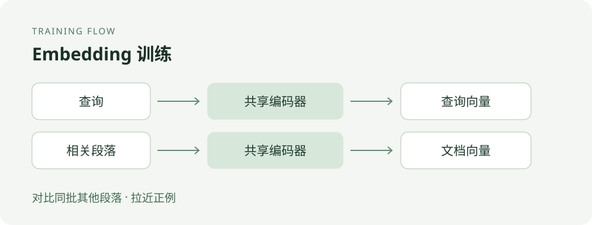

# Fine-tuning a Chinese embedding model for retrieval

[中文](README.md)

A search for “How do I learn Python?” should find a beginner's guide even when the wording differs. An embedding model encodes the query and documents as vectors, so retrieval can rank documents by vector similarity. A general-purpose model may nevertheless miss relevant passages when a collection uses specialized terms, domain-specific questions, or unusual document types. Fine-tuning on representative query–passage pairs is one way to adapt it to that retrieval task.

This tutorial demonstrates the smallest training path: read query–passage pairs, treat other passages in each batch as negatives, and update the model with a contrastive loss. The four built-in examples are for learning and checking the code path; **they do not establish an improvement in retrieval quality**.

## When to consider fine-tuning

Question answering over a knowledge base, document search, and support search all need to identify useful passages from a larger collection. If manual review or retrieval evaluation shows that a model repeatedly misses domain-relevant material, collect representative queries and relevant documents and compare the base and adapted models. Fine-tuning is not necessarily the first step: chunking, query formulation, index configuration, and data quality also affect retrieval.

An embedding model usually retrieves a candidate set quickly; a reranker can then reorder those candidates. This tutorial trains the embedding model only.

## How the training works



Each record contains a query and a relevant passage. For example, a Python-learning question and an introductory Python passage form a positive pair. For a batch of several pairs, the script scores each query against all passages in that batch. The paired passage is the positive; the others are treated as negatives. Cross-entropy then encourages the positive to rank higher relative to those candidates. This is in-batch contrastive learning.

For a batch of $N$ pairs, let $\mathbf{q}_i$ and $\mathbf{d}_i$ be the encoded, normalized query and passage vectors. The score for query $i$ and passage $j$, and the batch loss, are:

$$
s_{ij}=\frac{\mathbf{q}_i^{\mathsf T}\mathbf{d}_j}{\tau},
\qquad
\mathcal{L}=-\frac{1}{N}\sum_{i=1}^{N}
\log\frac{\exp(s_{ii})}{\sum_{j=1}^{N}\exp(s_{ij})}.
$$

The numerator uses the paired positive. The denominator includes all passages in the batch, including the positive and the passages paired with other queries. The script L2-normalizes vectors, uses their dot product as cosine similarity, and scales scores by temperature $\tau=0.02$ before cross-entropy.

Other passages are only **assumed** to be irrelevant. If one also answers the query, it becomes a false negative and may harm training. Deduplication, relevance labeling, and batch construction matter. A batch of one has no in-batch negative and supplies no useful contrastive signal.

## Run the example

Install dependencies in this directory. For CUDA, install a PyTorch build compatible with the device separately:

```bash
pip install torch transformers sentence-transformers tqdm
python train_embedding.py
```

The default model is `BAAI/bge-base-zh-v1.5`; the first run may download it. Use `--model_name_or_path` to select a local model. The script chooses CUDA when available, otherwise CPU. It trains for three epochs with batch size four by default, saves an epoch checkpoint, and writes the final model to `models/bge-finetuned/final_model`.

The default input is `demo_data.jsonl`. If that default file is missing, the script creates its built-in examples. A missing custom data path instead produces an error, so the demo is not silently mistaken for a real dataset. Both batch size and dataset size must be at least two. If the last batch would contain a single record, the script drops it to avoid an update without negatives.

## Use your own data

Create a UTF-8 JSONL file with one JSON object per line. Each object contains `query` and `pos_doc`:

```jsonl
{"query":"如何学习 Python？","pos_doc":"学习 Python 可以从安装环境、变量和循环等基础开始。"}
{"query":"什么是机器学习？","pos_doc":"机器学习研究如何让计算机从数据中学习。"}
```

Pair each query with a passage that answers it. Cover real queries, domain wording, and easily confused candidates. Split training and evaluation data in advance and check for duplicate or highly similar queries and documents to reduce leakage. The script truncates queries and passages according to `--query_max_len` and `--passage_max_len`; verify that the important content survives truncation.

During training, the model separately encodes queries and positive passages, and the loss updates it using similarities across the batch. At retrieval time, encode candidate passages with the trained model and build a vector index. Encode a new query, compare it with candidate vectors, and return the highest-scoring passages. The model outputs vectors; the ranking comes from the subsequent similarity calculation, not an answer generated by the model.

```bash
python train_embedding.py \
  --model_name_or_path BAAI/bge-base-zh-v1.5 \
  --train_dataset path/to/train.jsonl \
  --output_dir path/to/output \
  --epochs 3 \
  --batch_size 4
```

Other parameters include `--lr`, `--query_max_len`, and `--passage_max_len`; see [`train_embedding.py`](train_embedding.py) for defaults. The script does not implement explicit hard negatives, validation-set evaluation, or automatic best-checkpoint selection.

## Assess whether fine-tuning helps

On a separate evaluation set, test the base and fine-tuned models with the same document collection, chunking, queries, and retrieval configuration. Compare Recall@K, MRR, or NDCG as appropriate and inspect failures: whether the relevant passage reaches the candidate set, where it ranks, whether specialist wording improves, and whether previously successful queries regress. Choose metrics and K according to how many candidates the downstream task actually reads.

The displayed `acc` is positive-pair ranking accuracy **within the current training batch**; `loss` is also measured on training batches. Neither is an independent retrieval evaluation, and neither demonstrates generalization or an improvement in a real application. The script does not perform the evaluation described above; run a separate comparison to establish the actual effect.

## Scope of this example

The built-in dataset has four examples from different topics. With the default batch size of four, each epoch has one batch. The example demonstrates data loading, contrastive loss, parameter updates, and model saving; it is not a sufficiently representative training set and includes no independent validation set, baseline comparison, or real application retrieval results. Before deployment, prepare suitable data and evaluate the adapted model against a baseline.
