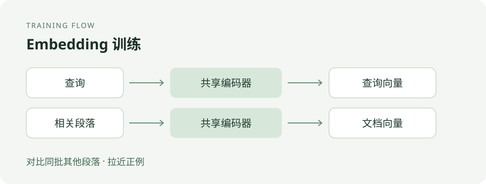

# 中文文本 Embedding 微调：用查询与相关文档训练检索模型

当用户搜索“如何学习 Python”，检索系统需要找到讲 Python 入门的段落，即使两者的字面措辞不完全相同。Embedding 模型将查询和文档编码为向量，再按向量相似度寻找候选文档。通用模型已经具备语义匹配能力，但在专业术语、业务问法或特定文档类型上，相关性排序不一定符合实际需求。用这些场景里的查询和相关文档继续训练，可以尝试让模型更适应该领域的检索任务。

本示例展示一条最小训练路径：读取查询与相关段落，将同一批次的其他段落作为负例，通过对比学习更新模型。它适合学习训练机制和检查代码流程；内置数据只有 4 组，**不能用来证明微调提升了检索质量**。

## 什么时候值得尝试

知识库问答、文档搜索和客服检索都需要从大量候选内容中找出与问题相关的段落。如果已有模型经人工检查或检索指标评估，确实经常漏掉领域内的相关内容，可以收集真实查询及其相关文档，比较微调前后的检索效果。微调并非默认的第一步：文本切分、查询表达、索引配置和数据质量同样会影响结果，应先确认问题所在。

Embedding 通常负责从大量文档中快速召回候选；重排序模型可以在此基础上进一步判断候选顺序。二者解决的环节不同，本示例只训练前者。

## 训练原理



训练数据中的每条记录包含一个查询和一个相关段落。例如，查询“如何学习 Python？”与 Python 入门段落是一组正例。一个批次有多组记录时，脚本会计算每个查询与该批次所有段落的相似度，将对应段落视为正例，其他段落视为负例，再使用交叉熵损失提高正例的相对排名。这种方式称为批内负例对比学习。

设批次中有 $N$ 对查询和正例，模型编码并归一化后分别得到 $\mathbf{q}_i$ 和 $\mathbf{d}_i$。查询 $i$ 与文档 $j$ 的分数，以及整个批次的损失为：

$$
s_{ij}=\frac{\mathbf{q}_i^{\mathsf T}\mathbf{d}_j}{\tau},
\qquad
\mathcal{L}=-\frac{1}{N}\sum_{i=1}^{N}
\log\frac{\exp(s_{ii})}{\sum_{j=1}^{N}\exp(s_{ij})}.
$$

分子是该查询对应正例的分数，分母包含批次内所有文档，包括正例和其他样本的文档。训练提高正例相对于这些候选的分数。本脚本运行时温度 $\tau=0.02$，分数经过温度缩放后再计算交叉熵。

脚本对向量做 L2 归一化，以点积计算余弦相似度，并使用温度参数缩放相似度。批内其他段落只是**假定**不相关：如果它们同样能回答当前查询，就会形成假负例，干扰训练。因此要注意数据去重、相关性标注和批次构造。批次只有一条记录时没有批内负例，无法提供有效的对比信号。

## 快速运行

在本目录安装依赖，使用 CUDA 需另行安装与设备兼容的 PyTorch：

```bash
pip install torch transformers sentence-transformers tqdm
python train_embedding.py
```

默认加载 `BAAI/bge-base-zh-v1.5`，首次运行可能需要下载模型；也可通过 `--model_name_or_path` 指向本地模型。脚本自动选择 CUDA，若不可用则使用 CPU。默认训练 3 轮、批次大小为 4，每轮保存检查点，最终模型写入 `models/bge-finetuned/final_model`。

默认数据文件是 `demo_data.jsonl`；该文件缺失时脚本创建内置演示数据。自定义数据路径缺失时直接报错，避免误把演示数据当作真实训练集。批次和数据集至少需要两条记录；若末批只有一条，脚本丢弃该末批，避免无负例的零损失更新。

## 使用自己的数据

准备 UTF-8 编码的 JSONL 文件，每行一个 JSON 对象，包含 `query` 和 `pos_doc`：

```jsonl
{"query":"如何学习 Python？","pos_doc":"学习 Python 可以从安装环境、变量和循环等基础开始。"}
{"query":"什么是机器学习？","pos_doc":"机器学习研究如何让计算机从数据中学习。"}
```

将查询和能够回答该查询的文档段落配对；尽量覆盖真实查询、领域表达和容易混淆的候选内容。训练集和评估集应事先分开，并检查重复或高度相似的查询与文档，减少数据泄漏。文档和查询分别按 `--passage_max_len`、`--query_max_len` 截断，数据准备时需要确认关键内容没有被截掉。

训练时，模型分别编码查询和正例段落，得到各自的向量；损失函数使用同批次向量之间的相似度更新模型。检索时，先用训练后的模型将候选段落分别编码并建立向量索引；收到新查询后再将查询编码，与候选向量计算相似度，返回分数较高的段落。模型输出的是向量，检索结果的排序来自后续的相似度计算，而不是模型直接生成答案。

```bash
python train_embedding.py \
  --model_name_or_path BAAI/bge-base-zh-v1.5 \
  --train_dataset path/to/train.jsonl \
  --output_dir path/to/output \
  --epochs 3 \
  --batch_size 4
```

其余可配置参数为 `--lr`、`--query_max_len` 和 `--passage_max_len`；完整默认值见 [`train_embedding.py`](train_embedding.py)。脚本不支持显式难负例、验证集评估或自动选择最佳检查点，需要时应另行实现。

## 怎样判断微调是否有用

在独立评估集上，使用同一文档库、切分方式、查询和检索配置，分别测试基础模型和微调后的模型。根据任务比较 Recall@K、MRR 或 NDCG 等指标，并检查真实失败案例：相关文档是否进入候选集、排在什么位置、专业问法是否改善，以及原本表现好的查询有没有退化。选定指标和 K 值时应结合下游实际会读取多少条候选文档。

脚本显示的 `acc` 是**当前训练批次内**正例的排名准确率，`loss` 也是训练批次上的损失；两者都不是独立检索评估结果，不能据此宣称模型泛化能力或业务效果提升。脚本本身不执行上述评估，实际收益需要自行运行对照实验确认。

## 当前示例的范围

内置数据是 4 条不同主题的演示样本；默认批次大小为 4，所以每轮只有一个批次。它展示了数据读取、对比损失、参数更新和模型保存的代码路径，并不代表具备足够覆盖面的训练集，也不包含独立验证集、基线对照或实际业务检索结果。实际部署前，应先补齐数据、评估及效果对照，再决定是否采用微调模型。
