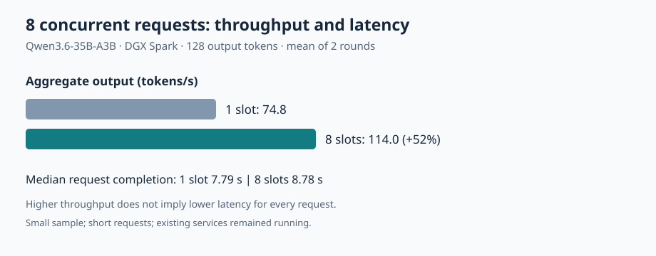

[中文](README.md)

# Running Qwen3.6-35B-A3B on DGX Spark

This directory measures two inference engines and compares llama.cpp with one and eight slots. The speculative-decoding configuration matrix for three prompts is in [llm-inference-perf](../llm-inference-perf/README.md). The protocols differ, so read the token/s figures separately.

How fast can this 35B model run locally on a DGX Spark with a rated memory bandwidth of **273 GB/s**? We measured single-user generation speed and how long the service takes to finish when eight requests arrive at once.

## How Fast Is Generation for One User?

In the short-prompt, single-request test, llama.cpp (MTP2) reached about **87 token/s**, while NInfer (MTP3) reached about **119 token/s**. At these rates, decoding 500 tokens is estimated to take about **4–6 seconds**. Time to first token also depends on prompt processing; with thinking enabled, some generation time may be spent thinking.

Qwen3.6-35B-A3B is a mixture-of-experts model with about 35 billion total language-model parameters and about 3 billion active for each token. Both deployments used quantization and speculative decoding, but their weight formats and serving configurations also differed. Isolating the benefit of MTP requires an on/off comparison with the same configuration. Comparing with an online API would require streaming requests and measurements of time to first token, output speed, and total time; this run tested only local inference.

[From autoregressive to speculative decoding](../../docs/zh/inference/从自回归到投机解码.md) · [Both deployments and full results](../../docs/zh/inference/35B双引擎推理对照.md)

## How Long Do Eight Concurrent Users Wait?

We also compared one and eight serving slots with the same quantized weights and llama.cpp configuration. A slot represents how many requests the same model can advance concurrently. Each round sent eight short requests simultaneously, each generating exactly 128 tokens; each setting was repeated twice.

| Serving slots | Time for all requests to finish | Median completion time per request |
|---|---:|---:|
| 1 slot | about 13.7 seconds | about 7.8 seconds |
| 8 slots | about 9.0 seconds | about 8.8 seconds |



Eight slots finished the batch sooner, with aggregate throughput about **52%** higher, but the median completion time for these requests increased. For batch generation, start with total batch time. For interactive services, also measure time to first token and tail latency.

[Slot comparison and reproduction steps](../../docs/zh/inference/llama.cpp单槽与八槽并发对照.md) · [Run script](scripts/bench_llamacpp_slots.py) · [Per-request data](evidence/)

## Environment and Reproduction

The slot comparison used Linux aarch64, DGX Spark GB10, CUDA, and llama.cpp `0.4.0-dev` (commit `ccc3646`). The script requires Python 3, `nvidia-smi`, a `llama-server` supporting the MTP and `q8_0` KV-cache options used by the script, and Qwen3.6-35B-A3B `UD-Q4_K_M` GGUF weights. These describe this run, not minimum hardware requirements. Prompts are built into the script, so no separate dataset is needed.

Refer to the upstream [CUDA build instructions](https://github.com/ggml-org/llama.cpp/blob/ccc3646/docs/build.md) to try building in a Linux aarch64 environment with NVIDIA drivers, CUDA Toolkit, a C/C++ compiler, CMake, and Git:

```bash
# Run in a new working directory; do not overwrite an existing source directory
git clone https://github.com/ggml-org/llama.cpp.git
cd llama.cpp
git checkout --detach ccc3646
cmake -S . -B build -DCMAKE_BUILD_TYPE=Release -DGGML_CUDA=ON
cmake --build build --config Release --target llama-server -j 4
./build/bin/llama-server --version
./build/bin/llama-server --help
```

This is a reference path based on the reported commit. The original experiment did not record all build options or the CUDA version, so the rebuilt binary cannot be confirmed identical to the historical binary. Before launch, check that `--help` lists the options used by the script. After downloading the `UD-Q4_K_M` model, record its local file hash and source, and reserve memory and disk space as needed. The scripts use only the Python standard library; no third-party Python packages are required.

On 2026-11-14, a CUDA-enabled `llama-server` was built successfully from the `ccc3646` source archive on Linux aarch64 with CUDA Toolkit 13.0.88 and GNU 13.3.0; its `--help` listed the long options used by the script, and the combination completed the model test below. OpenSSL and UI assets were unavailable, so HTTPS and the embedded UI were disabled. The archive lacks Git metadata and the binary reports commit `unknown`; identity with the historical binary cannot be established.

Prepare the engine and model, and make sure local port 19433 is free. Run these commands from the repository root, replacing paths with their actual locations:

```bash
cd experiments/engine-slot-concurrency
export LLAMA_SERVER="/path/to/llama-server"
export MODEL_GGUF="/path/to/Qwen3.6-35B-A3B-UD-Q4_K_M.gguf"
python scripts/bench_llamacpp_slots.py
```

The script starts the one-slot and eight-slot servers in sequence. By default, it writes results, server logs, and resource samples to `.work/bench-output/`; set `BENCH_OUT` or `XL_OUT_DIR` to use another directory. Existing logs and results with the same names may be overwritten; use a new output directory for reruns.

The script samples Linux `MemAvailable` every two seconds; below 18 GiB it terminates the server it launched and stops further tests. Sampling has a delay and cannot trigger when memory readings fail, so this is not a substitute for a device-level memory guard. Check available memory before starting and use external protection appropriate for the device.

The same-named weights are available from [Unsloth's MTP GGUF model repository](https://huggingface.co/unsloth/Qwen3.6-35B-A3B-MTP-GGUF/tree/main). As of 2026-11-13 the GGUF file is listed at 22.7 GB; running also requires additional memory for the KV cache and engine, so this is not a minimum memory requirement. If the model is not already local, install the optional download tool in the experiment directory and download it into a directory you specify that is empty:

```bash
python -m pip install -r requirements.txt
hf download unsloth/Qwen3.6-35B-A3B-MTP-GGUF Qwen3.6-35B-A3B-UD-Q4_K_M.gguf --revision 5bc3e238d916f48a861bac2f8a1990a0e9b7e98d --local-dir /path/to/model-dir
sha256sum /path/to/model-dir/Qwen3.6-35B-A3B-UD-Q4_K_M.gguf
```

[`requirements.txt`](requirements.txt) is only for downloads and does not pin versions; both benchmark clients use the Python standard library. Historical device records used a same-named file from this source, but the slot experiment did not record the weight hash, so it is not possible to confirm the downloaded file is identical. The original full build options were not preserved, so these commands alone cannot guarantee strict reproduction.

On 2026-11-14 the pinned model was downloaded completely. Its size was 22,663,387,424 bytes and its measured SHA-256 was `0b21525e972670ed59e1812e170b27c26355381f0656ecc4e25617ece7dac58b`, matching repository metadata. The historical slot run did not record a weight hash, so identity with its weights remains unknown.

The full script completed on the same date with that model and the rebuilt engine: eight requests per run, 128 generated tokens per request, two repetitions per configuration, and no request errors. At eight concurrent requests, one slot completed the batch in 12.11 and 12.14 seconds, versus 5.55 and 5.47 seconds with eight slots. The median request completion times across both runs were 6.85 and 5.20 seconds, respectively. At concurrency one, the two runs took 13.24 and 12.43 seconds with one slot, and 12.85 and 12.66 seconds with eight slots. These are two-run results for this device, model, and rebuilt engine, not a general speedup or the same measurement as the historical results above. The NInfer two-engine comparison was not rerun.

### NInfer Configuration for the Two-Engine Comparison

The one-slot and eight-slot scripts above run llama.cpp only. The NInfer deployment in the two-engine comparison used the GB10 fork at commit `4c2fc2f9504d2f373c84e896bf18523906a646d7` and `qwen3_6_35b_a3b.ninfer` from the [Qwen3.6-35B-A3B NInfer model](https://huggingface.co/neroued/Qwen3.6-35B-A3B-NInfer/tree/main), listed at 22.8 GB on 2026-11-13. After downloading, calculate its hash with `sha256sum` and compare it with this run's [checksum record](evidence/sha256.txt). The historical run used a context and KV capacity of 32768, maximum concurrency of 8, and FP8 KV precision; MTP3 and DFlash7 were measured separately.

See the [NInfer build instructions](../ninfer-serving/README.en.md#build-the-gb10-fork) for dependencies and steps to build the same fork version. After preparing `NINFER_SRC` as described there, download the model with the [Hugging Face CLI](https://huggingface.co/docs/huggingface_hub/guides/cli) and check its hash:

```bash
python -m pip install -r requirements.txt
hf download neroued/Qwen3.6-35B-A3B-NInfer qwen3_6_35b_a3b.ninfer --local-dir /path/to/model-dir
sha256sum /path/to/model-dir/qwen3_6_35b_a3b.ninfer
```

The [model card](https://huggingface.co/neroued/Qwen3.6-35B-A3B-NInfer) says that the V3 file matching this run's hash already includes MTP and DFlash weights, so a separate draft file is unnecessary. Compare file hashes when using another version. The command below reconstructs the MTP3 entry point from the available configuration and service script for the same fork; it is not the complete original launch command. Run it from this experiment directory, substituting the actual path:

```bash
export NINFER_ARTIFACT=/path/to/model-dir/qwen3_6_35b_a3b.ninfer
"$NINFER_SRC/build-gb10-system-pkg/apps/ninfer-serve" "$NINFER_ARTIFACT" \
  --host 127.0.0.1 --port 19410 --device 0 --model-id qwen3.6-35b-a3b \
  --max-context 32768 --kv-capacity 32768 --max-concurrency 8 --kv-dtype fp8 \
  --spec mtp --draft-tokens 3 --lm-head-draft
```

After the service is ready, run `curl -fsS http://127.0.0.1:19410/v1/models` in another terminal to check it. The measurement entry point is the [concurrent request script](scripts/bench_ninfer_concurrency.py); first inspect its options with `python scripts/bench_ninfer_concurrency.py --help`. For DFlash7, the model card suggests `--spec dflash --draft-tokens 7`, but it describes the current upstream engine. Neither the MTP launch command above nor the DFlash switch has been revalidated on the pinned GB10 fork. Check the options supported by that version and inspect complete logs and results; these instructions do not establish a fresh reproduction. Parameters and measurement protocol are described in the [two-engine comparison](../../docs/zh/inference/35B双引擎推理对照.md).
