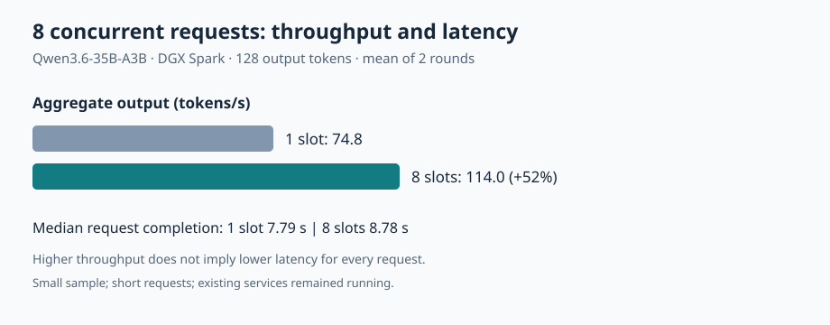

# 在 DGX Spark 上运行 Qwen3.6-35B-A3B

[English](README.en.md)

本目录测两套引擎，以及 llama.cpp 的 1 槽和 8 槽。三个提示词的投机配置矩阵在 [llm-inference-perf](../llm-inference-perf/README.md)，协议不同，两边的 token/s 分开读。

一台标称内存带宽 **273 GB/s** 的 DGX Spark，本地跑这个 35B 模型有多快？我们测了单人生成的速度，也测了 8 个请求同时到来时，服务要多久才能处理完。

## 一个人用，生成有多快？

短提示、单请求测试中，llama.cpp（MTP2）约 **87 token/s**，NInfer（MTP3）约 **119 token/s**。以生成 500 个 token 为例，按这两档速度估算，解码约需 **4–6 秒**。首字等待还取决于提示词处理，开启思考时，部分生成时间也会花在思考上。

Qwen3.6-35B-A3B 是混合专家模型，语言模型总计约 350 亿参数，每个 token 约激活 30 亿。两套部署都用了量化和投机解码，权重格式与服务配置也有差异。单独测量 MTP 的收益需要同配置开关对照。与在线 API 的体验差异则要用流式请求测首字、输出速度和总耗时，这一轮只测了本机。

[从自回归到投机解码](../../docs/zh/inference/从自回归到投机解码.md) · [查看两套部署的配置与完整结果](../../docs/zh/inference/35B双引擎推理对照.md)

## 八个人同时用，要等多久？

我们另用同一份量化权重和同一套 llama.cpp 配置，比较了 1 个与 8 个服务槽位。槽位表示同一个模型能同时推进多少个请求。每轮同时发出 8 个短请求，每个固定生成 128 token，每档重复两轮。

| 服务槽位 | 全部请求完成 | 单个请求完成时间中位数 |
|---|---:|---:|
| 1 槽 | 约 13.7 秒 | 约 7.8 秒 |
| 8 槽 | 约 9.0 秒 | 约 8.8 秒 |



八槽整批完成更快，聚合吞吐约高 **52%**，但这批请求的中位完成时间增加了。批量生成可以先看整批耗时，交互式服务还要测首字等待和高分位延迟。

[查看槽位对照与复现步骤](../../docs/zh/inference/llama.cpp单槽与八槽并发对照.md) · [运行脚本](scripts/bench_llamacpp_slots.py) · [逐请求数据](evidence/)

## 环境与复现

槽位对照使用 Linux aarch64、DGX Spark GB10、CUDA 和 llama.cpp `0.4.0-dev`（commit `ccc3646`）。脚本需要 Python 3、`nvidia-smi`、支持脚本中 MTP 和 `q8_0` KV 缓存参数的 `llama-server`，以及 Qwen3.6-35B-A3B 的 `UD-Q4_K_M` GGUF 权重。以上是本次配置，不是最低硬件要求。提示词内置于脚本，无需额外数据集。

可参考上游 [CUDA 构建说明](https://github.com/ggml-org/llama.cpp/blob/ccc3646/docs/build.md)，在具有 NVIDIA 驱动、CUDA Toolkit、C/C++ 编译器、CMake 和 Git 的 Linux aarch64 环境尝试构建：

```bash
# 在新的工作目录执行，不要覆盖已有源码目录
git clone https://github.com/ggml-org/llama.cpp.git
cd llama.cpp
git checkout --detach ccc3646
cmake -S . -B build -DCMAKE_BUILD_TYPE=Release -DGGML_CUDA=ON
cmake --build build --config Release --target llama-server -j 4
./build/bin/llama-server --version
./build/bin/llama-server --help
```

这是一条按自报提交重建的参考路径；原始实验没有记录完整编译选项及 CUDA 版本，无法确认重建二进制与历史版本相同。启动前检查 `--help` 是否包含脚本所用参数。下载 `UD-Q4_K_M` 模型后记录本地文件哈希及来源，并按需要预留内存和磁盘空间。脚本只用 Python 标准库，无需安装第三方 Python 依赖。

2026-11-14 使用 `ccc3646` 的源码归档，在 Linux aarch64、CUDA Toolkit 13.0.88 和 GNU 13.3.0 下启用 CUDA 编译 `llama-server` 成功；`--help` 列出了脚本使用的长选项，本次也用这些选项完成下述模型测试。构建时缺少 OpenSSL 和 UI 资源，HTTPS 与内嵌界面未启用；归档不含 Git 元数据，程序报告的 commit 为 `unknown`，不能证明与历史二进制相同。

先准备引擎和模型，并确保本地端口 19433 空闲。以下命令从仓库根目录运行，路径换成实际文件位置：

```bash
cd experiments/engine-slot-concurrency
export LLAMA_SERVER="/path/to/llama-server"
export MODEL_GGUF="/path/to/Qwen3.6-35B-A3B-UD-Q4_K_M.gguf"
python scripts/bench_llamacpp_slots.py
```

脚本依次启动 1 槽和 8 槽服务；默认将结果、服务日志和资源采样写入 `.work/bench-output/`，也可用 `BENCH_OUT` 或 `XL_OUT_DIR` 指定目录。已有同名日志和结果可能被覆盖，复跑时请使用新的输出目录。

脚本每两秒读取 Linux 的 `MemAvailable`；低于 18 GiB 时会终止本次启动的服务并停止后续测试。采样有间隔，且内存读取失败时无法触发，不能代替设备级内存守卫；启动前应确认可用内存并设置适合设备的外部保护。

同名权重可从 [Unsloth 的 MTP GGUF 模型仓库](https://huggingface.co/unsloth/Qwen3.6-35B-A3B-MTP-GGUF/tree/main)获取。截至 2026-11-13，仓库列出的该 GGUF 文件为 22.7 GB；运行时还需为 KV 缓存和引擎预留额外内存，这不是最低内存要求。若没有本地模型，可在实验目录安装可选下载工具并准备到自行指定的空目录：

```bash
python -m pip install -r requirements.txt
hf download unsloth/Qwen3.6-35B-A3B-MTP-GGUF Qwen3.6-35B-A3B-UD-Q4_K_M.gguf --revision 5bc3e238d916f48a861bac2f8a1990a0e9b7e98d --local-dir /path/to/model-dir
sha256sum /path/to/model-dir/Qwen3.6-35B-A3B-UD-Q4_K_M.gguf
```

[requirements.txt](requirements.txt) 仅用于下载，未锁版本；两条基准客户端使用 Python 标准库。历史设备记录曾使用此来源的同名文件，但槽位实验没有记录权重哈希，无法确认下载文件与当时完全一致。原始实验的完整构建选项未保存，因此仅凭上述命令无法保证严格复现。

2026-11-14 重新下载固定版本的模型，文件大小为 22,663,387,424 字节，实测 SHA-256 为 `0b21525e972670ed59e1812e170b27c26355381f0656ecc4e25617ece7dac58b`，与模型仓库元数据一致；由于历史槽位实验没有记录哈希，仍不能确认与历史权重完全相同。

同日用该模型及上面重新编译的引擎运行完整脚本：每轮 8 个请求、每个请求生成 128 token，每种组合重复两轮，均无请求错误。8 个请求同时到达时，1 槽的整批耗时分别为 12.11、12.14 秒，8 槽为 5.55、5.47 秒；两轮合计的单请求完成时间中位数分别为 6.85、5.20 秒。单并发时，1 槽两轮分别为 13.24、12.43 秒，8 槽为 12.85、12.66 秒。此结果属于本次设备、模型和重建引擎，只有两轮，不能当作普遍加速比例，也不能与上方历史记录混为同一次测量。NInfer 双引擎对照未在本轮重跑。

### 双引擎对照的 NInfer 配置

上面的单槽与八槽脚本只运行 llama.cpp。双引擎对照中的 NInfer 使用 GB10 fork commit `4c2fc2f9504d2f373c84e896bf18523906a646d7`，以及 [Qwen3.6-35B-A3B NInfer 模型](https://huggingface.co/neroued/Qwen3.6-35B-A3B-NInfer/tree/main)的 `qwen3_6_35b_a3b.ninfer`，该文件在 2026-11-13 列为 22.8 GB；下载后可用 `sha256sum` 计算文件哈希，与本次[校验记录](evidence/sha256.txt)比较。历史运行的上下文和 KV 容量均为 32768，最大并发 8，KV 精度 FP8；MTP3 与 DFlash7 分别测量。

同一版本 fork 的构建依赖和步骤可参考 [NInfer 构建说明](../ninfer-serving/README.md#构建-gb10-fork)。准备好其中的 `NINFER_SRC` 后，可用 [Hugging Face CLI](https://huggingface.co/docs/huggingface_hub/guides/cli) 下载模型并检查哈希：

```bash
python -m pip install -r requirements.txt
hf download neroued/Qwen3.6-35B-A3B-NInfer qwen3_6_35b_a3b.ninfer --local-dir /path/to/model-dir
sha256sum /path/to/model-dir/qwen3_6_35b_a3b.ninfer
```

[模型卡](https://huggingface.co/neroued/Qwen3.6-35B-A3B-NInfer)说明与本次哈希一致的 V3 文件已包含 MTP 和 DFlash 权重，不需另外下载草稿文件；不同版本先比较文件哈希。以下命令按现存配置和同 fork 的服务脚本重建 MTP3 入口，并非原始完整启动命令；从实验目录启动，路径换成实际值：

```bash
export NINFER_ARTIFACT=/path/to/model-dir/qwen3_6_35b_a3b.ninfer
"$NINFER_SRC/build-gb10-system-pkg/apps/ninfer-serve" "$NINFER_ARTIFACT" \
  --host 127.0.0.1 --port 19410 --device 0 --model-id qwen3.6-35b-a3b \
  --max-context 32768 --kv-capacity 32768 --max-concurrency 8 --kv-dtype fp8 \
  --spec mtp --draft-tokens 3 --lm-head-draft
```

服务就绪后，另一个终端运行 `curl -fsS http://127.0.0.1:19410/v1/models` 检查；测量入口为 [并发请求脚本](scripts/bench_ninfer_concurrency.py)，先用 `python scripts/bench_ninfer_concurrency.py --help` 查看参数。DFlash7 可参考模型卡中的 `--spec dflash --draft-tokens 7`，但模型卡对应的是当前上游引擎；上述 MTP 启动命令和 DFlash 切换在固定 GB10 fork 上均尚未重新验证，仍需核对该版本实际支持的参数、完整日志和结果，不能据此声称已从零复现。参数与测量协议见[双引擎对照](../../docs/zh/inference/35B双引擎推理对照.md)。
