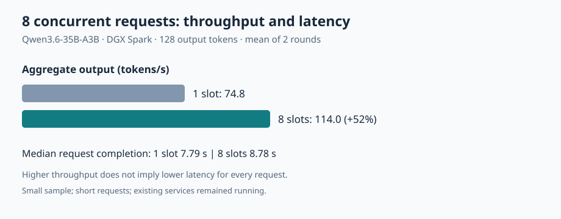

# How many slots should a 35B model use for eight requests on a DGX Spark?

[中文](README.md)

When eight short requests arrive on one DGX Spark, llama.cpp with eight slots completes the batch in about nine seconds, compared with about 13.7 seconds with one slot. The median completion time for an individual request, however, increases from about 7.8 to about 8.8 seconds. Choosing a slot count therefore depends on whether the goal is to finish the whole batch sooner or reduce how long individual users wait.

## How one model handles several requests

A slot is a place where the inference server holds the generation state of a request. With one slot, the first request generates while the others wait in a queue. With eight slots, a single model on the same GPU can interleave progress across multiple requests. This can increase batch throughput, but requests share computation and bandwidth, and more slots also require context cache space for more requests. Slots are not additional GPUs or separate model copies.

## Results

With eight short requests arriving concurrently and each generating 128 tokens, aggregate throughput over two runs was 74.91 / 74.78 tokens/s with one slot and 113.78 / 114.14 tokens/s with eight slots, an increase of about 52%. The full batch took 13.67 / 13.69 seconds with one slot and 9.00 / 8.97 seconds with eight. Early requests completed sooner with one slot; with eight slots, requests completed close to one another. Higher aggregate throughput did not mean every request completed sooner.

| Server slots | Client concurrency | Aggregate throughput, two runs (tokens/s) | Median per-request completion, two runs | Requests per run |
|---|---:|---|---|---:|
| 1 | 1 | 69.71 / 75.07 | 1.815 / 1.700 s | 8 |
| 8 | 1 | 76.46 / 79.35 | 1.630 / 1.621 s | 8 |
| 1 | 8 | 74.91 / 74.78 | 7.774 / 7.808 s | 8 |
| 8 | 8 | 113.78 / 114.14 | 8.848 / 8.702 s | 8 |

Aggregate throughput is the number of tokens actually generated in a run divided by elapsed client time from thread-pool creation and submission until all responses complete. It includes prefill, queueing, and network calls. Per-request completion time is measured from the HTTP request until its full response, including queueing; time to first token was not measured. The two server configurations ran sequentially, not in randomized order, so differences at client concurrency one should not be attributed directly to the slot count.

## Method and reproducible configuration

The test ran on November 6, 2026, on a DGX Spark GB10 with one GPU and unified memory. Both configurations used llama.cpp `0.4.0-dev`, build 1, commit `ccc3646`, the same `Qwen3.6-35B-A3B-UD-Q4_K_M.gguf` weights, CUDA, q8_0 K/V cache, MTP draft length 2, and the same remaining server parameters. The one-slot server used `-np 1 -c 4096`; the eight-slot server used `-np 8 -c 32768`. The target context capacity per slot was therefore the same, while the configured total context capacity increased with slot count; actual KV cache memory was not measured separately. Servers were started separately rather than loading two model copies at once; other services were running on the device throughout the test.

After one smoke request per server, the test ran client concurrency 1 and then 8, twice per setting. Each run used eight different short English prompts, with concurrency controlled by a client thread pool. Requests used `n_predict=128`, `temperature=0`, fixed seeds, `ignore_eos=true`, and `cache_prompt=false`. This holds generation length constant but does not evaluate answer quality.

The [benchmark script](scripts/bench_llamacpp_slots.py) contains the startup parameters, prompts, and request code. Set `LLAMA_SERVER` and `MODEL_GGUF` before running it; it starts the two local server instances sequentially and requires the output directory not to exist. The server will not start if resource monitoring cannot initialize. On monitor failure or low available memory, the script kills the server process it started. When in-flight client requests return still depends on their connections and is not guaranteed to be immediate. A round is recorded only after request count, token count, and interruption checks; `run-status.json` identifies a running, failed, or completed run. Only `complete` means the entire matrix finished; it is written after the monitor exits and its final sample is checked. A forcibly terminated process can leave `running` behind, which must not be treated as complete. [Raw results](docs/evidence/bench-llamacpp-slots-20261106.json) contain per-request results and timings. The GGUF hash and repository revision were not recorded, so the exact weight file revision cannot be established.

The historical summary recorded approximately 46.9 GiB as the lowest available system memory; the individual resource-monitor samples were not retained in the repository, so that minimum cannot be independently recalculated from the published files. The monitoring output did not report an applicable standalone GPU memory figure. Other services remained running and may have affected measurements, so this is not an exclusive-device result. The test servers exited after the run.

## How to use this result, and its limits

For batch summarization, where the application waits for every result in a batch, total batch time can inform configuration choices. For interactive chat, measure both time to first token and full-response latency under representative traffic. A practical starting point is a sweep over 1, 2, 4, and 8 slots using the intended context length and available memory.

The results support a narrower finding: for these fixed short requests, increasing parallel slots for the same model service improved batch aggregate throughput. They do not establish the same benefit for longer contexts, sustained traffic, other sampling settings, or larger workloads. Each setting has only two runs of eight requests; the data cannot establish stable tail latency. Accuracy, peak GPU memory, power consumption, and time to first token were not measured.

An earlier llama.cpp versus NInfer experiment used a 512-token cap, differently quantized models, different context settings, and different speculative configurations. Its figures cannot be combined directly with this table, and the earlier gap cannot be attributed to slot count on this evidence. To compare engines, run a separate test with the model, quantization, and other server settings aligned as closely as possible.
