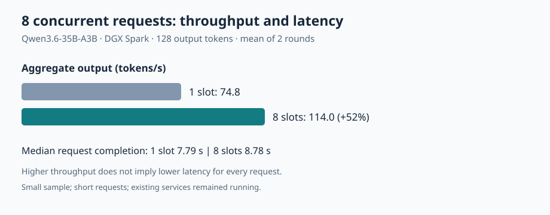

# 一台 DGX Spark 同时收到 8 个请求，35B 模型该开几个槽？

[English](README.en.md)

同一台 DGX Spark 收到 8 个短请求时，llama.cpp 开 8 个槽约 9 秒处理完全部请求，开 1 个槽则要约 13.7 秒。不过，单个请求的中位完成时间反而从约 7.8 秒增至约 8.8 秒。选择槽位时，要先确定你更看重整批处理时间，还是用户各自等多久。

## 一个模型怎样处理多个请求

槽位是推理服务用来保存某个请求生成状态的位置。开 1 个槽时，先到的请求占用槽位生成，其他请求排队。开 8 个槽时，同一张 GPU 上的同一份模型可以交错推进多个请求的生成。这样能提高整批的处理速度，但多个请求共享算力和带宽，开更多槽也需要为更多请求保留上下文缓存。

## 结果

在八个短请求同时到达、每个生成 128 token 的条件下，单槽两轮聚合吞吐为 74.91 / 74.78 token/s，八槽为 113.78 / 114.14 token/s，约提高 52%。每轮完成全部八个请求分别耗时 13.67 / 13.69 秒和 9.00 / 8.97 秒。单槽时较早的请求先完成，八槽时所有请求接近同时完成；因此八槽提高整体吞吐，并不代表每个请求的完成时间都更短。

| 服务槽位 | 客户端并发 | 两轮聚合吞吐 token/s | 两轮每请求完成时间中位数 | 每轮请求数 |
|---|---:|---|---|---:|
| 1 | 1 | 69.71 / 75.07 | 1.815 / 1.700 秒 | 8 |
| 8 | 1 | 76.46 / 79.35 | 1.630 / 1.621 秒 | 8 |
| 1 | 8 | 74.91 / 74.78 | 7.774 / 7.808 秒 | 8 |
| 8 | 8 | 113.78 / 114.14 | 8.848 / 8.702 秒 | 8 |

聚合吞吐是每轮实际生成 token 总数除以线程池创建、提交请求到全部完成的总时间，包含预填充、排队和网络调用。每请求完成时间从发起 HTTP 请求到完整响应，包含排队；未测首 token 时间。两次独立服务依次运行，没有随机交错，C1 差异不应直接归因于槽位。

## 方法和可复现配置

2026-11-06，DGX Spark GB10，单 GPU 统一内存，llama.cpp `0.4.0-dev` build 1 commit `ccc3646`，使用相同 `Qwen3.6-35B-A3B-UD-Q4_K_M.gguf` 权重、CUDA、q8_0 K/V、MTP draft 2 和相同服务参数。单槽为 `-np 1 -c 4096`，八槽为 `-np 8 -c 32768`，因此目标每槽上下文容量相同，配置的总上下文容量随槽位增加；本次没有单独测量 KV 缓存的实际内存占用。两次服务分别启动，没有同时加载两个副本；测试期间设备还有其他服务。

先各运行一个冒烟请求，每组先后测试并发 1 和 8，每档两轮；每轮 8 个不同英文短提示，客户端线程池控制并发。每请求 `n_predict=128`、`temperature=0`、固定 seed、`ignore_eos=true`、`cache_prompt=false`。这让每个请求的生成长度一致，但不评估答案质量。启动参数、提示和请求代码在 [脚本](scripts/bench_llamacpp_slots.py) 中，完整逐请求结果和计时在 [原始数据](docs/evidence/bench-llamacpp-slots-20261106.json) 中。设置环境变量 `LLAMA_SERVER` 和 `MODEL_GGUF` 后运行脚本；它将依次启动两个本地服务实例并要求输出目录尚不存在；资源监控无法初始化时不会启动测试服务。监控异常或可用内存低于阈值时，脚本会终止自己启动的服务进程；客户端请求何时返回仍取决于连接状态，不能保证立即退出。 每轮须通过请求数、token 数和中断状态检查后才写入结果；输出目录中的 `run-status.json` 标明运行中、失败或完成，只有 `complete` 才表示整套矩阵结束，且写入前等待监控线程退出并检查最后一次采样。进程被强制终止等情况下可能残留 `running`，不能将其视为完成。原记录未保存该 GGUF 文件哈希或仓库 revision，无法确认权重文件的精确版本。

历史汇总记录资源监控期间系统可用内存最低约 46.9 GiB；逐次资源监控日志未随仓库保存，无法由仓内数据核算该最低值。监控读取未报告适用的 GPU 独立显存数字；现有服务在测试期间保持启动，可能影响测量，不宜当作独占设备成绩。测试服务在结束后退出。

## 如何使用和边界

如果你的任务是批量生成摘要，常常需要等一批结果全部返回，这次测试的整批耗时可以作为配置参考。如果你在部署交互式聊天，应该用真实流量同时测首字等待时间和完整响应时间。可以从 1、2、4、8 个槽做一轮配置扫描，再结合目标上下文长度和内存占用选值。

这次数据支持：在上述固定短请求场景中，增加同一模型服务的并行槽位提高了批次聚合吞吐。它不证明长上下文、持续流量、其他采样参数或更大负载下都有同样收益。每档仅两轮，每轮 8 个请求，不能据此估算稳定的尾延迟，也没有测准确率、显存峰值、功耗与首 token 延迟。

此前 llama.cpp 对 NInfer 的实验使用 512 token 上限、不同量化模型、不同上下文和投机配置；不能将本实验的数字直接拼入旧表，也不能据此把旧差距归因于槽位。要比较引擎本身，需要另行尽量统一模型、量化和其他服务条件。
