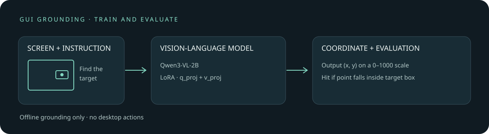

# GUI grounding fine-tuning: predicting an interface location from a screenshot and instruction

[中文](README.md)

When a user asks an interface agent to “open settings,” it first needs to locate the relevant button in a screenshot. This experiment fine-tunes Qwen3-VL-2B-Instruct with LoRA on public GUI screenshots to predict a target coordinate from an image and an English instruction, then compares the base and adapted models on another dataset. It addresses **grounding only**: it does not click or check whether an action succeeded.

On a fixed set of 30 held-out samples on DGX Spark, the base model hit 24 targets and the adapted model hit 25. Two cases changed from miss to hit and one from hit to miss. The sample is small and was not randomly selected, so this demonstrates a runnable workflow, **not reliable improvement in generalization**.



## What the grounding model learns

A sample contains an interface image, an instruction, and a bounding box for the target element. For example, with a 1000 × 800 image and box `[200, 160, 400, 240]`, the center is pixel coordinate `(300, 200)`. Normalizing separately by width and height to the 0–1000 range produces the training answer `(300, 250)`. This is a synthetic example to explain the data structure.

```text
Training input:  screenshot + “find the settings button”
Training target: (300, 250)      # box center, relative coordinates 0–1000
Prediction input: screenshot + “find the settings button”
Prediction output: (x, y)        # a point, not an action or bounding box
Evaluation: point inside the annotated box is a hit; invalid or out-of-range coordinates are misses
```

Evaluation accepts `(x, y)` or `x, y`, including decimals. Unmatched parentheses, other formats and out-of-range coordinates are misses. Summaries reparse the original prediction and check its point and hit flag.

A training manifest record has the following simplified structure. This is synthetic data; `file` points to an image beside the manifest, `sha256` checks its bytes, and the full record also includes source and element details:

```json
{"file":"example.png","sha256":"<image SHA-256>","width":1000,"height":800,"instruction":"Find the settings button","bbox_pixels":[200,160,400,240]}
```

The training script divides the box center by image width and height, multiplies by 1000 and rounds, producing the target string `(300, 250)`. The processor builds model input from the image and instruction; the target string and end token follow the prompt. Prompt positions in the loss labels are set to `-100`, so cross-entropy is computed only for the target and end token. The model outputs token probability distributions, decoded at inference into coordinate text rather than pixel coordinates directly. The holdout field `bbox_xyxy_normalized` represents a box on a 0–1 scale; evaluation divides the generated 0–1000 coordinates by 1000 before the point-in-box test.

The multimodal model encodes the screenshot and instruction, then autoregressively generates coordinate text. LoRA learns low-rank updates while the base weights remain frozen. Here only `q_proj` and `v_proj` in the language model's attention layers are adapted; the vision encoder is not trained. The published training script computes cross-entropy on coordinate tokens and the trailing EOS token, masking the prompt and image tokens. Historical metadata describes only coordinate tokens, so the surviving record cannot establish whether the historical run also included EOS:

$$
\mathcal{L}=-\frac{1}{M}\sum_{t=1}^{M}\log p_{\theta}(y_t\mid I,q,y_{<t}).
$$

$I$ is the screenshot, $q$ the instruction, and $y_t$ the $t$-th target coordinate-text token. Training uses the box center as its single reference, while evaluation accepts any point inside the box; the objectives are therefore not identical.

## Data and results

| Purpose | Source and selection | Data |
|---|---|---|
| Training | [GroundGUI RL](https://huggingface.co/datasets/PrentisAI/GroundGUI_RL) train split; 16 consecutive rows from each of offsets 0, 1000, 2500, 4000, 6000, 8000, 10000, and 12000: 128 samples across 57 apps | Screenshots, English instructions, pixel-coordinate boxes; target location only, not the original action class |
| Held-out evaluation | [ScreenSpot](https://huggingface.co/datasets/bevaya/ScreenSpot) test split; 10 consecutive rows from each of offsets 0, 450, and 900 | Screenshots, English instructions, normalized boxes; 10 each from Windows, iOS, and GitLab |

The dataset cards list MIT and Apache-2.0 licenses respectively; follow upstream terms and any constraints on the data itself. Screenshots can contain account information, so the repository does not include training or evaluation images, annotations, or per-example predictions. Data is downloaded outside the repository; aggregate results and training loss are retained here. No image hashes matched between the sets; a near-duplicate check also found no cross-set images with 64-bit difference-hash distance at most five. This cannot rule out similar interfaces or semantic duplicates. Whether base-model pretraining included these test images is unknown.

| Held-out source | Base hits | LoRA hits |
|---|---:|---:|
| Windows | 10/10 | 10/10 |
| iOS | 9/10 | 9/10 |
| GitLab | 5/10 | 6/10 |
| Total | 24/30 | 25/30 |

The paired difference is +3.3 percentage points. A paired bootstrap over these 30 cases gives an approximate 95% interval of −6.7 to +16.7 percentage points. Consecutive sampling can introduce case dependence, so the interval describes resampling variation within this small set rather than a population accuracy interval; it is not directly comparable to the full ScreenSpot leaderboard. A point-in-box hit is not successful completion of an entire task.

## Reproduction

The recorded run used NVIDIA GB10 and BF16, batch size 1, gradient accumulation 4, 128 samples and 32 parameter updates. AdamW used learning rate 2e-4; LoRA used rank 8, alpha 16, dropout 0.05, and 1,605,632 trainable parameters. Recorded versions were PyTorch 2.14.0+cu130, Transformers 5.16.1, and PEFT 0.20.0. Hardware and software differences can change outputs. [`evidence/metadata.json`](evidence/metadata.json) records environment and elapsed time; `evidence/` also contains training loss and the historical comparison summary.

The commands below target Linux and CUDA. Install a device-compatible PyTorch first, then the remaining dependencies. In the GB10 run, each step checked at least 50 GiB system available memory, and CUDA process memory was limited to 20%. Other devices can set `GUI_MIN_AVAILABLE_GIB`; the observed GB10 headroom is not a universal minimum requirement.

```bash
python -m pip install 'transformers==5.16.1' 'peft==0.20.0' 'accelerate==1.14.0' 'qwen-vl-utils==0.0.14' 'pillow==12.3.0' 'requests==2.34.2' 'huggingface_hub'
export GUI_ROOT="$HOME/gui-grounding-run"  # outside the repository; data may contain personal information
export GUI_MODEL="$HOME/models/Qwen3-VL-2B-Instruct"
mkdir -p "$GUI_ROOT" "$GUI_MODEL"
python -c 'from huggingface_hub import snapshot_download; import os; snapshot_download(repo_id="Qwen/Qwen3-VL-2B-Instruct", revision="89644892e4d85e24eaac8bacfd4f463576704203", local_dir=os.environ["GUI_MODEL"])'
python scripts/gui_train_download.py
python scripts/gui_download.py
python scripts/gui_qwen_eval.py
python scripts/gui_qwen_train.py
GUI_ADAPTER="$GUI_ROOT/qwen3vl-2b-lora-groundcua/adapter" python scripts/gui_qwen_eval.py
python scripts/gui_summarize.py
```

The download scripts read current rows from the dataset service and compute image SHA-256 locally; the service does not pin a revision, so images, instructions, and annotations can change upstream. Scripts alone therefore cannot ensure exact reproduction of the historical data. Training metadata marks the fetched data revision as unknown and records the local manifest SHA-256. Keep that manifest private because it contains image hashes and labels. Historical records cite training revision `6ecc90819dca07dc92d69d6ec8df4a951c9715d2` and evaluation revision `0be08781e2e188582f6131625ae1598d443b4d5d`; these do not establish that a fresh download uses those revisions. The recorded model-weight SHA-256 was `7de1838c87a5349b016c26a1c3f7d2bc400a3d485f95ef39a7059ffd734977a0`.

The base and adapted evaluations use the same prompt, image resize range, and greedy decoding. The evaluation script can resume an interrupted run and checks the data manifest, prompt, and model path against its initial context. Older outputs lack this context and cannot be resumed automatically; use a different `GUI_ROOT`. The summary script checks both evaluations' manifests, prompts, base-model paths, per-case labels, and recorded point-in-box hits. The historical per-case 24/30 → 25/30 records are not public, so the published aggregate cannot be independently recomputed from them. Historical outputs without context cannot pass the newer summary checks, though the [historical aggregate](evidence/qwen3vl-2b-screenspot-comparison.json) remains available.

Path checks do not verify the model weight contents. Do not replace base or adapter weights during a resumed run or between the two evaluations. The training script refuses to overwrite an existing loss file; choose a new `GUI_ROOT` for a fresh experiment. Adapters and private data stay in `GUI_ROOT` and are not automatically copied into the repository.

## Additional 48-example holdout

[See the paired stratified evaluation](docs/holdout-48.en.md): 34/48 baseline hits and 42/48 after fine-tuning; this small sample does not establish population-wide generalization.
