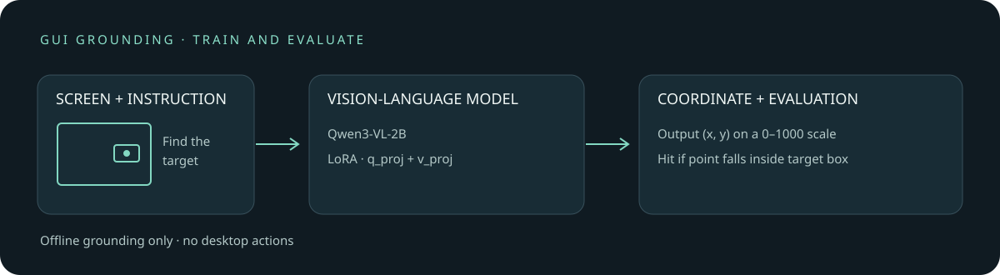

# GUI 定位微调：从截图和指令预测操作位置

[English](README.en.md)

当用户说“打开设置”时，界面智能体首先要在截图里找到目标按钮。本实验以 Qwen3-VL-2B-Instruct 为基座，使用公开 GUI 截图数据训练 LoRA，让模型根据截图和英文指令输出目标坐标，并在另一数据集上比较微调前后结果。它只解决**定位**，不执行点击，也不判断操作是否完成。

在 DGX Spark 上，固定的 30 条留出样本中，基座命中 24 条，微调后命中 25 条。2 条从错变对，1 条从对变错。样本很小且不是随机抽样，结果说明流程可以运行，**不足以证明微调带来可靠的泛化提升**。



## 定位模型学什么

一个样本包括界面图片、用户指令和目标元素的边界框。例如图片尺寸为 1000 × 800，目标框为 `[200, 160, 400, 240]`，其中心是像素坐标 `(300, 200)`；按宽高分别归一化到 0–1000 后，训练答案是 `(300, 250)`。这是说明结构的合成例子。

```text
训练输入：截图 + “找到设置按钮”
训练目标：(300, 250)                    # 标注框中心，相对坐标 0–1000
预测输入：截图 + “找到设置按钮”
预测输出：(x, y)                       # 预测点，而不是动作或边界框
评估规则：预测点落在标注框内即命中；格式错误或坐标越界计未命中
```

多模态模型将截图与指令编码后，自回归生成坐标文本。LoRA 在冻结基座的同时学习注意力投影的低秩增量；这里仅更新语言部分注意力层的 `q_proj` 和 `v_proj`，不训练视觉编码器。公开训练脚本对目标坐标及结尾 EOS token 计算交叉熵，提示词和图像 token 不参与损失；历史元数据仅描述坐标 token，无法从现存记录核实历史运行是否包含 EOS：

$$
\mathcal{L}=-\frac{1}{M}\sum_{t=1}^{M}\log p_{\theta}(y_t\mid I,q,y_{<t})
$$

$I$ 是截图，$q$ 是指令，$y_t$ 是目标坐标文本的第 $t$ 个 token。训练用框中心作为唯一参考答案；评估允许框内任意一点命中，因此两者的目标并不完全相同。

## 数据与结果

| 用途 | 来源和抽样 | 数据结构 |
| --- | --- | --- |
| 训练 | [GroundGUI RL](https://huggingface.co/datasets/PrentisAI/GroundGUI_RL) 的 train split；从偏移 0、1000、2500、4000、6000、8000、10000、12000 各取连续 16 条，共 128 条、57 个应用 | 截图、英文指令、像素坐标框；只取目标位置，不学习原始动作类别 |
| 留出评估 | [ScreenSpot](https://huggingface.co/datasets/bevaya/ScreenSpot) 的 test split；从偏移 0、450、900 各取连续 10 条 | 截图、英文指令、归一化目标框；Windows、iOS、GitLab 各 10 条 |

原数据集卡分别标注 MIT 和 Apache-2.0。使用数据应遵循上游许可及数据本身的使用约束。截图可能包含账号信息，仓库不附训练或评估原图、标注和逐例预测；数据下载到仓库外，仓内保留汇总结果与训练损失。两集合没有相同图片哈希；近重复检查也未发现 64 位差值哈希距离不超过 5 的跨集合图片，但这不能排除相似界面或语义重复。基座预训练集是否包含这些测试图未知。

| 留出来源 | 基座命中 | LoRA 后命中 |
| --- | ---: | ---: |
| Windows | 10/10 | 10/10 |
| iOS | 9/10 | 9/10 |
| GitLab | 5/10 | 6/10 |
| 合计 | 24/30 | 25/30 |

配对差值为 +3.3 个百分点；对这 30 条案例做配对 bootstrap 得到 95% 区间约为 −6.7 至 +16.7 个百分点。连续抽样会引入案例相关性，该区间只描述这一小批案例的重采样波动，不能当作总体准确率区间，也不能与完整 ScreenSpot 排行榜直接比较。落点命中不等于完整任务成功。

## 复现

本次设备为 NVIDIA GB10，模型使用 BF16，训练时 batch size 1、梯度累积 4、128 条样本、32 次参数更新；AdamW 学习率 2e-4，LoRA rank 8、alpha 16、dropout 0.05，可训练参数 1,605,632。训练记录的 Torch 版本为 2.14.0+cu130、Transformers 5.16.1、PEFT 0.20.0；设备和版本不同可能影响输出。`evidence/metadata.json` 保存环境和用时，`evidence/` 另有训练 loss 与对照汇总。

以下命令适用于 Linux / CUDA。先安装适合设备的 PyTorch，再安装依赖。GB10 实测每个步骤均检查系统可用内存至少 50 GiB，进程的 CUDA 内存比例限制为 20%；其他设备可按环境设置 `GUI_MIN_AVAILABLE_GIB`，不应将本次设备余量当成通用最低要求。

```bash
python -m pip install 'transformers==5.16.1' 'peft==0.20.0' 'accelerate==1.14.0' 'qwen-vl-utils==0.0.14' 'pillow==12.3.0' 'requests==2.34.2' 'huggingface_hub'
export GUI_ROOT="$HOME/gui-grounding-run"  # 仓库外，保存可能含个人信息的数据
export GUI_MODEL="$HOME/models/Qwen3-VL-2B-Instruct"
mkdir -p "$GUI_ROOT" "$GUI_MODEL"
python -c 'from huggingface_hub import snapshot_download; import os; snapshot_download(repo_id="Qwen/Qwen3-VL-2B-Instruct", revision="89644892e4d85e24eaac8bacfd4f463576704203", local_dir=os.environ["GUI_MODEL"])'
python scripts/gui_train_download.py
python scripts/gui_download.py
python scripts/gui_qwen_eval.py
python scripts/gui_qwen_train.py
GUI_ADAPTER="$GUI_ROOT/qwen3vl-2b-lora-groundcua/adapter" python scripts/gui_qwen_eval.py
python scripts/gui_summarize.py
```

下载脚本通过数据集服务读取当前行并在本地计算图片 SHA-256；该服务不固定 revision，所以图片、指令和标注可能随上游变化，无法仅凭脚本确保与原实验完全一致。训练元数据对数据 revision 标记为未知，并记录本次本地清单的 SHA-256；清单包含图片哈希与标注，应保留在私有目录。历史实验记录的训练数据 revision 为 `6ecc90819dca07dc92d69d6ec8df4a951c9715d2`，评估数据 revision 为 `0be08781e2e188582f6131625ae1598d443b4d5d`，不能据此断言重新下载的数据来自该版本。模型本次权重 SHA-256 为 `7de1838c87a5349b016c26a1c3f7d2bc400a3d485f95ef39a7059ffd734977a0`。

基座和微调后的评估均使用同一提示词、图片缩放范围及贪心解码。评估脚本可从中断处继续，并检查数据清单、提示词和模型路径是否与启动时一致；旧版脚本生成的结果没有上下文记录，不能自动续跑，应另选 `GUI_ROOT`。汇总脚本会核对两次评估的清单、提示词、基座路径和逐例标注，并根据记录的坐标及标注框检查命中值；历史 24/30 → 25/30 的逐例记录未公开，不能从公开汇总独立复核；历史结果若缺少上下文文件，不能通过新版汇总检查，已公开的历史汇总仍可查看；路径检查不验证模型目录中的权重内容，续跑及两次评估期间不要替换基座或 adapter 权重。训练脚本发现旧 loss 文件时拒绝覆盖，请更换 `GUI_ROOT` 开始新实验。训练输出 adapter 与私有数据保存在 `GUI_ROOT`，不会自动复制到仓库。
