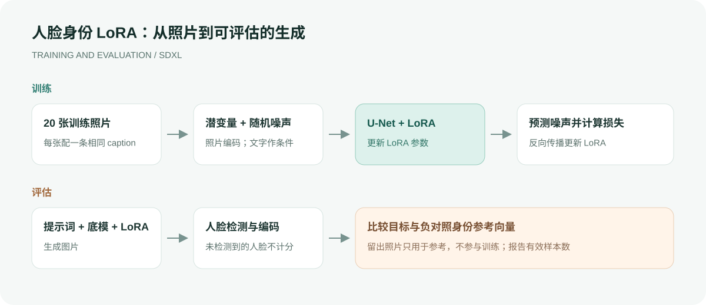

# Face Identity LoRA: Quantifiable Identity Specificity from 20 Photos

This experiment fine-tunes SDXL on photos of one CelebA identity and tests whether a LoRA can generate a target person whose identity is not specific in the base model. Evaluation uses ArcFace similarity with positive and negative controls. The transcribed historical results show a difference between target and negative-control similarity; they do not establish the precisely optimal step count, multi-seed stability, or a unique performance bottleneck. See the [Chinese README](README.md).

## The 1,000-step checkpoint scored 0.3232 for the target and 0.0546 for the negative control

Data came from CelebA identity `celeb_id=14`: 20 training images and 10 test images. For each generated image in which a face was detected, the ArcFace embedding cosine similarity was computed against the target-identity and negative-control test-set prototypes, then averaged. Images without a detected face were excluded from the mean, so valid sample counts are also reported.

The base-model and LoRA controls share the prompt template, seed, and sampler; the LoRA prompt additionally includes a trigger token. The base model generated at 768px and the LoRA at 512px, so their difference cannot be attributed entirely to fine-tuning.



| Generation condition | vs. target | vs. negative control | Resolution | Valid samples |
|---|---:|---:|---:|---:|
| Base model, no LoRA | −0.017 | 0.0249 | 768px | 12 |
| 1,000-step LoRA, peak `vs target` in this scan | **0.3232** | **0.0546** | 512px | 7 |

For the 1,000-step result, the target-minus-negative-control difference within the same generated batch is **0.2686**, a signal that merits replication. The base model and LoRA used different image sizes; do not calculate `0.3232 − (−0.017)` as a net fine-tuning gain. A direct comparison needs a same-resolution baseline.

## Control results: the same generated images were closer to the target reference

The negative control is identity `celeb_id=15`. The 1,000-step images scored 0.3232 against the target and only 0.0546 against the negative control, a net difference of 0.2686. This makes the explanation that the model learned only generic facial features less compelling. Target and negative-control scores use the same generated images, so the base-model resolution mismatch does not affect this comparison.

The positive control is the similarity between real target-identity training photos and the test-set prototype, with mean 0.7159. The 1,000-step generated result is about 45% of this reference under this metric. That ratio describes only this metric in this run; it is not a general measure of “identity learning completion,” and the positive control is not a theoretical upper bound.

The base-model group scored −0.017 for the target and 0.0249 for the negative control. This sample does not show a clear identity preference, but it does not prove that the two means are equal.

## The 178×218 source images limit learnable detail

The 20 training images came from the [CelebA dataset](https://mmlab.ie.cuhk.edu.hk/projects/CelebA.html), using its Hugging Face [Parquet version](https://huggingface.co/datasets/flwrlabs/celeba). CelebA includes face images, identity labels, and attribute annotations. This experiment filters one shard by `celeb_id`, then assigns two out of every three rows to training and one to testing in shard row order. The test set is not used for training. This is a split created for the experiment, not the official dataset split. Source images are 178×218 and are upscaled to 512 for training. Upscaling cannot add details absent from the originals, so source resolution is a known input limitation.

The dataset authors' terms restrict use to non-commercial research and prohibit further distribution of dataset images. Read and follow the [data terms](https://mmlab.ie.cuhk.edu.hk/projects/CelebA.html) when reproducing this work.

Before training, this run checked identity consistency, cross-identity contamination, duplicates, train/test leakage, and face quality, then used the data after manual review of training and test contact sheets. During reproduction, `check_dataset.py` exits nonzero for blocking conditions involving identity outliers, suspected cross-identity contamination, or duplicate/leakage. It also stops if no face can be detected in the training, test, or negative-control split, because the required checks cannot then be completed. Face proportion, pose, and sharpness flags are written to `output/qc/qc.json` and require review alongside the report.

## A training example and model input/output

After export, a training image and a same-name text file form a pair, for example:

```text
data/celeb_14/train/tr_000.jpg
data/celeb_14/train/tr_000.txt    # vkqzm, a photo of a person
data/celeb_14/test/te_002.jpg     # illustrative filename only; held out for evaluation
```

The numbers in filenames come from original shard row numbers; these names only illustrate the structure. During training, an image is encoded as a latent and given sampled noise; the caption is encoded as text conditioning. The U-Net receives the noisy latent, timestep, and text condition, and predicts the noise. The configuration trains only the U-Net LoRA, not the text encoder. The saved artifact is adapter weights, not a standalone full base model.

DDPM noise prediction can be written as the following mean squared error, where $z_t$ is the noisy latent at step $t$, $c$ is the text condition, and $\epsilon$ is the injected random noise:

$$
\mathcal L_{\mathrm{noise}} =
\mathbb E_{z_0,c,\epsilon,t}\!\left[
\left\|\epsilon - \epsilon_{\theta,\phi}(z_t,t,c)\right\|_2^2
\right].
$$

$\theta$ denotes frozen base-model parameters and $\phi$ denotes trainable LoRA parameters. This loss is noise-prediction error, not ArcFace identity similarity; ArcFace is used only for post-training evaluation. The configuration uses a DDPM scheduler and does not explicitly specify a loss type. Current ai-toolkit source defaults to MSE, but the tool version used for the original training is not fixed in public evidence. The equation describes a common implementation for this configuration and cannot be claimed as a term-by-term reconstruction of the historical run. At inference, the model receives a prompt and random initial latent, loads the LoRA, and generates an image step by step. Evaluation then extracts a face embedding and compares it with the held-out identity reference embedding.

## The main configuration uses rank 32, learning rate 1e-4, and 2,000 steps

The historical configuration records a local SDXL variant with the `vkqzm` token added and a frozen text encoder. Its caption was `vkqzm, a photo of a man`. The base weights, token initialization, and full hash were not retained. The current reproduction configuration instead uses the public SDXL base and `a photo of a person`; it is not an exact reconstruction or a same-conditions rerun of the historical training. Tokenization of `vkqzm` in the public base must be checked: the string is not necessarily one token or inert.

- Current reproduction base model: `stabilityai/stable-diffusion-xl-base-1.0`
- LoRA: linear rank 32, alpha 32, network dropout 0.05
- Optimization: AdamW, lr 1e-4, bf16, EMA 0.99, batch size 1
- Training: 2,000 steps (20 images × 100 epochs), checkpoint every 500 steps, caption dropout 0.0
- Current reproduction data: training resolution 512; caption `vkqzm, a photo of a person`
- Evaluation settings for the published results: 30 steps, guidance 7, `dpmsolver++`, seeds `1000+i`; the base-model baseline requested 20 images and each main-configuration scan point requested 10; the LoRA prompt only adds the trigger

Generation parameters are consistent within the checkpoint scan, and all its images are 512px. The separately published base-model baseline was generated at 768px and cannot be directly subtracted from scan results.

## The current sample cannot resolve the 0.0122 difference between 500 and 1,000 steps

| Checkpoint | vs. target | vs. negative control | Net difference | Valid samples |
|---|---:|---:|---:|---:|
| 500 steps | 0.3110 | −0.0004 | **0.3114** | 6 |
| 1,000 steps | **0.3232** | 0.0546 | 0.2686 | 7 |
| 1,500 steps | 0.2518 | 0.0305 | 0.2213 | 9 |
| 2,000 steps | 0.2461 | 0.0331 | 0.2130 | 9 |

Ranked by `vs target`, 1,000 steps is the scan peak; ranked by target-minus-negative-control difference, 500 steps is higher. The difference is sensitive to negative-control variation, and the 500-step negative-control mean is near zero, so the metrics select different checkpoints. `vs target` more directly answers “does it look like the person?” while the net difference checks identity specificity; they should not be conflated as a single ranking criterion.

The `vs target` means at 500 and 1,000 steps differ by only 0.0122 (n=6 versus 7), too little for this sample to distinguish precisely. The 1,000- and 2,000-step means differ by 0.0772 (n=7 versus 9), and the latter part of this scan trends downward. The same seed set was used, but valid images differ across checkpoints. The difference therefore should not be treated as an independent-sample comparison, and it is insufficient to establish overfitting or a uniquely optimal training duration.

## The combined configuration did not exceed 0.3232; training-parameter effects remain unresolved

The second configuration changes training from 2,000 to 800 steps, learning rate from 1e-4 to 5e-5, and caption dropout from 0 to 0.15 at the same time. Its final 800-step adapter scored 0.2623 (n=5) at 512px, below the main configuration's 1,000-step scan peak of 0.3232 (n=7).

This only shows that the combined configuration did not achieve a higher mean in this small-sample evaluation. Because steps, learning rate, and caption dropout all changed together, the effects cannot be attributed separately; this does not support the conclusion that “the bottleneck is not in the training parameters.” Source resolution is a known input limitation, but this experiment did not vary it independently, so its contribution to the result ceiling is unquantified. Future comparisons should change one variable at a time to preserve attribution.

## Generation groups had only 5–12 valid samples; variation across training seeds was not measured

Published results use the fixed generation-seed sequence `1000+i`, but score only images with a detected face: the base-model group requested 20 and had valid n=12; main-configuration scan points requested 10 and had valid n=6–9; combined-configuration points had valid n=5 each. The current script defaults to requesting 20 images per condition and accepts `--n` to change it. Valid sample counts differ across conditions, and face detection affects which images are scored. Differences of 0.01–0.02 between steps should be read with this uncertainty and not used for fine ranking.

The reported checks reflect image-to-image variation for this training run and fixed generation seeds. They do not cover variation across independent training seeds. Results for one identity and one base model do not directly generalize to other identities or models. To compare neighboring checkpoints more carefully, increase generation to at least 50 images per condition, report face-detection rates, and repeat with multiple training seeds.

## Published JSON preserves historical values; current scripts produce new reproduction results

`assets/` contains the workflow diagram. `evidence/` contains `baseline.json`, `checkpoint_scan.json`, and `regularized_scan.json`. These JSON files record results produced before the scripts were refactored and later transcribed as public evidence; their values were not changed. They are not one-click outputs generated directly by the current scripts. Original training logs and historical adapter weights are not included in the public evidence, so the complete training process cannot be independently verified from the transcribed results alone. Current scripts write new results to `output/` and do not overwrite public evidence. The saved JSON lacks per-image negative-control scores, so paired uncertainty for the identity difference cannot be independently recomputed; future runs should preserve both scores for each image.

## Reproduction

Run all commands from `experiments/image-finetune/face-identity-lora/`. The training script also changes to this directory; relative paths in the configuration are resolved from here.

### Environment setup

The commands below use Linux and Bash. The Python code uses type syntax supported since Python 3.10; CPU architectures and dependency combinations have not all been compatibility-tested. The training configuration specifies `cuda:0` and BF16, and the generation script also fixes CUDA and BF16, so the driver, PyTorch CUDA build, and GPU must be compatible, and the GPU must support BF16. Minimum VRAM, RAM, and disk requirements have not been measured. Reserve space for the SDXL base model, CelebA shard, training latent cache, multiple adapter checkpoints, and generated images. GPU is not needed just to export data.

In one data check on Linux aarch64 with Python 3.12, InsightFace 0.7.3, and ONNX Runtime 1.23.2 (CPU), faces were detected in 20/20 target training images and 10/10 target test images exported from the pinned shard. The negative control was included; cross-identity contamination and duplicate checks passed. One of 20 training images was flagged as an identity outlier. The current rule blocks rates above 5%, so the check passed, but flagged samples still require manual review. The run used layered dependencies with conflicts in the base environment; it did not validate a clean installation or training.

Data export requires `pyarrow` and `pillow`; generation and LoRA loading require `torch`, `diffusers`, `transformers`, `accelerate`, `peft`, and `safetensors`; data checks and face scoring require `numpy`, `opencv-python`, `insightface`, and `onnxruntime`. The install script uses CPU ONNX Runtime, so face detection and scoring are not GPU-accelerated; CUDA is used for training and image generation. In a dedicated virtual environment, install the CUDA version appropriate for the device using the [PyTorch installation guide](https://pytorch.org/get-started/locally/), then install the remaining requirements:

```bash
python3 -m venv .venv
source .venv/bin/activate
# Install torch according to the PyTorch installation guide first:
python -m pip install -r requirements.txt
```

You can obtain [ai-toolkit](https://github.com/ostris/ai-toolkit) source with `git clone --recursive https://github.com/ostris/ai-toolkit.git /path/to/ai-toolkit`, then follow that revision's installation instructions and point `AI_TOOLKIT` at `run.py`. Install it in the same Python environment: the training entry point uses `python3` by default, or you can specify an interpreter with `PYTHON`. The ai-toolkit version, data-shard revision, and complete dependency combination used for the original training are not fixed. These steps are an unverified setup starting point and do not guarantee reproduction of the historical training. Record dependency versions, base-model revision, and shard hash when running.

On 2026-11-14, an initial attempt used ai-toolkit commit `438595b78b15bb395d26eb6012702627f4ab1a1d` in a separate Linux aarch64 environment with PyTorch 2.15.0+cu132. Its dependencies passed `pip check` and command-line help displayed, but loading the actual training configuration failed because upstream code imports the missing `torchaudio`; training did not start. The failure shows that `pip check` and a help command alone do not establish training compatibility. The retry with matching versions is recorded below.

Later that day, a separate environment with PyTorch 2.11.0+cu130, torchvision 0.26.0+cu130, torchaudio 2.11.0+cu130, and the same ai-toolkit commit passed `pip check` and completed two SDXL LoRA training steps on CUDA, saving a new adapter. The smoke run used 20 training images, batch size 1, BF16, and disabled sampling. It checks the training path, not the historical 1,000-step result or identity quality; the historical adapter remains unavailable. The toolkit used that commit's `requirements_base.txt`, with diffusers fixed at `c943837899b16cbae2f619b8dd4f7bb6f07dd81a`; constrain the three PyTorch packages while installing the toolkit dependencies so they are not replaced.

The local base-model copy contained only `*.fp16.safetensors`, while this toolkit version looked for names without `.fp16`. The run used a separate model directory with hard links under the default names to the same weights. This is unnecessary when the complete default weight files are available. Verify the model source and file hashes before preparing a copy; do not overwrite existing files.

The following installs the tested GPU package versions; first check system, architecture, and driver compatibility, and install the toolkit dependencies in the same environment:

```bash
python -m pip install torch==2.11.0+cu130 torchvision==0.26.0+cu130 torchaudio==2.11.0+cu130 --index-url https://download.pytorch.org/whl/cu130
AI_TOOLKIT_DIR=/path/to/ai-toolkit
git -C "$AI_TOOLKIT_DIR" checkout 438595b78b15bb395d26eb6012702627f4ab1a1d
git -C "$AI_TOOLKIT_DIR" submodule update --init --recursive
CONSTRAINTS="$(mktemp)"
printf '%s\n' 'torch==2.11.0+cu130' 'torchvision==0.26.0+cu130' 'torchaudio==2.11.0+cu130' > "$CONSTRAINTS"
python -m pip install -c "$CONSTRAINTS" -r "$AI_TOOLKIT_DIR/requirements_base.txt"
python -m pip check
python -c "import torch, torchvision, torchaudio; print(torch.__version__, torchvision.__version__, torchaudio.__version__, torch.cuda.is_available())"
```

Prepare these files:

- Obtain a single shard containing target identity 14 and negative-control identity 15 from the [CelebA Parquet file directory](https://huggingface.co/datasets/flwrlabs/celeba/tree/main/img_align%2Bidentity%2Battr), and pass its path to `--parquet`. The shard must have a `celeb_id` column and an `image` column containing image bytes. The public record does not fix the shard revision, so an arbitrary current shard is not guaranteed to produce the historical 20/10 split.
- Training and generation load the [SDXL base model](https://huggingface.co/stabilityai/stable-diffusion-xl-base-1.0) by default. The first use of the model ID requires access to the model source and caches the weights. Alternatively, set a prepared local base-model path in the training YAML and `SDXL_BASE` separately.
- Obtain `buffalo_l` from the [InsightFace model releases](https://github.com/deepinsight/insightface/releases). Place `w600k_r50.onnx` and `det_10g.onnx` under `~/.insightface/models/buffalo_l/`, or set `FACE_MODELS_DIR` to their directory. Check the usage terms for the model and data; this repository does not redistribute weights or CelebA images.

The following downloads the first training shard at a fixed revision, verifies its hash, and checks identity counts. This revision contains 30 images each for identities 14 and 15, but matching counts alone do not establish that it is the historical shard. Replace `ASSET_ROOT` with a workspace that has enough space. The commands create a new asset directory and write data/model files:

```bash
export ASSET_ROOT=/path/to/workspace
mkdir -p "$ASSET_ROOT"
ASSET_DIR="$(mktemp -d "$ASSET_ROOT/face-assets-XXXXXXXX")" || exit 1
export ASSET_DIR
hf download flwrlabs/celeba 'img_align+identity+attr/train-00000-of-00019.parquet' --repo-type dataset --revision 2d738f56e0e7f925ea36ae7c808ea925264aacec --local-dir "$ASSET_DIR"
export CELEBA_SHARD="$ASSET_DIR/img_align+identity+attr/train-00000-of-00019.parquet"
printf '%s  %s\n' '9f349da30bb755c3af41929270d6c5560121dd09121616980f05cb4e7b00b988' "$CELEBA_SHARD" | sha256sum -c -
python - <<'PY'
import os
from collections import Counter
import pyarrow.parquet as pq
table = pq.read_table(os.environ['CELEBA_SHARD'], columns=['celeb_id'])
counts = Counter(table.column('celeb_id').to_pylist())
print('identity 14:', counts[14], 'identity 15:', counts[15])
PY
```

The following downloads and verifies `buffalo_l` using hashes from the [official InsightFace model registry](https://github.com/deepinsight/insightface/blob/master/server/backend/insightface_server/models/packages.py). These model weights are restricted to non-commercial research use. Install `curl`, `sha256sum`, and `unzip` if your system does not provide them:

```bash
export FACE_MODELS_DIR="$ASSET_DIR/buffalo_l"
mkdir -p "$FACE_MODELS_DIR"
curl -fL https://github.com/deepinsight/insightface/releases/download/model-zoo/buffalo_l.zip -o "$ASSET_DIR/buffalo_l.zip"
printf '%s  %s\n' '80ffe37d8a5940d59a7384c201a2a38d4741f2f3c51eef46ebb28218a7b0ca2f' "$ASSET_DIR/buffalo_l.zip" | sha256sum -c -
unzip -n "$ASSET_DIR/buffalo_l.zip" -d "$FACE_MODELS_DIR"
printf '%s  %s\n' '5838f7fe053675b1c7a08b633df49e7af5495cee0493c7dcf6697200b85b5b91' "$FACE_MODELS_DIR/det_10g.onnx" | sha256sum -c -
printf '%s  %s\n' '4c06341c33c2ca1f86781dab0e829f88ad5b64be9fba56e56bc9ebdefc619e43' "$FACE_MODELS_DIR/w600k_r50.onnx" | sha256sum -c -
```

After installing the dependencies and weights, check GPU availability and script entry points:

```bash
python -c 'import torch; print("torch", torch.__version__, "CUDA", torch.version.cuda, "available", torch.cuda.is_available()); assert torch.cuda.is_available(); print("GPU", torch.cuda.get_device_name(0), "BF16", torch.cuda.is_bf16_supported()); assert torch.cuda.is_bf16_supported()'
python scripts/build_dataset.py --help
python scripts/score_generations.py --help
```

These checks do not load SDXL or run training; passing them does not establish end-to-end compatibility. The script below installs InsightFace / ONNX Runtime in the current Python environment and checks for weights, but does not prepare missing weights. Data export, quality checks, and generation evaluation overwrite same-named files in their target directories. The commands below create new data, training, and evaluation directories for each run; do not reuse an old `FACE_RUN_ROOT`.

### Export, train, and evaluate

```bash
# 0. Use a new directory outside the repository for each run. Set FACE_RUNS_ROOT to a location with enough space.
export FACE_RUNS_ROOT=/path/to/experiment-runs
mkdir -p "$FACE_RUNS_ROOT"
FACE_RUN_ROOT="$(mktemp -d "$FACE_RUNS_ROOT/face-XXXXXXXX")" || exit 1
export FACE_RUN_ROOT
export FACE_DATA_DIR="$FACE_RUN_ROOT/data"
export FACE_TRAIN_DIR="$FACE_RUN_ROOT/train-output"
export FACE_OUT_DIR="$FACE_RUN_ROOT/qc-before"
bash scripts/install_eval_stack.sh

# 1. Export data from a Parquet shard containing both target and negative-control identities
python scripts/build_dataset.py --parquet "$CELEBA_SHARD" --also-negative

# 2. Save a pre-check report separately; the training entry point checks again before starting
python scripts/check_dataset.py

# 3. Create a config for this run, keeping training paths aligned with the checked data
python - <<'PY'
import json, os
from pathlib import Path
source = Path('config/face_identity_lora.yaml').read_text(encoding='utf-8')
replacements = {
    'training_folder: "output/face_identity_lora"':
        'training_folder: ' + json.dumps(os.environ['FACE_TRAIN_DIR']),
    'folder_path: "data/celeb_14/train"':
        'folder_path: ' + json.dumps(str(Path(os.environ['FACE_DATA_DIR']) / 'celeb_14/train')),
}
for old, new in replacements.items():
    if source.count(old) != 1:
        raise SystemExit('Training config format changed; inspect: ' + old)
    source = source.replace(old, new, 1)
with (Path(os.environ['FACE_RUN_ROOT']) / 'train.yaml').open('x', encoding='utf-8') as f:
    f.write(source)
PY
export FACE_OUT_DIR="$FACE_RUN_ROOT/qc-training"
AI_TOOLKIT=/path/to/ai-toolkit/run.py bash scripts/train_lora.sh "$FACE_RUN_ROOT/train.yaml"

# 4. Inspect generated files and replace the following paths with the actual final adapter and checkpoint directory
find "$FACE_TRAIN_DIR" -name '*.safetensors' -print
export FACE_LORA=/path/to/generated-adapter.safetensors
export FACE_CHECKPOINT_DIR=/path/to/generated-checkpoint-directory
export FACE_OUT_DIR="$FACE_RUN_ROOT/evaluation"
python scripts/score_generations.py --size 512 baseline
python scripts/score_generations.py --size 512 lora --lora "$FACE_LORA"
python scripts/score_generations.py --size 512 scan --run-dir "$FACE_CHECKPOINT_DIR"
```

The published base-model baseline is 768px. The reproduction commands generate a new 512px baseline so it matches the LoRA scan; they do not alter the existing 768px result. Use the same `--size` in all three evaluation commands. New results are written to `$FACE_OUT_DIR/baseline/`, `$FACE_OUT_DIR/lora/`, and `$FACE_OUT_DIR/scan/`, respectively. Repeating an evaluation command overwrites files with the same names; use a new `FACE_OUT_DIR` for a new run.

### Environment variable scope

| Variable | Default | Scope |
|---|---|---|
| `FACE_EXP_ROOT` | Current experiment directory | Default root for Python-script data and evaluation outputs |
| `FACE_DATA_DIR` | `$FACE_EXP_ROOT/data` | Data export, data checks, evaluation references, and pre-training checks |
| `FACE_MODELS_DIR` | `~/.insightface/models/buffalo_l` | RetinaFace and ArcFace weight location |
| `FACE_OUT_DIR` | `$FACE_EXP_ROOT/output` | Data-check and evaluation outputs; not the training YAML output directory |
| `FACE_TARGET_ID` | `14` | Target identity for export, checks, and evaluation |
| `FACE_NEGATIVE_ID` | `15` | Negative-control identity for export, checks, and evaluation |
| `FACE_TRIGGER` | `vkqzm` | Trigger in data captions and evaluation prompts |
| `SDXL_BASE` | `stabilityai/stable-diffusion-xl-base-1.0` | Base model for evaluation scripts; does not rewrite the training YAML |
| `AI_TOOLKIT` | `~/ai-toolkit/run.py` | ai-toolkit training entry point |

`train_lora.sh` does not write environment variables back into YAML. Both training configs currently hard-code the data path `data/celeb_14/train`, their respective `training_folder`, and the base model `model.name_or_path`. Therefore, setting `FACE_DATA_DIR`, `FACE_OUT_DIR`, or `SDXL_BASE` alone does not change the corresponding paths actually used by ai-toolkit training. To change training data, output, or base model, edit the selected YAML directly and adjust evaluation `--lora`, `--run-dir`, and evaluation `SDXL_BASE` accordingly.

## Directory structure

```text
config/
  face_identity_lora.yaml              2,000 steps / lr 1e-4 / caption dropout 0
  face_identity_lora_regularized.yaml  800 steps / lr 5e-5 / caption dropout 0.15
assets/                                Original workflow diagram
evidence/                              Transcribed metric JSON
scripts/
  face_lib.py            Shared paths, generation parameters, and ArcFace similarity computation
  build_dataset.py       Export identities, split alternately, and write captions and manifest
  check_dataset.py       Blocking data checks and face-quality report
  install_eval_stack.sh  Install evaluation dependencies and check weights
  train_lora.sh          ai-toolkit training entry point with pre-training data checks
  score_generations.py   Generate and score baseline / lora / scan
```

Data is re-exported from CelebA by `build_dataset.py`; the commands on this page write data, training, and evaluation artifacts into a newly created `FACE_RUN_ROOT`.
