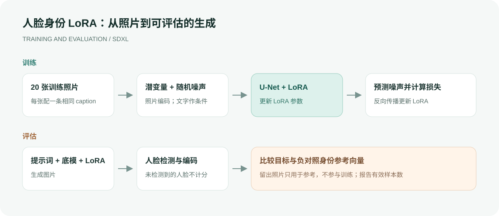

# 人脸身份 LoRA：20 张照片建立可量化的身份特异性

[English](README.en.md)

本实验用 CelebA 单人照片微调 SDXL，检验 LoRA 能否生成底模未表现出身份特异性的
目标人物。评估使用 ArcFace 相似度和正、负对照。历史转录数据呈现了目标与负对照的相似度差异；
不用于认定精确最优步数、多种子训练稳定性或唯一性能瓶颈。

## 1000 步检查点对本人 0.3232，对负对照 0.0546

数据来自 CelebA 身份 `celeb_id=14`，共 20 张训练图、10 张测试图。对每张检测到
人脸的生成图，分别计算其与目标身份、负对照身份测试集原型的 ArcFace embedding
余弦相似度，再取均值；未检测到人脸的图片不计入均值，因此表中同时列出有效样本数。

底模和 LoRA 对照共用提示词模板、seed 与采样器，LoRA 提示词额外加入 trigger token。
底模输出为 768px，LoRA 输出为 512px；两者的差异不能全部归因于微调。



| 生成条件 | vs 本人 | vs 负对照 | 生成分辨率 | 有效样本数 |
|---|---:|---:|---:|---:|
| 底模，无 LoRA | −0.017 | 0.0249 | 768px | 12 |
| 1000 步 LoRA，本次 `vs target` 峰值 | **0.3232** | **0.0546** | 512px | 7 |

1000 步结果在同一批生成图内对本人与负对照的净差为 **0.2686**，显示针对目标身份
的相似度差异，是需要复测的信号。底模与 LoRA 的生成尺寸不同，不能计算 `0.3232 − (−0.017)` 并把它
解释为微调的净提升；直接比较需使用同分辨率基线。

## 对照结果：同一批生成图更接近目标身份参考

负对照使用另一个身份 `celeb_id=15`。1000 步生成图对本人为 0.3232，对负对照仅
0.0546，净差 0.2686。这降低了「只学到通用人脸特征」对结果的解释力；
目标与负对照分数来自同一批图，不涉及底模基线的分辨率差异。

正对照是目标身份真实训练照片与测试集原型的相似度，均值 0.7159。1000 步生成结果
约为这个参照值的 45%，仍低于真实照片之间的相似度。该比例只描述本次指标下的差距，
不是通用的「身份学习完成度」，正对照也不是理论上界。

底模组对本人与负对照分别为 −0.017 和 0.0249。当前样本
未显示明确的身份偏向，但这不等于证明两个均值完全相同。

## 178×218 源图限制了可学习的细节

20 张训练图来自 [CelebA 数据集](https://mmlab.ie.cuhk.edu.hk/projects/CelebA.html) 的
Hugging Face [Parquet 版本](https://huggingface.co/datasets/flwrlabs/celeba)。CelebA 包含人脸照片、身份和属性标注；本实验从一个分片中按 `celeb_id` 筛选身份，
按分片行顺序每 3 张取 2 张训练、1 张测试，测试集不进入训练。这是实验自建划分，
不等同于数据集官方划分。源图为 178×218，训练时放大到 512；
放大不会补充源图中不存在的细节，因此源图分辨率是本次输入的明确限制。

数据集原作者的协议限制非商业研究使用，并禁止进一步分发数据集图片；复现时应自行
阅读并遵守[数据使用协议](https://mmlab.ie.cuhk.edu.hk/projects/CelebA.html)。

本次数据经过身份一致性、跨身份污染、重复与训练/测试泄漏、人脸质量检查，并在
人工查看训练、测试联系表后用于训练。复现时，`check_dataset.py` 会对身份离群率、
疑似跨身份污染和重复/泄漏的阻断条件返回非零退出码；训练、测试或负对照集无法检测到
人脸时也会退出，因为此时无法完成所需检查。人脸占比、姿态与清晰度标记
写入 `output/qc/qc.json`，需要结合报告复核。

## 一条训练样本和模型的输入输出

数据导出后，一张训练图片与一个同名文本文件构成一对，例如：

```text
data/celeb_14/train/tr_000.jpg
data/celeb_14/train/tr_000.txt    # vkqzm, a photo of a person
data/celeb_14/test/te_002.jpg     # 仅示意文件命名，留出供评估
```

文件名中的数字由分片原始行号决定，以上只展示结构。训练时，图片被编码为潜变量并
加入采样噪声，caption 经文本编码后作为条件；U-Net 接收含噪潜变量、时间步和文字
条件，输出对噪声的预测。配置只训练 U-Net 的 LoRA，不训练文本编码器；保存的是
adapter 权重，不是一份独立的完整底模。

DDPM 的噪声预测可以写成下面的均方误差，其中 $z_t$ 是第 $t$ 步的含噪潜变量，
$c$ 是文字条件，$\epsilon$ 是注入的随机噪声：

$$
\mathcal L_{\mathrm{noise}} =
\mathbb E_{z_0,c,\epsilon,t}\!\left[
\left\|\epsilon - \epsilon_{\theta,\phi}(z_t,t,c)\right\|_2^2
\right].
$$

$\theta$ 表示冻结的底模参数，$\phi$ 表示可训练的 LoRA 参数。这里的损失是噪声
预测误差，不是 ArcFace 身份相似度；ArcFace 只用于训练后的评估。配置使用 DDPM
调度器且未显式指定损失类型；当前 ai-toolkit 源码默认 MSE，但原训练所用工具版本
未在公开证据中固定，因此上式解释该配置的常见实现，不能断言逐项还原历史运行。
预测时，模型接收提示词与随机初始潜变量，加载 LoRA 后逐步生成图像；评估再从
生成图中提取人脸向量，与留出身份参考向量比较。

## 主配置采用 rank 32、lr 1e-4 和 2000 步

历史配置记载使用了一个已加入 `vkqzm` 词元的本地 SDXL 版本，训练时冻结文本编码器；
当时的 caption 是 `vkqzm, a photo of a man`。底模权重、词元初始化方式与完整哈希
没有保留。下方当前复现配置改用公开 SDXL 底模和 `a photo of a person`，因此不能视为
严格重建历史训练，也不能直接当作同条件复测。
`vkqzm` 在当前公开底模的 tokenizer 中如何分词需要实际检查，不能假定它是单个词元
或对模型没有影响。

- 当前复现配置底模：`stabilityai/stable-diffusion-xl-base-1.0`
- LoRA：linear rank 32、alpha 32、network dropout 0.05
- 优化：AdamW，lr 1e-4，bf16，EMA 0.99，batch size 1
- 训练：2000 步（20 张 × 100 epoch），每 500 步保存，caption dropout 0.0
- 当前复现配置数据：训练分辨率 512，caption 为 `vkqzm, a photo of a person`
- 公开结果的评估口径：30 步、guidance 7、`dpmsolver++`，seed 为 `1000+i`；
  底模基线请求 20 张，主配置扫描每轮 10 张；LoRA 提示词仅增加 trigger

检查点扫描内部的生成参数一致，分辨率均为 512px。公开底模基线单独在 768px 下
生成，不能与扫描结果直接相减。

## 当前样本分不出 500 与 1000 步的 0.0122 差距

| 检查点 | vs 本人 | vs 负对照 | 净差 | 有效样本数 |
|---|---:|---:|---:|---:|
| 500 步 | 0.3110 | −0.0004 | **0.3114** | 6 |
| 1000 步 | **0.3232** | 0.0546 | 0.2686 | 7 |
| 1500 步 | 0.2518 | 0.0305 | 0.2213 | 9 |
| 2000 步 | 0.2461 | 0.0331 | 0.2130 | 9 |

按 `vs target` 排序，1000 步是扫描峰值；按「对本人减去对负对照」的净差排序，
500 步更高。净差对负对照的波动敏感，500 步的负对照均值接近 0，因此两个指标会
选出不同检查点。`vs target` 更直接对应「像不像本人」，净差则用于检查身份特异性，
两者不应混为同一个排序标准。

500 与 1000 步的 `vs target` 均值只差 0.0122（n=6 对 7），当前样本不足以精细
区分二者。1000 与 2000 步相差 0.0772（n=7 对 9），本次扫描中后段均值下降；
生成使用同一组 seed，且不同检查点的有效图片不完全相同，不能按独立样本直接解释
差异，也不足以证明过拟合或确定唯一最优训练量。

## 组合配置未超过 0.3232，也不能排除训练参数的影响

第二组配置同时把训练量从 2000 步改为 800 步、学习率从 1e-4 改为 5e-5、caption
dropout 从 0 改为 0.15。其 800 步最终 adapter 在 512px 下得到 0.2623（n=5），
没有超过主配置的 1000 步扫描峰值 0.3232（n=7）。

这组结果只说明该组合配置在本次小样本评估中没有取得更高均值。步数、学习率和
caption dropout 同时变化，无法分别归因，也不能据此推出「瓶颈不在训练参数」。
源图分辨率是已知的输入限制，但实验没有单独操纵源图分辨率，尚不能量化它对结果
上限的独立贡献。后续若要保持归因清晰，应一次只改变一个变量。

## 生成组只有 5–12 张有效样本，训练 seed 间波动未测

公开结果使用固定的生成 seed 序列 `1000+i`，但只对检出人脸的图片计分：底模组
请求 20 张、有效 n=12；主配置扫描每轮 10 张、有效 n=6–9；组合配置各点有效 n=5。
当前脚本默认每个条件请求 20 张，可用 `--n` 调整。不同条件的有效样本数不相同，
人脸检出本身也会影响可计分样本的构成。步间 0.01–0.02 的差异应结合这一不确定度
阅读，不宜据此精细排序。

文中的检验反映本次训练和固定生成 seed 下已计分图片的波动，未覆盖重新训练时的
seed 间差异；单一身份、单一底模的结果也不直接代表其他身份或模型。若要进一步
比较相邻检查点，可增加每个条件的生成数至 50 张以上、报告人脸检出率，并补充多个
训练 seed 的重复结果。

## 公开 JSON 保留原实验数值，当前脚本生成新的复现结果

`assets/` 保存流程图，`evidence/` 保存 `baseline.json`、`checkpoint_scan.json`、
`regularized_scan.json`。这些 JSON 所记结果产生于脚本重构前，随后转录为公开证据
文件，数值未改；它们不是当前版本脚本直接生成的一键复现产物。原始训练日志与历史 adapter 权重未随公开证据保存，不能仅凭转录结果独立核实完整训练过程。当前脚本会把新结果
写入 `output/`，不覆盖公开证据。已保存的 JSON 没有逐图负对照分数，无法独立复算
身份净差的配对不确定度；重新实验应保留同一图片的两个分数。

## 复现

以下命令均从本实验目录 `experiments/image-finetune/face-identity-lora/` 执行；
训练脚本也会切换到该目录，配置中的相对路径以该目录为基准。

### 环境准备

下面的命令以 Linux 和 Bash 为例。Python 代码使用了 3.10 起支持的类型语法；
CPU 架构及各依赖组合尚未完成兼容性验证。训练配置使用 `cuda:0` 和 BF16，
生成脚本也固定使用 CUDA 和 BF16，因此需要驱动、PyTorch CUDA 版本与 GPU 匹配，
且 GPU 支持 BF16。显存、内存和磁盘的最低要求未测定：须为 SDXL 底模、CelebA
分片、训练 latent 缓存、多个 adapter 检查点和生成图片预留空间。仅导出数据不需要 GPU。

在 Linux aarch64、Python 3.12、InsightFace 0.7.3 和 ONNX Runtime 1.23.2（CPU）
的一次检查中，固定分片导出的目标身份训练和测试图片分别有 20/20、10/10 张检出人脸，
负对照参与检查，跨身份污染与重复检查通过。1/20 张训练图被标记为身份离群；当前
规则在离群率超过 5% 时阻断，因此检查通过，但仍须人工复核标记样本。本次使用分层
依赖环境，基础环境存在依赖冲突；这不是从零安装或训练的验证。

数据导出需要 `pyarrow`、`pillow`；生成和 LoRA 加载需要 `torch`、`diffusers`、
`transformers`、`accelerate`、`peft` 和 `safetensors`；数据检查和人脸计分需要
`numpy`、`opencv-python`、`insightface` 和 `onnxruntime`。安装脚本使用的是 CPU 版
ONNX Runtime，不能把人脸检测与计分当成 GPU 加速；CUDA 供训练与图像生成使用。
先在独立虚拟环境中按 [PyTorch 安装指南](https://pytorch.org/get-started/locally/)
安装适合设备的 CUDA 版本，再安装其余依赖：

```bash
python3 -m venv .venv
source .venv/bin/activate
# 按 PyTorch 安装指南安装 torch 后：
python -m pip install -r requirements.txt
```

可先用 `git clone --recursive https://github.com/ostris/ai-toolkit.git /path/to/ai-toolkit` 获取 [ai-toolkit](https://github.com/ostris/ai-toolkit) 源码，再按该版本的安装说明处理自身依赖，并将
`AI_TOOLKIT` 指向 `run.py`。请在同一 Python 环境中完成安装：训练入口默认使用
`python3`，也可通过 `PYTHON` 指定解释器。原训练使用的 ai-toolkit 版本、数据分片
revision 和完整依赖组合未固定；上述安装步骤是未经端到端验证的准备起点，不能保证
还原历史训练。实际运行后应记录依赖版本、底模 revision 和分片哈希。

2026-11-14 首次在 Linux aarch64 的独立环境中尝试 ai-toolkit 提交 `438595b78b15bb395d26eb6012702627f4ab1a1d`，PyTorch 为 2.15.0+cu132；安装其依赖后 `pip check` 通过，命令行帮助可显示。但加载实际训练配置时，上游代码导入未安装的 `torchaudio` 而退出，训练未开始。这个失败说明不能仅凭 `pip check` 或帮助命令判断训练可用；下文记录了另换匹配版本后的重试。

同日另建隔离环境后，使用 PyTorch 2.11.0+cu130、torchvision 0.26.0+cu130、torchaudio 2.11.0+cu130 和上述 ai-toolkit 提交，`pip check` 通过，SDXL 在 CUDA 上完成了 2 步 LoRA 训练并保存新的 adapter。短测使用 20 张训练图片、batch size 1、BF16 和关闭采样的配置；它验证训练链路，不代表历史 1000 步结果或身份效果已复现，历史 adapter 仍未找回。训练工具链使用该提交的 `requirements_base.txt`，其中 diffusers 固定到 `c943837899b16cbae2f619b8dd4f7bb6f07dd81a`；安装时应约束三项 PyTorch 包，避免被其他依赖替换。

本次底模副本只有 `*.fp16.safetensors` 文件，而该工具版本默认寻找不带 `.fp16` 的名称。我们在单独的底模目录为相同权重建立了不带后缀的硬链接后训练；如果使用完整的默认权重文件，则无需此步骤。准备副本时应先核验模型来源与文件哈希，避免覆盖已有文件。

以下是本次基础 GPU 环境的安装版本示例；实际需先确认系统、架构和驱动支持，并在同一环境安装上述工具链依赖：

```bash
python -m pip install torch==2.11.0+cu130 torchvision==0.26.0+cu130 torchaudio==2.11.0+cu130 --index-url https://download.pytorch.org/whl/cu130
AI_TOOLKIT_DIR=/path/to/ai-toolkit
git -C "$AI_TOOLKIT_DIR" checkout 438595b78b15bb395d26eb6012702627f4ab1a1d
git -C "$AI_TOOLKIT_DIR" submodule update --init --recursive
CONSTRAINTS="$(mktemp)"
printf '%s\n' 'torch==2.11.0+cu130' 'torchvision==0.26.0+cu130' 'torchaudio==2.11.0+cu130' > "$CONSTRAINTS"
python -m pip install -c "$CONSTRAINTS" -r "$AI_TOOLKIT_DIR/requirements_base.txt"
python -m pip check
python -c "import torch, torchvision, torchaudio; print(torch.__version__, torchvision.__version__, torchaudio.__version__, torch.cuda.is_available())"
```

准备以下文件：

- 从 [CelebA Parquet 文件目录](https://huggingface.co/datasets/flwrlabs/celeba/tree/main/img_align%2Bidentity%2Battr)取得包含目标身份 14 和负对照身份 15 的同一个分片，并将其路径传给 `--parquet`。分片须有 `celeb_id` 和含图片字节的 `image` 列；公开记录未固定分片 revision，无法保证任意当前分片都得到历史上的 20/10 划分。
- 训练与生成默认加载 [SDXL 底模](https://huggingface.co/stabilityai/stable-diffusion-xl-base-1.0)。首次使用模型 ID 时需要访问模型源并缓存权重，也可在训练 YAML 和 `SDXL_BASE` 中分别指定已准备好的本地底模路径。
- 从 [InsightFace 模型发布页](https://github.com/deepinsight/insightface/releases)获取 `buffalo_l`，把其中的 `w600k_r50.onnx` 和 `det_10g.onnx` 放在 `~/.insightface/models/buffalo_l/`，或将 `FACE_MODELS_DIR` 指向这两个文件所在目录。检查模型及数据的使用条件；本仓不转存权重或 CelebA 图片。

以下命令下载固定版本的第一个训练分片、校验哈希并检查身份数量。该版本中身份 14 和
15 各有 30 张，但无法仅凭数量证明它与历史分片相同。替换 `ASSET_ROOT`
为有足够空间的工作目录，脚本会在其中创建新的素材目录；这些命令会产生数据和模型文件：

```bash
export ASSET_ROOT=/path/to/workspace
mkdir -p "$ASSET_ROOT"
ASSET_DIR="$(mktemp -d "$ASSET_ROOT/face-assets-XXXXXXXX")" || exit 1
export ASSET_DIR
hf download flwrlabs/celeba 'img_align+identity+attr/train-00000-of-00019.parquet' --repo-type dataset --revision 2d738f56e0e7f925ea36ae7c808ea925264aacec --local-dir "$ASSET_DIR"
export CELEBA_SHARD="$ASSET_DIR/img_align+identity+attr/train-00000-of-00019.parquet"
printf '%s  %s\n' '9f349da30bb755c3af41929270d6c5560121dd09121616980f05cb4e7b00b988' "$CELEBA_SHARD" | sha256sum -c -
python - <<'PY'
import os
from collections import Counter
import pyarrow.parquet as pq
table = pq.read_table(os.environ['CELEBA_SHARD'], columns=['celeb_id'])
counts = Counter(table.column('celeb_id').to_pylist())
print('identity 14:', counts[14], 'identity 15:', counts[15])
PY
```

以下命令下载并校验 `buffalo_l`。哈希来自 [InsightFace 官方模型清单](https://github.com/deepinsight/insightface/blob/master/server/backend/insightface_server/models/packages.py)；模型权重限非商业研究使用。`curl`、`sha256sum` 和 `unzip` 是系统工具，如系统未提供需先安装：

```bash
export FACE_MODELS_DIR="$ASSET_DIR/buffalo_l"
mkdir -p "$FACE_MODELS_DIR"
curl -fL https://github.com/deepinsight/insightface/releases/download/model-zoo/buffalo_l.zip -o "$ASSET_DIR/buffalo_l.zip"
printf '%s  %s\n' '80ffe37d8a5940d59a7384c201a2a38d4741f2f3c51eef46ebb28218a7b0ca2f' "$ASSET_DIR/buffalo_l.zip" | sha256sum -c -
unzip -n "$ASSET_DIR/buffalo_l.zip" -d "$FACE_MODELS_DIR"
printf '%s  %s\n' '5838f7fe053675b1c7a08b633df49e7af5495cee0493c7dcf6697200b85b5b91' "$FACE_MODELS_DIR/det_10g.onnx" | sha256sum -c -
printf '%s  %s\n' '4c06341c33c2ca1f86781dab0e829f88ad5b64be9fba56e56bc9ebdefc619e43' "$FACE_MODELS_DIR/w600k_r50.onnx" | sha256sum -c -
```

安装完以上依赖和权重后，先检查 GPU 与脚本入口：

```bash
python -c 'import torch; print("torch", torch.__version__, "CUDA", torch.version.cuda, "available", torch.cuda.is_available()); assert torch.cuda.is_available(); print("GPU", torch.cuda.get_device_name(0), "BF16", torch.cuda.is_bf16_supported()); assert torch.cuda.is_bf16_supported()'
python scripts/build_dataset.py --help
python scripts/score_generations.py --help
```

这些检查不加载 SDXL 或执行训练，成功也不代表整套训练和评估兼容。下方脚本会在
当前 Python 环境安装 InsightFace / ONNX Runtime，并检查权重，不会准备缺失的权重。
数据导出、质量检查和生成评估会覆盖目录内的同名文件。下方命令为每次运行创建新的数据、训练与评估目录；不要复用旧的 `FACE_RUN_ROOT`。

### 导出、训练与评估

```bash
# 0. 每次运行使用新的仓库外目录，先将 FACE_RUNS_ROOT 替换为有足够空间的目录
export FACE_RUNS_ROOT=/path/to/experiment-runs
mkdir -p "$FACE_RUNS_ROOT"
FACE_RUN_ROOT="$(mktemp -d "$FACE_RUNS_ROOT/face-XXXXXXXX")" || exit 1
export FACE_RUN_ROOT
export FACE_DATA_DIR="$FACE_RUN_ROOT/data"
export FACE_TRAIN_DIR="$FACE_RUN_ROOT/train-output"
export FACE_OUT_DIR="$FACE_RUN_ROOT/qc-before"
bash scripts/install_eval_stack.sh

# 1. 从包含目标与负对照身份的 parquet 分片导出数据
python scripts/build_dataset.py --parquet "$CELEBA_SHARD" --also-negative

# 2. 单独保存预检查报告，训练入口还会再执行一次检查
python scripts/check_dataset.py

# 3. 为这次运行创建配置，训练路径与检查所用数据保持一致
python - <<'PY'
import json, os
from pathlib import Path
source = Path('config/face_identity_lora.yaml').read_text(encoding='utf-8')
replacements = {
    'training_folder: "output/face_identity_lora"':
        'training_folder: ' + json.dumps(os.environ['FACE_TRAIN_DIR']),
    'folder_path: "data/celeb_14/train"':
        'folder_path: ' + json.dumps(str(Path(os.environ['FACE_DATA_DIR']) / 'celeb_14/train')),
}
for old, new in replacements.items():
    if source.count(old) != 1:
        raise SystemExit('训练配置格式已改变，请检查: ' + old)
    source = source.replace(old, new, 1)
with (Path(os.environ['FACE_RUN_ROOT']) / 'train.yaml').open('x', encoding='utf-8') as f:
    f.write(source)
PY
export FACE_OUT_DIR="$FACE_RUN_ROOT/qc-training"
AI_TOOLKIT=/path/to/ai-toolkit/run.py bash scripts/train_lora.sh "$FACE_RUN_ROOT/train.yaml"

# 4. 查看本次产生的文件，并将下面两个路径替换为实际的最终 adapter 和检查点目录
find "$FACE_TRAIN_DIR" -name '*.safetensors' -print
export FACE_LORA=/path/to/generated-adapter.safetensors
export FACE_CHECKPOINT_DIR=/path/to/generated-checkpoint-directory
export FACE_OUT_DIR="$FACE_RUN_ROOT/evaluation"
python scripts/score_generations.py --size 512 baseline
python scripts/score_generations.py --size 512 lora --lora "$FACE_LORA"
python scripts/score_generations.py --size 512 scan --run-dir "$FACE_CHECKPOINT_DIR"
```

公开底模基线是 768px；复现命令重新生成 512px 基线，是为了让新基线与 LoRA 扫描
同口径，而不是改写已有的 768px 结果。三个评估命令应使用相同的 `--size`，新结果
分别写入 `$FACE_OUT_DIR/baseline/`、`$FACE_OUT_DIR/lora/` 与 `$FACE_OUT_DIR/scan/`。同一评估命令重复执行会覆盖同名输出，重跑时须另设新的 `FACE_OUT_DIR`。

### 环境变量的作用范围

| 变量 | 默认值 | 作用范围 |
|---|---|---|
| `FACE_EXP_ROOT` | 当前实验目录 | Python 脚本的数据与评估输出默认根目录 |
| `FACE_DATA_DIR` | `$FACE_EXP_ROOT/data` | 数据导出、数据检查、评估参照；训练脚本的开训前检查 |
| `FACE_MODELS_DIR` | `~/.insightface/models/buffalo_l` | RetinaFace 与 ArcFace 权重位置 |
| `FACE_OUT_DIR` | `$FACE_EXP_ROOT/output` | 数据检查与评估产物，不是训练 YAML 的输出目录 |
| `FACE_TARGET_ID` | `14` | 数据导出、检查与评估的目标身份 |
| `FACE_NEGATIVE_ID` | `15` | 数据导出、检查与评估的负对照身份 |
| `FACE_TRIGGER` | `vkqzm` | 数据 caption 与评估提示词中的 trigger |
| `SDXL_BASE` | `stabilityai/stable-diffusion-xl-base-1.0` | 评估脚本的底模，不改写训练 YAML |
| `AI_TOOLKIT` | `~/ai-toolkit/run.py` | ai-toolkit 训练入口 |

`train_lora.sh` 不会把环境变量写回 YAML。两个训练配置目前固定了数据目录
`data/celeb_14/train`、各自的 `training_folder` 和底模 `model.name_or_path`。
因此，单独设置 `FACE_DATA_DIR`、`FACE_OUT_DIR` 或 `SDXL_BASE` 不会改变 ai-toolkit
实际训练时使用的对应路径。需要更换训练数据、训练输出或训练底模时，应直接编辑
所选 YAML，并同步调整评估命令的 `--lora`、`--run-dir` 与评估用 `SDXL_BASE`。

## 目录结构

```
config/
  face_identity_lora.yaml              2000 步 / lr 1e-4 / caption dropout 0
  face_identity_lora_regularized.yaml  800 步 / lr 5e-5 / caption dropout 0.15
assets/                                自绘流程图
evidence/                              转录的指标 JSON
scripts/
  face_lib.py            共享路径、生成参数与 ArcFace 相似度计算
  build_dataset.py       导出身份、交替划分、写 caption 与 manifest
  check_dataset.py       数据阻断检查与人脸质量报告
  install_eval_stack.sh  安装评估依赖并校验权重
  train_lora.sh          ai-toolkit 训练入口，开训前检查数据
  score_generations.py   baseline / lora / scan 生成与评分
```

数据由 `build_dataset.py` 从 CelebA 重新导出；本页命令将数据、训练与评估产物写入新建的 `FACE_RUN_ROOT`。
