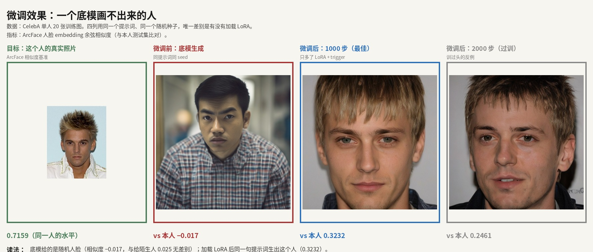
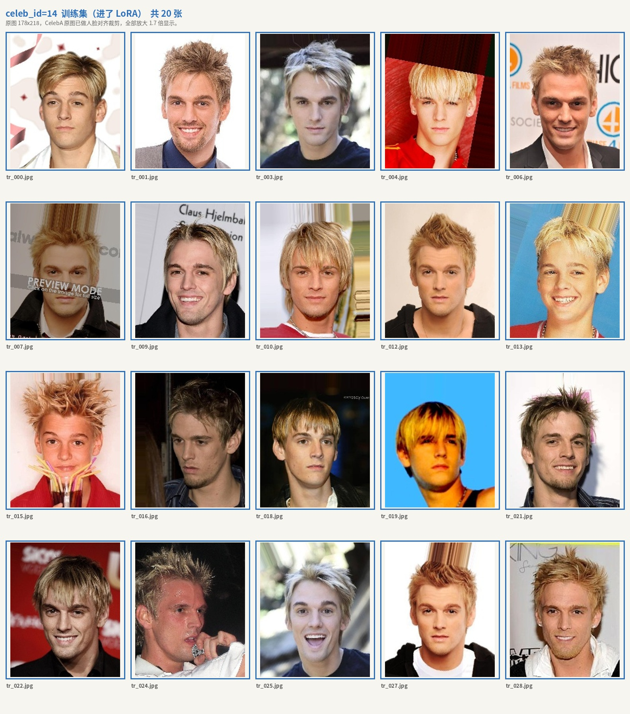

# 人脸身份 LoRA 微调实验

> 用 20 张照片让 SDXL 底模学会画一个它本来画不出来的人。这里写清测什么、
> 结论是什么、数字怎么来的。

## 20 张照片把相似度从 −0.017 拉到 0.3232

数据：CelebA 单人身份（`celeb_id=14`），20 张训练 / 10 张测试。下面四列共用同一
提示词模板、同一随机种子、同一采样器，唯一差别是有没有挂 LoRA。

相似度 = 生成图与本人测试集的 ArcFace embedding 余弦相似度。



| 生成方式 | vs 本人 | 分辨率 | 说明 |
|---|---|---|---|
| 底模（无 LoRA） | **−0.017** | 768px | 画出来的是另一个人 |
| 微调后 1000 步（最佳检查点） | **0.3232** | 512px | 同一个人 |
| 微调后 2000 步（过训） | 0.2461 | 512px | 训练过量的反例 |
| 参照：这个人自己的照片之间 | 0.7159 | 原图 | 「同一个人」的水平线 |

**前两行不能直接相减。** 底模基线在 768px 生成，检查点扫描在 512px 生成。分辨率
影响 ArcFace 可用的像素量，所以 0.3232 与 −0.017 之间的差距里含有分辨率的贡献，
不能全部算作微调的效果。

同一分辨率内部的比较不受影响：500 / 1000 / 1500 / 2000 步都在 512px 下测，净差
（同一批生成图对本人 vs 对他人的相似度之差）也在同一批图内部计算。要让底模基线与
微调结果同口径，用 `score_generations.py baseline --size 512` 生成 512px 基线；
脚本会拒绝把不同分辨率的两个数并列成一个差值。

## 两个对照排除「脸本来就像」的假阳性

评估同时算两个对照，原始数据在 `docs/evidence/baseline.json` 与
`checkpoint_scan.json`：

- **负对照**：同一批微调后的生成图，与另一个人的相似度只有 0.0546——模型学到的
  是这个特定身份，不是一张通用的人脸。0.3232 与 0.0546 的净差 0.27。
- **正对照**：这个人自己的训练集 vs 测试集相似度 0.7159，是「同一个人」的上界。
  微调后 0.3232 约为上界的 45%——方向对，但没学满，这也是下一步的靶子。

底模对这一身份的输出与对陌生人无法区分（−0.017 vs 0.0249），说明靶子是真的：
提示词描述不出一张具体的脸，而 20 张照片的 LoRA 可以。

两个对照都在同一批生成图内部比较，因此不受上面那个分辨率差异影响。

## 源图 178×218，放大到 512 训练

20 张训练图全部来自 CelebA（HuggingFace `flwrlabs/celeba`），按 `celeb_id` 切出、
交替切分，测试集不进训练。训练时放大到 512——源数据本身撑不住更高清晰度，这是
实验的主要瓶颈。



训练前对数据做过审查：身份一致性、跨身份污染、重复与训练/测试泄漏、质量四项机器
检查全部通过（`check_dataset.py`，不过审非零退出），训练集与测试集联系表经人工
目检后才开训。

## 训练配置：rank 32、lr 1e-4、2000 步

- 底模：SDXL base
- LoRA：linear rank 32 / alpha 32 / dropout 0.05，lr 1e-4 adamw，bf16，EMA 0.99
- 步数 2000（20 张 × 100 epoch），save_every 500
- 训练分辨率 512（源图 178×218）
- caption：`vkqzm, a photo of a person`
- 评估：同提示词模板（仅多 trigger）、同 seed（1000+i）、同采样器、同分辨率

## 微调有效，但只学到正对照的 45%

底模对该身份的输出与陌生人无法区分（−0.017 vs 0.0249），微调后 0.3232，与负对照的
净差 0.27。方向是对的，但 0.3232 对正对照 0.7159 只有约 45%——没学满。检查点扫描
每轮生成 10 张，人脸检出 6 到 9 张（1000 步 7 张），检出率本身也说明生成的人脸还不
够稳。

## 瓶颈是源图分辨率，不是训练参数

检查点扫描 500 / 1000 / 1500 / 2000 步 → 0.3110 / 0.3232 / 0.2518 / 0.2461，1000 步
见顶后下滑，是过拟合。第二组实验降 lr、减步数、加 caption dropout 想压过拟合，结果
反而略降（800 步 0.2623）——说明限制不在训练参数。原图仅 178×218，放大训练时
LoRA 学到的是插值模糊，这个上限不是调参能突破的。

## 步间 0.01 量级的差异超出样本量能区分的范围

按 `vs target` 选最佳步数是 1000 步（0.3232），按 `net gain`（对本人减去对他人）
则是 500 步（+0.3114），两个指标不一致。原因是负对照本身在 ±0.05 间浮动，而 500 步
那批图的负对照恰好接近 0。取 1000 步的理由是 `vs target` 更直接对应「像不像这个人」，
且 1500 / 2000 步的下降是单调的，峰值位置比具体差值可靠。

样本量是这份结论最大的软肋：每行 5 到 12 张图，标准差 0.05 量级，步与步之间
0.01 到 0.02 的差别不足以下判断。要更硬的结论，应把每步生成数提到 50 张以上。

下一步：换 1024² 数据源（如 CelebA-HQ）或同一身份更多张，重跑同口径评估。

## 复现

环境：Python 3.10+、CUDA GPU、[ai-toolkit](https://github.com/ostris/ai-toolkit)。

```bash
# 0. 评估栈：onnxruntime + insightface，并检查 ArcFace 权重是否就位
bash scripts/install_eval_stack.sh

# 1. 数据：从 HF parquet 切出一个身份，交替划分训练/测试，写训练 caption
python scripts/build_dataset.py --parquet /path/to/celeba_shard0.parquet --also-negative

# 2. 审查：四项机器检查，不过审非零退出（train_lora.sh 会自动再跑一遍）
python scripts/check_dataset.py

# 3. 训练（配置见 config/face_identity_lora.yaml）
AI_TOOLKIT=/path/to/ai-toolkit/run.py bash scripts/train_lora.sh

# 4. 评估：底模基线 → 微调后 → 全检查点扫描（三者必须同 --size）
python scripts/score_generations.py baseline --size 512
python scripts/score_generations.py lora --size 512 --lora output/face_identity_lora/face_identity_lora.safetensors
python scripts/score_generations.py scan --size 512 --run-dir output/face_identity_lora
```

路径都走环境变量，不写死在脚本里：

| 变量 | 默认值 | 说明 |
|---|---|---|
| `FACE_EXP_ROOT` | 本仓检出目录 | 实验根目录 |
| `FACE_DATA_DIR` | `$FACE_EXP_ROOT/data` | 数据根，下面按 `celeb_<id>/{train,test}` 组织 |
| `FACE_MODELS_DIR` | `~/.insightface/models/buffalo_l` | ArcFace 两个 onnx 的位置 |
| `FACE_OUT_DIR` | `$FACE_EXP_ROOT/output` | 评估产物与图片 |
| `FACE_TARGET_ID` | `14` | 被测身份 |
| `FACE_NEGATIVE_ID` | `15` | 负对照身份 |
| `SDXL_BASE` | `stabilityai/stable-diffusion-xl-base-1.0` | 底模，本地路径或 HF id |
| `AI_TOOLKIT` | `~/ai-toolkit/run.py` | ai-toolkit 入口 |

评估栈：ArcFace `w600k_r50.onnx`（R50，512 维）+ RetinaFace `det_10g.onnx`，
onnxruntime + insightface。两个权重从 InsightFace `buffalo_l` 发布包获取，
本仓不转存。

## 目录结构

```
config/
  face_identity_lora.yaml              2000 步 / lr 1e-4 / 无 caption dropout
  face_identity_lora_regularized.yaml  800 步 / lr 5e-5 / dropout 0.15（对过拟合的尝试）
docs/evidence/                         对比图、训练/测试集、原始 metrics JSON
scripts/
  face_lib.py            共享：路径解析、生成参数、ArcFace 编码器、相似度统计
  build_dataset.py       切出身份、交替划分、写 caption、生成 manifest
  check_dataset.py       四项机器检查，不过审以非零码退出
  install_eval_stack.sh  安装评估栈并校验权重
  train_lora.sh          ai-toolkit 训练入口，开训前跑一遍数据检查
  score_generations.py   三个子命令：baseline / lora / scan
```

`data/` 与 `output/` 不入库：数据由 `build_dataset.py` 从 CelebA 重新导出，
评估产物按 run 可重新生成。
