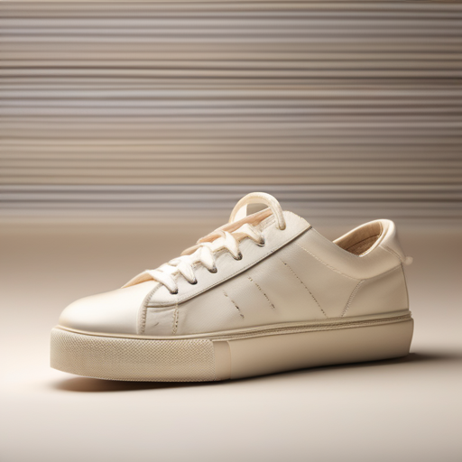
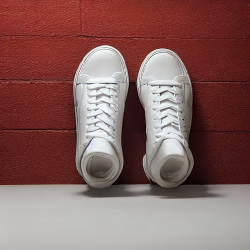
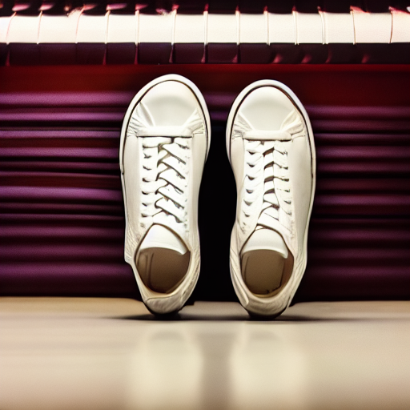

# Adapting a smaller text-to-image model with synthetic product images

English | [简体中文](README.md)

Product imagery often needs consistent backgrounds, lighting and composition. Can a larger model generate image–caption pairs that help adapt a smaller model to this setting? This experiment publishes the prompts, run records and scoring procedure so readers can reconstruct the data and examine the training approach.

**Status:** Teacher images, student training and held-out generation are complete. One independent AI reviewer scored anonymized thumbnails. The student is supervised on teacher-generated images; this does not match the teacher's internal features, noise predictions or output distribution, and is not inference-step distillation. Training completion alone does not establish a quality improvement.

## What was run

On one DGX Spark GPU, we generated 64 teacher training images and 32 held-out teacher images. The student LoRA trained for 400 optimizer steps in FP16, with batch size 1, gradient accumulation 4 and gradient checkpointing; the recorded training time was 5 minutes 52 seconds. Not all training images were manually reviewed, so some may violate their captions.

The teacher revision was `462165984030d82259a11f4367a4eed129e94a7b`; the student revision was `451f4fe16113bff5a5d2269ed5ad43b0592e9a14`. The LoRA SHA-256 was `aae5734d3ecaab8570bdc87f13189f4ed273c60a0b46110e634f7473b7c09fb7`; its weights are not distributed here. Minimum recorded system available memory was 70.14 GiB; other services were present, so this is not model-exclusive memory.

[Training log](evidence/train-output.txt) · [Memory log](evidence/train-memory.txt) · [Teacher training metadata](evidence/teacher-train-metadata.jsonl) · [Teacher held-out metadata](evidence/teacher-heldout-metadata.jsonl) · [Generation configuration](evidence/teacher-run-manifest.json)

## Held-out comparison

The teacher, original student and adapted student each generated one image for each of the same 32 held-out prompts and seeds. A reviewer who had not participated in generation scored the 96 images using anonymized IDs. For one sneaker prompt requesting a single shoe on an ivory background, the teacher produced one shoe, while both student outputs contained two shoes on darker backgrounds. This example cannot establish overall performance.

| Teacher | Student before | Student after |
| --- | --- | --- |
|  |  |  |

Generation records: [teacher](evidence/teacher-heldout-metadata.jsonl), [student before](evidence/student-before-metadata.jsonl), [student after](evidence/student-after-metadata.jsonl).

### Anonymized thumbnail review

The reviewer reported not seeing the identity mapping before scoring. Eight contact sheets displayed 12 images each, with the longest side at most 290 pixels. The object criterion required both correct category and a single object; the background criterion covered color and a seamless background. Subject completeness and obvious artifacts were scored separately. A single AI review is sensitive to thumbnails, subjective thresholds and the reviewing model; it is not an independent human preference test or an objective ranking.

| Review item | Teacher | Student before | Student after |
| --- | ---: | ---: | ---: |
| Object and count correct | 23/32 | 24/32 | 27/32 |
| Background correct | 11/32 | 13/32 | 15/32 |
| Subject complete | 25/32 | 21/32 | 26/32 |
| Obvious artifact present | 14/32 | 12/32 | 7/32 |

For the paired student comparison, object and count improved in 6 cases and regressed in 3; background improved in 3 and regressed in 1; completeness improved in 7 and regressed in 2; obvious artifacts disappeared in 6 and appeared in 1. The remaining pairs were unchanged on each criterion; no scores were missing. These are observations from 32 controlled prompts and one seed per prompt. Train and held-out prompts share a template, so the differences cannot establish generalization to other products, prompts or human preferences, nor isolate the effect of a distillation method.

[Exploratory category and paired analysis](PAIRED-ANALYSIS.md) notes that the net increase in object scores was concentrated in cameras; its small-sample and post-hoc limitations apply. [Individual scores](evidence/review-scores.csv), [identity key](evidence/review-key.json), [summary](evidence/review-summary.json), and [anonymized thumbnail sheets](figures/review-contact-sheets/) permit a coarse audit. The sheets were recreated after review and are not the originals used by the reviewer; thumbnail size and JPEG compression hide details. The full-resolution images and weights are not published.

Recompute the review summary:

```bash
python scripts/summarize_blind_review.py --review evidence/review-scores.csv \
  --key evidence/review-key.json --out review-summary.json
```

## Teacher examples and models

An example training prompt asks for a ceramic mug on an ivory background in soft daylight. The generated subject is recognizable, but the background is grayish: teacher-generated images are not perfect ground truth.


| Role | Model | Rationale |
| --- | --- | --- |
| Teacher | [Stable Diffusion XL 1.0 base](https://huggingface.co/stabilityai/stable-diffusion-xl-base-1.0) | Larger text-to-image model; its base can be used without a refiner |
| Student | [Stable Diffusion 1.5](https://huggingface.co/stable-diffusion-v1-5/stable-diffusion-v1-5) | Smaller base adapted with LoRA on generated image–caption pairs |

The architectures differ; teacher images are training data, not direct noise-prediction targets. Their model cards specify CreativeML Open RAIL++-M and CreativeML Open RAIL-M respectively. Check the actual version's license and use restrictions for models, adapters and outputs. The SD 1.5 hosting repository describes itself as a mirror; verify the downloaded revision.

## Data and design

We wrote English product-photography prompts and generated images rather than downloading third-party photographs. Training uses 8 object categories × 4 backgrounds × 2 lighting conditions, or 64 prompts. The held-out set uses 4 different object categories with the same backgrounds and lighting, or 32 prompts. Objects do not overlap across splits, but the shared template and scene components restrict this to a controlled object-transfer test. One fixed seed is used per prompt; identical seed integers do not produce equivalent noise trajectories across model architectures.

The teacher generates one image for each training prompt; only those images train the student LoRA. Each held-out prompt is generated by all three conditions at the same image size, number of steps and guidance. The architectures may use different default schedulers, which must be recorded. Keep training and evaluation images separate and blind the reviewer to model identities. Inspect training outputs and document any exclusions using a predefined rule; do not silently select favorable images.

[Data and reproducibility notes](DATA-AND-REPRODUCIBILITY.md) link the exact prompt lists, recorded configurations and missing material. Full training images, full evaluation images, LoRA weights, the complete dependency lock and the training-script commit are unavailable, so the historical run cannot be reproduced exactly from the public record.

## Reproduce the workflow

Run commands from this experiment directory. Generation and training require CUDA, PyTorch, diffusers, transformers, accelerate, datasets, peft and Pillow. Pin model revisions, dependencies and the diffusers training-script commit for a new run; replace placeholders below with actual paths and revisions. The generator refuses an existing output directory to prevent stale images contaminating a new run.

```bash
python scripts/make_prompts.py --out data/prompts
python scripts/generate.py --model stabilityai/stable-diffusion-xl-base-1.0 \
  --revision MODEL_COMMIT --prompts data/prompts/train.jsonl --out data/train
python scripts/generate.py --model stabilityai/stable-diffusion-xl-base-1.0 \
  --revision MODEL_COMMIT --prompts data/prompts/heldout.jsonl --out results/teacher
python scripts/generate.py --model stable-diffusion-v1-5/stable-diffusion-v1-5 \
  --revision MODEL_COMMIT --prompts data/prompts/heldout.jsonl --out results/student-before
```

After reviewing the training images, run the [Diffusers text-to-image LoRA example](https://github.com/huggingface/diffusers/tree/main/examples/text_to_image) using a local snapshot of the pinned student revision. Its scheduler loading does not pass a revision in the training script described here, so a local snapshot avoids resolving a different version offline.

```bash
accelerate launch train_text_to_image_lora.py \
  --pretrained_model_name_or_path /path/to/student-snapshot \
  --train_data_dir data/train --image_column image --caption_column text \
  --resolution 512 --train_batch_size 1 --gradient_accumulation_steps 4 --gradient_checkpointing \
  --max_train_steps 400 --learning_rate 1e-4 --mixed_precision fp16 \
  --checkpointing_steps 200 --seed 42 --output_dir runs/student-lora
python scripts/generate.py --model stable-diffusion-v1-5/stable-diffusion-v1-5 \
  --revision MODEL_COMMIT --lora runs/student-lora --prompts data/prompts/heldout.jsonl \
  --out results/student-after
```

Prepare a blinded review and keep the mapping away from the reviewer. Both the review output directory and the identity-key path must be new; use new paths after an interruption to avoid overwriting existing scores.

For a new review, add `--images review/blind/images` to `summarize_blind_review.py` to compare the anonymous image bytes with the private key's SHA-256 hashes; write the summary to a new path. This verifies image consistency, not reviewer independence or correctness. The published historical key contains no image hashes, so that check cannot verify the historical review.

```bash
python scripts/prepare_review.py --results results --out review/blind --key review/identity-key.json
python scripts/summarize_review.py --review review/blind/review.csv \
  --key review/identity-key.json --out review/summary.json
```

For each image, mark object correctness, background correctness, completeness and obvious artifacts as 1, 0 or blank when indeterminate. Report counts, missing outputs and disagreements; compare matched prompts and retain failed generations. Archive the new images, versions, weights, training logs and review records separately.

## Follow-up experiments

**Camera prompts.** After the original post-hoc observation, eight new prompts with two seeds each were compared across the three conditions. A single AI thumbnail reviewer rated both the original and adapted student 16/16 on one recognizable camera, so the earlier increase did not repeat on that measure. This is a small exploratory test: [prompts, paired scores and contact sheets](camera-followup/README.md).

**Teacher versus student-generated data.** With the same training budget for a camera-image task, a single AI thumbnail reviewer rated the teacher-data model against the self-generated-data model as improved in 3 pairs, worse in 5 and unchanged in 8 on the primary single-camera measure. No teacher-data advantage was observed in this test. The generation pipelines differed in model, scheduler and software version, so the comparison does not isolate model size. See the [design, scores and illustration](teacher-data-control/README.en.md).

## References

- [SDXL model card and license](https://huggingface.co/stabilityai/stable-diffusion-xl-base-1.0)
- [Stable Diffusion 1.5 model card and license](https://huggingface.co/stable-diffusion-v1-5/stable-diffusion-v1-5)
- [Diffusers text-to-image training guide](https://huggingface.co/docs/diffusers/training/text2image)

[Teacher-data development gate](teacher-advantage-check/README.en.md): 24 of 32 pairs were valid and the stated gate was not met, so this training run was stopped.

[1024px teacher screening](native-teacher-check/README.en.md): 25 of 32 pairs were valid, with 5 teacher and 0 baseline successes; the gate failed and this round did not proceed to training.
