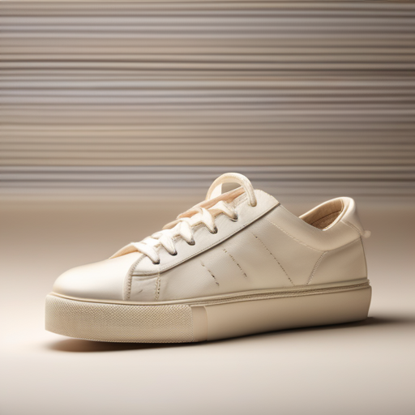
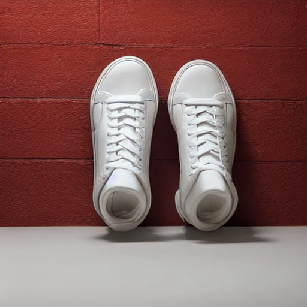

# 用合成商品图适配轻量文生图模型

商品展示需要统一的背景、灯光和构图。这个实验研究：能否让大模型生成场景化图文样本，再用它们微调较小模型，使其更适合生成统一风格的商品图。这里公开提示词、运行记录和复算方法，供读者重新构建数据并检验同类训练流程。

**状态：教师样本、学生训练和留出图已完成；一名独立 AI 评审完成匿名图片评分。** 本实验是用教师生成数据进行学生监督微调，不直接匹配教师网络的中间特征、噪声预测或概率分布；它也不是针对推理步数的蒸馏。是否提升必须由独立评估决定。

## 本次运行记录

DGX Spark 单卡上生成了 64 张教师训练图与 32 张教师留出图，学生 LoRA 使用 fp16、批大小 1、梯度累积 4、梯度检查点训练 400 个优化步，用时 5 分 52 秒。训练完成只能说明流程跑通，不能单凭训练损失判断画质是否提升。样本尚未全部人工审核；训练图中可能含不符合提示词的内容。

教师 revision 为 462165984030d82259a11f4367a4eed129e94a7b，学生 revision 为 451f4fe16113bff5a5d2269ed5ad43b0592e9a14。LoRA 权重 SHA-256 为 aae5734d3ecaab8570bdc87f13189f4ed273c60a0b46110e634f7473b7c09fb7；权重未随仓库分发。训练最低系统可用内存为 70.14 GiB；设备上另有常驻服务，因此不应把这个数字等同于模型独占内存。

[训练记录](evidence/train-output.txt) · [内存记录](evidence/train-memory.txt) · [教师训练样本清单](evidence/teacher-train-metadata.jsonl) · [教师留出清单](evidence/teacher-heldout-metadata.jsonl) · [生成环境与采样配置](evidence/teacher-run-manifest.json)

## 留出对象对照

三组各对 32 条相同的留出提示词和种子生成图片。独立 AI 评审按匿名编号查看全部 96 张图片；下面展示一组另行目视检查的例子。

对两组样例的直接观察：第一条运动鞋提示要求单只鞋和象牙色背景；教师图是一只鞋，学生微调前后都生成了两只鞋且背景偏暗。香水瓶示例中，学生微调前后均生成了瓶子，但两张背景都偏灰而非象牙色。这只是对两条提示词的目视描述，不能说明整体模型优劣。

同一条运动鞋提示词，按教师、学生微调前、学生微调后的顺序排列：

| 教师 | 学生微调前 | 学生微调后 |
|---|---|---|
|  |  |  |

教师、学生微调前、学生微调后的生成记录分别见 [教师](evidence/teacher-heldout-metadata.jsonl)、[学生微调前](evidence/student-before-metadata.jsonl)和[学生微调后](evidence/student-after-metadata.jsonl)。

## 留出图的匿名评审

一名未参与生成的 AI 评审按随机匿名编号检查 96 张图，对每个提示词的三个输出分别打分；评审者称评分前未查看模型身份映射；评分时使用 8 张接触表，每张展示 12 图，每图最长边不超过 290 像素。对象项同时要求类别正确且数量为一，背景项要求颜色和无缝背景符合提示；主体完整和明显伪影分别统计，伪影越少越好。单次 AI 目视评分受缩略图、主观阈值与评审模型影响，微小文字、轻微畸变和精确颜色可能漏判，不能视为独立人类质量评价或客观画质排名。

| AI 评审项目 | 教师 | 学生微调前 | 学生微调后 |
|---|---:|---:|---:|
| 对象和数量符合 | 23/32 | 24/32 | 27/32 |
| 背景符合 | 11/32 | 13/32 | 15/32 |
| 主体完整 | 25/32 | 21/32 | 26/32 |
| 有明显伪影 | 14/32 | 12/32 | 7/32 |

对学生的同提示词配对比较，对象和数量有 6 条由不符合变为符合、3 条反向；背景为 3 条改善、1 条反向；主体完整为 7 条改善、2 条反向；明显伪影有 6 条消失、1 条新增。其余项在各自维度未变化，没有缺失分数。这些是本次单评审观察：仅有 32 条受控提示、每条一个种子，训练与留出共享提示模板，不能据此推断对其他商品、提示词或人类偏好的改善，也不能把差异直接归因于蒸馏方法。

[类别分组与配对变化的探索性分析](PAIRED-ANALYSIS.md)：整体对象分数的净增加集中在相机类别，样本和事后比较的限制见分析说明。

[逐图匿名评分](evidence/review-scores.csv) · [揭盲映射](evidence/review-key.json) · [复算结果](evidence/review-summary.json)。八张 [匿名缩略图索引](figures/review-contact-sheets/)覆盖 96 张输出，图片下方编号对应评分和映射；它们是事后重新制作的核查图，不是评审时使用的原接触表。缩略与 JPEG 压缩会隐藏细节，不能完全替代原图检查；原始图片和权重未在仓库公开。重新汇总：

```bash
python scripts/summarize_blind_review.py --review evidence/review-scores.csv \
  --key evidence/review-key.json --out review-summary.json
```
## 教师生成样例

训练提示词示例为象牙色背景、柔和日光下的陶瓷杯。下图的主体清楚，但背景偏灰，说明教师输出也不一定符合提示词；不能把生成图片当成完美标签。


留出提示词中的运动鞋不属于训练对象类别：[教师留出示例](figures/teacher-heldout-sample.png)。

## 教师与学生

| 角色 | 模型 | 选择理由 |
|---|---|---|
| 教师 | [Stable Diffusion XL 1.0 base](https://huggingface.co/stabilityai/stable-diffusion-xl-base-1.0) | 更大的文生图模型，可独立使用 base 模型；无需 refiner |
| 学生 | [Stable Diffusion 1.5](https://huggingface.co/stable-diffusion-v1-5/stable-diffusion-v1-5) | 更小的底座，在统一图片数据上训练 LoRA |

模型体系不同，不把教师输出直接当成学生的噪声监督。教师模型卡采用 CreativeML Open RAIL++-M，学生模型卡采用 CreativeML Open RAIL-M；生成、权重及衍生适配器的使用和再分发应遵循各自许可证及使用限制。学生托管仓库声明其为原权重镜像，使用前需确认实际下载版本。

完整的提示词、实际运行参数及仍缺少的复现材料见 [数据与复现清单](DATA-AND-REPRODUCIBILITY.md)。

## 数据与实验设计

本项目用脚本构造英文商品摄影提示词，不下载第三方图片。训练集为 8 类对象 × 4 种背景 × 2 种光线，共 64 条；留出集是另外 4 类对象 × 相同背景和光线，共 32 条。留出对象与训练对象不重叠，但模板、背景和光线共享，因而只测试这种受控的对象迁移，不能代表任意提示词泛化。每条固定种子；对照组对同一提示词和种子生成，模型架构不同意味着种子不对应相同噪声轨迹。

教师对训练提示词各生成一图，形成图文对；仅用这些训练图片训练学生 LoRA。对全部留出提示词，分别运行教师、微调前学生和微调后学生，固定尺寸、采样步数和 guidance；运行时记录模型 revision、依赖、耗时、参数与生成图片。不同架构的默认调度器可能不同，须记录实际 scheduler，不能把速度差只归因于参数量。训练集和留出集的图片目录必须分开，评审不看模型名称，随机化顺序。

生成后运行以下命令，将图片随机重命名并生成盲评表；映射文件与评审目录分开保管：

    python scripts/prepare_review.py --results results --out review/blind --key review/identity-key.json

生成脚本和盲评准备脚本要求各自的输出目录不存在，盲评映射文件也必须是新路径，以免旧图混入或覆盖已有评分。中断后请使用新目录重新运行；不要把身份映射交给评审者。

评估逐图标注对象是否正确、背景颜色是否满足、主体是否完整、是否有明显伪影；每项填 1（是）、0（否）或留空（无法判断），以同一规则对三个输出做盲评。完成后运行以下命令，按模型汇总每项的有、无和缺失数：

    python scripts/summarize_review.py --review review/blind/review.csv --key review/identity-key.json --out review/summary.json
逐项报告分数、样本数、缺失输出及标注规则；单个模型失败、图像过滤或评审分歧保留原始记录。对同一提示词做配对比较，样本量小不作普遍能力结论；教师图也可能有错误，不等于真值。先对训练图人工检查，有错误应按预先记录的规则剔除而不是暗中挑选。

## 复现流程

需要 CUDA 环境、PyTorch、diffusers、transformers、accelerate、datasets、peft、Pillow。固定依赖版本、模型 revision 和 diffusers 训练脚本提交后记录，以下命令中的路径按实际环境替换。

```bash
python scripts/make_prompts.py --out data/prompts
python scripts/generate.py --model stabilityai/stable-diffusion-xl-base-1.0 \
  --revision MODEL_COMMIT --prompts data/prompts/train.jsonl --out data/train
python scripts/generate.py --model stabilityai/stable-diffusion-xl-base-1.0 \
  --revision MODEL_COMMIT --prompts data/prompts/heldout.jsonl --out results/teacher
python scripts/generate.py --model stable-diffusion-v1-5/stable-diffusion-v1-5 \
  --revision MODEL_COMMIT --prompts data/prompts/heldout.jsonl --out results/student-before
```

核查训练图后，使用固定提交下载的学生模型快照路径运行训练。当前训练脚本的 scheduler 加载未传 revision，使用本地快照可避免离线时读取错误版本。使用 [Diffusers 的 LoRA 训练示例](https://github.com/huggingface/diffusers/tree/main/examples/text_to_image)：

```bash
accelerate launch train_text_to_image_lora.py \
  --pretrained_model_name_or_path /path/to/student-snapshot \
  --train_data_dir data/train --image_column image --caption_column text \
  --resolution 512 --train_batch_size 1 --gradient_accumulation_steps 4 --gradient_checkpointing \
  --max_train_steps 400 --learning_rate 1e-4 --mixed_precision fp16 \
  --checkpointing_steps 200 --seed 42 --output_dir runs/student-lora
python scripts/generate.py --model stable-diffusion-v1-5/stable-diffusion-v1-5 \
  --revision MODEL_COMMIT --lora runs/student-lora --prompts data/prompts/heldout.jsonl \
  --out results/student-after
```

实际图片、环境、权重版本、训练日志及盲评记录需作为实验结果另行归档。生成物可能受模型的许可与安全限制约束；不将未确认许可的数据混入。

## 参考

- [SDXL 模型卡与许可证](https://huggingface.co/stabilityai/stable-diffusion-xl-base-1.0)
- [Stable Diffusion 1.5 模型卡与许可证](https://huggingface.co/stable-diffusion-v1-5/stable-diffusion-v1-5)
- [Diffusers 文本生成图像训练教程](https://huggingface.co/docs/diffusers/training/text2image)

## 相机类别后续复测

针对前次事后发现的相机类别差异，新增 8 条提示、每条两个种子，分别比较教师、学生原模型和 LoRA 学生。单名 AI 对缩略图盲评时，学生原模型和 LoRA 在“一台可辨认相机”指标均为 16/16，未重复观察到该指标提升。此结果是事后驱动的小样本探索，不能推广到其他物体；[提示词、配对评分与匿名接触表](camera-followup/README.md)可供复核，原始图片未公开。

**English:** In an exploratory camera follow-up, eight new prompts with two seeds each yielded 16 paired student outputs. One blinded AI thumbnail reviewer rated both the base and LoRA student 16/16 on one recognizable camera, so the earlier improvement was not repeated on that measure. The small, post-hoc sample does not generalize; see the [prompts, paired scores and anonymized contact sheets](camera-followup/README.md). Original images are not distributed.

## 教师数据与学生自生成数据对照

在相机产品图场景，以相同训练预算对比学生自生成数据与教师生成数据。16 组配对中，单名 AI 的缩略图评分显示教师数据组在“一台可辨认相机”指标上较自生成组改善 3 例、下降 5 例、持平 8 例；这次没有观察到教师组优势。两条数据生成路径的模型、采样器及软件版本不同，不能单独归因模型大小。[对照设计、评分与配图](teacher-data-control/README.md)保留了方法和局限。

**English:** A matched camera-image follow-up compares teacher-generated with student-generated training data. One blinded AI thumbnail reviewer found 3 improvements, 5 regressions and 8 unchanged cases for teacher data on the primary single-camera measure. The complete generation pipelines differ; see the [design and ratings](teacher-data-control/README.en.md).
