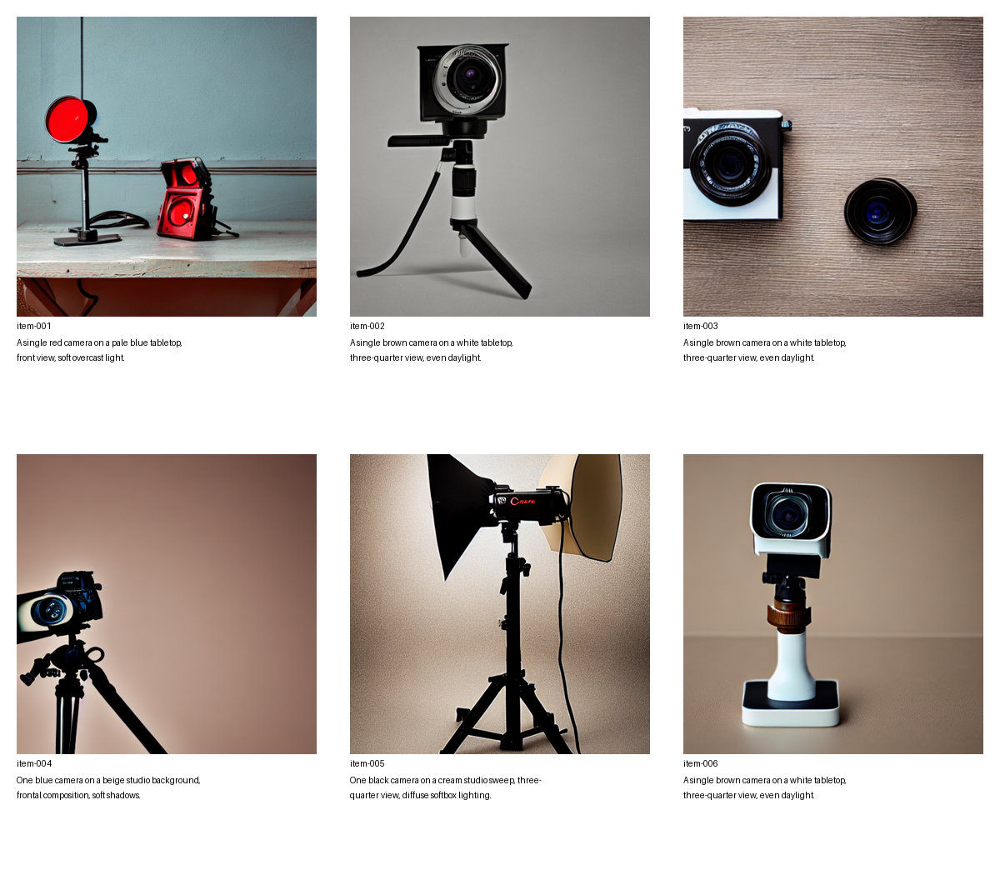

# Do teacher-generated images help more than a student's own images?

Training a small model on images from a larger model may improve it, but improvement alone does not show what the teacher contributed. What happens under the same training budget when the student trains on images it generated itself? This controlled follow-up compares the two complete data-generation pipelines for a narrow camera-product-image task.

This is **generated-sample supervision**: the teacher supplies images and the student learns with the ordinary diffusion training objective. The training does not match the teacher's noise predictions or intermediate features, and the result does not establish general parity with the teacher.

## Results

Three student variants generated 16 images each from eight new prompts and two new seeds per prompt. One AI reviewer, blinded to model identity, rated 48 thumbnails across eight contact sheets:

| Group | One recognizable camera ↑ | Camera color correct ↑ | Background correct ↑ | Severe artifacts ↓ |
| --- | ---: | ---: | ---: | ---: |
| Original student | 9/16 | 10/16 | 9/16 | 6/16 |
| Student trained on self-generated images | 11/16 | 11/16 | 10/16 | 4/16 |
| Student trained on teacher-generated images | 9/16 | 8/16 | 11/16 | 5/16 |

The primary metric was one recognizable camera. Matched by prompt and seed, teacher-data training improved 3 cases, worsened 5, and left 8 unchanged relative to self-generated-data training. **This observation does not show an advantage for teacher data on the primary metric.** It also does not establish general equivalence: the sample is small, the camera category was selected after earlier results, and the eight prompts are closely related. A single AI reviewer inspected contact sheets, not individual full-resolution images; thumbnail resolution limits fine-detail judgments. Ratings are subjective and do not establish statistical significance or generalization.



This is a JPEG-compressed copy of one of eight review sheets; compression may change fine details; identities were revealed after scoring. The [revealed ratings](revealed-ratings.csv) include per-image prompts, seeds and SHA-256 hashes.

## Design

The arms are the original Stable Diffusion 1.5 student, the same student trained on its own generated images, and the same student trained on SDXL-generated images. Both training arms start from the same student snapshot and use the same 64 prompts, captions and integer seeds, with one image per prompt. They use the same training script and environment for 400 optimizer updates: 512 × 512, batch size 1, gradient accumulation 4, learning rate 1e-4 and training seed 42. Both arms were trained anew; an earlier teacher-trained LoRA was not reused.

The teacher dataset consists of 64 previously saved SDXL images generated with Euler, 30 steps, guidance 7.5 and diffusers 0.39.0.dev0. The unmodified SD 1.5 student generated the comparison dataset with PNDM, 30 steps, guidance 7.5 and diffusers 0.40.0. The same integer seed does not imply the same noise across models and schedulers. The experiment therefore compares **complete data-generation pipelines**, not model size or the teacher model in isolation. Teacher images are not ground truth, and their training-image quality was not individually rated in this follow-up.

All held-out images were generated using the student base, PNDM, 512 × 512, 30 steps, guidance 7.5, and matched prompts and seeds. Training used PyTorch 2.14.0+cu130, diffusers 0.40.0, transformers 5.17.0, accelerate 1.15.0, datasets 5.0.1 and peft 0.20.0. Student snapshot: `451f4fe16113bff5a5d2269ed5ad43b0592e9a14`; teacher snapshot: `462165984030d82259a11f4367a4eed129e94a7b`. Training-script SHA-256: `d1958e329d01f5878a545de675b94e0b3dc86b6625d2db1eaffd08eee5684da5`. The historical training environment was not fully recorded, so this is not a strict reproduction of the earlier LoRA.

## Recompute

```bash
python recompute.py
```

The script checks 48 unique ratings, 16 complete matched triples, and matching prompts and seeds, then prints group counts and paired changes. `1` indicates presence or correctness; `0` indicates absence or incorrectness. Fewer artifacts are better. Recomputing the recorded ratings is not a substitute for reviewing the original images. Device outputs, training logs and originals are backed up separately; this directory includes one example contact sheet, not all 48 original images.

Model cards: [Stable Diffusion 1.5](https://huggingface.co/stable-diffusion-v1-5/stable-diffusion-v1-5) lists CreativeML Open RAIL-M, and [SDXL base 1.0](https://huggingface.co/stabilityai/stable-diffusion-xl-base-1.0) lists OpenRAIL++. No model weights or complete original images are distributed here.
