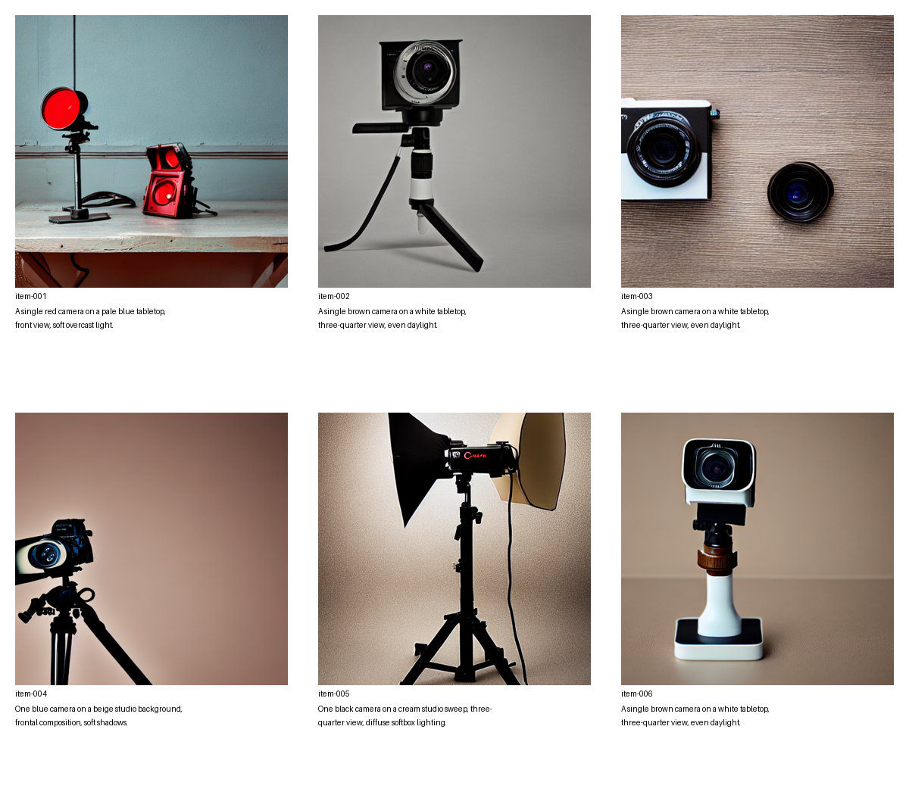

# 教师生成的数据是否比学生自己的数据更有用？

用大模型生成图片，再用图片训练小模型，效果变好并不自动说明大模型提供了额外价值：相同预算下，用小模型自己生成的数据训练，结果会怎样？本实验在相机产品图这一窄场景中加入自生成数据对照，比较教师数据的整套生成方案与学生自生成方案。

这是**生成样本监督**：教师提供图片，学生以常规扩散训练目标学习；训练没有匹配教师的噪声预测或中间特征。它不证明学生模型在通用图像生成能力上接近教师。

## 实验结果

固定 8 条新提示，每条使用两个新随机种子，三组各生成 16 张图。单名 AI 评审在不知道分组的情况下，对 8 张接触表上的 48 张缩略图打分，揭盲后结果如下：

| 组别 | 一台可辨认相机 ↑ | 相机颜色符合 ↑ | 背景符合 ↑ | 明显伪影 ↓ |
| --- | ---: | ---: | ---: | ---: |
| 原始学生 | 9/16 | 10/16 | 9/16 | 6/16 |
| 学生自生成数据训练 | 11/16 | 11/16 | 10/16 | 4/16 |
| 教师生成数据训练 | 9/16 | 8/16 | 11/16 | 5/16 |

首要指标为“一台可辨认相机”。逐提示和种子配对时，教师组相对自生成组有 3 例改善、5 例变差、8 例不变。**这次观察没有显示教师数据组在首要指标上优于自生成数据组。**结果也不证明两种方法普遍等价：样本量小，相机类别是从此前结果中事后选出的，8 条提示彼此相近；一名 AI 评审只看了接触表，没有逐张检查原图，细节判断受缩略图分辨率限制。评分有主观性，不能据此推断显著性或泛化能力。



图为评审使用的 8 张接触表之一的 JPEG 压缩副本，压缩可能改变细节，编号在打分后才与组别对应。逐图评分、提示、种子和图片 SHA-256 见 [揭盲数据](revealed-ratings.csv)。

## 如何对照

三组分别为原始 Stable Diffusion 1.5 学生、用学生自身生成图片训练的学生、用 SDXL 生成图片训练的学生。两组训练均从同一个学生快照出发，使用相同的 64 条图片提示、文字标签和种子，每条提示一张图。每组以同一训练脚本和环境运行 400 次优化更新：512 × 512，batch size 1，梯度累积 4，学习率 1e-4，训练种子 42。历史教师训练权重没有用于本对照，两组都重新训练。

教师训练图取自此前保存的 64 张 SDXL 图片，生成设置为 Euler、30 步、guidance 7.5、diffusers 0.39.0.dev0；自生成数据由未加载 LoRA 的 SD 1.5 生成，使用 PNDM、30 步、guidance 7.5、diffusers 0.40.0。两组图片虽然使用相同整数种子，但不同模型和调度器不对应相同噪声。因此实验比较的是**完整数据生成来源**，不能将差异单独归因于参数量或教师模型本身。教师生成图片不是真值，也未在本轮逐张标注训练图片质量。

留出生成三组均采用学生基座、PNDM、512 × 512、30 步、guidance 7.5 与相同的提示和种子。训练环境为 PyTorch 2.14.0+cu130、diffusers 0.40.0、transformers 5.17.0、accelerate 1.15.0、datasets 5.0.1、peft 0.20.0。学生快照为 `451f4fe16113bff5a5d2269ed5ad43b0592e9a14`，教师快照为 `462165984030d82259a11f4367a4eed129e94a7b`。训练脚本 SHA-256 为 `d1958e329d01f5878a545de675b94e0b3dc86b6625d2db1eaffd08eee5684da5`；历史训练环境不完整，不能将本次结果当作对旧 LoRA 的严格复现。

## 复算

```bash
python recompute.py
```

脚本检查 48 个唯一评分、16 组完整配对和每组提示及种子一致，然后输出分组计数与配对变化。`1` 表示该项存在或符合，`0` 表示不存在或不符合；伪影越少越好。它复算记录中的评分，不替代重新对原图评审。设备输出、训练记录和原图另有备份；本目录只提供一张接触表样例，不包含全部 48 张原图。

模型来源：[Stable Diffusion 1.5](https://huggingface.co/stable-diffusion-v1-5/stable-diffusion-v1-5) 模型卡标注 CreativeML Open RAIL-M，[SDXL base 1.0](https://huggingface.co/stabilityai/stable-diffusion-xl-base-1.0) 标注 OpenRAIL++。本目录不包含模型权重或完整原图。
