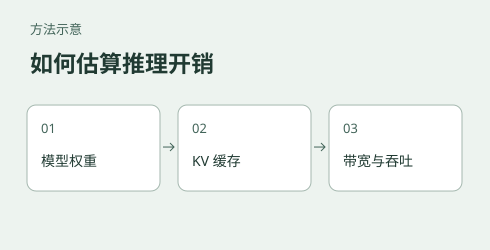

# LLM inference costs: from memory budgets to performance estimates

[中文](README.md)



Fitting model weights onto a device is only the beginning. Longer contexts and concurrent generation increase KV cache and runtime overhead; the same model may also run at different speeds on different engines. This experiment uses simplified, calculable models to break down those costs, prepare a memory budget, compare configurations, and decide what to measure before deployment.

**Status: a teaching and estimation experiment, not a deployment performance predictor.** Historical scripts and records contain problems with stage timing, units, and some formulas; see the [audit and usage limits](docs/使用边界与审计.md) (Chinese). Do not use their speed figures to select hardware or promise service performance. Measure on the target system.

## A starting question: how much memory does context use?

For standard full attention with equal key and value head dimensions, assuming the cache is materialized for all tokens and no prefixes are shared:

$$M_{KV}=2LBTH_{kv}d_h b$$

Here $L$ is the number of layers retaining standard KV, $B$ the number of concurrent sequences, $T$ the cached length per sequence, $H_{kv}$ the number of KV heads, $d_h$ the dimension of each head, and $b$ the bytes per KV element. The result is bytes: divide by $10^9$ for GB or $2^{30}$ for GiB. Weight quantization and KV precision must be specified separately.

For example, 16 layers, 4 KV heads, head dimension 256, BF16 cache, one sequence and length 65,536 require **4 GiB** of KV data. At eight concurrent sequences of the same length, the same assumptions give 32 GiB. Weight storage, other layer state, activations, workspaces, and runtime overhead also need a budget. Paged allocation, cache sharing, or variable sequence lengths change the actual allocation.

The formula covers only the stated conditions. In a hybrid architecture, the state of non-full-attention layers cannot simply be assumed to be zero. Verify the model configuration, KV precision, and serving engine separately.

## How should speed be estimated?

Inference is commonly divided into input processing (**prefill**) and incremental output generation (**decode**). An analysis can first estimate weight and cache bytes, then compare assumed data-movement time with compute time to identify constraints worth measuring. This does not prove the real bottleneck: actual read counts, cache hits, kernel efficiency, and request scheduling all matter.

Fitting an efficiency factor to one measured point and substituting it back into that same point will match by construction; it is not independent validation. Hold out context lengths, batch sizes, or engine configurations when validating an estimate. A profiler and device counters are needed to support a bottleneck claim.

## Runnable examples

Python 3.10 or later is required. This example calculates theoretical operation counts for the two matrix multiplications in dense, non-causal full attention and the size of an assumed materialized attention-score matrix for one layer. It excludes other layer types in a hybrid architecture and does not predict actual latency or peak memory.

```bash
cd experiments/inference-cost-models
python scripts/attention_model.py
```

The dimensions are synthetic, not a verified configuration of a particular model. The memory example defaults to the 4 GiB case above and can be changed to match an actual configuration:

```bash
python scripts/hybrid_architecture_model.py --layers 16 --kv-heads 4 --head-dim 256 --context 65536 --batch 8 --kv-dtype bf16
```

The output is standard KV payload for equal-length sequences. FP8 and FP4 are calculated using ideal element widths only; quantization scales and metadata are excluded. Their presence in this arithmetic does not establish that an engine supports those precisions. Other layer states and runtime overhead are also excluded.

### When can speculative decoding cost more than it saves?

A draft model proposes candidate tokens and a target model verifies them. Low acceptance can make the extra draft and verification work outweigh the benefit. The [example](scripts/speculative_model.py) assumes $k$ drafted tokens, a fixed conditional acceptance probability $\alpha$ for each token after all previous ones were accepted, no EOS, and one additional correction or bonus token per round:

$$E[N]=\sum_{i=0}^{k}\alpha^i,\qquad S=\frac{E[N]}{c_v+k c_d}.$$

Here $c_v$ is the cost of one verification round and $c_d$ the cost per drafted token, both relative to one ordinary decoding step. Run `python scripts/speculative_model.py`: with $k=4$, $c_v=1$, and $c_d=0.05$, the model gives about 0.877x at $\alpha=0.05$ and 2.311x at $\alpha=0.70$. These are illustrative assumptions, not device measurements or speed predictions: acceptance depends on position and input, while draft and verification costs vary with hardware, implementation, and workload.

For request-level HTTP timing, install `requests` with `python -m pip install requests`, then run `python scripts/compare_engines.py --help`. The script does not separate inference stages.

See the [inference cost guide](docs/推理成本估算指南.md) (Chinese) for assumptions, inputs, outputs, and measurement design. Other scripts are research drafts whose parameters and outputs still need individual review; read the [audit and usage limits](docs/使用边界与审计.md) before running them.

## Materials and evidence

- [Inference cost guide](docs/推理成本估算指南.md): assumptions behind memory, attention, and speed estimates and how to design a verifiable test.
- [Audit and usage limits](docs/使用边界与审计.md): identified issues, restrictions on historical numbers, and unresolved checks.
- [Historical LLM-Viewer comparison](docs/LLM-Viewer交叉验证.md), [vLLM deployment notes](docs/vLLM在GB10上的部署.md), and [SGLang deployment notes](docs/SGLang在GB10上的部署.md): retained for provenance; their quantitative claims are subject to the audit.
- [Iteration log](迭代日志.md) and [earlier iteration log](docs/迭代日志.md): historical assumptions and revisions, not current conclusions.

These supporting documents are currently in Chinese.

A concrete extrapolation check: in the [recorded slot experiment](../gb10-inference/qwen36-35b-ab/README.en.md), the two one-slot batch throughput measurements average 74.84 tokens/s at client concurrency 8. Multiplying by eight predicts 598.76 tokens/s, whereas the two eight-slot measurements average 113.96 tokens/s, a prediction error of about +425% relative to the measured value. These are batch-level HTTP measurements, not pure decode rates. Run order and total configured context also changed, so the gap does not identify a bottleneck or establish a general scaling curve. The [calculation and raw evidence](docs/推理成本估算指南.md#用已有数据检验一个外推假设) are provided in Chinese.

The [historical LLM-Viewer comparison](docs/LLM-Viewer交叉验证.md) combined stage predictions with historical measured rates; the retained test scripts derive rates from whole HTTP request time, although their exact use in that run is not independently established. Those rates cannot validate prefill or decode predictions, and dividing assumed weight bytes by request time does not measure hardware bandwidth. Its proposed 4.80 = 1.14 × 4.50 error decomposition is also arithmetically false. The original tool outputs and full environment are not retained.
