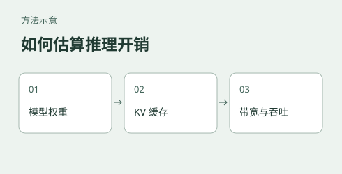

# 大模型推理成本：从内存预算到性能估算



把模型放进设备只是部署的第一步：上下文变长、多个请求同时生成，KV Cache 和运行时开销还会增长；同一模型换引擎，速度也可能不同。本实验用可计算的简化模型拆解这些成本，帮助部署前列出内存预算、比较配置，并设计需要实测的问题。

**当前状态：教学与估算实验，尚不能作为部署性能预测器。** 历史脚本和记录存在阶段计时、单位及部分公式问题，见[审计说明](docs/使用边界与审计.md)。不要使用其中的速度数字选购硬件或承诺服务性能；应在目标环境实测。

## 从一个问题开始：上下文会占多少内存？

对于每层 K、V 头维相同的标准全注意力，假设缓存按全部 token 物化且无前缀共享：

$$M_{KV}=2LBTH_{kv}d_h b$$

其中 $L$ 为需要保留标准 KV 的层数，$B$ 为并发序列数，$T$ 为每条序列的缓存长度，$H_{kv}$ 为 KV 头数，$d_h$ 为每头维度，$b$ 为 KV 每元素字节数。结果以字节计；除以 $10^9$ 得 GB，除以 $2^{30}$ 得 GiB。权重量化格式与 KV 精度需要分别指定。

例如 16 层、4 个 KV 头、头维 256、BF16 缓存、1 条序列、长度 65,536 时，KV 为 **4 GiB**。若并发增加到 8 且每条长度不变，在上述假设下为 32 GiB；还要预留权重、其他层状态、激活、工作区和运行时空间。分页分配、缓存共享或不等长序列会改变实际分配量。

该公式仅覆盖所列条件。混合架构中非全注意力层的状态不能直接忽略为零；模型加载配置、KV 精度和运行引擎都应单独核实。

## 怎样估算速度？

推理通常分为处理输入的 **prefill** 和逐步生成输出的 **decode**。可先估算权重和缓存的字节数，再比较假设的数据移动时间与计算时间，找出值得测量的约束。这是分析路径，不能直接证明真实瓶颈：数据实际读取次数、缓存命中、算子效率及请求调度都会影响结果。

若用测得的速度反推某个效率，再把它代回同一个测点，结果吻合是数学上的必然，不是独立验证。验证时应保留未用于标定的长度、批量或引擎配置；识别瓶颈还需要 profiler 和设备计数器。

## 可运行的示例

需要 Python 3.10+。下例只计算稠密、非因果 full attention 两次矩阵乘的理论操作量，以及单层假设物化的注意力分数矩阵大小；不包含混合架构中的其他层，不预测真实延迟或峰值内存。

```bash
cd experiments/inference-cost-models
python scripts/attention_model.py
```

内存算例还可运行 `python scripts/hybrid_architecture_model.py`；请求级 HTTP 计时使用 `python scripts/compare_engines.py --help`，并需安装 requests。前者不包含其他层状态与运行时开销，后者不拆分推理阶段。

更多原理、输入输出和测量方案见[推理成本估算指南](docs/推理成本估算指南.md)。已有其他脚本是研究草稿，其参数与输出尚待逐项审计；运行前请先阅读[使用边界与审计](docs/使用边界与审计.md)。

## 材料与证据

- [推理成本估算指南](docs/推理成本估算指南.md)：内存、注意力与速度估算的假设，如何设计可核验的测试。
- [使用边界与审计](docs/使用边界与审计.md)：已发现问题、历史数字的使用限制与待验证事项。
- [LLM-Viewer 历史对照](docs/LLM-Viewer交叉验证.md)、[vLLM 部署记录](docs/vLLM在GB10上的部署.md)、[SGLang 部署记录](docs/SGLang在GB10上的部署.md)：保留历史记录供溯源，其中的定量结论受审计说明约束。
- [迭代记录](迭代日志.md)和[早期迭代记录](docs/迭代日志.md)：记录历史假设与修改，不代表当前结论。
