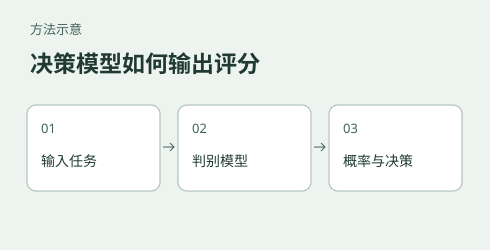

# Evaluating and reproducing open-source Jev-style decision models

[中文](README.md)



An agent or automated workflow often needs a quick routing, classification, or state-scoring decision rather than a long generated answer. A generative model emits output token by token, so output format and length affect latency. When the possible answers are known in advance, directly scoring options can avoid some generation steps.

TypeSafe's Jev is a decision-model approach that produces probabilities for predefined choices. Its official offering is a commercial cloud API with undisclosed weights. This project explores several community implementations on a local single-GPU machine, measuring deployment feasibility, latency, and behavior on small samples. It is not an official Jev benchmark.

## What you can use this for

If you are considering a local model for ticket routing, content classification, or workflow decisions, the reports illustrate how to compare direct option scoring with JSON generation and provide scripts and logs for retesting. The text examples also include a confidently wrong answer: scores can help triage cases, but cannot replace accuracy and calibration evaluation on your own labeled data.

Latency depends on the device, input, and model configuration. Models and questions were not identical across all measurements; small samples do not establish a generally most accurate option or production capacity. The multimodal Jev-Omni experiment is separate from the text comparison.

## Models and environment

| Model | Approach in this experiment |
|---|---|
| Laya | ModernBERT-based encoder with a transformer decision head; selects English or multilingual checkpoints and can combine questions in one request |
| metask-jev 4B | Qwen3.5-4B fine-tune scoring constrained single-token answer choices using output logits |
| Nimble 9B | Qwen3.5-9B plus LoRA; the CUDA scorer evaluates fields separately |
| Qwen3-VL 4B | Autoregressive structured-output baseline, including JSON generation |
| Jev-Omni 12B | Gemma 4 12B IT fine-tune for text, image, audio, and video option scoring; evaluated separately |

The recorded environment was aarch64 GB10, one CUDA GPU, 20 CPU cores and 121 GB unified memory, with Python 3.12, PyTorch 2.14.0+cu130 and CUDA 13.0. Laya was 0.3.5 for the text benchmark; Nimble and metask versions are described in their respective guides. Exact logs and configurations should be checked per run in [execution logs](docs/执行日志/).

## What was measured

The text comparison tested loading, request latency and resident memory, plus short English/Chinese classification and proposition examples. Laya, metask and Qwen used a shared set of 20 classification and five proposition questions; Nimble used different example questions, so its accuracy is not comparable with those results. The tests also examined combined questions in Laya and output length in the generative baseline. Jev-Omni was tested separately on four input modalities.

The [text report](docs/实验报告.md) records the following median latencies on fixed short inputs. Workloads differ, including the number of fields, so the table is not an equal-work ranking:

| Configuration | Input | Median complete decision |
|---|---|---:|
| Laya English checkpoint | English, one question | 16.98 ms |
| Laya multilingual checkpoint | Chinese, one question | 8.25 ms |
| Nimble 9B | English / Chinese, two fields | 365.33 / 366.66 ms |
| metask-jev 4B | English / Chinese, one question | 133.5 / 133.7 ms |
| Qwen3-VL 4B | English / Chinese, minimal output | 103.48 / 104.85 ms |
| Qwen3-VL 4B | English / Chinese, JSON output | 1448.17 / 1153.54 ms |

On 20 classification examples, the report records 95% English and Chinese for Laya, and 95% English / 100% Chinese for metask. This is far too small to establish general accuracy or superiority. One Chinese Laya error received 0.906 confidence. Three Chinese proposition examples were also wrong while corresponding English examples were correct; three cases do not establish general Chinese ability. The JSON test and direct-scoring tests use different models and procedures, and generative systems can also batch; retest representative tasks and deployment configurations before selecting a system.

## Training comparison: RLCD and soft cross-entropy

The [Laya RLCD experiment](laya_rlcd_train/README.md) tests whether adding a scoring-rule policy-gradient term to distillation improves agreement with teacher-generated decision distributions compared with soft cross-entropy alone. The data is synthetic; its soft labels are not real-world event outcomes. Therefore ECE and Brier metrics against these labels cannot establish calibration to reality. Before a new run, the split audit rejects cases with identical state and questions even when their labels differ; it cannot identify paraphrased or near-duplicate inputs and was not applied retrospectively to the historical run.

On 2,000 held-out questions, two RLCD runs reported reference-label top-1 agreement of 0.7510 and 0.7700, while one soft-CE run reported 0.7855. The RLCD repeats used the same recorded configuration and seed but their difference is unexplained. The runs are too few to establish a general ranking or equivalence. The implementation splits training and calibration after expanding questions, so questions from the same case can cross that boundary. See the [training report](laya_rlcd_train/docs/RLCD微调报告.md) for conditions and evidence.

To repeat the training path, install a compatible PyTorch, `datasets`, `huggingface_hub`, and the upstream Laya training package, then run from `laya_rlcd_train`:

```bash
python scripts/prepare_data.py --out-dir data
bash scripts/run_ab_compare.sh
```

The model and data downloads do not pin revisions; record upstream versions and file hashes. `PYTHON` can override the default `$HOME/laya-rlcd-env/bin/python`. The script checks available Linux system memory before starting, defaulting to 50 GiB and adjustable with `MIN_AVAILABLE_GIB`; it does not continuously monitor training. It refuses existing output directories or logs. The exact historical upstream source revision has not been established, so these steps do not guarantee identical numerical results.

## Documentation and experiment entry points

The following linked guides are currently in Chinese:

- [Deployment guide](docs/部署指南.md): model selection context, environment, per-model deployment and operational considerations.
- [Reproduction guide](docs/复现教程.md): weights, execution sequence, and log interpretation.
- [Text experiment report](docs/实验报告.md): latency, classification samples, measurement scope, and log references.
- Model-specific instructions: [Laya](laya/README.md), [metask](metask/README.md), [Nimble](nimble/README.md), [generative baseline](llm_baseline/README.md), and [Jev-Omni](jevomni/README.md).
- Training workflows: [Laya RLCD vs. soft-CE](laya_rlcd_train/README.md), [text decision-model training](text_jev_train/README.md), and [vision decision-model training](vision_jev_train/README.md).
- [Execution logs](docs/执行日志/) contain text and multimodal outputs; check each report for which runs and hardware measurements were retained.

**Vision training data leakage:** `vision_jev_train` includes the ScienceQA reference-answer reasoning `solution` in model input during data preparation. Its training and evaluation results cannot establish independent answering without that reasoning. Remove the leaked field and retrain and evaluate before drawing that conclusion.

## Attribution

Laya, Nimble, metask-jev, and Jev-Omni are community projects. This repository's local deployment, test scripts, and measurements are independent of those projects. See their respective repositories for licenses and model-weight ownership.
