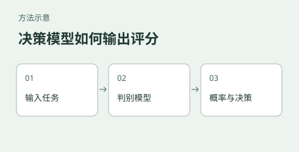

# Jev 系列开源复刻评测与复现实验

[English](README.en.md)

## 这个实验是什么

在智能体（Agent）和自动化工作流中，大量环节只需要做出快速路由、类别判定或状态评分（System 1 快速决策），并不需要大模型生成长文本。生成式模型需要逐 token 输出结果，输出格式与长度会影响延迟；如果任务只需要预设选项，直接打分可能减少生成步骤。

TypeSafe 推出的 Jev 模型将判别式机制引入大模型，直接输出结构化概率，面向预设选项输出概率。但 Jev 官方仅提供云端商业接口且权重不公开。

本实验的核心目标，是对开源社区中出现的几种典型 Jev 复刻方案进行实机摸底，验证它们在本地单卡私有化部署下的工程可行性、短样本下的延迟、判定表现和适用边界。

## 读者可以用它做什么

如果你要为工单分派、内容分类或流程路由选择本地模型，这里展示如何比较直接给选项打分与生成 JSON 的部署成本，并提供脚本和日志供重新测试。文本基准还展示了高置信度错误：分数可以辅助筛查，但不能替代用自身数据验证准确率与校准情况。

延迟来自特定设备、输入和模型配置，模型与题目并非全部相同；小样本结果不能用于证明某方案普遍更准确，也不能作为生产容量承诺。多模态实验另见 Jev-Omni 子目录，不与文本基准视为同一套对照。

## 运行环境

| 项 | 值 |
|---|---|
| 硬件 | aarch64 架构 GB10 算力盒（20 核 CPU，121 GB 统一内存，单卡 CUDA） |
| 系统 | Python 3.12，PyTorch 2.14.0+cu130，CUDA 13.0 |
| 被测版本 | laya 0.3.5、nimble 与 metask-jev 按各目录 README 锁定 |
| 原始日志 | `docs/执行日志/` 包含文本基准及多模态测试输出；对应关系见各报告 |

## 我们大概做了什么实验

我们选取了社区中技术路线各不相同的三个开源复刻项目，并引入主流轻量级生成式大模型作为基线对照：

- **Laya (1.1B)**：基于 ModernBERT 编码器加 Transformer 决策头的专用判别式架构，一次前向输出全部字段的概率，英文与多语言两个分支由路由器自动选择，支持单次请求合并多道题。
- **metask-jev (4B)**：基于 Qwen3.5-4B 微调，把候选答案约束为单个 Token，直接读取输出层对应 Token 的 Logits 并归一化为概率。
- **Nimble (9B)**：基于 Qwen3.5-9B 的 LoRA 适配器，配版本锁定的基座，在 CUDA 上用专用打分器逐字段计算。
- **Qwen3-VL (4B) 基线**：代表传统的自回归结构化（JSON）生成方案，作为延迟与成本的参照基准。
- **Jev-Omni (12B)**：在 Gemma 4 12B IT 上微调的多模态决策模型，统一支持文本、图像、音频、视频四类输入，输出同样是候选选项的概率分布而非生成文本。

在 aarch64、统一内存和单卡 CUDA 平台上，本目录包含以下实验：

1. **基准性能测量**：测试各模型在冷启动耗时、单次请求推理延迟（毫秒级中位数）以及常驻显存占用的真实表现。
2. **中英双语业务测试**：使用英中工单分类与命题判断示例测试部分模型。文本主报告的分类评估仅 20 条，不能代表实际业务准确率；Nimble 使用另一组题目，其准确率未纳入同表。
3. **特定运行机制验证**：深入实测 Laya 的多题合并批处理收益（计算摊薄效果）、中文命题判断中的样例表现，以及生成式方案因输出长度增加导致的耗时劣势。
4. **多模态决策验证**：在单卡上部署 Jev-Omni，实测文本、图像、音频、视频四类输入的真实推理延迟、判定结果与置信度表现。
5. **可复现日志归档**：保留文本与多模态运行日志，便于按报告中的出处核对记录；是否包含每次运行及全部硬件指标需逐项确认。

## 这里有哪些教程与文档

本目录提供了从选型、单模型部署到整套评测复现的完整文档：

- **[docs/部署指南.md](docs/部署指南.md)**：面向只想部署单个模型接入业务的人，包含选型表、环境配置、单模型部署步骤、验证与生产注意事项。
- **[docs/复现教程.md](docs/复现教程.md)**：面向想重跑整套评测、对齐报告数字的人，包含权重对照、运行顺序、日志读法。
- **[docs/实验报告.md](docs/实验报告.md)**：延迟与准确率对比表、测量口径、三个关键工程发现以及选型建议。
- **各模型独立部署与说明**：
  - [laya/README.md](laya/README.md)：Laya 的安装步骤、前置依赖、多题合并示例与注意事项。
  - [metask/README.md](metask/README.md)：metask-jev 的环境初始化、基准测试运行与温度系数配置。
  - [nimble/README.md](nimble/README.md)：Nimble 的基座与 LoRA 权重合成、CUDA 打分逻辑与显存开销说明。
  - [llm_baseline/README.md](llm_baseline/README.md)：Qwen3-VL 生成式基线的测试脚本与结构化提示词设计。
  - [jevomni/README.md](jevomni/README.md)：Jev-Omni 的权重下载、素材准备、四模态部署验证与延迟基准。
- **微调与训练决策模型**：
  - [laya_rlcd_train/README.md](laya_rlcd_train/README.md)：在合成决策数据上比较 RLCD 与 soft-ce；结果反映对教师软标签的一致性，不代表真实事件的概率校准。
  - [text_jev_train/README.md](text_jev_train/README.md)：纯文本路线，Qwen3-0.6B 全参微调，typed-decisions 数据集，四步跑通训练、选优、校准、服务。
  - [vision_jev_train/README.md](vision_jev_train/README.md)：视觉路线，Qwen3.5-2B 加 LoRA，ScienceQA 按图片 sha256 去重切分，含启动内存体检与运行内存硬闸。
> **视觉训练数据限制**：`vision_jev_train` 的数据准备脚本将 ScienceQA 的参考答案推理 `solution` 加入模型输入，训练与评估存在答案信息泄漏。当前结果不能证明模型在不提供答案推理时能独立答题；需要移除泄漏字段并重新训练、评估。

- **[docs/执行日志/](docs/执行日志/)**：收录文本与多模态测试的终端输出和 JSON，供查阅对应的耗时与判定结果。

## 致谢

本实验被测的开源复刻方案（Laya、Nimble、metask-jev、Jev-Omni）均为社区项目，本项目自行完成本地部署、测试脚本编写与全部实测，与上述项目无隶属关系。被测对象的许可证与权重归属见各自仓库。
