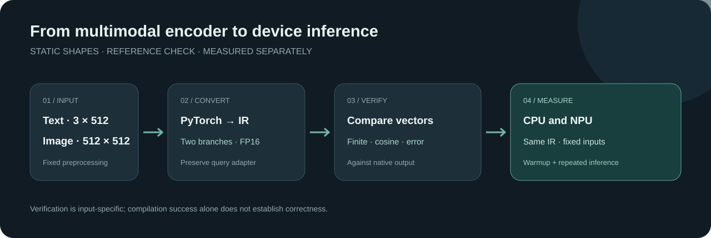

# Deploying Jina CLIP on Intel CPU and NPU

[中文](README.md)



Can `jinaai/jina-clip-v2` produce **correct, repeatably accelerated** OpenVINO inference on Intel CPU and NPU? A successful conversion or compilation is not enough: this experiment checks vector correctness, both text and vision branches, and repeated measurements.

On the fixed inputs used here, FP16 text and image vectors on NPU passed comparison with native PyTorch. Text batch-3 steady-state throughput calculated from mean latency was 12.57× the CPU result. CPU tuning parameters were not fully recorded, so this ratio is not a hardware performance ceiling.

## Why this experiment matters

Multimodal vectors support retrieval and ranking. A conversion tool accepting a graph does not prove the output remains useful: a driver, compiler, or adaptation error can produce NaNs or alter its semantics. We therefore ask whether conversion preserves the text and vision branches and the `retrieval.query` LoRA, whether both devices agree with native output, and whether performance gains remain after correctness checks.

The same comparisons help investigate failures. A correct CPU result with an invalid NPU result is a reason to inspect the device software stack; however, a driver change correlating with recovery is not by itself proof of root cause.

## Setup and correctness criteria

| Item | Configuration |
|---|---|
| Model | `jinaai/jina-clip-v2`, revision `e10d47f5691d0454a0fb5d13f46f2199b74cb436` |
| Machine | Core Ultra 7 155H + Intel AI Boost |
| OpenVINO / driver | 2026.4.1 / 32.0.100.5540; historical comparison used driver 32.0.100.4023 |
| PyTorch / Transformers | 2.14.1 / 4.57.6 |
| Inputs | text `3 × 512`; image `1 × 3 × 512 × 512` |
| IR | Static FP16; text keeps the `retrieval.query` LoRA |

Each branch is checked independently against native output after row normalization. A pass requires finite values, maximum absolute difference of normalized vectors at most 0.02, and minimum row cosine at least 0.999. These are thresholds for this experiment, not universal retrieval guarantees.

## Findings

- Disabling LoRA changed text vectors: enabled-versus-disabled cosine was 0.9166–0.9384. It is a diagnostic comparison, not an equivalent deployment shortcut.
- CPU minimum row cosine was 0.99999982 for text and 1.0 for vision on the tested inputs. This supports the conversion path on those inputs, not all possible inputs.
- The historical 4023 driver produced all-NaN FP16 text vectors while vision passed. With 5540 and the same OpenVINO, IR, and inputs, minimum NPU cosine was 0.99999201 for text and 0.99997693 for vision; the smoke image's top label was `a photo of a beach`, and the text compiler was `CompilerType.DRIVER`. The old driver's raw record is not published in this directory, so readers cannot independently verify that A/B or determine root cause from the available files.
- NNCF INT8 was not accepted: on 5540, minimum row cosine was 0.99768680 on NPU and 0.99777812 on CPU, below the experiment's 0.999 threshold. The historical old-driver NPU value of 0.06670082 lacks a raw record here. Finite output alone is not a pass. The documented passing path is FP16 on driver 5540, not a claim that INT8 is suitable.

## Repeated same-machine benchmarks

Both devices used the same FP16 text IR and passed the native check first. Each received two warmups and ten timed iterations; compilation time is excluded. Text latency is synchronous encoding of an entire batch of three, not one short sentence. Throughput is `3 / mean batch time`.

| Device | Mean | P50 | P95 | Mean throughput |
|---|---:|---:|---:|---:|
| CPU text | 10.84758 s | 10.83500 s | 10.92145 s | 0.27656 sequences/s |
| NPU text | 0.86285 s | 0.86276 s | 0.86343 s | 3.47686 sequences/s |
| CPU vision | 10.25726 s | 10.25549 s | 10.32516 s | 0.09749 images/s |
| NPU vision | 0.67428 s | 0.67471 s | 0.67514 s | 1.48306 images/s |

The NPU mean latency ratios for these fixed text and vision workloads were approximately 1/12.57 and 1/15.21 of CPU respectively. The vision case used one historical beach photo at `1 × 3 × 512 × 512`. CPU thread count, affinity, and power state were not fully recorded, so the differences cannot be attributed solely to NPU architecture or treated as well-tuned ceilings. P95 from ten observations is unstable. Results apply to this revision, FP16 IR, inputs, OpenVINO version, and driver; they do not establish other batch sizes, services, energy efficiency, or task quality. [Benchmark evidence](docs/evidence/) contains individual timings.

As a separate cross-backend reference, DGX Spark GB10 with PyTorch native measured mean text latency of 0.08150 s (FP32) and 0.08230 s (FP16), and vision FP32 latency of 0.14874 s. These are different hardware and inference stacks and are not combined with NPU figures into an acceleration ratio.

## COCO image–text retrieval

The experiment used the first 200 image/English-caption pairs from the [COCO 2017 validation dataset](https://huggingface.co/datasets/phiyodr/coco2017), selecting the first caption for each image. Query text uses `retrieval.query`; document text uses no LoRA. Original images, the original subset manifest, and the dataset revision were not retained, so fetching the first 200 current Dataset Server rows does not guarantee the identical subset.

| Direction | Backend | Recall@1 | Recall@5 | Recall@10 | MRR | nDCG@10 |
|---|---|---:|---:|---:|---:|---:|
| Text → image | CUDA native | 0.810 | 0.995 | 0.995 | 0.88609 | 0.91360 |
| Text → image | OpenVINO NPU | 0.810 | 0.995 | 0.995 | 0.88526 | 0.91295 |
| Image → text | CUDA native | 0.825 | 0.990 | 0.995 | 0.89678 | 0.92151 |
| Image → text | OpenVINO NPU | 0.825 | 0.990 | 0.995 | 0.89702 | 0.92173 |

For both directions, the paired target had the same rank for 198/200 queries; mean absolute rank differences were 0.01 and 0.015. This compares one paired target per query, not full candidate ordering, and treats other semantically valid candidates as nonmatches. It covers 200 of 5,000 validation items in English, not all COCO or other domains and languages.

Recorded total CUDA native encoding times were 4.94 s for query text, 3.10 s for document text, and 34.38 s for images; NPU times were 58.16, 58.11, and 145.33 s. CUDA used batch 8 for text and images; NPU used fixed text batch 3 and individual images. Devices, backends, precision, and batching differ, so these totals are not a fair hardware comparison. COCO image licenses vary; check each image before redistributing it.

## Reproduction

The measured NPU setup requires Windows 11, an Intel NPU, and driver 32.0.100.5540; revalidate other driver versions. The [Intel NPU driver page](https://www.intel.com/content/www/us/en/download/794734/intel-npu-driver-windows.html) provides the official driver. Run the commands below from `experiments/jina-clip-openvino`.

The model and custom implementation are fetched at the pinned revision; initial execution needs network, and subsequent runs support `--offline`. The model card lists [CC BY-NC 4.0](https://huggingface.co/jinaai/jina-clip-v2); confirm commercial authorization where needed. Conversion uses `trust_remote_code=True`: inspect the pinned remote code before running it.


### 1. Environment

Install dependencies:

```powershell
cd experiments/jina-clip-openvino
python -m venv .venv
.venv\Scripts\python.exe -m pip install -r requirements-openvino.txt
```

### 2. Convert and validate both branches on CPU

This creates the static IR, native references, and preprocessor:

```powershell
.venv\Scripts\python.exe scripts\run_openvino_smoke.py --device CPU --single-task --image example-images\illustrated-coast.png --work-dir artifacts --cache-dir models\huggingface
```

### 3. Validate both branches on NPU

After caching the model and custom code, use the same inputs:

```powershell
.venv\Scripts\python.exe scripts\run_openvino_smoke.py --device NPU --single-task --offline --image example-images\illustrated-coast.png --work-dir artifacts --cache-dir models\huggingface
```

### 4. Validate an existing text IR

Compare each device with the same native reference:

```powershell
.venv\Scripts\python.exe scripts\validate_existing_text_ir.py --device CPU --ir artifacts\fp16\jina-clip-text_v2_fp16.xml --reference artifacts\fp16\native_reference.npz --preprocessor artifacts\fp16\preprocessor --output artifacts\text-CPU.json
.venv\Scripts\python.exe scripts\validate_existing_text_ir.py --device NPU --ir artifacts\fp16\jina-clip-text_v2_fp16.xml --reference artifacts\fp16\native_reference.npz --preprocessor artifacts\fp16\preprocessor --output artifacts\text-NPU.json
```

### 5. Repeat the text benchmark

Run CPU and NPU sequentially to avoid interfering workloads:

```powershell
.venv\Scripts\python.exe scripts\benchmark_text_ir.py --device CPU --ir artifacts\fp16\jina-clip-text_v2_fp16.xml --reference artifacts\fp16\native_reference.npz --preprocessor artifacts\fp16\preprocessor --output artifacts\benchmark-CPU.json --warmup 2 --iterations 10
.venv\Scripts\python.exe scripts\benchmark_text_ir.py --device NPU --ir artifacts\fp16\jina-clip-text_v2_fp16.xml --reference artifacts\fp16\native_reference.npz --preprocessor artifacts\fp16\preprocessor --output artifacts\benchmark-NPU.json --warmup 2 --iterations 10
```

### 6. Repeat the vision benchmark

Run these sequentially:

```powershell
.venv\Scripts\python.exe scripts\benchmark_vision_ir.py --device CPU --ir artifacts\fp16\jina-clip-vision_v2_fp16.xml --reference artifacts\fp16\native_reference.npz --preprocessor artifacts\fp16\preprocessor --image example-images\illustrated-coast.png --output artifacts\benchmark-vision-CPU.json --warmup 2 --iterations 10
.venv\Scripts\python.exe scripts\benchmark_vision_ir.py --device NPU --ir artifacts\fp16\jina-clip-vision_v2_fp16.xml --reference artifacts\fp16\native_reference.npz --preprocessor artifacts\fp16\preprocessor --image example-images\illustrated-coast.png --output artifacts\benchmark-vision-NPU.json --warmup 2 --iterations 10
```

### 7. Prepare a COCO subset

On a machine that can access Dataset Server and image sources:

```bash
python scripts/prepare_coco_api_subset.py --output-dir data/coco2017-val200 --limit 200
```

### 8. Evaluate NPU retrieval

A document-side IR without LoRA is required. Its generation script is not in this repository, so complete reproduction from scratch is not currently possible. Supply a separately validated document-side IR first:

```powershell
.venv\Scripts\python.exe scripts\evaluate_retrieval.py --backend openvino --device NPU --subset data\coco2017-val200\subset.json --query-ir artifacts\fp16\jina-clip-text_v2_fp16.xml --document-ir artifacts\no-lora-fp16\jina-clip-text_v2_fp16.xml --vision-ir artifacts\fp16\jina-clip-vision_v2_fp16.xml --preprocessor artifacts\fp16\preprocessor --output artifacts\retrieval-coco200-NPU.json
```

### 9. Evaluate CUDA native retrieval

Then run the native comparison:

```bash
python scripts/evaluate_retrieval.py --backend native --device cuda --subset data/coco2017-val200/subset.json --preprocessor artifacts/fp16/preprocessor --cache-dir models/huggingface --output artifacts/retrieval-coco200-native-cuda.json --batch-size 8 --offline
```

### 10. Auxiliary checks

Compare LoRA modes and inspect dynamic nodes:

```powershell
.venv\Scripts\python.exe scripts\compare_lora_modes.py
.venv\Scripts\python.exe scripts\inspect_ir_dynamic_ops.py artifacts\fp16\jina-clip-text_v2_fp16.xml
.venv\Scripts\python.exe scripts\inspect_ir_dynamic_ops.py artifacts\fp16\jina-clip-vision_v2_fp16.xml
```

The sample illustration is original and differs from the historical beach photo; it does not reproduce the original visual result and no longer checks a specific label. Add `--force-convert` when rebuilding IR. Use a new `--work-dir` when changing the image or text to avoid reusing stale native references.

Evidence under `docs/evidence/` contains current-driver results with hostnames removed and paths made repository-relative; old-driver raw output is absent. The historical photo is not distributed because its redistribution license has not been confirmed. This experiment does not establish support for all models, batches, images, or INT8 deployment; validate correctness and repeated performance for the intended production stack.
