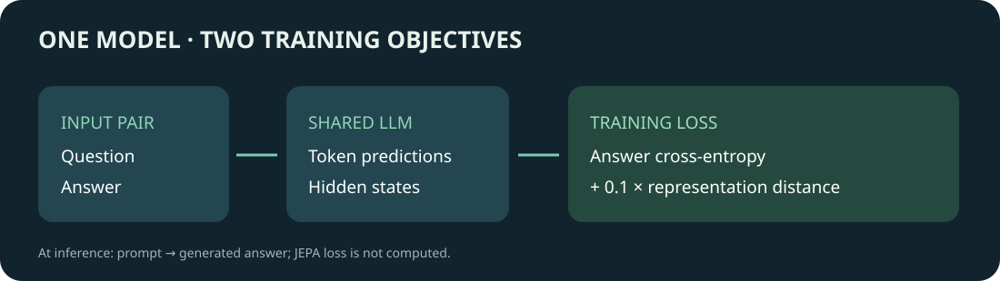

# Adding a JEPA objective to a language model: a single-GPU training experiment

[中文](README.md)

Can a language model learn a relationship between question and answer representations while also learning to generate an answer? [LLM-JEPA](https://arxiv.org/abs/2509.14252) adds an objective that predicts latent representations of related views alongside the usual autoregressive language-model loss. On DGX Spark, we ran ordinary LoRA fine-tuning and LLM-JEPA training on a small addition dataset, then compared generation with the unfine-tuned model.

**Result: the unfine-tuned model answered all 40 questions correctly; ordinary LoRA scored 39/40 and JEPA 40/40.** The self-generated task is too simple and has only one seed, so it cannot establish that JEPA improved model capability. The contribution here is an inspectable path from data and label checks through training and generation evaluation.

## Mechanism: two views of the same question

Suppose the user asks `What is 1 + 2?` and the assistant answers `3`. The autoregressive model predicts answer tokens from the question context. The JEPA term also encodes the question and answer views and brings their hidden representations closer. In this configuration, the views share language-model parameters; each representation is the final-layer hidden vector at the last content token, with no additional predictor token.

The training loss is:

$$L=L_{LM}+0.1\left(1-\frac{1}{B}\sum_{i=1}^{B}\cos(z_{q,i},z_{a,i})\right)$$

Here $L_{LM}$ is cross-entropy over answer tokens, while $z_q$ and $z_a$ represent question and answer views. The implementation retains the model's text-generation path; the JEPA term is used only during training. This setup follows the [authors' implementation](https://github.com/galilai-group/llm-jepa); JEPA methods do not all use the same structure or generation procedure.

## Data, inputs, and outputs

A script generates addition problems with the first operand in 0–9 and the second in 0–19. After a fixed-seed shuffle, 160 ordered pairs form training data and 40 different pairs form the test set. Training messages contain a system instruction, user question, and assistant answer. Inference supplies only the first two and lets the model generate the answer. Evaluation uses greedy decoding with at most 12 new tokens and checks an exact string match after stripping leading and trailing whitespace.

The questions have one template, answer ranges overlap heavily, and the base model already solves them. The result therefore checks that the path retains basic generation ability; it does not measure complex reasoning or training-induced improvement. Per-question outputs and a training summary are available in [results](results/).

Although ordered pairs differ across the split, addition is commutative: 21 of 40 test problems have an equivalent reversed pair in training. This is not an independent split by mathematical problem. Run `python scripts/audit_results.py` to reconstruct the split and check recorded outputs. To study generalization, split by unordered pair and retrain and evaluate.

## Measured result

| Model | Strict exact match | Training steps | Training time |
|---|---:|---:|---:|
| Unfine-tuned Qwen2.5-1.5B-Instruct | 40/40 | — | — |
| Ordinary LoRA | 39/40 | 20 | 21.42 s |
| LoRA with JEPA objective | 40/40 | 20 | 39.46 s |

In this single run JEPA Trainer time was longer. Timing includes training but excludes separate model loading and final model saving; one measurement does not establish general performance. Runs used DGX Spark, PyTorch 2.14.0+cu130, Transformers 5.19.0, and PEFT 0.20.0. Both training paths used the same data, seed 42, batch size 2, gradient accumulation 4, length 128, learning rate 2e-5, one epoch, and LoRA rank 8. Equal step counts do not imply equal compute budgets.

The first run exposed a possible difference in how the ordinary Trainer and the authors' custom Trainer reduce losses during gradient accumulation. A patch attempts to make both paths use mean loss per microbatch and scale by the accumulation count. In a small CPU model check with JEPA weight set to zero, the maximum gradient difference across 15 parameter groups was zero. This does not establish identical reduction across other versions, batch settings, or a full real training run. After the patch, the baseline and JEPA training logs reported `train_loss` of 2.314 and 0.04509 respectively; the difference remains unexplained, and logged losses from different objectives cannot be compared as evidence of quality. Earlier pre-fix runs are excluded from the table.

Further investigation showed that forward loss for the same samples varied substantially with device, batch, padding length, and attention implementation. See [padding and precision investigation](PADDING-AND-PRECISION.en.md) and the [layer and local-reduction probe](PADDING-LAYER-PROBE.md) (both in Chinese). The latter narrows the observation to the first-layer base projection; local numerical changes do not demonstrate that the full model issue is fixed. The complete reason for the historical loss difference remains unresolved.

## Reproduction

1. Prepare a single-GPU environment and a local Qwen2.5-1.5B-Instruct model. Record its revision and license. The original run did not record model revision, so bitwise reproduction is not guaranteed. Match the dependency versions above. The authors' code is [Apache-2.0](https://github.com/galilai-group/llm-jepa/blob/main/LICENSE); model weights and dependencies have their own licenses.
2. Check out the [authors' repository](https://github.com/galilai-group/llm-jepa) at `ea0017c654ad917066ff32afc88276bea8ca5f7e`. Do not run its `setup.sh` for this procedure.
3. Generate the data with `python scripts/make_toy_data.py --output /path/to/new-data`. The destination must not already exist.
4. Inspect the tokenizer with `python scripts/audit_tokenizer.py --model /path/to/model --data /path/to/new-data/train.jsonl`. For this model, use `LAST_TOKEN=-3`.
5. Set `AUTHOR_REPO`, `MODEL`, `DATA`, `RUN_ROOT`, and `PYTHON` to absolute paths and set `LAST_TOKEN=-3`, then run `bash scripts/run_single_gpu.sh`. It checks the authors' revision, refuses an existing output directory, copies source code, patches answer labels and compatibility with the current Transformers API, then runs both training paths sequentially. Inspect the patch and available hardware resources first.
6. Evaluate the unfine-tuned model and both outputs on the same test set using `python scripts/evaluate_toy.py --model /path/to/model --data /path/to/new-data/test.jsonl --output /path/to/new-result.json --device cuda`. Results include each answer and do not overwrite an existing file.

The authors' original answer-label logic can match the first occurrence of an answer token in the question. The patch instead checks that the full conversation begins with the generation-prompt token prefix and rejects truncated answers. The current Transformers chat template may return a dictionary by default, so the patch explicitly requests a token list. Reaudit labels and the last-token position when using another tokenizer or version.

To investigate effectiveness rather than the plumbing, use more discriminating data, an unfine-tuned baseline, multiple seeds, and matched compute budgets, and record generation quality and resource use. This single training-path experiment does not answer that question.

[Grouped addition base evaluation](docs/grouped-addition.en.md): the base answered 73 of 80 questions; LoRA and JEPA training on this data have not been completed.
