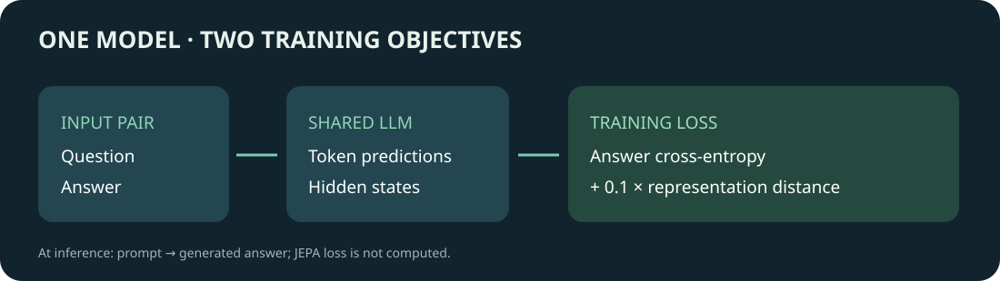

# 给语言模型加入 JEPA 目标：一次单卡训练通路实验

如何让语言模型在学习生成答案时，同时学习问题与答案之间的表征关系？[LLM-JEPA](https://arxiv.org/abs/2509.14252) 在常规的自回归语言模型损失之外，加入两个相关视角的潜在表征预测目标。我们在 DGX Spark 上用一个小规模加法数据集跑通常规 LoRA 微调和 LLM-JEPA 训练，再比较它们与未微调模型的生成结果。

**结果：未微调模型已经答对全部 40 题；常规微调为 39/40，JEPA 为 40/40。**这个自制数据集过于简单且只有一个随机种子，无法证明 JEPA 提升了模型能力。它的价值是展示一条从数据、标签检查到训练和生成评估的可检验路径。

## 原理：同一问题的两个视角

例如，训练样本中用户问 `What is 1 + 2?`，助手回答 `3`。自回归语言模型使用问题上下文预测回答 token；JEPA 项还分别编码问题和回答，拉近这两个视角的隐状态。在本次配置中，两者共享语言模型参数，取各自最后内容 token 的末层隐藏向量，未加入额外 predictor token。

训练损失为：

$$L=L_{LM}+0.1\left(1-\frac{1}{B}\sum_{i=1}^{B}\cos(z_{q,i},z_{a,i})\right)$$

其中 $L_{LM}$ 是回答 token 的交叉熵；$z_q$ 和 $z_a$ 分别是问题与答案视角的表征。这个实现保留原模型的文本生成路径，JEPA 项仅在训练时使用。该方案遵循[论文作者的实现](https://github.com/galilai-group/llm-jepa)，不是所有 JEPA 都使用相同的结构或生成方式。

## 数据与输入输出

数据由脚本自行生成：数字范围分别为 0–9 与 0–19，固定种子打乱后得到 160 个训练问题和 40 个不同的测试问题。训练时消息由 system 指令、user 问题、assistant 答案组成；推理时只提供前两项，让模型生成答案。评估使用贪心解码，最多生成 12 个 token，去掉首尾空白后与标准答案逐字匹配。

题目形式单一、答案范围大量重叠，而且模型本身已经会做这些题。测试结果因此只能检查链路是否保持基本生成能力，不能衡量复杂推理或训练带来的提升。三组逐题输出与训练汇总可在 [results](results/) 中查看。

## 实测结果

| 模型 | 严格完全匹配 | 训练步数 | 训练耗时 |
| --- | ---: | ---: | ---: |
| 原始 Qwen2.5-1.5B-Instruct | 40/40 | — | — |
| 常规 LoRA 微调 | 39/40 | 20 | 21.42 s |
| 加入 JEPA 目标的 LoRA 微调 | 40/40 | 20 | 39.46 s |

在这一次运行中 JEPA 的 Trainer 训练耗时更长；计时包括训练过程，不包括独立的模型加载和最终模型保存，只有单次记录，不能作为通用性能结论。运行在 DGX Spark，PyTorch 2.14.0+cu130、Transformers 5.19.0、PEFT 0.20.0；两组训练使用相同数据、seed 42、batch 2、梯度累积 4、长度 128、学习率 2e-5、1 epoch、LoRA rank 8。两组步数相同但计算量不同，不能视作等计算预算比较。

第一次运行发现原版常规 Trainer 与作者自定义 Trainer 的梯度累积损失归约口径可能不同。补丁尝试使两条路径使用每个 microbatch 的平均损失，并按累积步数缩放；CPU 小模型检查中，JEPA 权重为 0 时，两条路径的 15 组参数梯度最大差为 0。该检查不代表其他版本、batch 或真实训练全过程的归约一定相同。修复后这一次训练日志的 baseline train_loss 为 2.314，JEPA 为 0.04509，差异尚未解释；两种目标的日志 loss 也不能直接用于比较效果。修复前的旧轮次不纳入以上结果。

进一步检查发现，同一组样本的前向损失会随设备、批处理、填充长度和注意力实现明显变化。对照过程及其局限见[填充与精度排查](PADDING-AND-PRECISION.md)；历史训练日志差异的完整原因仍未确定。

## 复现路径

1. 准备单 GPU 环境及本地 Qwen2.5-1.5B-Instruct 模型，记录模型修订和许可；本次运行未记录模型 revision，不能保证逐位复现；依赖应与上面的版本对齐。作者代码为 [Apache-2.0](https://github.com/galilai-group/llm-jepa/blob/main/LICENSE)，模型和依赖各有自己的许可。
2. 将 [作者仓库](https://github.com/galilai-group/llm-jepa)检出到 `ea0017c654ad917066ff32afc88276bea8ca5f7e`。我们不运行其 `setup.sh`。
3. 用 `python scripts/make_toy_data.py --output /path/to/new-data` 生成数据；目标目录必须不存在。
4. 检查 tokenizer：`python scripts/audit_tokenizer.py --model /path/to/model --data /path/to/new-data/train.jsonl`。对该模型使用 `LAST_TOKEN=-3`。
5. 将 `AUTHOR_REPO`、`MODEL`、`DATA`、`RUN_ROOT`、`PYTHON`、`LAST_TOKEN=-3` 设为绝对路径或指定值后运行 `bash scripts/run_single_gpu.sh`。脚本验证作者 revision、拒绝已有输出目录，复制源码并修复答案标签与当前 Transformers API 的兼容问题，然后顺序运行两组训练。建议先核对补丁和硬件可用资源。
6. 用相同测试集分别对原模型与两组输出运行 `python scripts/evaluate_toy.py --model /path/to/model --data /path/to/new-data/test.jsonl --output /path/to/new-result.json --device cuda`。输出逐题结果，新结果不会覆盖已有文件。

作者原始的答案标签逻辑可能匹配到问题中首次出现的答案 token；补丁改为检查完整对话是否以生成提示的 token 为前缀，并拒绝被截断的答案。当前 Transformers 版本中聊天模板默认可能返回字典，补丁显式请求 token 列表。使用其他 tokenizer 或版本时必须重新审核标签和末 token 位置。

后续若要判断方法是否有效，需要更有区分度的数据、未微调基线、多个随机种子和等计算预算，并记录生成质量与资源开销；一次通路实验不承担这些结论。
