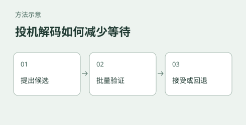

# Local LLM inference: testing speculative decoding on GB10

[中文](README.md)



Speculative decoding proposes tokens before the target model verifies them. The extra draft work only pays off when enough proposals are accepted and the verification path is efficient. This experiment records single-request generation speeds for three model configurations on a GB10 system, with several draft settings and prompts. It is a starting point for measuring your own workload, not a general performance ranking.

For the recorded Qwen3.6-35B-A3B configuration on one free-generation prompt, the baseline averaged **64.07 generated tokens/s** and the tested MTP configuration averaged **90.11 tokens/s**, about **40.7% higher**. These are three-run means for one prompt, not first-token latency or concurrent throughput. A token is a model unit, not a character. Repeated requests could reuse prefixes: the recorded prefill rates are not cold-start measurements.

The [mechanisms guide](docs/推理机制与性能解读.md) explains autoregressive generation, speculative verification, MTP, dense models and MoE. The [three-model report](reports/03-三模型投机矩阵-任务类型与参数交互.md) gives the experimental settings and recorded results. These detailed references are in Chinese.

## What was tested

| Item | Recorded configuration |
|---|---|
| Engine | Locally built llama.cpp; see each report for the recorded commit |
| Model A | Qwen3.8-Flash-Next, about 180B total parameters including a 125B MoE backbone, about 6B active, IQ4_XS in three shards |
| Model B | Qwen3.8-27B dense, UD-Q4_K_M GGUF |
| Model C | Qwen3.6-35B-A3B MoE, about 3B active, UD-Q4_K_M with an MTP head |
| Drafts | Flash-Next MTP Q8_0 head and a separately trained 27B DFlash2 Q4_K_M draft |
| Hardware and OS | GB10 Grace Blackwell unified-memory systems; Linux aarch64 on DGX Spark and Windows on Arm on RTX Spark |

The matrix uses three prompts, with three runs per listed configuration. It records generation speed, prefill speed and draft acceptance where available. It does **not** evaluate answer quality, multi-turn conversation, concurrent load or a context-length sweep. Each task category has one prompt, so differences cannot be attributed to task type; model architecture and drafting mechanism also change between some comparisons.

The [results directory](results/) contains historical configurations and per-run readings. The [matrix report](reports/03-三模型投机矩阵-任务类型与参数交互.md) supersedes some conclusions in earlier reports. The model files, their exact revisions, build options and full original running environment are not included, so these records alone do not guarantee an exact rerun.

## Observations and limits

- The three measured prompts showed different speed changes. For example, the 125B configuration's T1/T3 changes were +16.4%/+57.0%, while the 27B configuration's were +54.3%/+131.4%. This does not establish that one task type or architecture is inherently faster.
- For the tested settings, `p_min=0.0` had a mean throughput at least as high as `p_min=0.75`; some differences are small relative to run variation. A higher draft acceptance rate does not by itself imply higher throughput.
- For the 125B free-generation prompt, `n_max=5` was slower than the no-speculation baseline. On the other two prompts it averaged below `n_max=3`, though still above baseline and with substantial variability.
- None of the three N-gram variants showed a stable positive benefit across the three measured prompts. Other workloads need their own tests.

## Run a single-request example

Install Python and build a compatible CUDA-enabled llama.cpp server. The commands below exercise the service once; they do not reproduce the full historical matrix. The default main and draft paths are for the Flash-Next MTP example. DFlash2 requires a compatible main model and draft file, set separately using `MODEL_DIR`, `MAIN_MODEL` and `DRAFT_MODEL`; check the selected llama.cpp build's supported options first.

```bash
# Terminal 1: start the baseline and wait until it is ready
bash scripts/start-server.sh base

# Terminal 2: request up to 400 tokens, ignoring EOS to try to fix the length
python scripts/bench.py --host 127.0.0.1 --port 8835 --n-predict 400 --ignore-eos
```

Record `gen_tokens` and generation speed, and verify the stop reason in the server logs or raw response: the client prints parsed metrics, not the full response or stop reason. Context limits, unsupported options or failures can still prevent a 400-token result. Stop the baseline server before starting `bash scripts/start-server.sh mtp` on the same port; then repeat the same request. Run `dflash` only after selecting a matching main and draft model, since the default draft is the MTP file. Override executable and paths with `LLAMA_BIN`, `MODEL_DIR`, `MAIN_MODEL` and `DRAFT_MODEL`.

The example uses one service slot to match this single-request experiment; it does not establish a universal restriction on speculative decoding with concurrent requests. For a separate same-engine slot comparison, see [the 35B slot experiment](../gb10-inference/qwen36-35b-ab/README.en.md). A higher draft acceptance rate does not by itself imply higher generation speed: draft generation and verification also cost time, and changing the threshold can change how many candidates are proposed. Compare throughput and acceptance under the same model, build, workload and slot count; the historical notes do not establish a universal best threshold for MTP or DFlash2. See [speculative decoding](https://proceedings.mlr.press/v202/leviathan23a.html) and the [llama.cpp concurrent DFlash issue](https://github.com/ggml-org/llama.cpp/issues/27117) for algorithm and implementation context.

## Files

- [Main matrix report](reports/03-三模型投机矩阵-任务类型与参数交互.md): model settings, task matrix, measurements and limitations.
- [MTP parameter scan](reports/01-MTP参数扫描-Flash-Next.md) and [DFlash2 parameter scan](reports/02-DFlash2参数扫描-27B稠密.md): earlier measurements.
- [Earlier synthesis](reports/最终报告-投机解码收益的机制条件.md): retained for provenance; some conclusions are superseded by the matrix report.
- [Mechanisms guide](docs/推理机制与性能解读.md) and [debugging notes](docs/调试与排错记录.md).
- [Scripts](scripts/) and [recorded results](results/).

**Prefill interpretation:** `scripts/parse_matrix.py` displays an average prefill rate only when every round has a rate and the same positive `prefill_tokens` count; otherwise it shows `-` (an empty CSV field). For example, the 35B baseline T1 rounds process 28, 4 and 4 tokens, so averaging their rates does not measure full-prompt cold-start throughput. Individual measurements remain in the raw records. Equal token counts alone do not establish equal cache state or a cold start. Generation-rate aggregation is unchanged.
