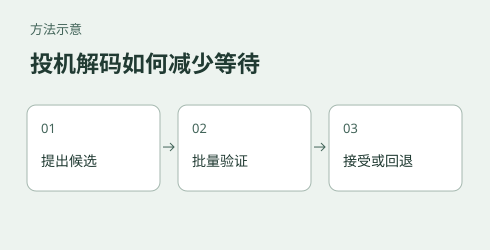

# llm-inference-perf：本地大模型推理性能实验

[English](README.en.md)



## 一台设备上，投机解码能让大模型快多少？

同样让模型生成 400 个 token，先由草稿模型或辅助预测模块猜一段、再让目标模型验证，是否真的比大模型逐个生成更快？答案取决于被接受的草稿数量与额外计算开销。本实验在 GB10 设备上比较三种模型配置的单请求生成速度，帮助你为自己的部署选择需要测试的草稿方案和参数。

例如，在实测的 Qwen3.6-35B-A3B 配置中，自由生成提示词的基线是 **64.07 token/s**，启用 MTP 后为 **90.11 token/s**，三轮均值提升约 **40.7%**。token 是模型切分文本的单位，并不等于字数；此处是生成阶段速度，并非首 token 时间，也不代表多用户并发速度。三轮、单条提示词不足以推断其他任务或设备也有同样收益。重复请求存在前缀复用，不能把记录中的 prefill 数据当作冷启动首 token 时间。

如果想理解自回归为什么逐步生成、草稿怎样验证，以及 MTP、稠密模型和 MoE 如何影响部署，先读 [推理机制与性能解读](docs/推理机制与性能解读.md)。模型参数、实验设计和每一组数据见 [三模型实测报告](reports/03-三模型投机矩阵-任务类型与参数交互.md)。

本实验为单请求测试，无法据此推断多请求并发时的吞吐与等待时间。

## 不测什么

- **模型质量与准确率**：跳过。本实验只测速度类指标（生成吞吐、预填充吞吐、草稿接受率）。草稿接受率是机制指标，不是模型能力指标。
- **训练与微调**：不涉及。
- **多轮对话、并发压力**：当前单请求串行，并发场景未测（结论的适用范围限制之一）。
- **长上下文下的衰减**：上下文固定档位测试，未做上下文长度扫描。

## 被测对象与版本

| 项 | 值 |
|---|---|
| 推理引擎 | llama.cpp（自编译，见各报告元信息段的 commit） |
| 主模型 A | Qwen3.8-Flash-Next，总参约 180B（MoE 主干 125B）、激活约 6B，IQ4_XS 三分片 |
| 主模型 B | Qwen3.8-27B，稠密，UD-Q4_K_M GGUF |
| 主模型 C | Qwen3.6-35B-A3B，MoE、激活约 3B，UD-Q4_K_M（自带 MTP 头） |
| 草稿模型 A | mtp-Qwen3.8-Flash-Next-Q8_0（MTP 草稿头） |
| 草稿模型 B | Qwen3.8-27B-DFlash2-Q4_K_M（独立训练的 DFlash2 草稿模型） |
| 硬件 | GB10 Grace Blackwell 统一内存设备（DGX Spark 与 RTX Spark 两种整机形态） |
| 操作系统 | Linux aarch64（DGX Spark）、Windows on Arm（RTX Spark） |

## 数据来源

报告记录的是模型与硬件的实测。矩阵配置和每轮读数保存在 `results/`；表中均值、标准差和适用范围见对应报告。

## 运行示例与复现边界

下面的命令是单次连通性与吞吐测试，不会自动重建报告的三模型、三任务、三轮矩阵。脚本默认的主模型和草稿模型针对 Flash-Next 的 MTP；DFlash2 使用不同的主模型与草稿文件，运行前必须分别设置 `MAIN_MODEL`、`MODEL_DIR` 和 `DRAFT_MODEL`，并核对当前 llama.cpp 是否支持对应参数和模型组合。模型文件、精确版本、编译选项及服务运行环境不随脚本提供。

依赖 Python 标准库，以及具备 CUDA 支持且兼容所选模型的 llama.cpp。服务器默认使用 8835 端口，分别运行基线与投机配置，**不要同时在同一端口启动多个服务**：

```bash
# 终端 1：先启动基线，等待服务就绪
bash scripts/start-server.sh base

# 终端 2：请求固定上限 400 个 token；忽略 EOS 以尝试固定生成长度
python scripts/bench.py --host 127.0.0.1 --port 8835 --n-predict 400 --ignore-eos
```

记录响应中的 `gen_tokens`、生成速度和实际停止原因；若请求失败、达到上下文限制或服务不支持参数，不能假定已生成 400 个 token。此脚本只输出解析后的计时与 token 数，不保存完整响应和停止原因；需要在服务器日志或原始响应中另行核验。完成基线后停止终端 1 的服务，再启动 `bash scripts/start-server.sh mtp`，对同一提示与请求参数重复测试。`dflash` 模式还需指定相匹配的主模型和 DFlash2 草稿模型，默认草稿不能用于该模式。

通过环境变量覆盖路径：`LLAMA_BIN`、`MODEL_DIR`、`MAIN_MODEL`、`DRAFT_MODEL`。示例脚本设置单槽以匹配本项单请求测试，不代表所有引擎版本均禁止投机解码并发。历史测量中的重复请求可能复用前缀，因此不要用其 prefill 吞吐代表冷启动性能。矩阵的历史读数及配置见 `results/` 和报告；这些命令尚未在本次文档修订中重跑全部矩阵。

## 实验清单

| 目录/文件 | 内容 |
|---|---|
| `reports/01-MTP参数扫描-Flash-Next.md` | 阶段一进展报告：MTP 三参数对 125B MoE 的影响 |
| `reports/02-DFlash2参数扫描-27B稠密.md` | 阶段一进展报告：同套参数对 27B 稠密 + DFlash2 的影响 |
| `reports/03-三模型投机矩阵-任务类型与参数交互.md` | **阶段二主报告，当前结论以此为准**：三模型 × 五种配置（含基线）× 三任务主矩阵及补充参数扫描，修订阶段一的误判 |
| `reports/最终报告-投机解码收益的机制条件.md` | 阶段一综合报告，**部分结论已被 03 修订**（文首有修订声明），保留供追溯推理路径与踩坑 |
| `docs/推理机制与性能解读.md` | 自回归、投机解码、MTP、稠密与 MoE 的原理和使用边界 |
| `docs/调试与排错记录.md` | 测量陷阱与踩坑：构建版本干扰、并发数约束、参数不生效的排查路径 |
| `scripts/` | 启动、测试和矩阵解析脚本；历史矩阵执行器在 `results/` |
| `results/` | 矩阵原始输出与配置（每配置每任务三轮读数，结论可回溯证据，已入库） |

## 结论速览

当前有效结论见 `reports/03-三模型投机矩阵-任务类型与参数交互.md`，四条：

1. **三个提示词的收益不同，尚不能归因于任务类型或模型结构**。例如 125B 的 T1/T3 分别为 +16.4% / +57.0%，27B 为 +54.3% / +131.4%；每类任务仅一个提示词，模型与草稿机制也同时不同。
2. 在所测阈值与配置中，`p_min=0.0` 的平均吞吐不低于 `p_min=0.75`；波动和不同模型的对照条件见主报告。接受率高不保证吞吐更高。
3. 125B 的自由生成提示词上，`n_max=5` 比无投机基线慢；在另外两个提示词上，它的均值低于 `n_max=3`，但仍高于基线且波动较大。
4. **N-gram 系列的三种变体在本次三个提示词上没有显示稳定正收益**；其他负载需要单独测试。

阶段一的三条旧结论（MoE 挂草稿净亏、125B MTP 零收益、对 MTP 过滤低置信度是净赚）已被阶段二数据推翻，保留在阶段一报告中供追溯。
