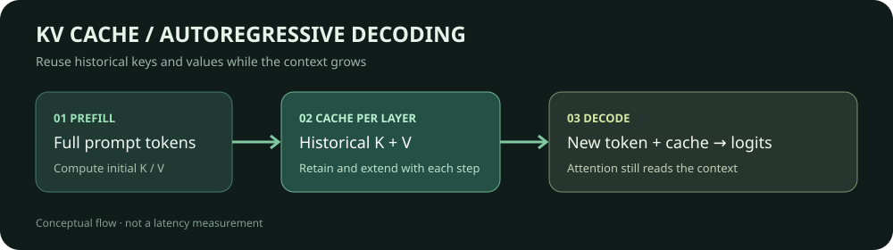

# KV cache: reuse history during token-by-token decoding

[中文](README.md) | English

An autoregressive model first processes the prompt and then predicts tokens one at a time. Recomputing the full prefix at every step repeats work. A KV cache stores previous keys and values at each attention layer; subsequent steps compute projections for new tokens and attend over the cached history.



This experiment compares last-position logits from a randomly initialized, tiny Qwen2 model using two paths: full-prefix recomputation and incremental inference with the framework’s KV cache. It checks numerical behavior; it does not measure model quality or speed.

## From input IDs to the next token

The model accepts token IDs shaped `batch × sequence` and produces logits over a vocabulary of size `V`, typically shaped `batch × sequence × V`. The final position gives scores for the next token. Greedy decoding or sampling selects an ID, which the tokenizer can decode into text. Implementations may return logits for only a subset of positions.

**Prefill** runs the prompt and returns `past_key_values`. During **incremental decoding**, the next token and prior cache are passed back to the model; each layer appends the new key and value, and the new query attends to earlier tokens. The example uses one unpadded sequence and fixed teacher-forced input IDs. Real batched serving also needs correct masks, positions and cache lifecycle handling.

For a simplified single attention head:

$$
q_t=x_tW_Q,\quad k_t=x_tW_K,\quad v_t=x_tW_V
$$

$$
K_{\leq t}=[K_{<t};k_t],\quad V_{\leq t}=[V_{<t};v_t],\quad
o_t=\operatorname{softmax}\left(\frac{q_tK_{\leq t}^{\mathsf T}}{\sqrt{d_h}}\right)V_{\leq t}
$$

Actual models add multiple heads and can use grouped-query attention. Qwen2 applies rotary position encoding to queries and keys before cache update. A cache avoids repeating earlier projections; each new query still attends to historical keys, so the overall cost of long-sequence attention does not simply become linear.

For a standard dense KV cache, an estimate in bytes is:

$$M_{KV}=2LBT H_{kv}d_h b$$

$L$ is the number of layers, $B$ batch size, $T$ cached sequence length, $H_{kv}$ the number of KV heads, $d_h$ the head dimension, and $b$ bytes per value. The factor 2 accounts for keys and values. Allocator overhead, padding, metadata and other cache layouts are excluded. Prefix sharing requires a supporting engine and compatible model, token prefix and positions.

## Run the numerical check

Python, PyTorch and Transformers are required. No model weights or dataset are downloaded. Install PyTorch for your platform and use the recorded Transformers version:

```bash
python -m pip install torch transformers==5.19.0
python kv_cache_check.py
```

The script creates a two-layer model, prefills three IDs, then incrementally grows the sequence to seven. At each position it compares cached logits with full-prefix recomputation and checks cache length. A CPU float32 run with Python 3.12.3, PyTorch 2.14.0+cu130 and Transformers 5.19.0 recorded a maximum absolute error of **4.47 × 10⁻⁸** across five positions; cache lengths were 3, 4, 5, 6 and 7. Floating-point differences vary by hardware, precision and operators. The script reports greedy-token matches separately: a near tie can change the selected token even when logits satisfy the numerical tolerance.

The script explicitly manages forward calls and cache passing while using the framework’s attention implementation; it does not implement an attention kernel from scratch. A performance study would need controlled model, input/output lengths, precision, batch and implementation, plus warmup and repeated timings. Report first-token latency, subsequent-token latency, throughput and peak memory separately; synchronize GPU timings.

## Sources

- [Transformers cache explanation](https://huggingface.co/docs/transformers/main/en/cache_explanation)
- [Qwen2 attention and cache update in Transformers 5.19.0](https://github.com/huggingface/transformers/blob/v5.19.0/src/transformers/models/qwen2/modeling_qwen2.py)
