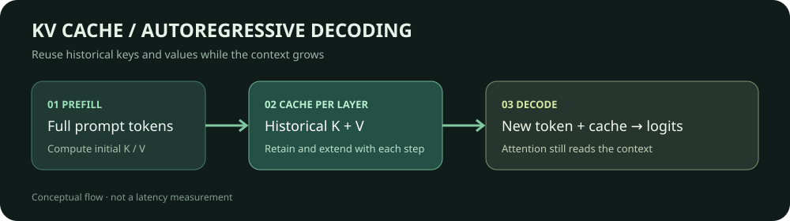

# KV Cache：复用历史状态，理解逐 token 解码

[English](README.en.md)

生成一段回答时，模型先读完整提示词，再一次次预测下一个 token。如果每次都重新计算已有文本，提示词越长，重复工作越多。KV Cache 保存各层历史 token 的 key 和 value，让后续步骤只需计算新 token 的投影，再与历史状态做注意力计算。



这里用一个随机初始化的小型 Qwen2 模型，逐位置对照「重算完整前缀」和「传入缓存、只处理新增 token」的 logits。它适合检查缓存的工作方式，不提供模型质量或推理速度结论。

## 从输入到下一个 token

模型接收形状为 `batch × sequence` 的 token ID，前向计算输出各位置的 logits，词表大小为 `V` 时，完整 logits 的形状为 `batch × sequence × V`。最后一个位置的 logits 对应下一个 token 的候选分数；经过贪心选择或采样得到 token ID，再由 tokenizer 解码成文本。具体实现也可能只返回部分位置的 logits。

缓存模式有两个阶段：

1. **预填充**：把提示词一次送入模型，计算各层注意力，并返回包含历史 K、V 的 `past_key_values`。
2. **增量解码**：把新 token 和上一步的缓存传入模型；新计算的 K、V 加入各层缓存，新 token 的 query 仍可关注此前的 token。缓存长度随序列增长。

脚本使用批大小为 1、无填充的 token ID，后续 token 固定来自预设序列，便于对照每一步。真实批处理还需要正确处理 attention mask、位置和缓存生命周期，具体接口随框架版本而异。

## 原理和成本

对某一层的当前隐藏状态 $x_t$，简化表示为：

$$
q_t=x_tW_Q,\quad k_t=x_tW_K,\quad v_t=x_tW_V
$$

$$
K_{\leq t}=[K_{<t};k_t],\quad V_{\leq t}=[V_{<t};v_t],\quad
o_t=\operatorname{softmax}\left(\frac{q_tK_{\leq t}^{\mathsf T}}{\sqrt{d_h}}\right)V_{\leq t}
$$

这是单头示意，实际模型还有多头、分组查询注意力等细节。Qwen2 对 query 和 key 应用旋转位置编码后，再将 key 和 value 更新到缓存。缓存避免重复计算历史状态，但新 token 仍需与历史 key 做注意力运算；它不意味着长序列注意力的总计算量变成线性。

对标准稠密 KV 缓存，估算占用字节数可写成：

$$
M_{KV}=2LBT H_{kv}d_h b
$$

其中 $L$ 是层数，$B$ 是批大小，$T$ 是缓存长度，$H_{kv}$ 是 KV 头数，$d_h$ 是每头维度，$b$ 是每个元素的字节数，系数 2 对应 K 和 V。它不包含分配器开销、填充、元数据等，也不直接适用于不同缓存结构、滑动窗口或缓存量化的全部细节。共享前缀的请求在模型、token 前缀、位置等条件匹配且推理引擎支持时，也可以复用前缀缓存。

## 运行数值对照

需要 Python、PyTorch 和 Transformers，无需下载权重或数据集。下面的版本组合用于本次 CPU 验证；PyTorch 的安装方式请按运行平台选择。

```bash
python -m pip install torch transformers==5.19.0
python kv_cache_check.py
```

脚本创建两层随机初始化的 Qwen2，输入固定 token ID，先预填充 3 个 token，再逐个追加至 7 个；每一步都与完整前缀重算的最后位置 logits 比较，并检查缓存长度。运行环境为 Python 3.12.3、PyTorch 2.14.0+cu130、Transformers 5.19.0，使用 CPU 和 float32。5 个位置的最大 logits 绝对误差为 **4.47 × 10⁻⁸**，缓存长度依次为 3、4、5、6、7。不同硬件、精度和算子可能产生不同的浮点误差，当最高分很接近时，贪心结果也可能不同；脚本将各位置的贪心结果是否一致作为观察项输出，不把它当作数值对照的通过条件。

脚本还检查每层 K、V 的张量形状，并输出与上式对应的逻辑数据量 `cache_payload_bytes`。例如 float32、缓存长度为 7 时，本例两层合计 1792 字节；这是张量元素字节数，不是进程内存或显存实测。

本例调用 Transformers 已实现的缓存，手动管理前向调用和缓存传递；不是从零实现注意力内核。若要比较速度，应固定模型、输入和生成长度、精度、批大小及实现，预热并重复测试，GPU 计时还需同步；分别报告首 token 延迟、后续 token 延迟、吞吐和峰值内存。此处不把数值一致性测试当作性能测试。

## 继续阅读

- [Transformers：缓存机制说明](https://huggingface.co/docs/transformers/main/en/cache_explanation)
- [Transformers 5.19.0：Qwen2 注意力与缓存更新源码](https://github.com/huggingface/transformers/blob/v5.19.0/src/transformers/models/qwen2/modeling_qwen2.py)
