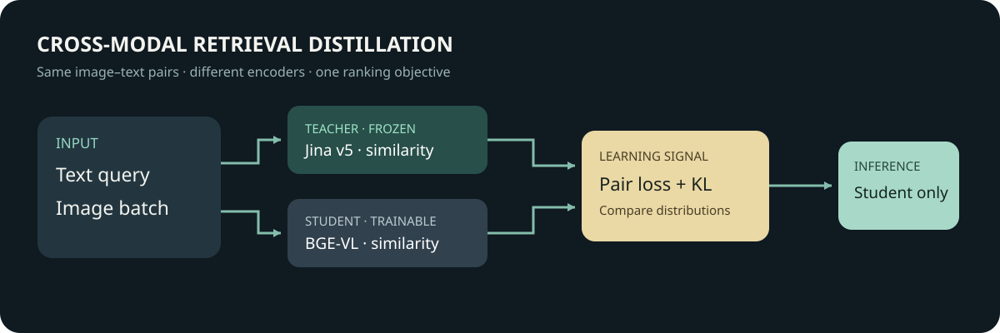

# Distilling a multimodal retrieval model

[中文](README.md)



Can a smaller model learn better text-to-image ranking from a larger teacher? We compared the original BGE-VL-base student, a student trained on paired images and captions, and a student trained with both pair supervision and a Jina v5 teacher. The distillation run did not improve R@1 over pair supervision in this small experiment.

## Results

For each of 100 held-out captions, the model ranks the same 100 test images. R@1 and R@5 count how often the paired image appears in the top 1 and top 5; MRR averages reciprocal rank.

| Condition | R@1 | R@5 | MRR |
| --- | ---: | ---: | ---: |
| Jina v5 teacher | 0.94 | 1.00 | 0.9658 |
| BGE-VL baseline | 0.93 | 0.99 | 0.9584 |
| Pair supervision | 0.93 | 1.00 | 0.9608 |
| Pair supervision + distillation | 0.91 | 1.00 | 0.9508 |

Relative to supervision, two queries lost first place and none gained it. The paired 10,000-resample bootstrap interval for the R@1 difference was [−0.05, 0.00]. Only one training seed was tested. A 100-image candidate pool, the high baseline, incomplete relevance labels, potential visual near-duplicates and unknown pretraining overlap all limit generalization. The teacher supports more modalities than the student, so their parameter counts are not a like-for-like compression ratio.

The DGX Spark teacher encoded 740 pairs in 84.69 s including model load. Supervised and distilled students trained for 64 steps in 13.57 and 12.99 s respectively. These timings cover different work and are not a latency comparison.

## Models, data and objective

The teacher is [Jina Embeddings v5 Omni Small](https://huggingface.co/jinaai/jina-embeddings-v5-omni-small), revision `5c54692f22e186fc12ea38a9193e3ff9e1cda2a3`, licensed CC BY-NC 4.0. The student is [BGE-VL-base](https://huggingface.co/BAAI/BGE-VL-base), revision `cc4c733ed997dbee4ac70ccffb911e70c9c24b93`, MIT, with 149,620,737 parameters measured locally. The 1.74B teacher figure includes modalities unused in this run.

We sampled 512 train, 128 validation and 100 test images from the Flickr30k Karpathy split, using the first caption per image. Split filenames were disjoint; selected images decoded successfully, had no identical file hashes and no identical normalized first captions. These checks do not exclude near-duplicate images or model pretraining exposure. Each query has just one annotated positive in this evaluation; other images can also be relevant.

Both conditions use the same initialization, batches, optimizer and two training epochs. The supervised loss is bidirectional contrastive cross-entropy. The distillation condition combines it equally with bidirectional KL divergence between teacher and student distributions over in-batch candidates. Text and image vectors are normalized, with scores $s_{ij}=q_i^\top v_j$ and teacher scores $t_{ij}=Q_i^\top V_j$:

$$P^T_{ij}=\operatorname{softmax}_j(t_{ij}/\tau_d),\quad P^S_{ij}=\operatorname{softmax}_j(s_{ij}/\tau_d)$$

$$\mathcal L=0.5\mathcal L_{pair}+0.5\mathcal L_{KD},\quad \mathcal L_{KD}=\tfrac12[\operatorname{KL}(P^T_{t\to i}\Vert P^S_{t\to i})+\operatorname{KL}(P^T_{i\to t}\Vert P^S_{i\to t})].$$

During training the teacher supplies soft relative scores. At inference the student independently encodes a query and images and ranks by cosine similarity; the teacher is no longer needed.

## Data and reproduction

The [original Flickr30k provider](https://shannon.cs.illinois.edu/DenotationGraph/data/) states that it does not own the images and supplies them for non-commercial research and education. Obtain data independently and check its terms. This repository does not distribute images, captions, teacher embeddings or weights.

The local annotation CSV had SHA-256 `395990db603ab8bafd5c7ab2746b22058bb1e75b78b3eb56ad755931364ac137`. Sampling depends on input row order; the [public annotation mirror](https://huggingface.co/datasets/nlphuji/flickr30k/blob/006d3058228379086e8ea76b2b12959d21b168f8/flickr_annotations_30k.csv) does not match that hash, so a run using it explores the method rather than reproducing the exact sample. The CSV needs `filename`, `split`, and `raw`, where `raw` is a five-caption array and `split` is train, val or test. Example with synthetic values:

```csv
filename,split,raw
example.jpg,train,"['a caption', 'second caption', 'third caption', 'fourth caption', 'fifth caption']"
```

The original device scripts produced the results above. The public scripts remove machine-specific paths and the private teacher wrapper; the entire revised pipeline has **not** been rerun on the real data. Preparation was checked with synthetic images. The experiment used Linux CUDA, about 50 GiB available system memory, Python 3.12, PyTorch 2.14.0+cu130, Transformers 5.16.1, Sentence Transformers 6.0.1, NumPy and Pillow. The teacher loads custom model code; review it before running.

Set `DATA` to the annotation CSV, `IMAGES` to the image directory and `WORK` to a directory outside this repository. Download the pinned models, then run:

```bash
python -c "from huggingface_hub import snapshot_download; snapshot_download('jinaai/jina-embeddings-v5-omni-small', revision='5c54692f22e186fc12ea38a9193e3ff9e1cda2a3', local_dir='/path/to/teacher')"
python -c "from huggingface_hub import snapshot_download; snapshot_download('BAAI/BGE-VL-base', revision='cc4c733ed997dbee4ac70ccffb911e70c9c24b93', local_dir='/path/to/student')"
python scripts/prepare.py --annotations "$DATA" --images "$IMAGES" --out "$WORK"
python scripts/teacher.py --workdir "$WORK" --images "$IMAGES" --teacher /path/to/teacher
python scripts/train.py --workdir "$WORK" --images "$IMAGES" --student /path/to/student
python scripts/verify.py
```

Preparation selects and audits the images, writing private pairs to `WORK`. The teacher encodes the selected data; the student script trains and evaluates the three student conditions. Keep outputs private. `verify.py` recalculates student metrics and the paired interval from [recorded per-query ranks](evidence/student-test-ranks.json). It does not rerun inference or independently validate the teacher aggregate, for which per-query ranks were not retained.
