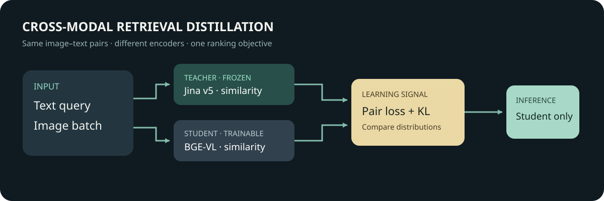

# 图文检索蒸馏：Jina v5 教师与 BGE-VL 学生

[English](README.en.md)



对于文本查询图片的任务，我们比较大模型给出的批内相关性分布能否改善小模型排序。本次蒸馏没有超过仅使用图文配对标签的学生：在 100 条测试查询上，R@1 从 0.93 降至 0.91。教师和学生初始模型已分别达到 0.94 与 0.93，测试集较小，结果不能推广到其他图文检索场景。

## 实测结果

每条测试描述在相同的 100 张测试图中查找对应图片，R@1 和 R@5 分别表示目标图片进入前 1、前 5 位的比例，MRR 对排名取倒数后求均值。

| 方法 | R@1 | R@5 | MRR |
| --- | ---: | ---: | ---: |
| Jina v5 教师 | 0.94 | 1.00 | 0.9658 |
| BGE-VL 学生原始模型 | 0.93 | 0.99 | 0.9584 |
| 学生，仅图文配对监督 | 0.93 | 1.00 | 0.9608 |
| 学生，配对监督加教师蒸馏 | 0.91 | 1.00 | 0.9508 |

相对监督组，蒸馏组有 2 条查询的目标从第 1 位降到后面，没有查询从非第 1 位升到第 1 位，其余 98 条的 R@1 归属不变。按查询配对重采样 10,000 次，R@1 差值的 95% 百分位区间为 [−0.05, 0.00]；这反映本次样本的不确定性，不能解释为在所有数据上的变化。

DGX Spark GB10 上，教师为 740 对图文编码并载入模型共 84.69 秒，PyTorch 峰值分配 3.55 GiB；两组学生各训练 64 步，监督组 13.57 秒，蒸馏组 12.99 秒，完整学生流程的 PyTorch 峰值分配 3.56 GiB。这些计时范围不同，也没有测量端到端检索延迟，不能用于教师和学生速度比较。运行环境为 PyTorch 2.14.0+cu130、Transformers 5.16.1、Sentence Transformers 6.0.1；学生权重使用 FP32，前向启用 BF16 自动混合精度。

这次结果说明所选教师信号与训练配置没有带来可见的 R@1 改善。100 个候选且目标图片大多已排在首位，改善空间有限；单一随机种子、缺少大量难负例以及教师和学生预训练数据的未知重叠，也限制了结论。目标之外的图片即使与描述相符也未被标为正例。

## 数据与模型

训练和评估使用 Flickr30k 的 Karpathy 划分；本地标注含 29,000 张训练图、1,014 张验证图、1,000 张测试图，每图五条英文描述。种子 20261107 分别抽取 512、128、100 张，每张使用第一条描述作为查询。图文对按图片划分，三部分文件名不交叉；选中的 740 张图可解码，文件 SHA-256 无完全重复，首描述规范化后无完全重复。文件名和字节核对不能排除视觉近重复，也不能证明模型预训练时未使用这些样本。

图片含真实人物和未成年人。十二张训练样例联系表只在内部检查，不对外提供；公开仓只保留用于独立获取数据的说明和可公开的统计。数据集原始发布方声明图片版权不归其所有，图片仅向研究者和教育者提供非商业研究或教育用途。 [Flickr30k 原始项目](https://shannon.cs.illinois.edu/DenotationGraph/data/)

教师是 [Jina Embeddings v5 Omni Small](https://huggingface.co/jinaai/jina-embeddings-v5-omni-small)，模型卡标注约 1.74B 参数与 CC BY-NC 4.0，设备缓存版本 `5c54692f22e186fc12ea38a9193e3ff9e1cda2a3`。它支持文本、图像、音频、视频，但本次只测试文本查找图片。学生是 [BGE-VL-base](https://huggingface.co/BAAI/BGE-VL-base)，版本 `cc4c733ed997dbee4ac70ccffb911e70c9c24b93`，本地模型实测 149,620,737 参数，模型卡标注 MIT；参数比例约 11.6∶1。两个模型模态范围不同，参数或显存差距不代表同等功能下的压缩比。

教师、原图和蒸馏权重均不随公开代码分发。实验按非商业研究处理；任何商用或分发模型的安排需要另行核对权利。

## 对照与学习目标

固定相同的 512 个训练对和 100 张测试候选，在同一测试集比较：学生初始模型、仅用图文配对训练的学生、加入教师分布蒸馏的学生，以及教师自身。两组学生使用同一初始化、批次顺序、训练步数与优化器。验证集只报告指标，不用来挑选配置。由于每张图只把对应描述视为标注正例，其他语义相关图片可能被算作负例。

令学生的归一化查询与图片向量为 $q_i,v_j$，教师相应向量为 $Q_i,V_j$，批次相似度分别为 $s_{ij}=q_i^\top v_j$ 和 $t_{ij}=Q_i^\top V_j$。监督组用双向批内交叉熵，蒸馏组在同一损失之外对齐教师给每个批内候选的相对概率：

$$
P^T_{ij}=\operatorname{softmax}_j(t_{ij}/\tau_d),\qquad
P^S_{ij}=\operatorname{softmax}_j(s_{ij}/\tau_d),
$$

$$
\mathcal L_{\rm KD}=\tfrac12\left[\operatorname{KL}(P^T_{\rm text\to image}\Vert P^S_{\rm text\to image})+\operatorname{KL}(P^T_{\rm image\to text}\Vert P^S_{\rm image\to text})\right],
\quad \mathcal L=0.5\mathcal L_{\rm pair}+0.5\mathcal L_{\rm KD}.
$$

这里的配对监督项也按文字搜图、图片搜文两个方向取平均：

$$
\mathcal L_{\rm pair}=\frac12\left[-\frac1N\sum_i\log\frac{e^{s_{ii}/\tau_p}}{\sum_j e^{s_{ij}/\tau_p}}-\frac1N\sum_j\log\frac{e^{s_{jj}/\tau_p}}{\sum_i e^{s_{ij}/\tau_p}}\right].
$$

实际训练的批量大小为 16，即每个方向通常在 16 个批内候选上计算，配对监督温度 $\tau_p=0.07$，蒸馏温度 $\tau_d=0.05$。KL 使用每批平均，代码没有额外乘以 $\tau_d^2$；因此这组 0.5/0.5 的权重及其损失尺度依赖当前温度和实现，不能直接套用到采用不同缩放方式的蒸馏代码。监督组只使用 $\mathcal L_{\rm pair}$，蒸馏组按上式组合两项。

训练时的输入是描述、图片和教师预先计算的向量；教师对批内图片的排序提供软目标，学生更新自己的文本和图片编码器。预测时学生独立编码新查询和候选图片，以余弦相似度排序，不再加载教师。教师不保证正确，蒸馏对照必须与使用同一监督数据的学生比较，才能初步识别教师信号带来的变化。

学生原始权重经两图两文 CPU 前向和反向传播检查，文本、图像投影层均有梯度。以两个测试样本比较原 Sentence Transformers 接口与训练脚本使用的 Transformers 接口，相似度矩阵最大绝对差为 0.000234；两者数值精度不同，正式对照统一使用后者。

单个随机种子和 100 条查询只能作为探索结果。

## 数据格式与复现

训练时每行需要一张图片及五条描述。数据准备脚本读取 `filename,split,raw` 三列，`raw` 是五条文本组成的数组，`split` 分为 `train`、`val`、`test`。例如，格式可写成以下**合成示例**，不是实际数据：

```csv
filename,split,raw
example.jpg,train,"['a caption', 'second caption', 'third caption', 'fourth caption', 'fifth caption']"
```

本实验的标注文件 SHA-256 为 `395990db603ab8bafd5c7ab2746b22058bb1e75b78b3eb56ad755931364ac137`。抽样取决于输入行顺序：不同版本即使同为 Karpathy 划分，固定种子也不保证选到同一批图片。[公开标注镜像](https://huggingface.co/datasets/nlphuji/flickr30k/blob/006d3058228379086e8ea76b2b12959d21b168f8/flickr_annotations_30k.csv)的文件与本次使用文件哈希不同，因此可用来探索同类流程，不能声称精确重现本次样本。原图须按 [Flickr30k 发布方条件](https://shannon.cs.illinois.edu/DenotationGraph/data/)自行获取，并检查使用权；仓库不分发图片、标注、教师向量或学生权重。

**复现状态：**原始设备脚本跑完了上表。公开脚本去除了设备私有路径和教师封装，并于 2026-11-07 在同一设备及数据上完成从头重跑；三组学生各 100 条测试排名均与原记录一致。[复现记录](evidence/reproduction-20261107.md)详述条件与边界。它需要 Linux CUDA 和约 50 GiB 可用系统内存。图文教师代码依赖模型自定义代码，应自行核查后运行。使用 Python 3.12、PyTorch 2.14.0+cu130、Transformers 5.16.1、Sentence Transformers 6.0.1、NumPy 和 Pillow。环境版本、标注顺序和硬件变化都可能影响结果。

在本实验目录执行，`DATA` 指向自行获取的 CSV，`IMAGES` 指向图片目录，`WORK` 指向仓库以外的工作目录：

```bash
python -c "from huggingface_hub import snapshot_download; snapshot_download('jinaai/jina-embeddings-v5-omni-small', revision='5c54692f22e186fc12ea38a9193e3ff9e1cda2a3', local_dir='/path/to/teacher')"
python -c "from huggingface_hub import snapshot_download; snapshot_download('BAAI/BGE-VL-base', revision='cc4c733ed997dbee4ac70ccffb911e70c9c24b93', local_dir='/path/to/student')"
python scripts/prepare.py --annotations "$DATA" --images "$IMAGES" --out "$WORK"
python scripts/teacher.py --workdir "$WORK" --images "$IMAGES" --teacher /path/to/teacher
python scripts/train.py --workdir "$WORK" --images "$IMAGES" --student /path/to/student
python scripts/verify.py
```

第一步按图片划分抽取 512 个训练样本、128 个验证样本及 100 个测试样本，检查图片可解码与文件是否重复，结果和图文配对写入本地工作目录。教师脚本在本地生成图文向量与测试摘要；学生脚本训练并评估原模型、配对监督和蒸馏三个条件。训练产物、图文描述与模型不要上传到公开仓库。

`WORK` 必须是尚不存在的新目录。教师向量绑定样本清单的 SHA-256，学生训练会检查清单和向量数量，以防样本被重排后误用旧教师向量。教师和学生阶段开始时都会将图片文件与清单中准备阶段记录的 SHA-256 核对，图片被替换或修改会报错。运行期间仍需保持图片文件不变；这些校验不证明模型权重、图片来源或近重复情况。重新准备数据或重跑时使用新的工作目录；旧版教师向量未记录该绑定，需重新生成。

`verify.py` 使用[每查询学生排名](evidence/student-test-ranks.json)独立复算三组学生指标和配对区间，不含图片、描述或身份；教师只保留上表聚合指标，不能从这份排名文件复算。复算检查的是统计计算，不能替代重新运行模型。图片近重复、预训练数据重叠和同图其他有效描述仍未排除。

三组排名以数组位置表示配对，但公开记录没有查询 ID 或可核验的对应指纹。因此复算区间依赖原始记录顺序正确，公开文件本身无法独立核验跨组配对。
