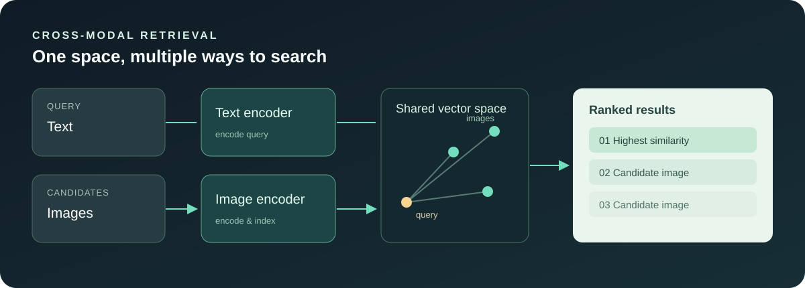

# Multimodal Embeddings: Search Visual Content with Text and Images

[中文](README.md)

When searching for images, users may not know the filenames or have exact keywords that match the images. A multimodal embedding model encodes text and images separately into comparable vectors. Images can be encoded and indexed in advance; a text query can then retrieve candidate images by similarity.

The direction can also be reversed: use an image to search text. Models that support composed queries can combine a reference image with text, for example to find images with a darker background based on a photo. Actual performance depends on the model, index, query wording, and candidate set, so evaluate on the target retrieval task.

## Contents and scope

| Entry | Contents | Current scope |
|---|---|---|
| [BGE-VL image-text encoding example](bge-vl-demo/) | Score candidate similarity for image queries and composed image-text queries | API example with two candidate images; no retrieval benchmark or accuracy claim |
| [Partial-layer CLIP fine-tuning code](clip-finetune/) | Flickr30k image-text pairs, bidirectional contrastive loss, and partial parameter freezing | Real-data small-sample GPU training and baseline comparison; full training not verified |

Before running, enter the relevant sub-experiment and follow its environment instructions to install dependencies and prepare models and data.

Embeddings retrieve candidates from a large collection. A reranker can then examine difficult top candidates individually for query relevance; reranking cannot recover images omitted by the first-stage retriever.
