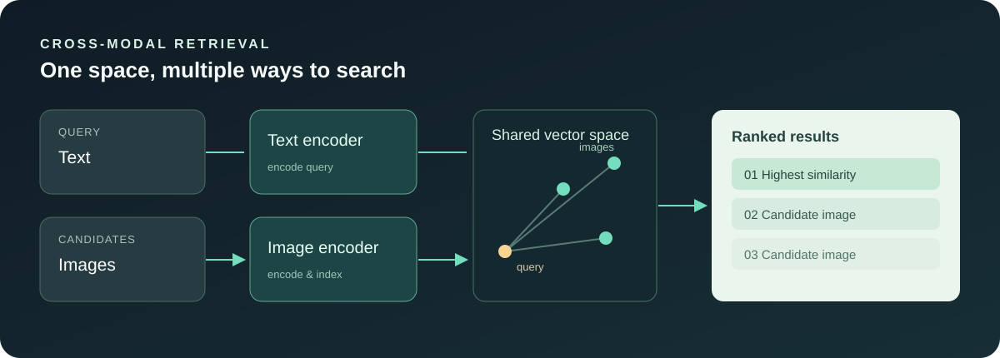

# 多模态 Embedding：用文字与图片检索视觉内容

[English](README.en.md)

搜索图片时，用户未必知道文件名，也不一定有与图片完全一致的关键词。多模态 Embedding 模型分别编码文字和图片，将它们表示为可以比较的向量：图片可以提前编码并建立索引，用户输入文字后，再按相似度找出候选图片。

这条路径也可以反过来用图片搜索文字。支持组合输入的模型还能以参考图片加文字作为查询，例如在一张照片的基础上搜索背景更暗的图片。实际效果取决于模型、索引、查询表达和候选数据，需要在自己的检索任务上评估。

## 内容与适用范围

| 入口 | 内容 | 当前范围 |
|---|---|---|
| [BGE-VL 图文编码示例](bge-vl-demo/) | 对图片查询与图文组合查询计算候选相似度 | 两张候选图片的接口示例；没有检索基准或精度结论 |
| [CLIP 部分层微调代码](clip-finetune/) | Flickr30k 图文对、双向对比损失与冻结部分参数 | 真实数据小样本 GPU 训练及前后对照；干净环境合成 CUDA 烟雾检查通过；完整数据训练未验证 |

## 环境准备

两个子实验依赖不同，本目录没有共用的 Python 环境清单。运行前进入对应目录，按其 README 和依赖文件安装环境：

- [BGE-VL 示例环境](bge-vl-demo/README.md#环境准备)：使用 [requirements.txt](bge-vl-demo/requirements.txt)，PyTorch CUDA 版本按设备另行安装。
- [CLIP 微调环境](clip-finetune/README.md#环境准备)：使用 [requirements.txt](clip-finetune/requirements.txt)，PyTorch CUDA 版本按设备另行安装；`requirements-historical.txt` 仅保留旧环境记录。

Embedding 负责从大量内容中找候选。对难以区分的前几项，可以再使用重排序模型逐一判断查询与候选是否相关；重排不能找回第一阶段遗漏的图片。
