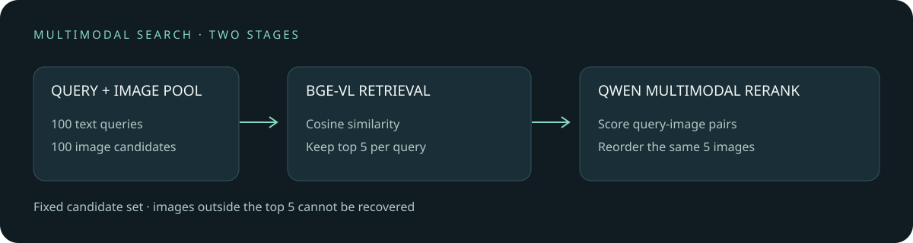

# Multimodal reranking after image retrieval

English | [中文](README.md)

When searching an image collection with text, a vector model can quickly retrieve candidates, but compressing each text and image into separate vectors can lose details. A multimodal reranker examines each text–image pair and may move better matches up the list. This adds a model evaluation per candidate and cannot recover images missed by the first stage.

For 100 English queries, BGE-VL-base retrieved five candidates from the same 100-image pool; Qwen3-VL-Reranker-2B then scored all 500 fixed candidates on DGX Spark:

| Metric | BGE ordering | Qwen reranking |
| --- | ---: | ---: |
| Paired image at rank 1 | 93/100 | 98/100 |
| MRR@5 | 0.957 | 0.985 |
| Paired image in top 5 | 99/100 | 99/100 |

Six queries improved from a missed to a correct first result; one changed in the opposite direction. A 10,000-sample paired bootstrap gives a 95% percentile interval of **0 to +10 percentage points** for the top-1 difference. The interval includes zero. The sample is small, and only the paired image is labelled relevant, so other semantically correct images count as misses. This is neither the full Flickr30k leaderboard nor a guarantee of end-to-end recall or cross-domain performance.



## How the two stages differ

BGE independently encodes query $q$ and image $I$ and ranks them by cosine similarity:

$$s_{\mathrm{retrieve}}(q,I)=\frac{e_q(q)\cdot e_I(I)}{\|e_q(q)\|\|e_I(I)\|}$$

Qwen then jointly processes each query and candidate image. Its relative `yes` and `no` scores pass through a sigmoid to produce a ranking score, which should not be interpreted as a calibrated probability. These stages use different models and scoring methods; both contribute to deployment cost.

## Data and scope

The sample comes from the Karpathy test split of [Flickr30k](https://shannon.cs.illinois.edu/DenotationGraph/). We used `random.Random(20261107).sample` on rows with `split == test` in a local annotation CSV, selecting 100 images and the first caption in each row's `raw` field. These same 100 images formed the retrieval pool, with the source image as the sole labelled target. Some of the other 99 images may also match. Whether model pretraining included these images is unknown; the models were not trained or fine-tuned on these samples in this experiment.

The annotation CSV SHA-256 was `395990db603ab8bafd5c7ab2746b22058bb1e75b78b3eb56ad755931364ac137`, but its exact upstream download URL was not recorded. Different CSV versions or row ordering change the sample. Obtain images and compatible annotations with appropriate usage rights; this repository does not distribute the images, captions, or filenames. `evidence/anonymous-ranks.json` contains shuffled paired ranks sufficient to recompute aggregate metrics, but cannot verify the image matches themselves.

BGE used revision `cc4c733ed997dbee4ac70ccffb911e70c9c24b93`. Qwen weights were obtained from the official ModelScope repository: `model.safetensors` had SHA-256 `466ec01961061e9d7f804b4fb1625fb6f406106cd1567e026096d4736fa9d5b9`, matching the [official Hugging Face file](https://huggingface.co/Qwen/Qwen3-VL-Reranker-2B/blob/main/model.safetensors) at repository revision `4bd860ac4f15ad1897a214615cccc700f8f71818`. This comparison verifies that weight file, not every file in the repository or other revisions. See [BGE-VL-base](https://huggingface.co/BAAI/BGE-VL-base) and [Qwen3-VL-Reranker-2B](https://huggingface.co/Qwen/Qwen3-VL-Reranker-2B).

On DGX Spark with BF16, the reranking process took **51 seconds** including model load, image I/O, preprocessing and 500 scores, but excluding first-stage retrieval. The lowest sampled available system memory was approximately 68 GiB. This single wall-clock measurement is not a deployment latency benchmark. BGE encoding of 100 texts and 100 images took 1.57 seconds at batch size 8, excluding model loading and candidate sorting.

## Recompute and reproduce

Recompute the published aggregate without the images:

```bash
python scripts/summarize.py
```

For a full rerun, prepare the same annotations, images and models on Linux/CUDA. The recorded environment used PyTorch 2.14.0+cu130, Transformers 5.16.1, sentence-transformers 6.0.1, qwen-vl-utils 0.0.14 and BF16. Create a private output directory outside the repository and set the environment variables below; candidate and reranking files contain original captions and filenames and must not be published directly.

```bash
python scripts/candidates.py --annotations "$ANNOTATIONS_CSV" --images "$IMAGES_DIR" --model "$BGE_MODEL" --output "$PRIVATE_DIR/candidates.json"
python scripts/rerank.py --candidates "$PRIVATE_DIR/candidates.json" --images "$IMAGES_DIR" --model "$QWEN_MODEL" --output "$PRIVATE_DIR/reranked.jsonl"
python scripts/anonymize.py --candidates "$PRIVATE_DIR/candidates.json" --reranked "$PRIVATE_DIR/reranked.jsonl" --output "$PRIVATE_DIR/anonymous.json"
python scripts/summarize.py "$PRIVATE_DIR/anonymous.json"
```

The CSV must contain `split`, `raw` and `filename`; `raw` must parse as a Python list of strings. The Qwen inference wrapper is adapted from the [official implementation](https://github.com/QwenLM/Qwen3-VL-Embedding), with a multimodal token-type tensor compatibility check for Transformers 5.16.1. The public parameterized scripts have not been rerun end-to-end on the real dataset: the measured run used equivalent private scripts, while the public summary script was checked against the anonymous ranks. Changes in dependencies, image preprocessing, sampling or model files may change results.

The reranker can resume a JSONL output. Before continuing, it validates existing rows against fingerprints of the full query and candidate row, image bytes and model identifier, and checks the recorded scores. Anonymization also verifies the query, complete candidate fields and finite scores. Older outputs without the query field must be regenerated. The identifier is only a path or model name: it cannot detect weights replaced at that path, and a remote name is not pinned to or verified against a revision by this script. Keep model files, code and dependencies unchanged across runs and verify the weight hash above. If interruption leaves a partial JSON line, back it up and remove that incomplete line before resuming.
