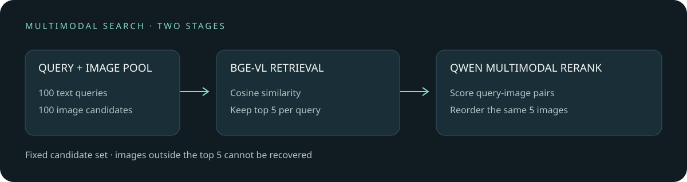

# 图文检索后的多模态重排

[English](README.en.md) | 中文

向图片库输入一句描述时，向量模型可以快速找出候选图片，但它把描述和图片分别压缩成向量，细节容易丢失。多模态重排器再逐一检查“描述和候选图是否匹配”，有机会把更符合描述的图片移到前面。代价是需要对每个候选再运行一次模型，而且它无法找回第一阶段未召回的图片。

我们以 100 条英文描述作为查询，让 BGE-VL-base 从同一批 100 张图中选出前 5 张，再用 Qwen3-VL-Reranker-2B 对这 500 个固定候选逐个评分。DGX Spark 上的结果如下：

| 指标 | BGE 原排序 | Qwen 重排后 |
| --- | ---: | ---: |
| 首位是配对图片 | 93/100 | 98/100 |
| MRR@5 | 0.957 | 0.985 |
| 前五包含配对图片 | 99/100 | 99/100 |

有 6 条查询从首位未命中变为命中，1 条反向变化。对 100 个配对首位命中差值做 10,000 次 bootstrap，95% 百分位区间为 **0 至 +10 个百分点**。区间包含零；该样本很小，且仅有一张标注配对图，其他语义上同样正确的图片仍被算作未命中。它不是完整 Flickr30k 排行榜，也不是端到端召回或跨场景性能保证。



## 为什么两阶段会不同

第一阶段用 BGE 分别编码文字 $q$ 和图片 $I$，计算归一化向量的余弦相似度：

$$s_{\mathrm{retrieve}}(q,I)=\frac{e_q(q)\cdot e_I(I)}{\|e_q(q)\|\|e_I(I)\|}$$

第二阶段把文字和每张候选图一起输入 Qwen 重排模型，计算 `yes` 与 `no` 的得分差，再经 sigmoid 得到排序分数。它是一个两类词相对分数，用于候选排序，不能直接当作经过校准的匹配概率。此实验先后使用两种不同的模型和评分方式；两阶段时间和硬件开销不可忽略。

## 数据和实验范围

数据来自 [Flickr30k](https://shannon.cs.illinois.edu/DenotationGraph/) 的 Karpathy test 分割。对本地标注 CSV 中 `split == test` 的记录，以 Python `random.Random(20261107).sample` 抽取 100 条，每图取 `raw` 列中的第一条描述作为查询，同一批 100 张图充当图片库；以描述所属的图作为唯一标签。脚本要求抽样后文件名互异，并拒绝零向量或非有限向量，避免无效余弦分数产生任意排序。其余 99 张不一定都与描述无关。因此 93/100 和 98/100 都只针对这个小图片池。模型原有预训练数据是否包含评估图片未知。

本次没有用这些样本训练或微调。原始 CSV 文件的 SHA-256 为 `395990db603ab8bafd5c7ab2746b22058bb1e75b78b3eb56ad755931364ac137`，但本地副本的具体上游下载地址未记录；不同版本或行顺序会改变抽样结果。请自行获取有权使用的图片和兼容标注，本仓库不分发图片、描述或文件名。`evidence/anonymous-ranks.json` 只包含打乱顺序的每条查询前后排名；它可复算汇总指标，但无法单凭它验证图片匹配是否合理。

BGE 使用 revision `cc4c733ed997dbee4ac70ccffb911e70c9c24b93`；Qwen 权重由模型官方 ModelScope 仓获取，`model.safetensors` SHA-256 为 `466ec01961061e9d7f804b4fb1625fb6f406106cd1567e026096d4736fa9d5b9`，与 [Hugging Face 官方文件页](https://huggingface.co/Qwen/Qwen3-VL-Reranker-2B/blob/main/model.safetensors)一致，对应模型仓 revision `4bd860ac4f15ad1897a214615cccc700f8f71818` 的权重指纹。两份模型详情见 [BGE-VL-base](https://huggingface.co/BAAI/BGE-VL-base) 和 [Qwen3-VL-Reranker-2B](https://huggingface.co/Qwen/Qwen3-VL-Reranker-2B)。

DGX Spark、BF16 下，固定候选重排的本次进程总时长为 **51 秒**，包含模型加载、图像读取、预处理及 500 次候选评分，不包含第一阶段候选生成；每秒内存监控记录的最低系统可用内存约 68 GiB。这是一次运行的墙钟时间，不是可靠的部署延迟基准。原 BGE 编码记录批量大小为 8，编码 100 条文字和 100 张图总计 1.57 秒，不含模型加载和候选排序。

## 复算与复现

无需图片即可复算公开汇总：

```bash
python scripts/summarize.py
```

完整复现需在 Linux/CUDA 准备同版标注、图片以及两份模型。环境记录：PyTorch 2.14.0+cu130、Transformers 5.16.1、sentence-transformers 6.0.1、qwen-vl-utils 0.0.14、BF16。输出目录应放在仓库外，候选及重排文件含原始描述和文件名，切勿直接公开：

```bash
python scripts/candidates.py --annotations "$ANNOTATIONS_CSV" --images "$IMAGES_DIR" --model "$BGE_MODEL" --output "$PRIVATE_DIR/candidates.json"
python scripts/rerank.py --candidates "$PRIVATE_DIR/candidates.json" --images "$IMAGES_DIR" --model "$QWEN_MODEL" --output "$PRIVATE_DIR/reranked.jsonl"
python scripts/anonymize.py --candidates "$PRIVATE_DIR/candidates.json" --reranked "$PRIVATE_DIR/reranked.jsonl" --output "$PRIVATE_DIR/anonymous.json"
python scripts/summarize.py "$PRIVATE_DIR/anonymous.json"
```

运行前请创建私有目录并设置环境变量。`candidates.py` 要求 CSV 含 `split`、`raw`、`filename` 列；`raw` 必须是非空的 Python 字符串列表，列表中的描述不得为空或全为空白；例如 `["A dog runs on grass.", "A dog is outdoors."]`。脚本以第一条完整描述作为查询，不会把字符串误当作列表并取其首字符。脚本中的 Qwen 推理封装来自 [Qwen 官方实现](https://github.com/QwenLM/Qwen3-VL-Embedding)，为本次 Transformers 5.16.1 环境添加了多模态 token 类型转 tensor 的兼容检查。公开参数化脚本尚未在真实数据上从头重跑；本次实测使用私有等价脚本，公开汇总脚本已用匿名结果复算。依赖版本、图片预处理、抽样和模型文件差异均可能改变结果。

重排脚本支持从已有 JSONL 续跑：每行指纹覆盖查询、完整候选、图片字节和模型标识，续跑前会校验已有结果。匿名化时还会检查查询、候选内容和有限分数是否一致；缺少查询字段的旧版输出须重新生成。模型标识只记录路径或名称，不能检测同一路径下权重的更换；传入远程模型名时，脚本也不会锁定或验证 revision。续跑时仍须保持模型文件、代码及依赖不变，并核对上文的权重指纹；该指纹只验证所述权重文件，不代表整个模型仓库的所有文件或其他 revision 均已验证。续跑中途终止若留下不完整的最后一行 JSON，需先将它移至备份，再从输出中移除该行。
