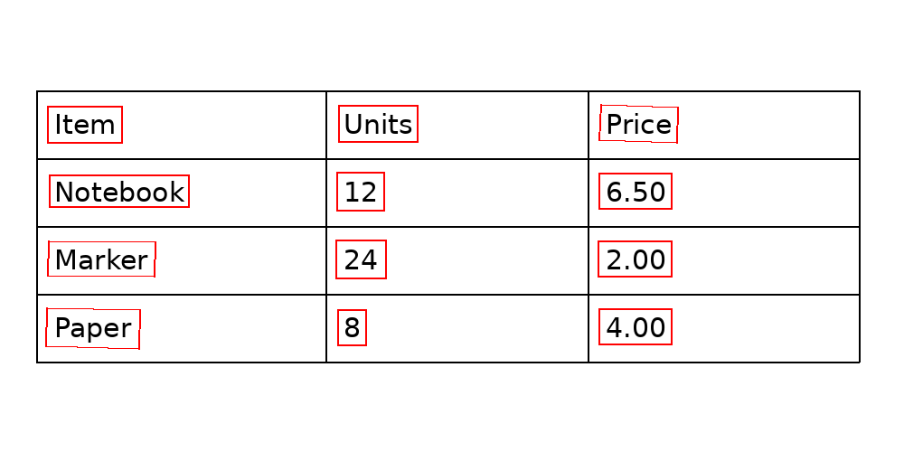

# Detecting and recognizing table text with PP-OCRv5

The detection-output validation change was checked on CPU; the OCR models were not rerun.


English | [简体中文](README.md)

To make a table image searchable, a system must locate text and then transcribe each region. This example passes polygonal text detections from PP-OCRv5 to its recognition model on one self-drawn table, with a runnable two-stage script.



## Input, output and observation

The input is a self-drawn 1000 × 500 English table with four rows, three columns and 12 printed text elements. Each cell contains text; there is no rotation, merging, handwriting or blur. It is not a public benchmark and is not representative of real business documents. The [input image](figures/synthetic-table.png) has SHA-256 `3bc084da2c422c23b7c04a1bdc63078e0e5ef363420323065ee1a2189d0b1802`.

Detection produces polygons and scores from the full image. The script crops each polygon's axis-aligned bounding rectangle and sends the crop to recognition, yielding text and a score. This is not perspective correction; rotated or curved text can include background or be cropped poorly.

In the original run, detection on the DGX Spark GPU produced 12 boxes. Recognition then ran one box at a time on the CPU with two PyTorch threads, producing the 12 strings written in the image. The recognition boxes were checked against the detection boxes. A later CPU reproduction ran both stages and produced the same box set and text.

| Stage | Input | Output | This run |
| --- | --- | --- | --- |
| Detection | Full table image | Text polygons and scores | Original run on GPU; CPU reproduction produced the same box set |
| Recognition | Axis-aligned crop for each box | Text and score | CPU, one box at a time; all 12 strings match this image |

The [detection](results/detection.json), [original recognition](results/recognition.json) and [CPU reproduction](results/cpu-reproduction.json) records contain the coordinates and text. The original detector's first forward pass took 0.368 seconds, excluding loading and pre/postprocessing; a single measurement is not a performance comparison. Scores are not calibrated probabilities of correctness. The 12/12 observation is for this one simple synthetic image, not a general accuracy rate.

## Model responsibilities

[PP-OCRv5_server_det](https://huggingface.co/PaddlePaddle/PP-OCRv5_server_det_safetensors) locates text regions; [PP-OCRv5_server_rec](https://huggingface.co/PaddlePaddle/PP-OCRv5_server_rec_safetensors) recognizes each crop. Both model cards list Apache-2.0. This example uses the Transformers/PyTorch safetensors variants; it is not a PaddlePaddle runtime benchmark.

The script sorts boxes only for display using the sample's fixed 75-pixel row spacing. It does not infer rows, columns or merged cells, or assign text to cells. See the separate [SLANet+ structure experiment](../table-structure-recognition/README.en.md); combining text with cells still requires an additional matching stage.

## Reproduce

The recorded environment was aarch64 DGX Spark, PyTorch `2.14.0+cu130`, Transformers `5.17.0`, OpenCV `5.0.0` and Pillow. CPU reproduction does not require a GPU. Install the dependencies, obtain both models from their cards and point the command at their local directories. The output must not already exist.

```bash
python scripts/run.py \
  --image figures/synthetic-table.png \
  --det-model /path/to/PP-OCRv5_server_det_safetensors \
  --rec-model /path/to/PP-OCRv5_server_rec_safetensors \
  --det-device cpu --rec-device cpu --threads 2 \
  --output /tmp/paddle-ocr-result.json
```

Either device argument can be `cuda` with a compatible PyTorch and GPU setup. Original `model.safetensors` SHA-256 values: detector `06e7a44aa5c4146531e88703140e0f7329910b92f84f8bf2756bfd37cec5cb0a`; recognizer `da94c5dd42c88b00c44081942b157bee8eda9ccd0481dbd0af3824f6c241aa91`. The original model repository revisions were not recorded; changes in other configuration files can also affect reproduction.

For a meaningful evaluation, use real documents annotated with boxes and transcriptions; measure detection matching and character error rate separately before assessing the combined pipeline. Box counts or model scores alone are not a substitute for labeled evaluation.
