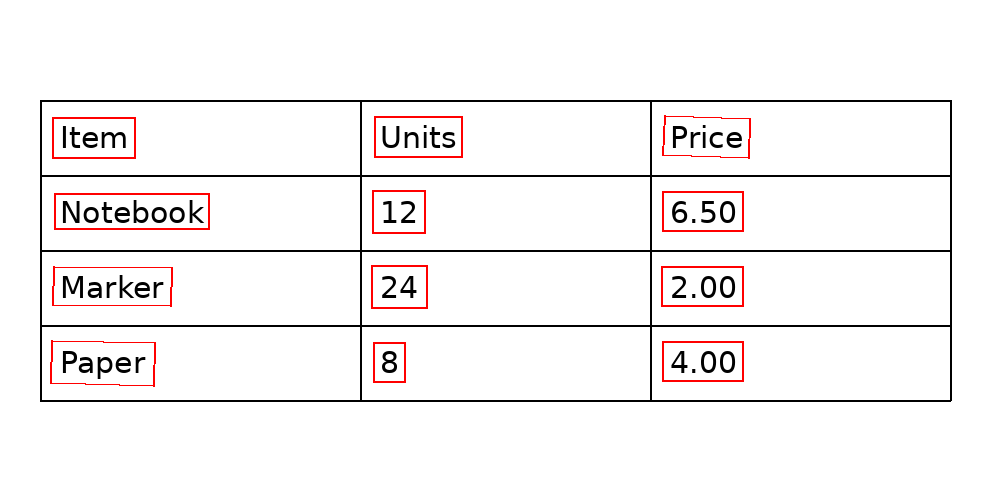

# 用 PP-OCRv5 定位并识别表格文字

本次检测结果校验修订仅做 CPU 测试，未重跑 OCR 模型。


[English](README.en.md) | 简体中文

把一张表格图片变成可搜索的文字，首先要解决两个不同的问题：**文字在哪儿，以及每个区域写了什么**。这里将 PP-OCRv5 检测模型的多边形框传给识别模型，在自行绘制的表格上验证这条路径，并提供可运行的两阶段代码。



## 输入、输出和实验结果

输入是一张自行绘制的 1000 × 500 英文表格图，四行三列，共有 12 个印刷文字元素。每个单元格均有文字，没有旋转、合并、手写或模糊；图片并非公开数据集，不能代表真实业务文档。[原图](figures/synthetic-table.png)及其 SHA-256：`3bc084da2c422c23b7c04a1bdc63078e0e5ef363420323065ee1a2189d0b1802`。

检测模型从整图输出文字区域多边形与分数；脚本取多边形的轴对齐外接矩形，从原图裁切后交给识别模型，得到每个区域的文字和分数。对于旋转或弯曲文字，外接矩形裁剪并不等同于透视矫正，可能混入背景或截取不合适。

原始记录中的检测在 DGX Spark GPU 上运行，输出 12 个框；随后用 CPU 和 2 个 PyTorch 线程逐框识别，12 个输出与图中预先写入的文字一致。已检查识别记录中的框与检测记录的 12 个框集合完全相同。为了验证可复现脚本，又以 CPU、2 线程重新执行检测和识别，输出的文字和框集合均与原记录相同。

| 阶段 | 输入 | 输出 | 本次运行 |
| --- | --- | --- | --- |
| 检测 | 完整表格图片 | 文字区域多边形及分数 | 原记录 GPU；CPU 复跑得到相同框集合 |
| 识别 | 每个检测框的外接矩形裁剪 | 文字及分数 | CPU 逐框识别，12 项与图中文字一致 |

[检测结果](results/detection.json)、[原识别结果](results/recognition.json)与 [CPU 复跑结果](results/cpu-reproduction.json)保留了具体坐标及文本。原记录中检测模型首次前向耗时 0.368 秒，仅为单次且不含加载、预处理、后处理；不用于性能比较。分数不是校准后的正确概率，12/12 只是这张简单合成图的结果，不是通用准确率。

## 模型与职责

[PP-OCRv5_server_det](https://huggingface.co/PaddlePaddle/PP-OCRv5_server_det_safetensors)负责文字区域检测，[PP-OCRv5_server_rec](https://huggingface.co/PaddlePaddle/PP-OCRv5_server_rec_safetensors)负责识别文字行；模型卡均标注 Apache-2.0。这里使用它们的 Transformers / PyTorch safetensors 版本，不是 PaddlePaddle 运行时性能测试。

本实验把文字框排序仅用于展示，排序规则依赖此图固定的 75 像素行距。它不识别表格行列或合并关系，也没有把文字匹配到单元格。表格结构识别的独立实验见 [SLANet+](../table-structure-recognition/README.md)；将文字与单元格自动匹配仍需额外实现。

## 复现

实测环境：DGX Spark aarch64，PyTorch `2.14.0+cu130`、Transformers `5.17.0`、OpenCV `5.0.0`、Pillow；CPU 复跑不需要 GPU。安装依赖后，按模型卡获取两个模型并设置对应目录。输出文件必须不存在，避免覆盖原有结果。

```bash
python scripts/run.py \
  --image figures/synthetic-table.png \
  --det-model /path/to/PP-OCRv5_server_det_safetensors \
  --rec-model /path/to/PP-OCRv5_server_rec_safetensors \
  --det-device cpu --rec-device cpu --threads 2 \
  --output /tmp/paddle-ocr-result.json
```

也可将 `--det-device` 或 `--rec-device` 设为 `cuda`；需事先配置兼容的 PyTorch 与 GPU 环境。原始模型文件 `model.safetensors` 的 SHA-256：检测 `06e7a44aa5c4146531e88703140e0f7329910b92f84f8bf2756bfd37cec5cb0a`，识别 `da94c5dd42c88b00c44081942b157bee8eda9ccd0481dbd0af3824f6c241aa91`。原始记录未保存模型仓库 revision，其他配置文件的变化也可能影响复现。

下一步评估应使用带文字框和转写标注的真实文档，分别统计检测框的匹配质量与识别字符错误率，再评估整条管线。仅看检测框数或识别模型分数不能替代标注评测。
