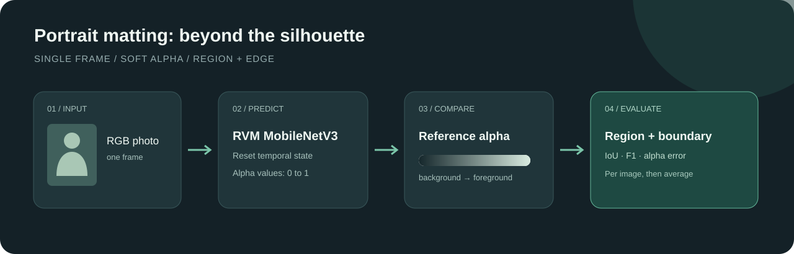

# Evaluating portrait matting with RVM

English | [简体中文](README.md)

On a DGX Spark, RVM MobileNetV3 achieved a macro-average **IoU of 0.9730** and **boundary F1 of 0.8916** on 30 individual portraits. This exploratory sample uses JPEG annotations; it does not establish performance on all of PPM-100 or on video.



Portrait matting supports background replacement and video calls by estimating foreground opacity, including partially covered pixels around hair. Unlike a binary mask, the alpha matte allows intermediate values. A common image model is $I=\alpha F+(1-\alpha)B$, with foreground $F$, background $B$, and opacity $\alpha$. Recovering these values from one image is underdetermined. RVM combines a low-resolution branch with high-resolution refinement and carries recurrent state for video; our test resets that state for every still image, so it says nothing about temporal stability. See the [upstream inference guide](https://github.com/PeterL1n/RobustVideoMatting/blob/master/documentation/inference.md).

## Results and interpretation

Measured 7 November 2026 on DGX Spark GB10, PyTorch 2.14.0+cu130 and FP32. Images were resized with a maximum side of 1024 pixels. Each received one warmup and three timed forwards. The alpha prediction was saved as an 8-bit PNG before scoring. Values below are equal-weight averages across images; [per-image evidence](docs/evidence/summary.json) is available.

| Metric | Macro mean | Interpretation |
| --- | ---: | --- |
| IoU | 0.9730 | Binary foreground overlap |
| Dice | 0.9862 | Binary foreground overlap |
| Boundary F1 | 0.8916 | Edge matching within three pixels |
| Alpha MAE | 0.00857 | Mean absolute opacity error over the image |
| Alpha MSE | 0.00417 | Mean squared opacity error over the image |
| Intermediate-alpha MAE | 0.1101 | Error where the label is strictly between zero and one |

Area and boundary metrics measure different things; their numerical difference is not an error rate. A high area score alone does not establish fine-edge quality. JPEG artifacts also affect the intermediate-alpha region.

The mean of per-image mean synchronized forward times was **6.91 ms/image**, with individual means around **5.55–10.14 ms**. Decoding, preprocessing, input transfer, output transfer, and saving are excluded. Since image shapes differ, this is neither fixed-resolution throughput nor video frame rate. No model or device comparison was performed under matched conditions.

## Data and licensing

We use the natural-background portraits and alpha annotations described by the [PPM-100 project](https://github.com/ZHKKKe/PPM), obtained through the [PaddleSeg distribution](https://paddleseg.bj.bcebos.com/matting/datasets/PPM-100.zip). The project states that source photographs come from Flickr and individual photograph licenses and attribution must be checked separately; the alpha annotations are CC BY-NC-SA 4.0. Images and annotations have distinct rights. The original photos, annotations, and generated images are not distributed here. Verify licensing, attribution and applicable portrait rights before publishing images.

The reproducible sample takes 10 images from the Paddle `val` split and 20 from `train` using seed 20261107. It is not a uniform sample of all PPM-100, and split names do not establish absence of overlap with model training data. This distribution stores photos and labels as lossy JPEG, so fine edges may contain compression artifacts. Do not compare the scores directly with scores on an unverified or lossless version of the dataset.

## Setup

Install Python, PyTorch and torchvision appropriate for your device, plus NumPy and Pillow. Select the correct platform and CUDA build using the [PyTorch installation guide](https://pytorch.org/get-started/locally/). CPU execution is supported but slower. RVM's upstream code is [GPL-3.0](https://github.com/PeterL1n/RobustVideoMatting/blob/master/LICENSE); review the applicable terms for code and weights. Download `rvm_mobilenetv3.pth` from the [official RVM download section](https://github.com/PeterL1n/RobustVideoMatting#download) to the Git-ignored `weights/` directory. The expected SHA-256 is `3c7c1d92033f7c38d6577c481d13a195d7d80a159b960f4f3119ac7b534cf4f8`.

Run the following from this experiment directory:

```bash
git clone https://github.com/PeterL1n/RobustVideoMatting.git rvm-src
git -C rvm-src checkout 53d74c6826735f01f4406b5ca9075eee27bec094
python -m pip install numpy pillow
curl -fL https://paddleseg.bj.bcebos.com/matting/datasets/PPM-100.zip -o PPM-100.zip
python scripts/prepare_ppm.py --archive PPM-100.zip --output local-ppm-30
```

The preparation script checks archive SHA-256 `5a3d9029437954594c26ea773e927c4b7c4caaee7e94f6bbd8e96196c868254a` and writes a manifest with per-file hashes. Keep the resulting dataset private and do not commit it. Git ignores the example data, downloads and output paths. If a checksum changes, investigate the source instead of bypassing the check.

Older manifests without these hashes must be updated before use. When using `score_mattes.py` independently, each JSONL record must include `sample_id`, `ground_truth_alpha`, `prediction_alpha`, and their respective `ground_truth_alpha_sha256` and `prediction_alpha_sha256` hashes. The script checks image bytes, records the manifest hash and refuses to overwrite results. This cannot establish that the manifest pairs images correctly or rule out dataset leakage.

## Run the evaluation

```bash
python scripts/run_rvm_ppm.py \
  --manifest local-ppm-30/manifest.jsonl --output local-rvm-results \
  --rvm-repo rvm-src --weights weights/rvm_mobilenetv3.pth \
  --device cuda --max-side 1024 --warmup 1 --repeats 3
```

Use `--device cpu` without CUDA. The output directory must not exist. Check the pinned RVM revision's dependencies before running.

Each RGB input is resized proportionally to at most 1024 pixels on its longest side and converted to FP32 in the 0–1 range with shape `1×3×H×W`. Labels must be 8-bit grayscale or RGB with identical channels; an RGBA label must also have an opaque alpha channel. Other labels are rejected rather than silently converted. The label is resized to match using bilinear interpolation. The model's internal downsample ratio is `min(1,512/max(H,W))`; each forward receives four empty recurrent states. Image and label are not independently EXIF-rotated, preserving their raster alignment. The output alpha is rounded to 8-bit PNG before scoring.

CUDA is synchronized immediately before and after each timed forward. `results.json` records hashes, dimensions, parameters, timings, per-image metrics, and macro averages. The `alpha/` and `target/` outputs contain restricted material and must remain local.

## Metric definitions

Threshold prediction and target at 0.5 for IoU and Dice. Boundary F1 uses the inner boundary of the binary regions with a three-pixel Chebyshev tolerance, measured after resizing. For soft alpha, report image-wide MAE, MSE, SAD (sum of absolute errors divided by 1000), and MAE over target values strictly between 0 and 1. SAD depends on image size; JPEG artifacts mean the intermediate region is not equivalent to a human-annotated trimap.

Metrics are calculated per image, then averaged equally. A missing intermediate region gives `null` for that image and is excluded from that metric's mean. If both masks have no foreground, IoU and Dice are defined as 1. If both have no boundary, boundary F1 is 1; if only one does, it is 0. Inspect per-image scores as well as averages.

## Checks

```bash
python scripts/test_score_mattes.py
python scripts/test_run_rvm_ppm.py
```

These synthetic tests cover metrics, preprocessing, output and integrity checks using a mock predictor. They do not run RVM or replace a real model and hardware evaluation.
