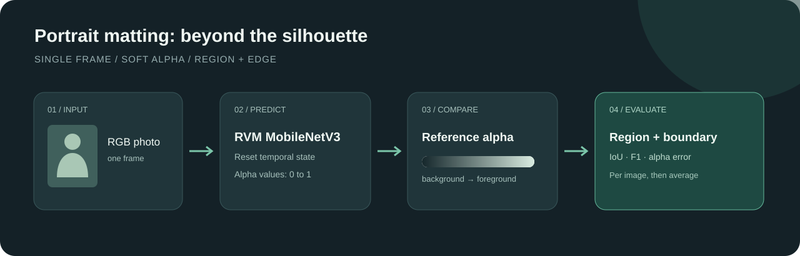

# 用 RVM 评估人物抠像：区域、发丝边界与推理时间

[English](README.en.md) | 简体中文

> 在 DGX Spark 上，RVM MobileNetV3 对 30 张人物单帧照片的区域 IoU 宏平均为 **0.9730**，边界 F1 为 **0.8916**。这是一组 JPEG 标注的小样本探索，不能外推为完整 PPM-100 或视频抠像性能。



视频会议或背景替换需要将人物与背景分离。二值分割只判断像素属于前景还是背景，抠像还估计透明度 alpha，例如头发边缘可能只有部分像素被人物覆盖。本教程用单帧人物照片评估 RVM，考察主体范围是否完整、边缘是否贴合，以及软透明度与标注相差多少；它不验证视频连续性。

图像形成过程可表示为 $I=\alpha F+(1-\alpha)B$，其中 $I$ 是观测图像，$F$ 是前景颜色，$B$ 是背景颜色，$\alpha\in[0,1]$ 是前景覆盖度。仅凭一张图估计这些量不是唯一解。RVM 将低分辨率分支与高分辨率细化结合，视频模式还传递循环状态；这里每张照片都清空状态，不能将单帧结果当成视频评测。[RVM 官方推理文档](https://github.com/PeterL1n/RobustVideoMatting/blob/master/documentation/inference.md)说明了分辨率、缩放比例和循环状态。

## 这次测到了什么

2026 年 11 月 7 日，设备为 DGX Spark GB10，PyTorch 2.14.0+cu130，FP32；输入最长边缩放至 1024，每张图独立重置 RVM 循环状态。每张先预热一次，随后计时三次。以下为 30 张逐图结果的宏平均；alpha 先保存为 8 位 PNG 再计算，逐图结果见 [数值证据](docs/evidence/summary.json)。

| 指标 | 宏平均 | 含义 |
| --- | ---: | --- |
| IoU | 0.9730 | 二值主体区域重合程度 |
| Dice | 0.9862 | 二值前景重合程度 |
| 边界 F1 | 0.8916 | 3 像素容差内的边缘匹配 |
| Alpha MAE | 0.00857 | 全图透明度绝对误差 |
| Alpha MSE | 0.00417 | 全图透明度平方误差 |
| 中间值区域 MAE | 0.1101 | 标注中 0 < alpha < 1 区域的误差 |

本次主体区域重合度高于边界 F1，提示不能用整体区域指标替代边缘评估；两个指标定义不同，不能把数值差简单解释成误差比例。标注有 JPEG 压缩伪影，中间值区域也会受到影响。

每图三次同步前向先求平均，再对 30 图取平均为 **6.91 ms/图**，逐图均值范围约 **5.55–10.14 ms**；不含读取、预处理、数据传输和保存。图片长宽不同，这是这批样本的模型前向时间，不是固定分辨率吞吐或视频帧率。没有和其他模型或设备做同条件对照。

## 数据及许可

使用 [PPM-100 官方项目](https://github.com/ZHKKKe/PPM)介绍的自然背景人像和 alpha 标注，通过 [PaddleSeg 教程分发包](https://paddleseg.bj.bcebos.com/matting/datasets/PPM-100.zip)取得。官方说明原照片来自 Flickr，不同照片须逐张核对许可及署名；alpha 标注是 CC BY-NC-SA 4.0。照片与标注不是同一授权，标注的非商业与相同方式共享条件应单独遵守。原始人物照片、标注和生成图都不随本教程分发；发布人物图之前另行核实照片的授权、署名及适用的人像权。

本教程固定抽样 Paddle 版本 `val` 的 10 张与 `train` 的 20 张，使用种子 20261107。它是小规模探索样本，并非对整个 PPM-100 均匀抽样，原分组名称不代表对任何模型的训练污染已排除。该分发包的照片及标签是有损 JPEG，不等同于已验证的无损原始标注，细发丝和透明边缘会受到压缩影响；结果不应直接与其他版本的 PPM-100 结果横向比较。

## 安装与准备

准备 Python、适用于设备的 PyTorch 和 torchvision，另安装 `numpy`、`Pillow`；版本以本机运行记录为准。RVM 上游代码采用 [GPL-3.0](https://github.com/PeterL1n/RobustVideoMatting/blob/master/LICENSE)，使用其代码与模型前应核对相应许可。按 [PyTorch 官方安装指南](https://pytorch.org/get-started/locally/)选择对应平台与 CUDA，CPU 也可运行但更慢。取固定版本 RVM 代码，并从其 [官方仓库的 PyTorch 下载入口](https://github.com/PeterL1n/RobustVideoMatting#download)下载 `rvm_mobilenetv3.pth` 至仓库外的 `weights/`。代码校验的权重 SHA-256 为 `3c7c1d92033f7c38d6577c481d13a195d7d80a159b960f4f3119ac7b534cf4f8`。

```bash
git clone https://github.com/PeterL1n/RobustVideoMatting.git rvm-src
git -C rvm-src checkout 53d74c6826735f01f4406b5ca9075eee27bec094
python -m pip install numpy pillow
curl -fL https://paddleseg.bj.bcebos.com/matting/datasets/PPM-100.zip -o PPM-100.zip
python scripts/prepare_ppm.py --archive PPM-100.zip --output local-ppm-30
```

采样脚本先检查压缩包 SHA-256 `5a3d9029437954594c26ea773e927c4b7c4caaee7e94f6bbd8e96196c868254a`，输出图像、标注和包含逐文件散列的 manifest。`local-ppm-30` 是本地数据目录，不应提交到公开仓库；示例所用的数据、下载文件和输出目录已配置 Git 忽略。文件名或哈希变更会导致检查失败，应重新核对来源，而不是禁用检查。

旧版不含哈希字段的清单需补充哈希后才能使用。单独使用 `score_mattes.py` 时，每条 JSONL 需包含 `sample_id`、`ground_truth_alpha`、`prediction_alpha`，以及两个路径分别对应的 `ground_truth_alpha_sha256` 和 `prediction_alpha_sha256`。脚本校验图片字节、记录清单哈希并拒绝覆盖结果，避免把改变后的图片当作原评估输入；这不能证明清单本身正确配对或排除数据泄漏。

## 运行单帧评测

```bash
python scripts/run_rvm_ppm.py \
  --manifest local-ppm-30/manifest.jsonl --output local-rvm-results \
  --rvm-repo rvm-src --weights weights/rvm_mobilenetv3.pth \
  --device cuda --max-side 1024 --warmup 1 --repeats 3
```

没有 CUDA 时可改为 `--device cpu`。输出目录必须不存在，防止覆盖。RVM 的实际依赖以其固定版本的依赖文件为准；首次执行前应确认本机 PyTorch 能正常加载这些依赖。

输入经过 RGB 解码、最长边不超过 1024 的等比例缩放，转为 0–1 的 FP32 `1×3×H×W`；标签须是 8 位灰度或三通道完全相同的灰度图，RGBA 标签的 alpha 通道还必须完全不透明，不符合时拒绝，避免将彩色标签静默转换。标签使用双线性缩放到同样尺寸。模型内部低分辨率比例设为 `min(1,512/max(H,W))`。每次前向传入四个空状态，输出为同尺寸 alpha；预测舍入为 8 位 PNG，指标与该保存结果一致。源图片和标签不独立做 EXIF 旋转，避免坐标错位。

每张图预热一次，计时三次；CUDA 计时前后同步。计时涵盖模型前向及同步，不含解码、输入上传、输出下载和写盘。不同图片的尺寸可能不同，所得耗时不能视作固定分辨率吞吐，也不能与端到端耗时直接比较。输出的 `results.json` 包含模型与数据哈希、尺寸、参数、逐次时间、逐图指标与宏平均；`alpha/` 和 `target/` 分别保存预测与缩放标注，二者包含受限素材信息，应留在本地。

## 如何解读结果

将预测和标注以 0.5 阈值二值化，计算区域 IoU 与 Dice，检查主体覆盖；再从二值区域得到内侧边缘，计算 3 像素 Chebyshev 容差下的边界 F1。容差是缩放后的像素单位，分辨率变化会改变含义。对软 alpha 同时报告全图 MAE、MSE、SAD（绝对误差之和除以 1000）和标注在 0 与 1 之间的区域 MAE。SAD 与像素数相关，跨分辨率不可直接比较；JPEG 可能在原本的确定区域产生中间值，因而这里的中间值区域也不等于人工 trimap。

各指标先逐图计算再等权平均；标签没有中间值时，中间值区域 MAE 记为 null，不参与该项平均。两边都没有前景时 IoU 与 Dice 定义为 1；两边均无边界时边界 F1 定义为 1，仅一侧没有边界为 0。平均分应结合逐图指标观察，不能单靠一个数字判断所有发丝或半透明物体的表现。

## 检查

```bash
python scripts/test_score_mattes.py
python scripts/test_run_rvm_ppm.py
python scripts/audit_summary.py
```

前两个测试使用合成数据与模拟预测器，检查指标、预处理衔接、结果写出和校验失败。最后一个脚本从公开的逐图数值复算宏平均及前向时间，不需要原始人物图片；由于原始图像和预测 alpha 不公开，它不能重新计算每张图的指标。这些检查都不运行 RVM，不能代替真实模型与设备测试。
