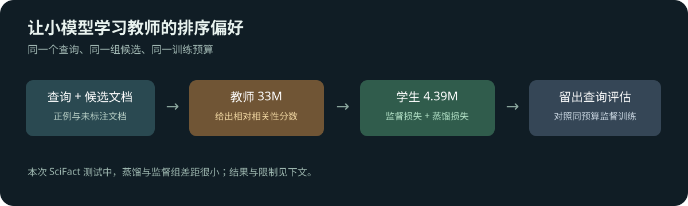

# Distilling a reranker for scientific search

[中文](README.md)

A search system can retrieve candidates cheaply, then use a cross-encoder to read each query-document pair and reorder them. This experiment asks whether a small reranker can learn a larger teacher's preferences and improve on ordinary supervised fine-tuning without paying the teacher's inference cost on every candidate.



## Results and limitations

On 300 held-out SciFact queries and the same fixed BM25 candidate pools:

| Model | Parameters | nDCG@10 | MRR@10 |
|---|---:|---:|---:|
| MiniLM-L12 teacher | 33.36M | 0.6583 | 0.6312 |
| TinyBERT student, before SciFact tuning | 4.39M | 0.6267 | 0.5963 |
| Student, supervised | 4.39M | 0.6336 | 0.6053 |
| Student, supervised plus distillation | 4.39M | 0.6355 | 0.6070 |

The distilled-minus-supervised nDCG@10 difference is 0.00182, with a paired query bootstrap 95% interval of [-0.00296, 0.00685]. It does not establish an advantage over supervised training. The table reports seed 20261107; the interval excludes retraining variability. Both checkpoints were already trained on MS MARCO; “before” means before this SciFact fine-tuning, not random initialization. Overlap with pretraining cannot be excluded. The planned BGE reranker v2-m3 did not finish downloading and was not evaluated.

### Repeat with a second training seed

We repeated supervised training and distillation with seed 20261108, keeping the data, candidate pools, checkpoints, steps and losses fixed. The same 300 test queries were reused.

| Training seed | Supervised nDCG@10 | Distilled nDCG@10 | Difference | Paired query bootstrap 95% interval |
|---|---:|---:|---:|---:|
| 20261107 | 0.6336 | 0.6355 | +0.00182 | [-0.00296, 0.00685] |
| 20261108 | 0.6357 | 0.6370 | +0.00126 | [-0.00420, 0.00664] |

Both intervals cross zero, so neither comparison establishes an advantage for distillation. Two seeds provide limited information about training variability; reusing the same test set does not create an independent test. Query bootstrap intervals exclude variability across training seeds, candidate pools and datasets. Per-query metrics, training losses, manifest and analysis are in the [seed 20261108 evidence](docs/evidence/seed-20261108/).

## Data and training

[SciFact](https://github.com/allenai/scifact) links scientific claims to evidence in research documents. The experiment uses 390 training, 89 development and 300 test queries, split by query with highly similar queries filtered. A training query has a labelled positive and one unlabelled document sampled from BM25 candidates. Unlabelled does not mean definitely irrelevant. Documents can occur across splits. Development and test use at most 30 BM25 candidates without injecting an answer; their labelled-positive candidate recall is 80.56% and 84.96%, respectively. A reranker cannot recover a document outside that pool.

The teacher and student each produce a logit for a query-document pair. For the positive and unlabelled candidate, the student learns both the label and the teacher's relative preference:

$$\mathcal L_{KD}=T^2D_{KL}(\operatorname{softmax}(z_T/T)\Vert\operatorname{softmax}(z_S/T)),\quad \mathcal L=0.5\mathcal L_{supervised}+0.5\mathcal L_{KD}.$$

Here $T=2$. The supervised control uses only the supervised loss. Both start from the same student checkpoint with the same seed, sampling, 180 steps, up to eight queries per step and learning rate 2e-5. With 390 training queries, the public script retains a six-query final batch in each complete epoch; three of the 180 batches contain six queries. Historical logs do not record batch sizes, so their actual composition cannot be independently verified. Teacher scores are not calibrated relevance probabilities.

The teacher is [MS MARCO MiniLM-L12](https://huggingface.co/cross-encoder/ms-marco-MiniLM-L12-v2), and the student is [MS MARCO TinyBERT-L2](https://huggingface.co/cross-encoder/ms-marco-TinyBERT-L2-v2). On DGX Spark, one sequential batched pass (up to 32 pairs per batch) over all development and test candidates including tokenization took 14.88 seconds for the teacher and 2.84 seconds for the distilled student. This is neither a service latency nor concurrency benchmark, and excludes teacher scoring and training costs.

## Reproduce

Prepare SciFact and `prepared/pools.json` using the [shared candidate-pool instructions](../../utils/scifact-pools/README.en.md); the pool SHA-256 should be `e7cac48e7083bdd948e2773136c1df9672b4ca8f787ee5b774697b32d689c5f8`. Preparation uses Python 3.11 or newer and runs on CPU. Copy the shared tool as well if copying this experiment on its own. Install Linux CUDA PyTorch, Transformers, NumPy and Hugging Face Hub, then run from this directory:

```bash
DATA_ROOT=/path/to/data-root
mkdir -p output
hf download cross-encoder/ms-marco-MiniLM-L12-v2 --revision 7b0235231ca2674cb8ca8f022859a6eba2b1c968 --local-dir output/teacher
hf download cross-encoder/ms-marco-TinyBERT-L2-v2 --revision 81d1926f67cb8eee2c2be17ca9f793c7c3bd20cc --local-dir output/student
python scripts/run.py --data-root "$DATA_ROOT" --teacher output/teacher --student output/student --out output/run
```

The data root must contain `scifact/` and `prepared/pools.json`. The script records the candidate pool, corpus and query hashes and, when stages run separately, checks them along with model paths and teacher output integrity. It does not automatically compare input hashes against the historical manifest; check them manually using the shared-pool instructions. A model path alone cannot verify its weights. Training stops if the teacher does not beat the student on development nDCG@10. Append `--device cpu --smoke` and use a separate output directory for a two-query, two-step interface check; this is not an effectiveness evaluation.

The `teacher` and `all` stages require a new or empty output directory. The `student` stage requires complete teacher outputs and no existing student outputs. After an interruption, start a fresh run directory to avoid overwriting or mixing results.

[Historical evidence](docs/evidence/) includes per-query metrics and paired analysis. Historical student candidate scores were not saved, so their rankings cannot be independently reconstructed from these files; the current script saves them. Follow the original dataset and model licenses when reusing the materials.

Ranking scores tied exactly are ordered lexicographically by document ID as a string. Evaluation rejects duplicate candidates, missing scores and non-finite scores; the historical per-query metrics cannot establish whether the original candidates and scores met these conditions.
