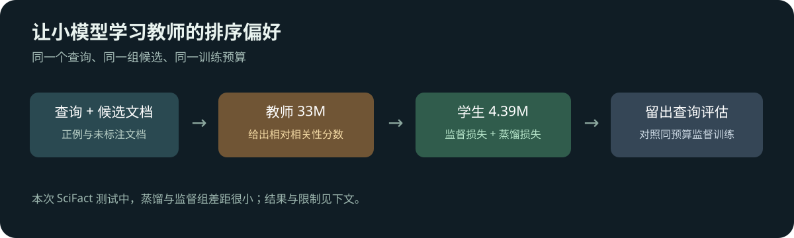

# 重排序模型蒸馏：小模型能学到教师的排序偏好吗？

搜索系统常先召回几十篇候选文档，再由重排序模型逐条阅读「查询 + 文档」，将更相关的结果排到前面。大模型能做更细的相关性判断，但每个候选都需要推理；如果把它的排序偏好教给更小的模型，就有机会降低重排序成本。本实验用 SciFact 科学文献检索数据，比较小模型原始表现、普通监督微调，以及加入教师信号后的蒸馏训练。



## 这次结果：蒸馏比普通监督高 0.0019，尚不足以确认优势

固定同一批 BM25 候选，使用 300 条留出测试查询计算 nDCG@10 与 MRR@10：

| 模型或训练方法 | 参数量 | nDCG@10 | MRR@10 |
|---|---:|---:|---:|
| 教师 MiniLM-L12 | 3336 万 | 0.6583 | 0.6312 |
| 学生 TinyBERT，SciFact 微调前 | 439 万 | 0.6267 | 0.5963 |
| 学生，普通监督训练 | 439 万 | 0.6336 | 0.6053 |
| 学生，监督 + 教师蒸馏 | 439 万 | **0.6355** | **0.6070** |

蒸馏组比普通监督高约 **0.00182 nDCG@10**。按测试查询做 10,000 次配对 bootstrap，差值 95% 区间约为 **−0.00296 至 0.00685**；现有结果无法排除没有提升。与微调前学生相比，两组的点估计都提高，但这里只运行一个训练种子，区间也不包含重新训练的波动。

教师对开发集的 nDCG@10 为 0.6370，学生为 0.6138；实验预先规定教师在开发集更好才继续训练。两个模型都已经在 MS MARCO 排序数据上训练，因此「微调前」只指本次 SciFact 微调之前，不是从随机初始化开始，也不意味着通用零样本模型。教师和学生是否在预训练中接触过与 SciFact 重叠的内容不能由本实验排除。

## 数据与评估边界

[SciFact](https://github.com/allenai/scifact) 提供科学论断及其文献证据。我们沿用 重排序微调实验 的数据准备结果：390 条训练、89 条开发、300 条测试查询，按查询划分并过滤高相似查询；训练正例经过原始 SciFact 证据标注核对。训练时每个查询配一个相关文档和一个从 BM25 候选中抽取的未标注文档；**未标注不等于确定无关**。

开发和测试复用每查询至多 30 篇 BM25 候选，不额外插入答案。候选池对标注正例的召回率分别为 80.56% 和 84.96%，因此重排序无法挽回未进入候选池的文档。测试查询不参与训练，但同一文献可出现在不同查询中，这不是文献完全隔离的泛化评估。nDCG@10 衡量前 10 位的排序质量，MRR@10 衡量第一个相关结果的排名。

## 蒸馏如何工作

教师与学生都是 cross-encoder：输入一对查询和文档，分别输出一个相关性 logit；对于同一查询，两篇文档的分数差可以表达相对偏好。给定训练对中的已标注相关文档 $d^+$ 和未标注文档 $d^-$，先以监督交叉熵让学生偏向 $d^+$。同时将教师、学生各自的两个 logit 用温度 $T=2$ 转为分布，并最小化：

$$\mathcal L_{\mathrm{KD}}=T^2\,D_{\mathrm{KL}}\!\left(\operatorname{softmax}(z_{teacher}/T)\;\middle\|\;\operatorname{softmax}(z_{student}/T)\right).$$

蒸馏组的总损失为 $0.5\mathcal L_{supervised}+0.5\mathcal L_{KD}$；普通监督组只用前一项。两组从同一学生检查点开始，使用相同随机种子、候选抽样、180 个优化步骤、每步 8 个查询、学习率 $2\times10^{-5}$，只改变损失。教师的分数不是真实相关概率，教师也可能对未标注文档判断有误。

教师是 [MS MARCO MiniLM-L12](https://huggingface.co/cross-encoder/ms-marco-MiniLM-L12-v2)，学生是 [MS MARCO TinyBERT-L2](https://huggingface.co/cross-encoder/ms-marco-TinyBERT-L2-v2)，模型卡均标注 Apache-2.0。教师参数量约为学生的 7.6 倍，是一个可运行的较大基线；这不是与最前沿大模型的比较。原计划的 BGE reranker v2-m3 因权重下载未完成，**没有参与这次结果**。

## 速度如何理解

同一设备上，对开发集和测试集所有候选各进行一次串行打分，计时包含分词：教师耗时 14.88 秒，原始学生 2.89 秒，蒸馏学生 2.84 秒。这只是本次固定批次的粗略总时间，不是服务并发吞吐或单条请求延迟，也没有把教师离线打分和蒸馏训练成本计入学生推理时间。实测使用 DGX Spark、PyTorch 2.14.0+cu130、Transformers 5.16.1。

## 复现

需要 Linux、CUDA PyTorch、Transformers、NumPy 和 Hugging Face Hub。按 [ColBERT 实验的数据准备步骤](../colbert-distillation/README.md#从数据准备候选与教师分数)准备 `scifact/` 和 `prepared/pools.json`，只需运行候选池准备脚本，不必运行教师打分或训练。该候选文件的 SHA-256 应为 `e7cac48e7083bdd948e2773136c1df9672b4ca8f787ee5b774697b32d689c5f8`；不同版本或候选池不能直接对比本文数字。

从本实验目录运行，使用已准备数据的目录替换 `DATA_ROOT`：

```bash
# 路径中需包含 scifact/ 和 prepared/pools.json
DATA_ROOT=/path/to/reranker-finetune/output
mkdir -p output
hf download cross-encoder/ms-marco-MiniLM-L12-v2 --revision 7b0235231ca2674cb8ca8f022859a6eba2b1c968 --local-dir output/teacher
hf download cross-encoder/ms-marco-TinyBERT-L2-v2 --revision 81d1926f67cb8eee2c2be17ca9f793c7c3bd20cc --local-dir output/student
python scripts/run.py --data-root "$DATA_ROOT" --teacher output/teacher \
  --student output/student --out output/run
```

默认 `--stage all` 依次进行教师打分和学生实验；也可先运行 `--stage teacher`，再以相同参数运行 `--stage student`，复用教师分数。脚本核对候选池、语料和查询文件的 SHA-256、模型路径及教师输出的完整性；模型目录内容仍需自行核验版本，单凭路径不能证明权重一致。教师开发集 nDCG@10 不高于学生时停止训练，否则执行普通监督与蒸馏两组。输出含逐查询指标、各模型逐候选分数、训练曲线、参数清单和模型权重。设备、软件版本和非确定性计算会影响结果。

两阶段命令均可追加 `--device cpu --smoke` 检查流程：每个划分只取两个查询、训练最多两步，需使用**独立输出目录**，不能覆盖正式结果。CPU 冒烟测试中教师与学生的开发集分数相同，训练按预设门槛跳过；这不是效果比较。正式运行应使用上面指定的模型版本与完整数据。

[历史评估与逐查询数据](docs/evidence/)保留本次实际结果及配对 bootstrap 分析。历史运行保留了逐查询指标与教师分数，但没有保存学生的逐候选分数，因此无法独立从学生的排名重新计算这些指标；复现脚本已补充保存。BEIR 数据卡标注 CC BY-SA 4.0；原始 SciFact 标注与摘要语料有各自许可，参见[原始许可](https://github.com/allenai/scifact/blob/master/LICENSE.md)。公开证据不包含原始文献正文或模型权重。
