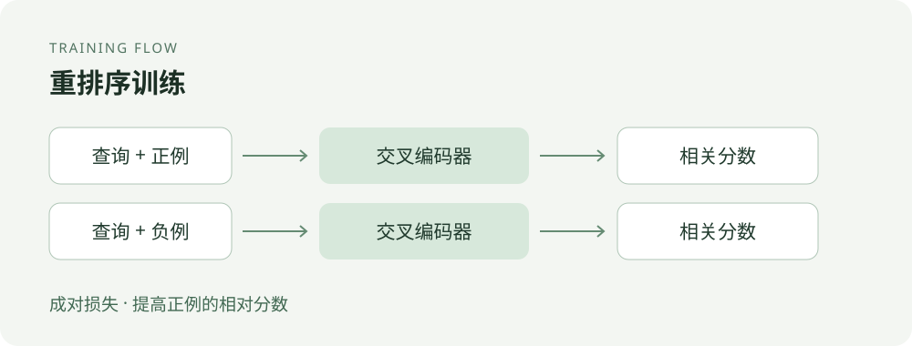
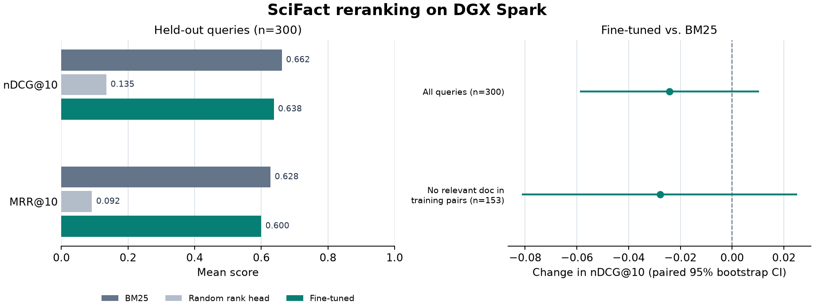

# Fine-tune a reranker on SciFact

[中文](README.md)

Search systems often retrieve documents quickly with BM25 and then rescore a smaller candidate set. A cross-encoder can inspect the query and document together, but its additional cost is worthwhile only if it improves ordering. This experiment trains RoBERTa-base on scientific claims and evidence, then tests that decision on the same BM25 candidates.



## Result

On 300 held-out queries, each with up to 30 BM25 candidates, mean nDCG@10 was **0.6617 for BM25**, **0.1351 for the initial model with a randomly initialized ranking head**, and **0.6375 after 180 training steps**. Corresponding MRR@10 was 0.6276, 0.0919 and 0.5998. The trained model improved over its random head, but its difference from BM25 was −0.0241 nDCG@10, with a paired query-bootstrap 95% interval of [−0.0589, 0.0105]. This run does not establish a benefit over BM25.

Thirty-nine queries had no labeled relevant document in the candidate set and count as zero in all three rankings. Candidate Hit@30 was 87.0%; mean Recall@30 was 85.54%. Reordering cannot recover documents that retrieval missed. Training and test queries share the document corpus, and one training seed is insufficient to measure training variability. The initial ranking head is random, not a pretrained reranker; there is no comparison here with an off-the-shelf reranking model.



## How it works

The model takes a query and a candidate abstract together and returns one relevance score. For each query, training compares a labeled positive document $d^+$ with an unjudged BM25 candidate $d^-$. An unjudged document is a negative proxy, not necessarily irrelevant. The pairwise loss is

$$\mathcal L=\log(1+\exp[s(q,d^-)-s(q,d^+)]).$$

The score represents an ordering signal, not a calibrated probability. At inference, score each query–document pair separately and sort candidates by score. This improves only the ordering of the retrieved set and adds one forward pass per pair.

## Data and training

SciFact contains scientific claims, abstracts and evidence links. This run used 5,183 abstracts, 390 training queries, 89 development queries and 300 test queries. Training positives are the intersection of BEIR labels and original SciFact sentence-evidence documents; each training query has eight unjudged BM25 candidates as negative proxies. Query pairs with token-set Jaccard similarity of at least 0.8 across splits were filtered. This rule does not eliminate every semantic duplicate or document overlap.

Training used 1,434 sampled triplets, full parameter updates, AdamW at 2e-5, a 192-token limit and seed 20261106. On a DGX Spark GB10 with BF16 autocast, training took 15.22 s; scoring the 9,000 test query–document pairs after training took 13.91 s. Peak PyTorch allocated memory was 2.85 GiB. These are batch timings, not service latency or throughput. Configuration and per-query evidence are in [config](config/config.json) and [evidence](docs/evidence/).

## Recalculate the reported metrics

From this directory, the verification uses only Python's standard library and the saved candidate IDs, relevance judgments and scores:

```bash
python scripts/verify_ranking.py
```

## Reproduce the training workflow

The measured environment was Linux aarch64, Python 3.12.3, CUDA 13.0, PyTorch 2.14.0+cu130, Transformers 5.17.0 and NumPy 2.5.3. Install a compatible CUDA PyTorch build first. The following commands download and verify both sources before data preparation, a short smoke run and the formal run:

```bash
python -m pip install transformers==5.17.0 numpy==2.5.3
mkdir -p output
curl -fL https://public.ukp.informatik.tu-darmstadt.de/thakur/BEIR/datasets/scifact.zip -o output/scifact.zip
curl -fL https://scifact.s3-us-west-2.amazonaws.com/release/latest/data.tar.gz -o output/scifact-original.tar.gz
sha256sum -c <<'EOF'
536e14446a0ba56ed1398ab1055f39fe852686ecad24a6306c80c490fa8e0165  output/scifact.zip
11c621288d41ac144d29b13b0f8503b3820b7d6e8b1f6ff24dff335c196d76be  output/scifact-original.tar.gz
EOF
unzip -q output/scifact.zip -d output
tar -xOzf output/scifact-original.tar.gz data/claims_train.jsonl > output/claims_train.jsonl
python scripts/prepare_scifact.py --data output/scifact \
  --original-claims output/claims_train.jsonl --config config/config.json --out output/prepared
python scripts/train_scifact_reranker.py --data output/scifact --prepared output/prepared \
  --config config/config.json --out output/smoke --smoke
python scripts/train_scifact_reranker.py --data output/scifact --prepared output/prepared \
  --config config/config.json --out output/formal --save-model
```

Use fresh output directories: the data-preparation script can overwrite existing files. Training checks dataset and candidate hashes and refuses an existing summary, but does not guarantee that every pre-existing output file is preserved. The pinned base-model revision is in the configuration; data and trained weights are downloaded or generated separately. Different hardware and library versions may produce different results.

The [BEIR SciFact dataset](https://huggingface.co/datasets/BeIR/scifact), [original SciFact data and license](https://github.com/allenai/scifact/blob/master/LICENSE.md), and [RoBERTa model](https://huggingface.co/FacebookAI/roberta-base) have their own terms. The related [reranker distillation experiment](../../../reranker-distillation/README.md) uses a pretrained MiniLM teacher and TinyBERT student, and answers a different question.
