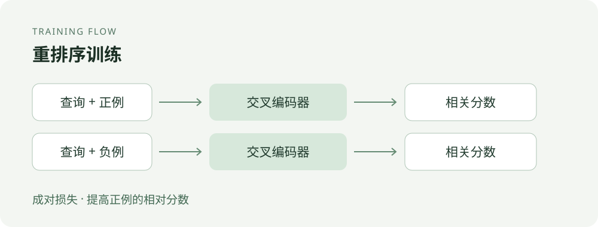
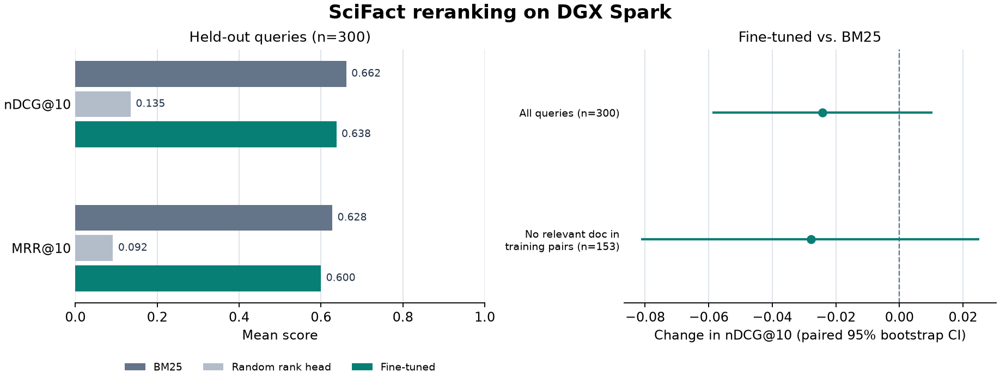

# 用 SciFact 微调重排序模型：让搜索结果更靠前

[English](README.en.md)

用 390 条带句级证据的英语科学论断训练 RoBERTa-base Cross-Encoder，检验它能否改善 BM25 已召回文献的顺序。180 步微调后，模型在 300 条留出查询上的 nDCG@10 从随机排序头的 **0.1351** 升至 **0.6375**，BM25 为 **0.6617**。本轮结果不足以支持用微调模型替换 BM25。

跟着本教程，你可以准备查询、正例和难负例，训练交叉编码器，并在固定候选集上比较微调前后与原始检索顺序。训练脚本、配置和逐查询证据都在本目录。

## 为什么要做这个实验

假设我们要查找支持一条科学论断的论文摘要。关键词检索可以快速从大量文献中找出一批候选，但包含相同词语的摘要未必真的支持这条论断。如果相关文献排在很后面，用户或后续的问答系统就可能先看到不相关的内容。

重排序的做法是保留第一阶段召回的候选，让模型逐一结合「查询和候选文档」打分，再按分数重新排列。它的价值在于改善前几条结果的相关性；代价是需要对每一对查询和候选分别计算，因此通常只用于数量有限的候选。它也无法找回第一阶段没有召回的文档。

通用模型不一定熟悉科学论断和证据摘要之间的关系，所以这里尝试用带证据标注的数据微调重排序模型，并与原始 BM25 顺序比较。读者可以据此了解如何构造训练对、评估排序质量，以及判断微调是否值得加入检索流程。

## 模型如何学习排序



本实验采用交叉编码器：把一条查询和一篇候选摘要一起输入 RoBERTa，再由排序头输出相关性分数。训练时，同一查询分别配上标注相关的摘要和一个未标注候选，调整模型参数，让相关摘要的分数高于负例的分数。未标注候选只是负例代理，不能保证全部真正不相关。

设查询为 $q$，正例为 $d^+$，负例代理为 $d^-$，交叉编码器输出分数 $s(q,d)$。脚本对每个三元组计算以下成对损失，再对批次取平均：

$$
\mathcal{L}_{\mathrm{pair}}
=\log\!\left(1+\exp\!\left[s(q,d^-)-s(q,d^+)\right]\right).
$$

正例分数高于负例时，分数差变小，损失随之下降；反过来则会受到更大的惩罚。这个目标学习同一查询下的相对顺序，分数本身不等同于相关概率。

评估时，BM25 先为每条查询找出 30 篇候选；三种排序方式处理完全相同的候选，再比较前 10 条的质量。nDCG@10 综合考虑相关文档的位置，MRR@10 关注第一个相关文档出现得有多靠前，两者越高越好。本次 300 条查询中有 39 条的候选里没有标注相关文档，即使重排也不能修复这些查询的召回缺口。



## 对照与结果

在共享的 5,183 篇摘要上，按 BM25 为每个查询取前 30 个候选。三种方法只改变候选顺序。39 条测试查询的候选中没有标注相关文档，三组均按 0 分计入。

| 固定候选排序方式 | nDCG@10 | MRR@10 |
|---|---:|---:|
| BM25 原序 | **0.6617** | **0.6276** |
| RoBERTa-base，随机初始化排序头 | 0.1351 | 0.0919 |
| 同一 RoBERTa-base，微调 180 步 | 0.6375 | 0.5998 |

- 候选的 Hit@30 为 **87.0%**，按查询平均的 Recall@30 为 **85.54%**。两项刻画第一阶段能提供给重排的相关文档。
- 相比 BM25，微调后有 **51** 题的 nDCG@10 上升，**77** 题下降，**172** 题持平。平均差 **−0.0241**，按查询配对重采样 10,000 次的 95% bootstrap 区间为 **[−0.0589, 0.0105]**，跨过零。
- 在全部标注相关文档均未进入实际训练对的 **153** 题上，nDCG@10 从 **0.6348** 降至 **0.6069**，区间为 **[−0.0813, 0.0251]**。

排序变化在两道单正例查询上很直观。查询 575 的相关摘要从第 16 位升至第 1 位，查询 1303 的相关摘要从第 1 位降至第 18 位。完整排名可以从每题的候选 ID 和分数回算。 [汇总](docs/evidence/summary.json) · [逐题数据](docs/evidence/per-query.jsonl)

## 训练和数据

SciFact 收集科学论断、论文摘要以及论断与文献之间的证据关系。这里把论断当作查询，把摘要当作候选文档：例如查询「某种干预是否影响某项指标」，候选是一篇研究该干预的论文摘要。训练时需要的不只是两段文本，还需要知道哪篇摘要有标注证据，以及哪些摘要被选作未标注负例。

实际训练组合由 ID 引用原始语料，结构如下；字段含义与训练脚本保存的历史记录一致，ID 为示意：

```json
{"query_id":"q1","positive_doc_id":"d1","unjudged_doc_id":"d2"}
```

脚本根据 ID 取回论断和摘要，对 `(查询, 正例)`、`(查询, 未标注候选)` 分别编码；超长输入只截断文档部分。排序头各输出一个实数，成对损失使用这两个分数更新模型。预测时只输入一组查询和候选摘要，输出一个相关性分数；对同一查询的候选逐一打分后降序排列。该分数不直接表示正确概率。

- 固定 BEIR 的 300 条测试查询。用词集合 Jaccard 相似度 ≥ 0.80 从训练和开发侧排除与留出查询近重复的样本，并保留 89 条开发查询用于冒烟。
- BEIR 的相关标签包含原数据里被引用的摘要。例如查询 337、891 的同一标注文档在原始句级证据字段为空。训练正例取 BEIR 标注与 SciFact 原始句级证据文档的交集，从 630 条训练查询中留下 **390** 条，含 **430** 对正例。每题从 BM25 前 30 中取 8 个未标注候选作负例代理。测试保留原 BEIR 的 339 对相关标签，其中 209 对有原始句级证据，130 对只有来源引用。
- 以同一查询的正例和难负例做成对训练，最小化 `softplus(负例分数 − 正例分数)`。全参数训练 180 步，累计处理 1,434 个三元组，来自同一批 390 条查询和不同的正负例组合。AdamW 学习率 2e-5，最长输入 192 token，种子 20261106。
- DGX Spark 的 GB10 上用 BF16 自动混合精度运行。训练 **15.22 秒**，训练后为 9,000 个查询与摘要对打分耗时 **13.91 秒**。这是批量前向计时。两轮评估、训练与保存合计 **46.48 秒**。PyTorch 峰值已分配显存为 **2.85 GiB**。 [数据审查](docs/evidence/data-audit.json) · [训练曲线数据](docs/evidence/training-curve.jsonl) · [运行日志](docs/evidence/formal-run.txt)

## 结果边界

这次训练让随机排序头学会了在候选里识别相关摘要。相对 BM25 的提升未通过预设门槛，低于零的点估计也不足以确认普遍退步。对于本次检索配置，BM25 可继续作为默认顺序。

这个结果衡量英语科学论断的文档相关性排序。训练与测试共享候选语料，留出单位是查询，词集合过滤只能识别符合该规则的近重复。误差区间反映本次模型在查询间的变化。实验使用一个训练种子和一个随机初始化排序头，未与开箱即用的预训练 Reranker 比较。

## 离线复算

只需 Python 标准库。脚本按已保存的 9,000 条候选记录重排，核对每题和全体的 nDCG@10、MRR@10，以及候选的 Hit@30 和 Recall@30。BM25 用保存的候选顺序，模型分数并列时沿用该顺序。

```bash
python scripts/verify_ranking.py
```

## 动手训练：准备数据、检查流程并运行

实测环境为 Linux aarch64、Python 3.12.3、CUDA 13.0、PyTorch 2.14.0+cu130、Transformers 5.17.0、NumPy 2.5.3。先准备能在目标 GPU 上运行的 CUDA PyTorch 构建，数据准备只用 Python 标准库。执行目录为本实验目录。下面依次下载并校验数据、构造训练样本、运行冒烟检查及正式训练。BEIR 提供检索语料及相关性标签，原始 SciFact 提供句级证据，用于筛选训练正例。请使用全新的输出目录：数据准备脚本可能覆盖已有文件；训练脚本会拒绝覆盖已有的 summary，但不能保证保护目录内所有文件。

```bash
python -m pip install transformers==5.17.0 numpy==2.5.3
mkdir -p output
curl -fL https://public.ukp.informatik.tu-darmstadt.de/thakur/BEIR/datasets/scifact.zip -o output/scifact.zip
curl -fL https://scifact.s3-us-west-2.amazonaws.com/release/latest/data.tar.gz -o output/scifact-original.tar.gz
sha256sum -c <<'EOF'
536e14446a0ba56ed1398ab1055f39fe852686ecad24a6306c80c490fa8e0165  output/scifact.zip
11c621288d41ac144d29b13b0f8503b3820b7d6e8b1f6ff24dff335c196d76be  output/scifact-original.tar.gz
EOF
unzip -q output/scifact.zip -d output
tar -xOzf output/scifact-original.tar.gz data/claims_train.jsonl > output/claims_train.jsonl

python scripts/prepare_scifact.py --data output/scifact \
  --original-claims output/claims_train.jsonl --config config/config.json --out output/prepared

python scripts/train_scifact_reranker.py --data output/scifact --prepared output/prepared \
  --config config/config.json --out output/smoke --smoke

python scripts/train_scifact_reranker.py --data output/scifact --prepared output/prepared \
  --config config/config.json --out output/formal --save-model
```

模型版本固定在 [配置](config/config.json)。复画结果图需 Matplotlib，执行 `python scripts/plot_ranking.py docs/evidence/summary.json assets/ranking.png`。本实验保留脚本、配置和基于文档 ID 的评估证据。BEIR 数据卡标注 CC BY-SA 4.0。原始 SciFact 的论断与证据标注采用 CC BY 4.0，摘要语料采用 ODC-By 1.0。数据和权重从各自来源获取。 [BEIR SciFact](https://huggingface.co/datasets/BeIR/scifact) · [AllenAI SciFact](https://github.com/allenai/scifact) · [原始许可](https://github.com/allenai/scifact/blob/master/LICENSE.md) · [RoBERTa-base](https://huggingface.co/FacebookAI/roberta-base)
