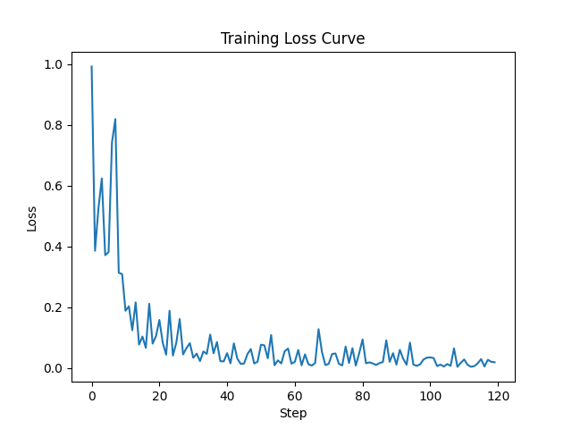

# Using the BGE Reranker Fine-Tuning Script (`train_bert_rerank.py`)

[中文](README.md)

This script fine-tunes a cross-encoder reranker with pointwise training and `BCEWithLogitsLoss`. The default model is `BAAI/bge-reranker-large`.

## Environment setup

Commands below use Linux Bash and run from `pointwise-bge/`. Training requires a CUDA GPU; memory use depends on batch size and sequence length. Create an isolated environment, install a PyTorch build matching the operating system, architecture and GPU using the [PyTorch installation guide](https://pytorch.org/get-started/locally/), then install the remaining dependencies:

```bash
python3 -m venv /path/to/venvs/retrieval
source /path/to/venvs/retrieval/bin/activate
# Install a PyTorch build matching the OS, architecture and GPU: https://pytorch.org/get-started/locally/
python -m pip install -r requirements.txt
python -c "import torch; print('PyTorch:', torch.__version__, 'CUDA build:', torch.version.cuda, 'GPU:', torch.cuda.is_available()); assert torch.cuda.is_available(), 'Training requires an available CUDA GPU'"
python -c "import torch; print('BF16:', torch.cuda.is_bf16_supported())"
```

The [dependency list](requirements.txt) pins direct versions for Transformers, Accelerate, NumPy, tqdm and Matplotlib. Install a PyTorch build matching the target device separately; pip still resolves transitive dependencies. Training defaults to BF16; if the GPU does not support it, disable mixed precision with `--mixed-precision no`. The full example downloads [BAAI/bge-reranker-large](https://huggingface.co/BAAI/bge-reranker-large) on first use, requiring network access and enough disk space for the model and checkpoints. You can download it in advance and point `--model-name-or-path` to the local model. The script enables `trust_remote_code=True`; inspect the model code and license before loading it. The repository includes the `default_train_data.jsonl` example. Set `--output-dir` to a new location outside the repository.

The following entry point installs the pinned dependencies in a clean environment, downloads a fixed revision of a small cross-encoder and runs a short GPU training pass on the repository example data. It defaults to the PyTorch 2.15 CUDA 13.2 build used on GB10/Linux aarch64; for other devices, change `TORCH_SPEC` and `TORCH_INDEX_URL`. Caches, the virtual environment and artifacts go to new locations outside the repository:

```bash
export XL_RUN_ID="pointwise-$(date -u +%Y%m%dT%H%M%SZ)"
export XL_DATA_DIR="/path/outside/repository/pointwise-data/$XL_RUN_ID"
export XL_OUT_DIR="/path/outside/repository/pointwise-runs/$XL_RUN_ID"
bash scripts/verify_clean_gpu.sh
```

On 2026-11-15, this entry point completed from a clean virtual environment on NVIDIA GB10: `pip check` passed with Python 3.12.3, PyTorch 2.15.0+cu132, Transformers 5.23.0, Accelerate 1.15.0, NumPy 2.5.4, tqdm 4.70.1 and Matplotlib 3.11.2; the pinned model snapshot downloaded successfully. Training used the 198 repository examples, batch size 4, gradient accumulation 2, BF16 and length 128 for one epoch, completing 25 optimizer updates and saving the model and loss curve. This verifies clean installation through model saving. There was no held-out evaluation, so it says nothing about ranking quality and does not reproduce the default BGE-large experiment. See the [clean-environment GPU training summary](evidence/clean-env-training-2026-11-15.json).

On 2026-11-13, a GPU smoke run was performed in an existing CUDA environment on DGX Spark, with isolated extra dependencies, a constructed single-label tiny-random-BERT and five synthetic examples. The log reported `Training device: cuda`; with batch size 3 and gradient accumulation 2, it completed one optimizer update, saved the model and exited with code 0. This check covered two small batches of different sizes. It did not use the default BGE model or real data, evaluate quality, or verify a clean installation.

On 2026-11-14, a separate environment ran a small real-data check with SciFact training candidates: one relevant and one unjudged document were selected for each of the first eight training queries, for 16 pairs. Unjudged documents are not guaranteed negatives. With `cross-encoder/ms-marco-TinyBERT-L2-v2` at revision `81d1926f67cb8eee2c2be17ca9f793c7c3bd20cc`, CUDA BF16 and batch size 4, one epoch completed four updates and saved a model. The copied and adjusted environment passed `pip check` with Python 3.12.3, PyTorch 2.15.0+cu132, Transformers 5.17.0, and Accelerate 1.15.0; it was not installed from scratch. This checks the training path, not quality or reproduction of the default BGE model.

## Data format (JSONL)

One example per line:

```json
{"query": "query text", "content": "document text", "label": 1}
```

`label` is recommended to be in the range [0, 1]; the script supports linear normalization internally.

## Quick start

Run from this experiment directory. Change `OUT` to a new location outside the repository; `DATA` can point to your own JSONL file. The example requires a CUDA GPU, model weights and dependencies. The model weights are downloaded on first use of the model ID:

```bash
DATA="$PWD/default_train_data.jsonl"
OUT=/path/to/new-output-directory
CUBLAS_WORKSPACE_CONFIG=:16:8 PYTHONHASHSEED=42 python train_bert_rerank.py \
  --model-name-or-path BAAI/bge-reranker-large \
  --train-dataset "$DATA" --output-dir "$OUT" \
  --epochs 1 --batch-size 4 --gradient-accumulation-steps 1 \
  --mixed-precision bf16 --max-len 512
```

You can replace `--model-name-or-path` with a prepared local model directory. After training, the model is saved at `$OUT/final_model/` and the loss curve at `$OUT/loss_curve.png`. At startup, the script checks that the data exists and exits if the output location already contains a model directory or loss plot. Choose a new output directory; it will not overwrite the repository's example plot. The small-batch command shows configuration only and does not establish model quality. See all options with `python train_bert_rerank.py --help`. After installing dependencies, `python -m unittest discover -s tests -v` checks arguments, output protection, tokenizer interfaces and gradient accumulation. It does not load weights or train a model.

## Reproducibility and deterministic execution

The script sets random seeds, enables deterministic algorithms and disables TF32 to reduce variation in the same environment. Results are not guaranteed to match across hardware or software versions. For GPU runs, set `CUBLAS_WORKSPACE_CONFIG=:16:8` and `PYTHONHASHSEED=42` before starting, as in the example. The program raises an error if an operation does not support deterministic execution. When changing `--seed`, change `PYTHONHASHSEED` as well.

## Main parameters

| Parameter | Default | Purpose |
|---|---|---|
| `--model-name-or-path` (or `--model`) | `BAAI/bge-reranker-large` | Model ID or local directory |
| `--train-dataset` (or `--data`) | `default_train_data.jsonl` | JSONL data path, relative to the working directory |
| `--output-dir` (or `--output`) | `./output_bge_reranker_large_finetuned` | Output directory for the model and loss plot |
| `--max-len` | 512 | Maximum input token count |
| `--epochs` | 30 | Number of training epochs |
| `--batch-size` (or `--batch`) | 50 | Examples per batch |
| `--gradient-accumulation-steps` (or `--grad-accumulation`) | 8 | Gradient accumulation steps |
| `--mixed-precision` (or `--precision`) | `bf16` | `no`, `fp16` or `bf16` |
| `--lr` | `1e-5` | Learning rate |
| `--seed` | 42 | Random seed |
| `--warmup-proportion` | 0.1 | Learning-rate warmup proportion |

Running `python train_bert_rerank.py` directly uses these defaults. Relative paths are resolved from the current working directory. For a formal experiment, size batches and sequence length to available resources, and plan data and output locations in advance.

## Memory and stability tips

- On OOM, reduce `--batch-size` to 1 and lower `--max-len`; if needed, use `bf16`.
- A learning rate that is too high can cause catastrophic forgetting. Values to try include `1e-5`, `5e-6` and `1e-6`.

## Inference example

```python
import torch
from train_bert_rerank import BertRerankerModel

device = "cuda" if torch.cuda.is_available() else "cpu"
save_dir = "/path/to/new-output-directory/final_model"

model = BertRerankerModel.from_pretrained(save_dir)
model.eval()
model.to(device)

pairs = [("example query", "example document")]
tokens = model.preprocess(pairs, max_len=512)
tokens = {k: v.to(device) for k, v in tokens.items()}

with torch.no_grad():
    out = model(tokens)               # out['logits'] shape: [1, 1]
    score = out["logits"].squeeze(-1) # relevance score before sigmoid
    probs = torch.sigmoid(score)       # maps to 0–1; not a calibrated probability

print(score.tolist())
print(probs.tolist())
```

## Example inference output

```
[-2.9021458625793457]
[0.05204758793115616]
```

The training log below is an example and contains no ranking metrics on an independent test set; training loss alone cannot establish retrieval quality. The script plans the learning-rate schedule using the actual synchronization count per epoch. During gradient accumulation, it weights each batch by its actual example count, including a final partial batch. Only single-process training is supported. Historical sample logs are from before a code fix and do not represent results from the fixed training loop.

## Example training output

```bash
CUBLAS_WORKSPACE_CONFIG=:16:8 PYTHONHASHSEED=42 python train_bert_rerank.py
Training Args: {'model_name_or_path': 'BAAI/bge-reranker-large', 'train_dataset': 'default_train_data.jsonl', 'output_dir': './output_bge_reranker_large_finetuned', 'max_len': 512, 'epochs': 30, 'lr': 1e-05, 'batch_size': 50, 'seed': 42, 'warmup_proportion': 0.1, 'gradient_accumulation_steps': 8, 'mixed_precision': 'bf16'}
Loading data: 198it [00:00, 196143.64it/s]
----- Label Distribution -----
Label 0.00: 99 (50.00%)
Label 1.00: 99 (50.00%)
Start training for 30 epochs ...
  0%|                                                       | 0/15 [00:00<?, ?it/s]Training finished! Saving model ...
Model saved successfully!
  0%|                                                       | 0/15 [00:42<?, ?it/s]
```

## Training loss curve



## Files

- `train_bert_rerank.py`: training script for the model, dataset and training loop.
- `README.md`: script documentation.
- `default_train_data.jsonl`: example training data.
