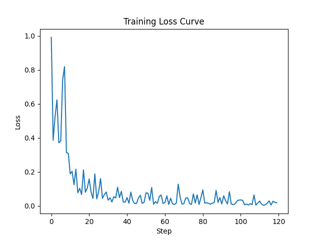

# BGE Reranker 微调脚本使用说明（train_bert_rerank.py）

[English](README.en.md)

交叉编码器（Cross-Encoder）重排模型微调脚本，默认使用 `BAAI/bge-reranker-large`，采用 pointwise 训练（BCEWithLogitsLoss）。

## 环境准备

以下命令以 Linux Bash 为例，在 `pointwise-bge/` 目录执行；准备有 CUDA GPU 的环境用于训练，显存占用取决于批次与序列长度。先创建独立环境，按 [PyTorch 安装说明](https://pytorch.org/get-started/locally/)选择匹配系统架构及 GPU 的构建，再安装其余依赖：

```bash
python3 -m venv /path/to/venvs/retrieval
source /path/to/venvs/retrieval/bin/activate
# 按 https://pytorch.org/get-started/locally/ 安装与系统、架构和 GPU 匹配的 PyTorch
python -m pip install -r requirements.txt
python -c "import torch; print('PyTorch:', torch.__version__, 'CUDA build:', torch.version.cuda, 'GPU:', torch.cuda.is_available()); assert torch.cuda.is_available(), '训练需要可用的 CUDA GPU'"
python -c "import torch; print('BF16:', torch.cuda.is_bf16_supported())"
```

[依赖清单](requirements.txt)固定了 Transformers、Accelerate、NumPy、tqdm 和 Matplotlib 的直接版本；PyTorch 需根据设备另行安装，传递依赖仍由 pip 解析。默认以 BF16 训练，GPU 不支持时可通过 `--mixed-precision no` 关闭混合精度。正式示例首次运行会从 [BAAI/bge-reranker-large](https://huggingface.co/BAAI/bge-reranker-large) 获取模型，需要网络和足够的模型与检查点存储空间；也可事先下载并将 `--model-name-or-path` 指向本地模型。脚本启用 `trust_remote_code=True`，加载前检查模型代码与许可。仓库提供 `default_train_data.jsonl` 示例；请将 `--output-dir` 指向仓库外的新目录。

可用下列入口从空环境安装固定依赖、下载固定 revision 的小型交叉编码器，并用仓库示例数据完成一次短 GPU 训练。该脚本默认使用适用于 GB10/Linux aarch64 的 PyTorch 2.15 CUDA 13.2 构建；其他设备应按其系统修改 `TORCH_SPEC` 和 `TORCH_INDEX_URL`。所有缓存、虚拟环境和产物写到仓库外的新目录：

```bash
export XL_RUN_ID="pointwise-$(date -u +%Y%m%dT%H%M%SZ)"
export XL_DATA_DIR="/path/outside/repository/pointwise-data/$XL_RUN_ID"
export XL_OUT_DIR="/path/outside/repository/pointwise-runs/$XL_RUN_ID"
bash scripts/verify_clean_gpu.sh
```

2026-11-15 在 NVIDIA GB10 上从空虚拟环境运行上述脚本：`pip check` 通过，Python 3.12.3、PyTorch 2.15.0+cu132、Transformers 5.23.0、Accelerate 1.15.0、NumPy 2.5.4、tqdm 4.70.1、Matplotlib 3.11.2；固定模型快照下载成功。使用 198 条示例样本、batch 4、梯度累积 2、BF16、128 token 长度训练 1 轮，完成 25 次优化器更新并保存模型和损失图。该结果验证了干净安装到训练保存的路径，不含留出集评估，不能说明排序效果，也不等于默认 BGE-large 实验复现；详见[干净环境 GPU 训练摘要](evidence/clean-env-training-2026-11-15.json)。

2026-11-13 在 DGX Spark 的已有 CUDA 环境及隔离附加依赖中，使用构造的单标签 tiny-random-bert 和 5 条合成样本运行一次 GPU 冒烟：日志打印 `Training device: cuda`，批次 3、梯度累积 2，完成 1 次优化器更新并保存模型，进程退出码为 0。这次检查覆盖大小不同的两个小批次，并非默认 BGE 模型、真实数据、效果评估或从零安装的验证。

2026-11-14 在另一个独立环境使用真实 SciFact 训练候选做了小规模流程检查：从已准备候选池的前 8 个训练查询各取一个相关文档和一个未标注文档，共 16 对；未标注不等于确定的负例。使用 `cross-encoder/ms-marco-TinyBERT-L2-v2` 固定 revision `81d1926f67cb8eee2c2be17ca9f793c7c3bd20cc`，在 CUDA BF16 下以 batch 4 训练一轮、完成 4 次更新并保存模型。Python 3.12.3、PyTorch 2.15.0+cu132、Transformers 5.17.0、Accelerate 1.15.0；复制并调整的独立环境通过 `pip check`，并非从零安装。此检查没有评估效果，也没有复现默认 BGE 模型。

## 数据格式（JSONL）

每行一个样本：

```json
{"query": "问题文本", "content": "文档文本", "label": 1}
```

`label` 建议在 [0,1] 区间；脚本内部支持线性归一化。

## 快速开始

在本实验目录运行；将 `OUT` 改成仓库外的新目录，`DATA` 可以改为自己的 JSONL。示例仍需 CUDA GPU、模型权重和依赖；首次使用模型 ID 时会下载权重：

```bash
DATA="$PWD/default_train_data.jsonl"
OUT=/path/to/new-output-directory
CUBLAS_WORKSPACE_CONFIG=:16:8 PYTHONHASHSEED=42 python train_bert_rerank.py \
  --model-name-or-path BAAI/bge-reranker-large \
  --train-dataset "$DATA" --output-dir "$OUT" \
  --epochs 1 --batch-size 4 --gradient-accumulation-steps 1 \
  --mixed-precision bf16 --max-len 512
```

也可将 `--model-name-or-path` 换成准备好的本地模型目录。训练完成后，模型位于 `$OUT/final_model/`，损失曲线位于 `$OUT/loss_curve.png`。脚本在启动前检查数据存在，若输出位置已有模型目录或损失图会退出，请选择新目录；它不会覆盖仓内示例图。上述小批量命令展示如何配置，不代表已经完成效果验证。查看全部选项：`python train_bert_rerank.py --help`。安装依赖后可运行 `python -m unittest discover -s tests -v`，离线检查参数、输出保护、分词接口和累积梯度；该检查不加载权重，也不执行模型训练。

## 可复现性与确定性运行

脚本设置随机种子、启用确定性算法并关闭 TF32，以减少相同环境中的随机差异；跨硬件或软件版本仍不能保证结果一致。使用 GPU 时，在启动命令前设置 `CUBLAS_WORKSPACE_CONFIG=:16:8` 和 `PYTHONHASHSEED=42`，如上例所示；若算子不支持确定性运行，程序会报错。更改 `--seed` 时应同时更改 `PYTHONHASHSEED`。

## 关键参数

| 参数 | 默认值 | 作用 |
|---|---|---|
| `--model-name-or-path`（或 `--model`） | `BAAI/bge-reranker-large` | 模型 ID 或本地目录 |
| `--train-dataset`（或 `--data`） | `default_train_data.jsonl` | JSONL 数据路径，相对于当前工作目录 |
| `--output-dir`（或 `--output`） | `./output_bge_reranker_large_finetuned` | 模型与损失图的输出目录 |
| `--max-len` | 512 | 输入最长 token 数 |
| `--epochs` | 30 | 训练轮数 |
| `--batch-size`（或 `--batch`） | 50 | 每批样本数 |
| `--gradient-accumulation-steps`（或 `--grad-accumulation`） | 8 | 梯度累积步数 |
| `--mixed-precision`（或 `--precision`） | `bf16` | `no`、`fp16` 或 `bf16` |
| `--lr` | `1e-5` | 学习率 |
| `--seed` | 42 | 随机种子 |
| `--warmup-proportion` | 0.1 | 学习率预热比例 |

直接执行 `python train_bert_rerank.py` 保留这些默认值，默认相对路径以当前工作目录为基准。正式实验应根据资源配置批次与长度，并事先规划数据和输出位置。

## 显存/稳定性建议

- OOM 时：将 `--batch-size` 调为 1，降低 `--max-len`；必要时改用 `bf16`。
- 学习率过大可能导致灾难性遗忘；可尝试 `1e-5`、`5e-6`、`1e-6`。

## 推理示例

```python
import torch
from train_bert_rerank import BertRerankerModel

device = "cuda" if torch.cuda.is_available() else "cpu"
save_dir = "/path/to/new-output-directory/final_model"

model = BertRerankerModel.from_pretrained(save_dir)
model.eval()
model.to(device)

pairs = [("查询示例", "文档示例")]
tokens = model.preprocess(pairs, max_len=512)
tokens = {k: v.to(device) for k, v in tokens.items()}

with torch.no_grad():
    out = model(tokens)               # out['logits'] shape: [1, 1]
    score = out["logits"].squeeze(-1) # 未过 sigmoid 的相关性分数
    probs = torch.sigmoid(score)       # 映射为 0–1 分数；未经校准不能作为真实概率

print(score.tolist())
print(probs.tolist())
```

## 推理模型的运行示例输出

```
[-2.9021458625793457]
[0.05204758793115616]
```

以下是训练过程示例，不包含独立测试集上的排序指标，不能单凭训练损失判断检索效果。脚本按每轮实际同步次数规划学习率，并在梯度累积时按各批实际样本数加权，包括最后一批不足批次大小的情况；当前仅支持单进程训练。历史示例日志来自修复前的代码，不代表修复后的训练结果。

## 训练模型的运行示例输出

```bash
CUBLAS_WORKSPACE_CONFIG=:16:8 PYTHONHASHSEED=42 python train_bert_rerank.py
Training Args: {'model_name_or_path': 'BAAI/bge-reranker-large', 'train_dataset': 'default_train_data.jsonl', 'output_dir': './output_bge_reranker_large_finetuned', 'max_len': 512, 'epochs': 30, 'lr': 1e-05, 'batch_size': 50, 'seed': 42, 'warmup_proportion': 0.1, 'gradient_accumulation_steps': 8, 'mixed_precision': 'bf16'}
Loading data: 198it [00:00, 196143.64it/s]
----- Label Distribution -----
Label 0.00: 99 (50.00%)
Label 1.00: 99 (50.00%)
Start training for 30 epochs ...
  0%|                                                       | 0/15 [00:00<?, ?it/s]Training finished! Saving model ...
Model saved successfully!
  0%|                                                       | 0/15 [00:42<?, ?it/s]
```

## 训练损失曲线



## 文件结构

- `train_bert_rerank.py`: 训练脚本（模型/数据集/训练循环）
- `README.md`: 本脚本说明
- `default_train_data.jsonl`:训练使用的数据
