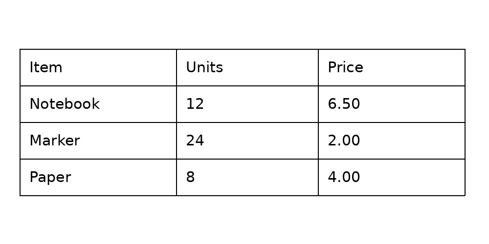

# Recovering table structure from an image with SLANet+

English | [简体中文](README.md)

Recognized words are not enough to reconstruct a spreadsheet: the row, column, and merged-cell relationships must also be retained. This experiment uses a single self-drawn table to inspect the structure predicted by SLANet+ and how the selected input region affects that prediction. The included CPU script reproduces the inference path.



## Role in a document pipeline

A complete pipeline may include page-layout analysis, table detection and cropping, structure recognition, text detection and recognition, and assignment of text to cells. This experiment runs **only structure recognition**; known coordinates simulate an upstream crop. It does not recognize text or validate table detection, cell matching, or an end-to-end OCR pipeline.

SLANet+ produces HTML-like structure tokens and a structure score. For example, `<tr><td></td><td></td><td></td></tr>` represents a row of three cells, without the cell text. Feature extraction and fusion feed a structure decoder; see the [Transformers documentation](https://huggingface.co/docs/transformers/model_doc/slanet). The [model card](https://huggingface.co/PaddlePaddle/SLANet_plus_safetensors) lists about 1.85 million parameters and Apache-2.0 licensing.

## Observation

The self-drawn English table contains four rows, three columns and no merged cells. Both inputs are derived from the same 1000 × 500 image; the crop uses `(40, 100, 951, 401)` and measures 911 × 301 pixels.

| Input | Predicted structure | Structure score | First forward |
| --- | --- | ---: | ---: |
| Full image | One extra row spanning three columns, followed by four rows of three cells | 0.9784 | 0.212 s |
| Crop | Four rows of three cells, matching the known structure | 0.99996 | 0.115 s |

The selected region changed the output for **this one sample**; it does not establish that cropping always improves accuracy. The score is not a calibrated probability of correctness: the full image still has an extra row despite a high score. Each time is one first forward pass on a different input; it is not a cropping speedup or device benchmark.

The recorded run used an aarch64 CPU on DGX Spark, two PyTorch threads, PyTorch 2.14.0+cu130 and Transformers 5.17.0. Timing excludes model loading, preprocessing and postprocessing. See the [full-image result](results/uncropped.json) and [crop result](results/cropped.json). The `model.safetensors` SHA-256 is `4455fa2a535b80738e0e0af2ca899f719efb8d6e1c7e7209cc5126f81607bf06`; the model repository revision was not recorded, and changes to other model files or software can affect reproduction.

## Reproduce

Install Python, `torch`, `transformers` and `Pillow`, then download [SLANet+](https://huggingface.co/PaddlePaddle/SLANet_plus_safetensors) to a local directory. The script draws the image using Linux font `/usr/share/fonts/truetype/dejavu/DejaVuSans.ttf`; a different font or Pillow version may change the input. Each output must be a new directory; the script refuses to overwrite an existing one.

```bash
python scripts/slanet_table_smoke.py --model /path/to/SLANet_plus_safetensors --out /tmp/slanet-uncropped
python scripts/slanet_table_smoke.py --model /path/to/SLANet_plus_safetensors --out /tmp/slanet-cropped --crop-table
```

Compare `result.structure` in `result.json` with the known rows and columns. New runs record `model_directory`, the local path supplied by the user; this path does not establish the model's provenance. Historical results use `model` for the name recorded for that run. `input_sha256` and `model_sha256` help identify whether the input and weights match the recorded run. A single synthetic image is a pipeline check; evaluating real performance requires diverse annotated documents, merged cells and a consistent structure metric, with detection, OCR and cell-assignment errors measured separately.

New runs also record the Pillow version and `input_rgb_pixels_sha256`, the hash of row-major RGB pixel bytes; compare it together with `image_wh`. PNG file hashes can differ due to encoding even when pixels match. The historical cropped input image, pixel hash and Pillow version were not saved, so its old `input_sha256` alone cannot establish that a newly reconstructed crop has exactly the same pixels.
